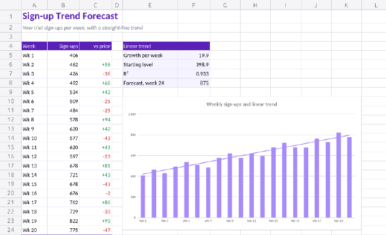

<!-- Generated by tools/gallery.mjs from showcase.yaml and build.json; do not edit. -->
# Sign-up Trend Forecast

[Sheet](../README.md) › [Charts](../README.md#charts) · `chart` `column-chart` `trendline` `forecast` `marketing`

Twenty weeks of trial sign-ups as columns with a linear trendline, the fit worked out in cells and a week-24 forecast.



| | |
|---|---|
| Document | [signup-trend-forecast.xlsx](signup-trend-forecast.xlsx) (9 KB) |
| Contents | 1 sheet; used range A1:F24 |
| Features | `sheet.charts.design`, `sheet.formulas.functions`, `sheet.format.number` |
| Built by | `kition-sheet` @ `79ed996ab2`: 38 commands in 11 ms |

## About

Weekly sign-ups wobble, but the trend is clear once a linear trendline runs through the
columns. SLOPE, INTERCEPT and RSQ compute the same
line in cells against the week numbers from SEQUENCE, and FORECAST.LINEAR projects week 24.
The week-over-week column uses a signed format with green and red rules.

## Checks

- `results.drawing.objects.0.chart.kind`: `"column"`
- `results.drawing.objects.0.chart.categories`: `{"count":20}`
- `results.drawing.objects.0.chart.series.0.trendline`: `{"kind":"linear"}`
- `results.fit.values.0.0`: `{"approx":19.851128,"tol":0.0001}`
- `results.fit.values.1.0`: `{"approx":398.863158,"tol":0.0001}`
- `results.fit.values.2.0`: `{"approx":0.933083,"tol":0.00001}`
- `results.fit.values.3.0`: `{"approx":875.290226,"tol":0.001}`
- diagnostics: none (the kit's check finds nothing wrong)
- the saved document opens again; the thumbnail matches `thumb.png` within the `render` tolerance

## Steps

<details><summary>38 commands (from <a href="showcase.yaml">showcase.yaml</a>)</summary>

```yaml
- command: range.setValues
  params:
    range: A1
    values:
      - - Sign-up Trend Forecast
      - - New trial sign-ups per week, with a straight-line trend
- command: range.setValues
  params:
    range: A4
    values:
      - - Week
        - Sign-ups
        - vs prior
      - - Wk 1
        - 406
        - null
      - - Wk 2
        - 462
        - =B6-B5
      - - Wk 3
        - 426
        - =B7-B6
      - - Wk 4
        - 492
        - =B8-B7
      - - Wk 5
        - 534
        - =B9-B8
      - - Wk 6
        - 509
        - =B10-B9
      - - Wk 7
        - 484
        - =B11-B10
      - - Wk 8
        - 578
        - =B12-B11
      - - Wk 9
        - 620
        - =B13-B12
      - - Wk 10
        - 577
        - =B14-B13
      - - Wk 11
        - 620
        - =B15-B14
      - - Wk 12
        - 597
        - =B16-B15
      - - Wk 13
        - 678
        - =B17-B16
      - - Wk 14
        - 721
        - =B18-B17
      - - Wk 15
        - 678
        - =B19-B18
      - - Wk 16
        - 676
        - =B20-B19
      - - Wk 17
        - 762
        - =B21-B20
      - - Wk 18
        - 729
        - =B22-B21
      - - Wk 19
        - 822
        - =B23-B22
      - - Wk 20
        - 775
        - =B24-B23
- command: range.setValues
  params:
    range: E4
    values:
      - - Linear trend
        - null
      - - Growth per week
        - =SLOPE(B5:B24,SEQUENCE(20))
      - - Starting level
        - =INTERCEPT(B5:B24,SEQUENCE(20))
      - - R²
        - =RSQ(B5:B24,SEQUENCE(20))
      - - Forecast, week 24
        - =FORECAST.LINEAR(24,B5:B24,SEQUENCE(20))
- command: home.fontSize
  params:
    range: A1
    size: 20
- command: home.bold
  params:
    range: A1
- command: home.fontColor
  params:
    range: A1
    color: "#5b21b6"
- command: home.italic
  params:
    range: A2
- command: home.fontColor
  params:
    range: A2
    color: "#6b7280"
- command: home.fillColor
  params:
    range: A4:C4
    color: "#5b21b6"
- command: home.fontColor
  params:
    range: A4:C4
    color: "#ffffff"
- command: home.bold
  params:
    range: A4:C4
- command: home.alignRight
  params:
    range: B4:C4
- command: home.numberFormat
  params:
    range: B5:B24
    format: "#,##0"
- command: home.numberFormat
  params:
    range: C5:C24
    format: +#,##0;-#,##0;0
- command: home.conditionalFormat
  params:
    range: C6:C24
    rule:
      type: expression
      formula: =C6>0
      style:
        font:
          color:
            Rgb: 1477711
- command: home.conditionalFormat
  params:
    range: C6:C24
    rule:
      type: expression
      formula: =C6<0
      style:
        font:
          color:
            Rgb: 12592682
- command: home.borders
  params:
    range: A5:C24
    preset: insideHorizontal
    color: "#ede9fe"
- command: home.borders
  params:
    range: A24:C24
    preset: bottom
    color: "#5b21b6"
- command: home.mergeAcross
  params:
    range: E4:F4
- command: home.fillColor
  params:
    range: E4:F4
    color: "#5b21b6"
- command: home.fontColor
  params:
    range: E4:F4
    color: "#ffffff"
- command: home.bold
  params:
    range: E4:F4
- command: home.fillColor
  params:
    range: E5:F8
    color: "#f5f3ff"
- command: home.numberFormat
  params:
    range: F5:F6
    format: "0.0"
- command: home.numberFormat
  params:
    range: F7
    format: "0.000"
- command: home.numberFormat
  params:
    range: F8
    format: "#,##0"
- command: home.bold
  params:
    range: F5:F8
- command: home.columnWidth
  params:
    cols: A:A
    width: 56
- command: home.columnWidth
  params:
    cols: B:C
    width: 70
- command: home.columnWidth
  params:
    cols: D:D
    width: 24
- command: home.columnWidth
  params:
    cols: E:E
    width: 120
- command: home.columnWidth
  params:
    cols: F:F
    width: 70
- command: home.columnWidth
  params:
    cols: G:K
    width: 66
- command: home.rowHeight
  params:
    rows: 1:1
    height: 28
- command: insert.chart
  params:
    range: A4:B24
    type: column
    at: E10
    width: 520
    height: 290
  as: chart
- command: drawing.chart
  params:
    id: "1"
    title: Weekly sign-ups and linear trend
    legend: null
    yAxis:
      min: 0
      max: 1000
      major: 200
    seriesFormat:
      - index: 0
        color: "#a78bfa"
        trendline: linear
- command: drawing.describe
  params: {}
  as: drawing
- command: sheet.read
  params:
    range: F5:F8
  as: fit
```

</details>
