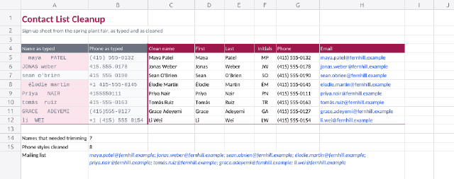

<!-- Generated by tools/gallery.mjs from showcase.yaml and build.json; do not edit. -->
# Text Cleanup with Functions

[Sheet](../README.md) › [Formulas & Functions](../README.md#formulas--functions) · `text-functions` `formulas` `dynamic-arrays` `data-cleanup` `conditional-formatting`

A messy contact import tidied with TRIM, PROPER, TEXTBEFORE, TEXTAFTER, TEXTJOIN and a LET formula that rebuilds every phone number.



| | |
|---|---|
| Document | [text-cleanup-functions.xlsx](text-cleanup-functions.xlsx) (7 KB) |
| Contents | 1 sheet; used range A1:H17 |
| Features | `sheet.formulas.functions`, `sheet.edit.fill-clear`, `sheet.format.conditional`, `sheet.format.font` |
| Built by | `kition-sheet` @ `79ed996ab2`: 40 commands in 24 ms |

## About

Names arrive with stray spaces and random capitals and phone numbers in six different styles.
PROPER(TRIM()) fixes the names (O'Brien and accented letters included), TEXTBEFORE and
TEXTAFTER split them, and one LET formula pulls the digits out of any phone style with MID over a
SEQUENCE, keeps the last ten and formats them. The emails are assembled from the parts, and
TEXTJOIN collects them into a single mailing-list line. Raw cells that needed trimming are
shaded.

## Checks

- `results.clean.values`: `[["Maya Patel","Maya","Patel","MP","(415) 555-0132","maya.patel@fernhill.example"],["Jonas Weber","Jonas","Weber","JW","(415) 555-0178","jonas.weber@fernhill.example"],["Sean O'Brien","Sean","O'Brien","SO","(415) 555-0190","sean.obrien@fernhill.example"],["Élodie Martin","Élodie","Martin","ÉM","(415) 555-0145","élodie.martin@fernhill.example"],["Priya Nair","Priya","Nair","PN","(415) 555-0111","priya.nair@fernhill.example"],["Tomás Ruiz","Tomás","Ruiz","TR","(415) 555-0163","tomás.ruiz@fernhill.example"],["Grace Adeyemi","Grace","Adeyemi","GA","(415) 555-0127","grace.adeyemi@fernhill.example"],["Li Wei","Li","Wei","LW","(415) 555-0154","li.wei@fernhill.example"]]`
- `results.summary.values.0`: `[7]`
- `results.summary.values.1`: `[8]`
- `results.summary.values.2.0`: `{"matches":"^maya\\.patel@fernhill\\.example; jonas.*li\\.wei@fernhill\\.example$","count":234}`
- diagnostics: none (the kit's check finds nothing wrong)
- the saved document opens again; the thumbnail matches `thumb.png` within the `render` tolerance

## Steps

<details><summary>40 commands (from <a href="showcase.yaml">showcase.yaml</a>)</summary>

```yaml
- command: range.setValues
  params:
    range: A1
    values:
      - - Contact List Cleanup
      - - Sign-up sheet from the spring plant fair, as typed and as cleaned
- command: range.setValues
  params:
    range: A4
    values:
      - - Name as typed
        - Phone as typed
        - Clean name
        - First
        - Last
        - Initials
        - Phone
        - Email
      - - "  maya   PATEL"
        - (415) 555-0132
        - =PROPER(TRIM(A5))
        - =TEXTBEFORE(C5," ")
        - =TEXTAFTER(C5," ",-1)
        - =UPPER(LEFT(D5,1)&LEFT(E5,1))
        - =LET(d,TEXTJOIN("",TRUE,IFERROR(MID(B5,SEQUENCE(LEN(B5)),1)*1,"")),r,RIGHT(d,10),"("&LEFT(r,3)&") "&MID(r,4,3)&"-"&RIGHT(r,4))
        - =LOWER(SUBSTITUTE(D5&"."&E5,"'",""))&"@fernhill.example"
      - - "JONAS weber "
        - 415.555.0178
      - - sean o'brien
        - 415 555 0190
      - - "  élodie martin"
        - +1 415-555-0145
      - - Priya   NAIR
        - "4155550111"
      - - tomás  ruiz
        - 415-555-0163
      - - "GRACE   ADEYEMI "
        - (415)555-0127
      - - li  WEI
        - +1 (415) 555 0154
- command: edit.fillDown
  params:
    range: C5:H12
- command: range.setValues
  params:
    range: A14
    values:
      - - Names that needed trimming
        - =SUMPRODUCT(--(A5:A12<>TRIM(A5:A12)))
      - - Phone styles cleaned
        - =COUNTA(B5:B12)
      - - Mailing list
        - =TEXTJOIN("; ",TRUE,H5:H12)
- command: home.fontSize
  params:
    range: A1
    size: 20
- command: home.bold
  params:
    range: A1
- command: home.fontColor
  params:
    range: A1
    color: "#9d174d"
- command: home.fontColor
  params:
    range: A2
    color: "#6b7280"
- command: home.fillColor
  params:
    range: A4:B4
    color: "#6b7280"
- command: home.fillColor
  params:
    range: C4:H4
    color: "#9d174d"
- command: home.fontColor
  params:
    range: A4:H4
    color: "#ffffff"
- command: home.bold
  params:
    range: A4:H4
- command: home.fontName
  params:
    range: A5:B12
    name: Courier New
- command: home.fontSize
  params:
    range: A5:B12
    size: 10
- command: home.fontColor
  params:
    range: A5:B12
    color: "#6b7280"
- command: home.fillColor
  params:
    range: A5:B12
    color: "#f9fafb"
- command: home.conditionalFormat
  params:
    range: A5:A12
    rule:
      type: expression
      formula: =A5<>TRIM(A5)
      style:
        fill:
          fg:
            Rgb: 16573676
          pattern: Solid
- command: home.bold
  params:
    range: C5:C12
- command: home.alignCenter
  params:
    range: F4:F12
- command: home.fontColor
  params:
    range: H5:H12
    color: "#1d4ed8"
- command: home.borders
  params:
    range: A5:H12
    preset: insideHorizontal
    color: "#e5e7eb"
- command: home.borders
  params:
    range: A12:H12
    preset: bottom
    color: "#9d174d"
- command: home.borders
  params:
    range: C4:C12
    preset: left
    style: medium
    color: "#9d174d"
- command: home.bold
  params:
    range: A14:A16
- command: home.alignLeft
  params:
    range: B14:B15
- command: home.alignLeft
  params:
    range: B5:B12
- command: home.mergeCells
  params:
    range: B16:H17
- command: home.wrapText
  params:
    range: B16:H17
- command: home.alignTop
  params:
    range: A16:H17
- command: home.italic
  params:
    range: B16
- command: home.fontColor
  params:
    range: B16
    color: "#1d4ed8"
- command: home.columnWidth
  params:
    cols: A:A
    width: 150
- command: home.columnWidth
  params:
    cols: B:B
    width: 132
- command: home.columnWidth
  params:
    cols: C:C
    width: 104
- command: home.columnWidth
  params:
    cols: D:E
    width: 66
- command: home.columnWidth
  params:
    cols: F:F
    width: 50
- command: home.columnWidth
  params:
    cols: G:G
    width: 96
- command: home.columnWidth
  params:
    cols: H:H
    width: 190
- command: sheet.read
  params:
    range: C5:H12
  as: clean
- command: sheet.read
  params:
    range: B14:B16
  as: summary
```

</details>
