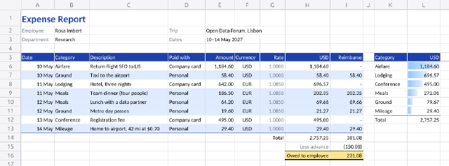

<!-- Generated by tools/gallery.mjs from showcase.yaml and build.json; do not edit. -->
# Travel Expense Report

[Sheet](../README.md) › [Business Templates](../README.md#business-templates) · `expenses` `template` `formulas` `data-validation` `conditional-formatting`

A conference trip's receipts in two currencies, converted, split into company-paid and reimbursable, and summed by category.



| | |
|---|---|
| Document | [travel-expense-report.xlsx](travel-expense-report.xlsx) (6 KB) |
| Contents | 1 sheet; used range A1:L16 |
| Features | `sheet.formulas.functions`, `sheet.data.tools`, `sheet.format.conditional`, `sheet.format.number`, `sheet.view.window` |
| Built by | `kition-sheet` @ `79ed996ab2`: 56 commands in 34 ms |

## About

Each receipt is converted to dollars at its rate and rounded to the cent. Only what the employee
paid personally is reimbursed (an IF on the payment column), the travel advance is netted off,
and SUMIFS adds up every category in the summary on the right. Category and payment cells have
drop-down lists, personally paid lines are tinted, and the header block and the amount owed sit
where an approver looks first.

## Checks

- `results.lines.values`: `[[1184.6,0],[58.4,58.4],[696.57,0],[202.35,202.35],[69.66,69.66],[21.27,21.27],[495,0],[29.4,29.4],[{"approx":2757.25,"tol":0.000001},{"approx":381.08,"tol":0.000001}],["Less advance",-150],["Owed to employee",{"approx":231.08,"tol":0.000001}]]`
- `results.categories.values`: `[[1184.6],[696.57],[495],[{"approx":272.01,"tol":0.000001}],[{"approx":79.67,"tol":0.000001}],[29.4],[{"approx":2757.25,"tol":0.000001}]]`
- `results.badCategory.ok`: `false`
- diagnostics: none (the kit's check finds nothing wrong)
- the saved document opens again; the thumbnail matches `thumb.png` within the `render` tolerance

## Steps

<details><summary>56 commands (from <a href="showcase.yaml">showcase.yaml</a>)</summary>

```yaml
- command: range.setValues
  params:
    range: A1
    values:
      - - Expense Report
      - - Employee
        - Rosa Imbert
        - null
        - Trip
        - Open Data Forum, Lisbon
      - - Department
        - Research
        - null
        - Dates
        - 10–14 May 2027
- command: range.setValues
  params:
    range: A5
    values:
      - - Date
        - Category
        - Description
        - Paid with
        - Amount
        - Currency
        - Rate
        - USD
        - Reimburse
      - - 2027-05-10
        - Airfare
        - Return flight SFO to LIS
        - Company card
        - 1184.6
        - USD
        - 1
        - =ROUND(E6*G6,2)
        - =IF(D6="Personal",H6,0)
      - - 2027-05-10
        - Ground
        - Taxi to the airport
        - Personal
        - 58.4
        - USD
        - 1
      - - 2027-05-11
        - Lodging
        - Hotel, three nights
        - Company card
        - 642
        - EUR
        - 1.085
      - - 2027-05-11
        - Meals
        - Team dinner (four people)
        - Personal
        - 186.5
        - EUR
        - 1.085
      - - 2027-05-12
        - Meals
        - Lunch with a data partner
        - Personal
        - 64.2
        - EUR
        - 1.085
      - - 2027-05-12
        - Ground
        - Metro day passes
        - Personal
        - 19.6
        - EUR
        - 1.085
      - - 2027-05-13
        - Conference
        - Registration fee
        - Company card
        - 495
        - USD
        - 1
      - - 2027-05-14
        - Mileage
        - Home to airport, 42 mi at $0.70
        - Personal
        - =42*0.7
        - USD
        - 1
      - - null
        - null
        - null
        - null
        - null
        - null
        - Total
        - =SUM(H6:H13)
        - =SUM(I6:I13)
      - - null
        - null
        - null
        - null
        - null
        - null
        - null
        - Less advance
        - -150
      - - null
        - null
        - null
        - null
        - null
        - null
        - null
        - Owed to employee
        - =I14+I15
- command: edit.fillDown
  params:
    range: H6:I13
- command: range.setValues
  params:
    range: K5
    values:
      - - Category
        - USD
      - - Airfare
        - =SUMIFS($H$6:$H$13,$B$6:$B$13,K6)
      - - Lodging
        - =SUMIFS($H$6:$H$13,$B$6:$B$13,K7)
      - - Conference
        - =SUMIFS($H$6:$H$13,$B$6:$B$13,K8)
      - - Meals
        - =SUMIFS($H$6:$H$13,$B$6:$B$13,K9)
      - - Ground
        - =SUMIFS($H$6:$H$13,$B$6:$B$13,K10)
      - - Mileage
        - =SUMIFS($H$6:$H$13,$B$6:$B$13,K11)
      - - Total
        - =SUM(L6:L11)
- command: data.validation
  params:
    range: B6:B13
    type: list
    formula1: =$K$6:$K$11
    dropdown: true
- command: data.validation
  params:
    range: D6:D13
    type: list
    formula1: Company card,Personal
    dropdown: true
- command: home.fontSize
  params:
    range: A1
    size: 20
- command: home.bold
  params:
    range: A1
- command: home.fontColor
  params:
    range: A1
    color: "#1e40af"
- command: home.fontColor
  params:
    range: A2:A3
    color: "#6b7280"
- command: home.fontColor
  params:
    range: D2:D3
    color: "#6b7280"
- command: home.bold
  params:
    range: B2:B3
- command: home.bold
  params:
    range: E2:E3
- command: home.borders
  params:
    range: A3:I3
    preset: bottom
    color: "#bfdbfe"
- command: home.fillColor
  params:
    range: A5:I5
    color: "#1e40af"
- command: home.fillColor
  params:
    range: K5:L5
    color: "#1e40af"
- command: home.fontColor
  params:
    range: A5:L5
    color: "#ffffff"
- command: home.bold
  params:
    range: A5:L5
- command: home.alignRight
  params:
    range: E5
- command: home.alignRight
  params:
    range: G5:I5
- command: home.alignRight
  params:
    range: L5
- command: home.numberFormat
  params:
    range: A6:A13
    format: d mmm
- command: home.numberFormat
  params:
    range: E6:E13
    format: "#,##0.00"
- command: home.alignCenter
  params:
    range: F6:F13
- command: home.numberFormat
  params:
    range: G6:G13
    format: "0.0000"
- command: home.fontColor
  params:
    range: G6:G13
    color: "#6b7280"
- command: home.numberFormat
  params:
    range: H6:I16
    format: '#,##0.00;(#,##0.00);"-"'
- command: home.numberFormat
  params:
    range: L6:L12
    format: "#,##0.00"
- command: home.conditionalFormat
  params:
    range: A6:I13
    rule:
      type: expression
      formula: =$D6="Personal"
      style:
        fill:
          fg:
            Rgb: 14674942
          pattern: Solid
- command: home.borders
  params:
    range: A6:I13
    preset: insideHorizontal
    color: "#e5e7eb"
- command: home.borders
  params:
    range: A13:I13
    preset: bottom
    color: "#1e40af"
- command: home.bold
  params:
    range: G14:I14
- command: home.alignRight
  params:
    range: G14:H16
- command: home.fontColor
  params:
    range: H15
    color: "#6b7280"
- command: home.bold
  params:
    range: H16:I16
- command: home.fillColor
  params:
    range: H16:I16
    color: "#fde68a"
- command: home.borders
  params:
    range: H16:I16
    preset: topDoubleBottom
- command: home.bold
  params:
    range: K12:L12
- command: home.borders
  params:
    range: K12:L12
    preset: top
    color: "#1e40af"
- command: home.borders
  params:
    range: K6:L11
    preset: insideHorizontal
    color: "#e5e7eb"
- command: home.conditionalFormat
  params:
    range: L6:L11
    rule:
      type: dataBar
      color: "#93c5fd"
- command: home.columnWidth
  params:
    cols: A:A
    width: 74
- command: home.columnWidth
  params:
    cols: B:B
    width: 78
- command: home.columnWidth
  params:
    cols: C:C
    width: 176
- command: home.columnWidth
  params:
    cols: D:D
    width: 82
- command: home.columnWidth
  params:
    cols: E:E
    width: 66
- command: home.columnWidth
  params:
    cols: F:G
    width: 56
- command: home.columnWidth
  params:
    cols: H:H
    width: 100
- command: home.columnWidth
  params:
    cols: I:I
    width: 74
- command: home.columnWidth
  params:
    cols: J:J
    width: 24
- command: home.columnWidth
  params:
    cols: K:K
    width: 74
- command: home.columnWidth
  params:
    cols: L:L
    width: 74
- command: view.freezePanes
  params:
    cell: A6
- command: sheet.read
  params:
    range: H6:I16
  as: lines
- command: sheet.read
  params:
    range: L6:L12
  as: categories
- command: data.validate
  params:
    cell: B7
    input: Souvenirs
  as: badCategory
```

</details>
