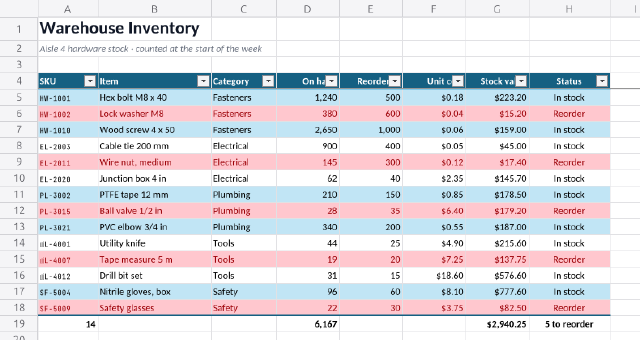

<!-- Generated by tools/gallery.mjs from showcase.yaml and build.json; do not edit. -->
# Warehouse Inventory Table

[Sheet](../README.md) › [Tables & Data](../README.md#tables--data) · `table` `structured-references` `total-row` `conditional-formatting` `inventory`

A stock list formatted as a structured table, with calculated columns, a total row and reorder alerts.



| | |
|---|---|
| Document | [warehouse-inventory-table.xlsx](warehouse-inventory-table.xlsx) (7 KB) |
| Contents | 1 sheet; used range A1:H19 |
| Features | `sheet.tables.design`, `sheet.format.conditional`, `sheet.formulas.functions`, `sheet.view.window` |
| Built by | `kition-sheet` @ `79ed996ab2`: 31 commands in 13 ms |

## About

The list is a real table named Inventory: banded rows, a header with filter buttons, and a
total row that sums the stock value and counts the items. Stock value and status are
calculated columns written with structured references such as [@[On hand]], and a formula
rule paints every row that has fallen below its reorder point. The header row is frozen.

## Checks

- `results.doc.sheets.0.tables`: `{"count":1,"any":{"name":"Inventory","range":"A4:H19","totals":true}}`
- `results.doc.sheets.0.freeze`: `[4,0]`
- `results.calc.values.0`: `[{"approx":223.2,"tol":0.0001},"In stock"]`
- `results.calc.values.1`: `[{"approx":15.2,"tol":0.0001},"Reorder"]`
- `results.totals.values.0.0`: `14`
- `results.totals.values.0.3`: `6167`
- `results.totals.values.0.6`: `{"approx":2940.25,"tol":0.001}`
- `results.totals.values.0.7`: `"5 to reorder"`
- diagnostics: none (the kit's check finds nothing wrong)
- the saved document opens again; the thumbnail matches `thumb.png` within the `render` tolerance

## Steps

<details><summary>31 commands (from <a href="showcase.yaml">showcase.yaml</a>)</summary>

```yaml
- command: range.setValues
  params:
    range: A1
    values:
      - - Warehouse Inventory
      - - Aisle 4 hardware stock · counted at the start of the week
- command: range.setValues
  params:
    range: A4
    values:
      - - SKU
        - Item
        - Category
        - On hand
        - Reorder at
        - Unit cost
        - Stock value
        - Status
      - - HW-1001
        - Hex bolt M8 x 40
        - Fasteners
        - 1240
        - 500
        - 0.18
        - =[@[On hand]]*[@[Unit cost]]
        - =IF([@[On hand]]<[@[Reorder at]],"Reorder","In stock")
      - - HW-1002
        - Lock washer M8
        - Fasteners
        - 380
        - 600
        - 0.04
        - =[@[On hand]]*[@[Unit cost]]
        - =IF([@[On hand]]<[@[Reorder at]],"Reorder","In stock")
      - - HW-1010
        - Wood screw 4 x 50
        - Fasteners
        - 2650
        - 1000
        - 0.06
        - =[@[On hand]]*[@[Unit cost]]
        - =IF([@[On hand]]<[@[Reorder at]],"Reorder","In stock")
      - - EL-2003
        - Cable tie 200 mm
        - Electrical
        - 900
        - 400
        - 0.05
        - =[@[On hand]]*[@[Unit cost]]
        - =IF([@[On hand]]<[@[Reorder at]],"Reorder","In stock")
      - - EL-2011
        - Wire nut, medium
        - Electrical
        - 145
        - 300
        - 0.12
        - =[@[On hand]]*[@[Unit cost]]
        - =IF([@[On hand]]<[@[Reorder at]],"Reorder","In stock")
      - - EL-2020
        - Junction box 4 in
        - Electrical
        - 62
        - 40
        - 2.35
        - =[@[On hand]]*[@[Unit cost]]
        - =IF([@[On hand]]<[@[Reorder at]],"Reorder","In stock")
      - - PL-3002
        - PTFE tape 12 mm
        - Plumbing
        - 210
        - 150
        - 0.85
        - =[@[On hand]]*[@[Unit cost]]
        - =IF([@[On hand]]<[@[Reorder at]],"Reorder","In stock")
      - - PL-3015
        - Ball valve 1/2 in
        - Plumbing
        - 28
        - 35
        - 6.4
        - =[@[On hand]]*[@[Unit cost]]
        - =IF([@[On hand]]<[@[Reorder at]],"Reorder","In stock")
      - - PL-3021
        - PVC elbow 3/4 in
        - Plumbing
        - 340
        - 200
        - 0.55
        - =[@[On hand]]*[@[Unit cost]]
        - =IF([@[On hand]]<[@[Reorder at]],"Reorder","In stock")
      - - TL-4001
        - Utility knife
        - Tools
        - 44
        - 25
        - 4.9
        - =[@[On hand]]*[@[Unit cost]]
        - =IF([@[On hand]]<[@[Reorder at]],"Reorder","In stock")
      - - TL-4007
        - Tape measure 5 m
        - Tools
        - 19
        - 20
        - 7.25
        - =[@[On hand]]*[@[Unit cost]]
        - =IF([@[On hand]]<[@[Reorder at]],"Reorder","In stock")
      - - TL-4012
        - Drill bit set
        - Tools
        - 31
        - 15
        - 18.6
        - =[@[On hand]]*[@[Unit cost]]
        - =IF([@[On hand]]<[@[Reorder at]],"Reorder","In stock")
      - - SF-5004
        - Nitrile gloves, box
        - Safety
        - 96
        - 60
        - 8.1
        - =[@[On hand]]*[@[Unit cost]]
        - =IF([@[On hand]]<[@[Reorder at]],"Reorder","In stock")
      - - SF-5009
        - Safety glasses
        - Safety
        - 22
        - 30
        - 3.75
        - =[@[On hand]]*[@[Unit cost]]
        - =IF([@[On hand]]<[@[Reorder at]],"Reorder","In stock")
- command: insert.table
  params:
    range: A4:H18
    style: TableStyleMedium9
    name: Inventory
  as: table
- command: table.totalRow
  params:
    table: Inventory
    on: true
- command: table.totalFunction
  params:
    table: Inventory
    column: Stock value
    function: sum
- command: table.totalFunction
  params:
    table: Inventory
    column: SKU
    function: count
- command: table.totalFunction
  params:
    table: Inventory
    column: On hand
    function: sum
- command: range.setValues
  params:
    range: H19
    values:
      - - =COUNTIF(Inventory[Status],"Reorder")&" to reorder"
- command: home.conditionalFormat
  params:
    range: A5:H18
    rule:
      type: expression
      formula: =$H5="Reorder"
      preset: lightRedFillDarkRedText
- command: home.fontSize
  params:
    range: A1
    size: 20
- command: home.bold
  params:
    range: A1
- command: home.fontColor
  params:
    range: A1
    color: "#111827"
- command: home.italic
  params:
    range: A2
- command: home.fontColor
  params:
    range: A2
    color: "#6b7280"
- command: home.numberFormat
  params:
    range: D5:E19
    format: "#,##0"
- command: home.numberFormat
  params:
    range: F5:F18
    format: $$#,##0.00
- command: home.numberFormat
  params:
    range: G5:G19
    format: $$#,##0.00
- command: home.fontName
  params:
    range: A5:A18
    name: JetBrains Mono
- command: home.fontSize
  params:
    range: A5:A18
    size: 9
- command: home.alignCenter
  params:
    range: H4:H19
- command: home.alignRight
  params:
    range: D4:G4
- command: home.columnWidth
  params:
    cols: A:A
    width: 74
- command: home.columnWidth
  params:
    cols: B:B
    width: 140
- command: home.columnWidth
  params:
    cols: C:C
    width: 80
- command: home.columnWidth
  params:
    cols: D:G
    width: 78
- command: home.columnWidth
  params:
    cols: H:H
    width: 100
- command: home.rowHeight
  params:
    rows: 1:1
    height: 28
- command: view.freezePanes
  params:
    cell: A5
- command: document.inspect
  params: {}
  as: doc
- command: sheet.read
  params:
    range: A19:H19
  as: totals
- command: sheet.read
  params:
    range: G5:H6
  as: calc
```

</details>
