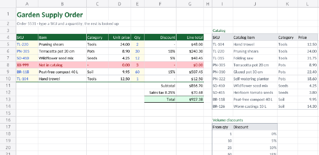

<!-- Generated by tools/gallery.mjs from showcase.yaml and build.json; do not edit. -->
# XLOOKUP Order Form

[Sheet](../README.md) › [Formulas & Functions](../README.md#formulas--functions) · `lookup` `formulas` `conditional-formatting` `number-formats` `data-validation`

An order form that fills in item names, categories, prices and volume discounts from a catalog with XLOOKUP and INDEX/MATCH.



| | |
|---|---|
| Document | [xlookup-order-form.xlsx](xlookup-order-form.xlsx) (7 KB) |
| Contents | 1 sheet; used range A1:L21 |
| Features | `sheet.formulas.functions`, `sheet.format.conditional`, `sheet.data.tools`, `sheet.format.number` |
| Built by | `kition-sheet` @ `79ed996ab2`: 60 commands in 20 ms |

## About

Type a SKU and a quantity; everything else is looked up. XLOOKUP finds the item and the price
with a fallback for unknown codes, INDEX/MATCH finds the category the classic way, and a second
XLOOKUP with match mode -1 (exact or next smaller) picks the volume discount tier for the
quantity. The unknown SKU in row 8 is flagged in red, and the quantity column only takes whole
numbers from 1 to 500.

## Checks

- `results.lines.values`: `[["TL-220","Pruning shears","Tools",24,2,0,48],["PN-305","Terracotta pot 20 cm","Pots",8.9,30,0.1,{"approx":240.3,"tol":0.000001}],["SD-410","Wildflower seed mix","Seeds",4.25,12,0.05,{"approx":48.45,"tol":0.000001}],["XX-999","Not in catalog","-",0,3,0,0],["BR-118","Peat-free compost 40 L","Soil",9.95,60,0.15,{"approx":507.45,"tol":0.000001}],["TL-104","Hand trowel","Tools",12.5,1,0,12.5]]`
- `results.totals.values`: `[[{"approx":856.7,"tol":0.000001}],[{"approx":70.68,"tol":0.000001}],[{"approx":927.38,"tol":0.000001}]]`
- `results.badQty.ok`: `false`
- diagnostics: none (the kit's check finds nothing wrong)
- the saved document opens again; the thumbnail matches `thumb.png` within the `render` tolerance

## Steps

<details><summary>60 commands (from <a href="showcase.yaml">showcase.yaml</a>)</summary>

```yaml
- command: range.setValues
  params:
    range: A1
    values:
      - - Garden Supply Order
      - - Order 5531 · type a SKU and a quantity, the rest is looked up
- command: range.setValues
  params:
    range: A4
    values:
      - - SKU
        - Item
        - Category
        - Unit price
        - Qty
        - Discount
        - Line total
      - - TL-220
        - =XLOOKUP(A5,$I$5:$I$14,$J$5:$J$14,"Not in catalog")
        - =IFERROR(INDEX($K$5:$K$14,MATCH(A5,$I$5:$I$14,0)),"-")
        - =XLOOKUP(A5,$I$5:$I$14,$L$5:$L$14,0)
        - 2
        - =XLOOKUP(E5,$I$18:$I$21,$J$18:$J$21,0,-1)
        - =D5*E5*(1-F5)
      - - PN-305
        - null
        - null
        - null
        - 30
      - - SD-410
        - null
        - null
        - null
        - 12
      - - XX-999
        - null
        - null
        - null
        - 3
      - - BR-118
        - null
        - null
        - null
        - 60
      - - TL-104
        - null
        - null
        - null
        - 1
      - - null
        - null
        - null
        - null
        - null
        - Subtotal
        - =SUM(G5:G10)
      - - null
        - null
        - null
        - null
        - null
        - Sales tax 8.25%
        - =ROUND(G11*8.25%,2)
      - - null
        - null
        - null
        - null
        - null
        - Total
        - =G11+G12
- command: edit.fillDown
  params:
    range: B5:D10
- command: edit.fillDown
  params:
    range: F5:G10
- command: range.setValues
  params:
    range: I4
    values:
      - - SKU
        - Catalog item
        - Category
        - Price
      - - TL-104
        - Hand trowel
        - Tools
        - 12.5
      - - TL-220
        - Pruning shears
        - Tools
        - 24
      - - TL-315
        - Folding saw
        - Tools
        - 31.75
      - - PN-305
        - Terracotta pot 20 cm
        - Pots
        - 8.9
      - - PN-310
        - Glazed pot 30 cm
        - Pots
        - 22.4
      - - PN-322
        - Self-watering planter
        - Pots
        - 18.6
      - - SD-410
        - Wildflower seed mix
        - Seeds
        - 4.25
      - - SD-415
        - Heirloom tomato seeds
        - Seeds
        - 3.8
      - - BR-118
        - Peat-free compost 40 L
        - Soil
        - 9.95
      - - BR-126
        - Worm castings 10 L
        - Soil
        - 14.3
      - - null
      - - null
      - - From qty
        - Discount
      - - 1
        - 0
      - - 10
        - 0.05
      - - 25
        - 0.1
      - - 50
        - 0.15
- command: home.fontSize
  params:
    range: A1
    size: 20
- command: home.bold
  params:
    range: A1
- command: home.fontColor
  params:
    range: A1
    color: "#166534"
- command: home.fontColor
  params:
    range: A2
    color: "#6b7280"
- command: home.fillColor
  params:
    range: A4:G4
    color: "#166534"
- command: home.fontColor
  params:
    range: A4:G4
    color: "#ffffff"
- command: home.bold
  params:
    range: A4:G4
- command: home.fillColor
  params:
    range: A5:A10
    color: "#fefce8"
- command: home.fillColor
  params:
    range: E5:E10
    color: "#fefce8"
- command: home.fontColor
  params:
    range: A5:A10
    color: "#1d4ed8"
- command: home.fontColor
  params:
    range: E5:E10
    color: "#1d4ed8"
- command: home.borders
  params:
    range: A4:G10
    preset: insideHorizontal
    color: "#d1d5db"
- command: home.borders
  params:
    range: A10:G10
    preset: bottom
    color: "#166534"
- command: home.numberFormat
  params:
    range: D5:D10
    format: "#,##0.00"
- command: home.numberFormat
  params:
    range: F5:F10
    format: 0%;;"-"
- command: home.alignRight
  params:
    range: D4:G4
- command: home.alignCenter
  params:
    range: E5:E10
- command: home.alignCenter
  params:
    range: E4
- command: home.numberFormat
  params:
    range: G5:G13
    format: $$#,##0.00
- command: home.alignRight
  params:
    range: F11:F13
- command: home.bold
  params:
    range: F13:G13
- command: home.borders
  params:
    range: F13:G13
    preset: topDoubleBottom
- command: home.fillColor
  params:
    range: F13:G13
    color: "#dcfce7"
- command: home.conditionalFormat
  params:
    range: A5:G10
    rule:
      type: expression
      formula: =$B5="Not in catalog"
      preset: lightRedFillDarkRedText
- command: data.validation
  params:
    range: E5:E10
    type: whole
    operator: between
    formula1: "1"
    formula2: "500"
    errorTitle: Quantity
    errorMessage: Enter a whole number from 1 to 500.
- command: home.fillColor
  params:
    range: I4:L4
    color: "#e5e7eb"
- command: home.fillColor
  params:
    range: I17:J17
    color: "#e5e7eb"
- command: home.bold
  params:
    range: I4:L4
- command: home.bold
  params:
    range: I17:J17
- command: home.fontColor
  params:
    range: I5:L14
    color: "#4b5563"
- command: home.fontColor
  params:
    range: I18:J21
    color: "#4b5563"
- command: home.numberFormat
  params:
    range: L5:L14
    format: "#,##0.00"
- command: home.numberFormat
  params:
    range: J18:J21
    format: 0%
- command: home.borders
  params:
    range: I4:L14
    preset: outside
    color: "#9ca3af"
- command: home.borders
  params:
    range: I17:J21
    preset: outside
    color: "#9ca3af"
- command: cell.set
  params:
    cell: I3
    input: Catalog
  as: c1
- command: cell.set
  params:
    cell: I16
    input: Volume discounts
- command: home.bold
  params:
    range: I3
- command: home.bold
  params:
    range: I16
- command: home.fontColor
  params:
    range: I3
    color: "#166534"
- command: home.fontColor
  params:
    range: I16
    color: "#166534"
- command: home.columnWidth
  params:
    cols: A:A
    width: 64
- command: home.columnWidth
  params:
    cols: B:B
    width: 140
- command: home.columnWidth
  params:
    cols: C:C
    width: 64
- command: home.columnWidth
  params:
    cols: D:D
    width: 64
- command: home.columnWidth
  params:
    cols: E:E
    width: 40
- command: home.columnWidth
  params:
    cols: F:F
    width: 92
- command: home.columnWidth
  params:
    cols: G:G
    width: 80
- command: home.columnWidth
  params:
    cols: H:H
    width: 24
- command: home.columnWidth
  params:
    cols: I:I
    width: 60
- command: home.columnWidth
  params:
    cols: J:J
    width: 130
- command: home.columnWidth
  params:
    cols: K:L
    width: 58
- command: sheet.read
  params:
    range: A5:G10
  as: lines
- command: sheet.read
  params:
    range: G11:G13
  as: totals
- command: data.validate
  params:
    cell: E6
    input: "0"
  as: badQty
```

</details>
