<!-- Generated by tools/gallery.mjs from showcase.yaml and build.json; do not edit. -->
# Slide showcase

Presentations: layouts, themes, shapes, text, tables, charts, transitions and animations. Saved as .pptx. Every sample is built from `showcase.yaml` by the kit's own commands and drawn by its own engine (`kition-slide`).

**42 samples** · 7 categories · 16 features of `kition-slide/features.yaml` · [all kits](../README.md)

[Animations & Transitions](#animations--transitions) (4) · [Business Reports](#business-reports) (10) · [Charts & Tables](#charts--tables) (6) · [Education](#education) (6) · [Events & Marketing](#events--marketing) (6) · [Layouts & Themes](#layouts--themes) (4) · [Pitch Decks](#pitch-decks) (6)

## Animations & Transitions

<table>
<tr>
<td width="33%" valign="top">
<a href="cafe-menu-kiosk-loop/">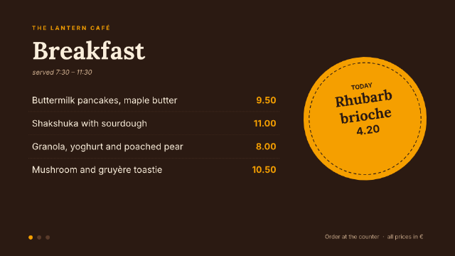</a> 
Slide 
<b><a href="cafe-menu-kiosk-loop/">Café Menu Kiosk Loop</a></b> 
A three-board café menu that runs unattended; each slide pushes up to the next after eight seconds, in a looping kiosk show. 
<i>3 slides; 960 × 540 pt</i> 
<code>transitions</code> <code>timing</code> <code>kiosk</code> <code>menu</code> <code>theme</code>
</td>
<td width="33%" valign="top">
<a href="paper-plane-motion-path/">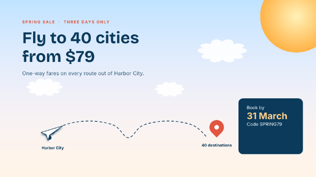</a> 
Slide 
<b><a href="paper-plane-motion-path/">Paper Plane Motion Path</a></b> 
A travel-sale slide where a paper plane drawn as a freeform flies two chained arc motion paths along a dashed route to the destination pin. 
<i>1 slide; 960 × 540 pt</i> 
<code>animation</code> <code>motion-path</code> <code>freeform</code> <code>marketing</code>
</td>
<td width="33%" valign="top">
<a href="planet-tour-morph/">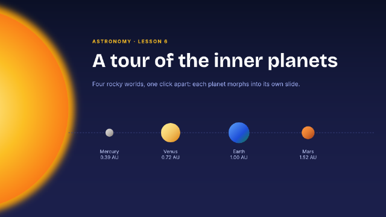</a> 
Slide 
<b><a href="planet-tour-morph/">Planet Tour with Morph</a></b> 
A four-slide science tour of the inner planets where Morph transitions grow each planet from the overview into its own fact slide. 
<i>4 slides; 960 × 540 pt</i> 
<code>transitions</code> <code>morph</code> <code>lesson</code> <code>shapes</code> <code>gradient</code>
</td>
</tr>
<tr>
<td width="33%" valign="top">
<a href="study-habits-bullet-build/">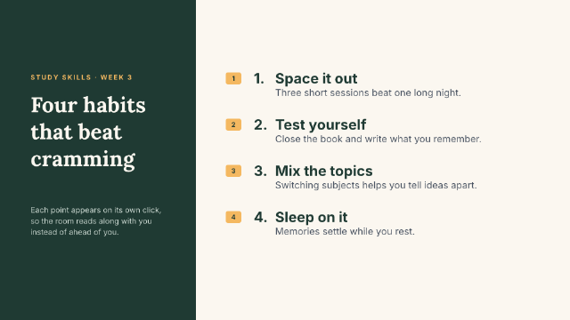</a> 
Slide 
<b><a href="study-habits-bullet-build/">Bullet Build by Paragraph</a></b> 
A study-skills slide whose four numbered points fly in one paragraph per click, marked with animation-order badges. 
<i>1 slide; 960 × 540 pt</i> 
<code>animation</code> <code>bullets</code> <code>numbering</code> <code>lesson</code>
</td>
<td width="33%"></td>
<td width="33%"></td>
</tr>
</table>

## Business Reports

<table>
<tr>
<td width="33%" valign="top">
<a href="annual-report-highlights/">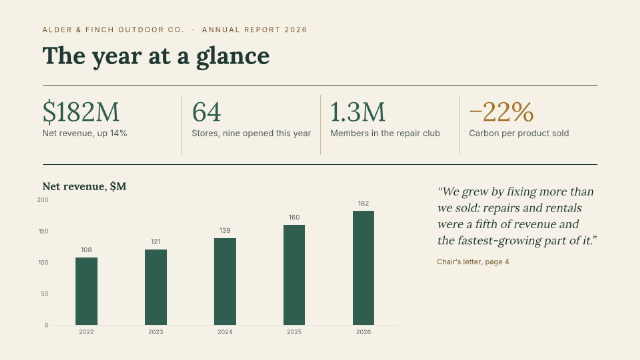</a> 
Slide 
<b><a href="annual-report-highlights/">Annual Report Highlights</a></b> 
A "year at a glance" spread in a serif face, with four headline figures between hairline rules and a five-year revenue column chart. 
<i>1 slide; 960 × 540 pt</i> 
<code>annual-report</code> <code>kpi</code> <code>chart</code> <code>serif</code>
</td>
<td width="33%" valign="top">
<a href="company-org-chart/">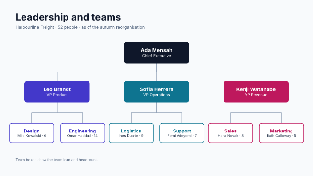</a> 
Slide 
<b><a href="company-org-chart/">Company Org Chart</a></b> 
A three-level organisation chart, with a chief executive, three department heads and six teams, joined by elbow lines drawn as freeform paths. 
<i>1 slide; 960 × 540 pt</i> 
<code>org-chart</code> <code>connectors</code> <code>shapes</code> <code>hierarchy</code>
</td>
<td width="33%" valign="top">
<a href="customer-journey-map/">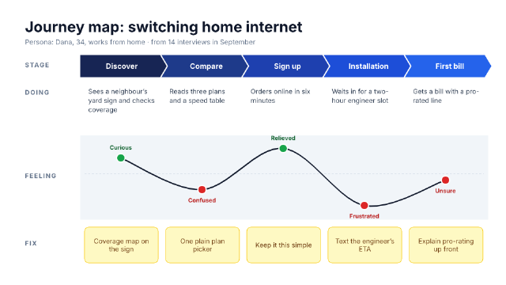</a> 
Slide 
<b><a href="customer-journey-map/">Customer Journey Map</a></b> 
Five stages of switching home internet, with chevron headers, what the customer does, a smoothed emotion curve and the fix for each stage. 
<i>1 slide; 960 × 540 pt</i> 
<code>journey-map</code> <code>freeform</code> <code>shapes</code> <code>chevrons</code> <code>service-design</code>
</td>
</tr>
<tr>
<td width="33%" valign="top">
<a href="okr-progress-dashboard/">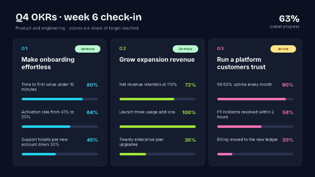</a> 
Slide 
<b><a href="okr-progress-dashboard/">OKR Progress Dashboard</a></b> 
A dark quarterly OKR check-in with three objective cards, nine key results as progress bars and a status pill on each objective. 
<i>1 slide; 960 × 540 pt</i> 
<code>okr</code> <code>dashboard</code> <code>progress-bars</code> <code>dark</code> <code>shapes</code>
</td>
<td width="33%" valign="top">
<a href="product-roadmap-timeline/">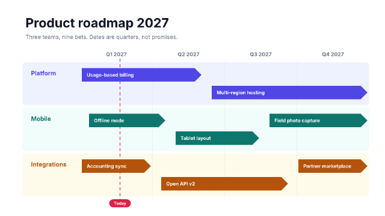</a> 
Slide 
<b><a href="product-roadmap-timeline/">Product Roadmap Timeline</a></b> 
A four-quarter product roadmap with tinted swimlanes for platform, mobile and integrations, arrow-shaped bars and a dashed "today" marker. 
<i>1 slide; 960 × 540 pt</i> 
<code>roadmap</code> <code>timeline</code> <code>shapes</code> <code>freeform</code>
</td>
<td width="33%" valign="top">
<a href="project-status-report/">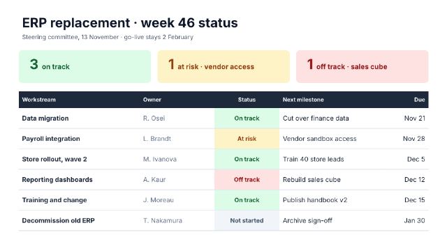</a> 
Slide 
<b><a href="project-status-report/">Project Status Report</a></b> 
A programme status slide with a red-amber-green summary strip and a six-workstream table whose status cells are filled by state. 
<i>1 slide; 960 × 540 pt</i> 
<code>table</code> <code>status</code> <code>rag</code> <code>cell-fill</code> <code>project-management</code>
</td>
</tr>
<tr>
<td width="33%" valign="top">
<a href="quarterly-review/">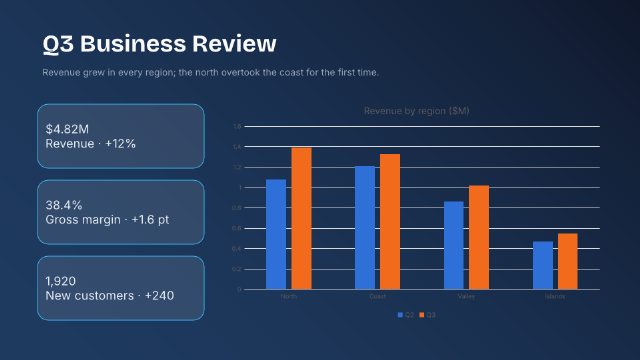</a> 
Slide 
<b><a href="quarterly-review/">Quarterly Business Review</a></b> 
A results slide with a gradient background, three KPI cards and a clustered column chart of revenue by region. 
<i>1 slide; 960 × 540 pt</i> 
<code>chart</code> <code>shapes</code> <code>gradient</code> <code>kpi</code> <code>theme-fonts</code>
</td>
<td width="33%" valign="top">
<a href="sales-funnel-stages/">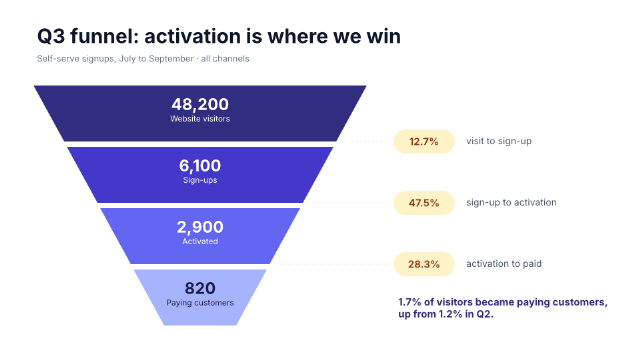</a> 
Slide 
<b><a href="sales-funnel-stages/">Sales Funnel Stages</a></b> 
A four-stage acquisition funnel drawn as tapered freeform bands, with stage counts inside and step conversion rates in pills beside each hand-off. 
<i>1 slide; 960 × 540 pt</i> 
<code>funnel</code> <code>freeform</code> <code>shapes</code> <code>kpi</code>
</td>
<td width="33%" valign="top">
<a href="strategy-pyramid/">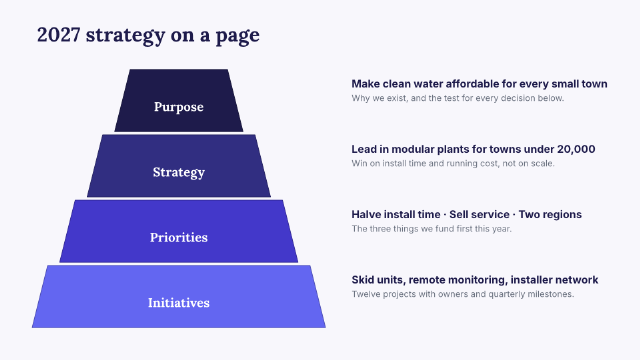</a> 
Slide 
<b><a href="strategy-pyramid/">Strategy Pyramid</a></b> 
A four-level strategy pyramid from purpose down to initiatives, built as a SmartArt diagram, resized into place and coloured from the theme. 
<i>1 slide; 960 × 540 pt</i> 
<code>smartart</code> <code>pyramid</code> <code>theme-colors</code> <code>strategy</code>
</td>
</tr>
<tr>
<td width="33%" valign="top">
<a href="swot-analysis-grid/">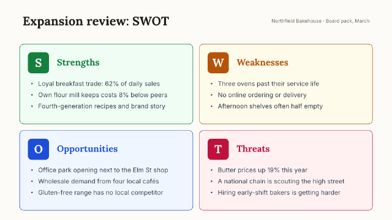</a> 
Slide 
<b><a href="swot-analysis-grid/">SWOT Analysis Grid</a></b> 
A strengths, weaknesses, opportunities and threats grid for a family bakery's expansion review, with tinted cards and lettered badges. 
<i>1 slide; 960 × 540 pt</i> 
<code>swot</code> <code>grid</code> <code>shapes</code> <code>bullets</code> <code>serif</code>
</td>
<td width="33%"></td>
<td width="33%"></td>
</tr>
</table>

## Charts & Tables

<table>
<tr>
<td width="33%" valign="top">
<a href="budget-variance-table/">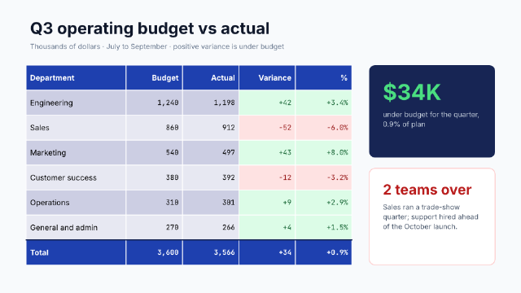</a> 
Slide 
<b><a href="budget-variance-table/">Budget vs Actual Table</a></b> 
A quarterly operating budget table with right-aligned monospaced figures, green and red variance cells, a bold total row and two callout cards. 
<i>1 slide; 960 × 540 pt</i> 
<code>table</code> <code>budget</code> <code>cell-fill</code> <code>finance</code> <code>monospace</code>
</td>
<td width="33%" valign="top">
<a href="kpi-dashboard-sparklines/">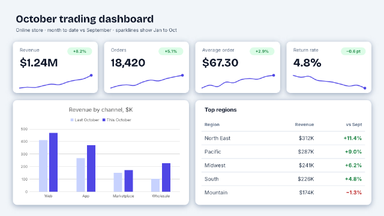</a> 
Slide 
<b><a href="kpi-dashboard-sparklines/">KPI Dashboard with Sparklines</a></b> 
A monthly e-commerce dashboard with four KPI tiles carrying freeform sparklines and change pills, a channel column chart and a regional table. 
<i>1 slide; 960 × 540 pt</i> 
<code>dashboard</code> <code>kpi</code> <code>sparkline</code> <code>chart</code> <code>table</code> <code>freeform</code>
</td>
<td width="33%" valign="top">
<a href="market-share-doughnut/">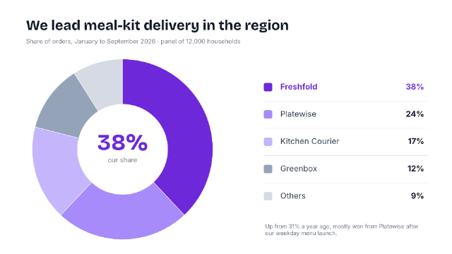</a> 
Slide 
<b><a href="market-share-doughnut/">Market Share Doughnut</a></b> 
A doughnut chart of market share with the company's own slice in a strong colour, its share set large in the hole, and a hand-built legend with values. 
<i>1 slide; 960 × 540 pt</i> 
<code>chart</code> <code>doughnut</code> <code>legend</code> <code>theme-colors</code>
</td>
</tr>
<tr>
<td width="33%" valign="top">
<a href="pricing-plan-comparison/">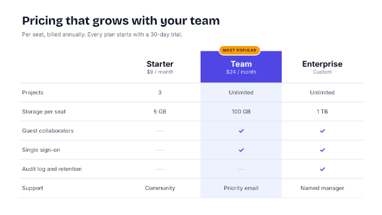</a> 
Slide 
<b><a href="pricing-plan-comparison/">Pricing Plan Comparison</a></b> 
A three-tier pricing table with a highlighted recommended column, a "Most popular" badge, check marks and right-sized rows. 
<i>1 slide; 960 × 540 pt</i> 
<code>table</code> <code>pricing</code> <code>cell-fill</code> <code>borders</code>
</td>
<td width="33%" valign="top">
<a href="revenue-mix-stacked-column/">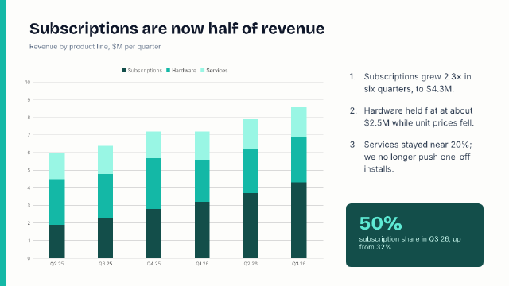</a> 
Slide 
<b><a href="revenue-mix-stacked-column/">Revenue Mix Stacked Columns</a></b> 
Six quarters of revenue stacked by product line in one colour family, with a headline that states the shift and three numbered takeaways. 
<i>1 slide; 960 × 540 pt</i> 
<code>chart</code> <code>stacked-column</code> <code>theme-colors</code> <code>numbering</code>
</td>
<td width="33%" valign="top">
<a href="survey-results-likert/">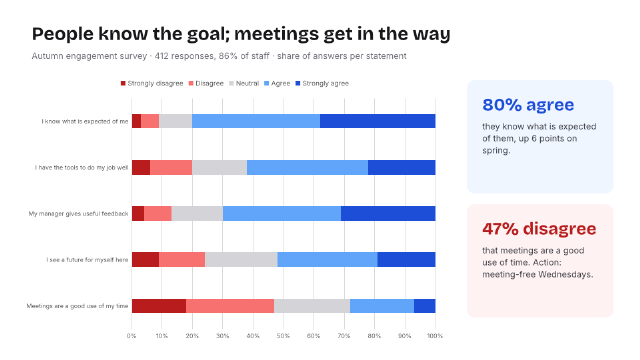</a> 
Slide 
<b><a href="survey-results-likert/">Survey Results Likert Bars</a></b> 
An employee survey shown as 100% stacked bars, five answers per statement in a red-to-blue diverging palette taken from the theme. 
<i>1 slide; 960 × 540 pt</i> 
<code>chart</code> <code>percent-bar</code> <code>survey</code> <code>theme-colors</code>
</td>
</tr>
</table>

## Education

<table>
<tr>
<td width="33%" valign="top">
<a href="alphabet-history-lecture/">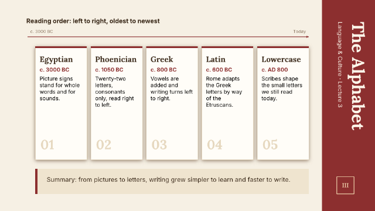</a> 
Slide 
<b><a href="alphabet-history-lecture/">Alphabet History Lecture</a></b> 
A lecture slide on how the Latin alphabet grew from picture signs, told in five dated stage cards along a timeline. 
<i>1 slide; 960 × 540 pt</i> 
<code>lesson</code> <code>timeline</code>
</td>
<td width="33%" valign="top">
<a href="geography-pop-quiz/">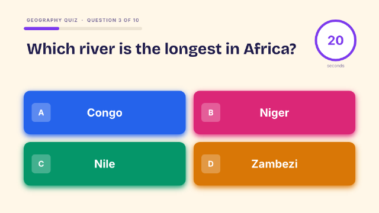</a> 
Slide 
<b><a href="geography-pop-quiz/">Geography Pop Quiz</a></b> 
A classroom quiz question with four colour-coded answer tiles and a timer, followed by a reveal slide that greys out the wrong answers and pulses the right one. 
<i>2 slides; 960 × 540 pt</i> 
<code>quiz</code> <code>lesson</code> <code>animation</code> <code>shapes</code>
</td>
<td width="33%" valign="top">
<a href="history-of-writing-timeline/">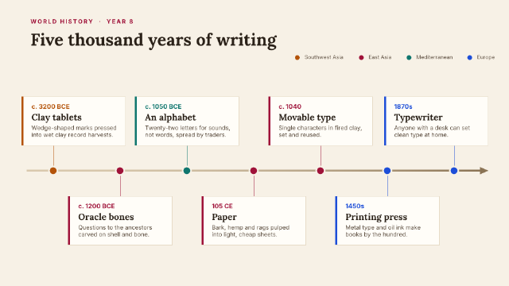</a> 
Slide 
<b><a href="history-of-writing-timeline/">History of Writing Timeline</a></b> 
A history-class timeline of seven milestones in writing, from clay tablets to the typewriter, with cards alternating above and below a dated axis. 
<i>1 slide; 960 × 540 pt</i> 
<code>timeline</code> <code>lesson</code> <code>shapes</code> <code>history</code>
</td>
</tr>
<tr>
<td width="33%" valign="top">
<a href="plant-cell-diagram/">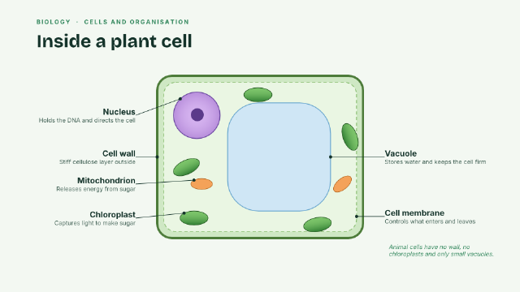</a> 
Slide 
<b><a href="plant-cell-diagram/">Plant Cell Diagram</a></b> 
A labelled biology diagram of a plant cell drawn from shapes, with six callouts joined to the organelles by connectors. 
<i>1 slide; 960 × 540 pt</i> 
<code>diagram</code> <code>connectors</code> <code>lesson</code> <code>shapes</code>
</td>
<td width="33%" valign="top">
<a href="spanish-vocabulary-cards/">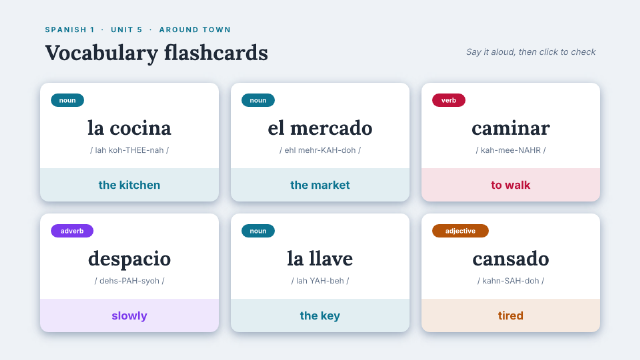</a> 
Slide 
<b><a href="spanish-vocabulary-cards/">Spanish Vocabulary Flashcards</a></b> 
Six Spanish flashcards with part-of-speech tags and pronunciation, whose English meanings wipe in one click at a time. 
<i>1 slide; 960 × 540 pt</i> 
<code>flashcards</code> <code>lesson</code> <code>animation</code> <code>shapes</code>
</td>
<td width="33%" valign="top">
<a href="water-cycle-lesson/">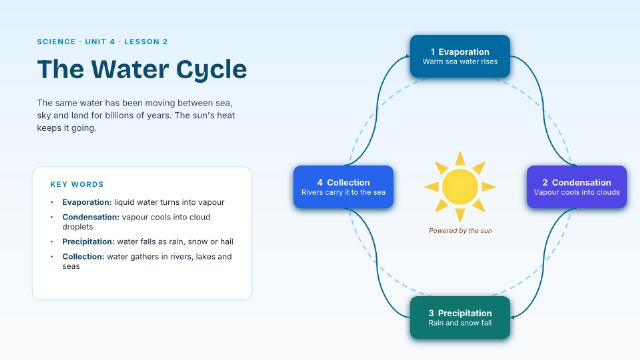</a> 
Slide 
<b><a href="water-cycle-lesson/">Water Cycle Lesson</a></b> 
A grade-school science slide that walks the four stages of the water cycle around a sun, with curved connector arrows. 
<i>1 slide; 960 × 540 pt</i> 
<code>lesson</code> <code>diagram</code> <code>connectors</code> <code>shapes</code> <code>gradient</code>
</td>
</tr>
</table>

## Events & Marketing

<table>
<tr>
<td width="33%" valign="top">
<a href="conference-agenda/">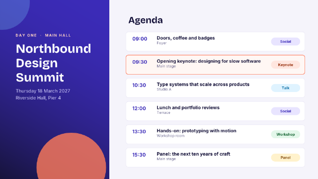</a> 
Slide 
<b><a href="conference-agenda/">Conference Agenda</a></b> 
A one-day design summit agenda with a gradient side panel, six session cards and coloured track tags, the keynote highlighted. 
<i>1 slide; 960 × 540 pt</i> 
<code>agenda</code> <code>event</code> <code>shapes</code> <code>gradient</code>
</td>
<td width="33%" valign="top">
<a href="product-launch-keynote/">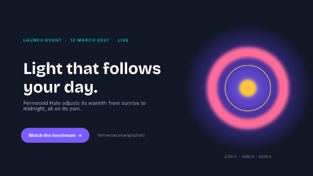</a> 
Slide 
<b><a href="product-launch-keynote/">Product Launch Keynote</a></b> 
A dark keynote opener in the built-in Nocturne theme, with a glowing product ring, a launch-date kicker and a call to action. 
<i>2 slides; 960 × 540 pt</i> 
<code>launch</code> <code>theme</code> <code>dark</code> <code>glow</code> <code>gradient</code>
</td>
<td width="33%" valign="top">
<a href="speaker-introduction/">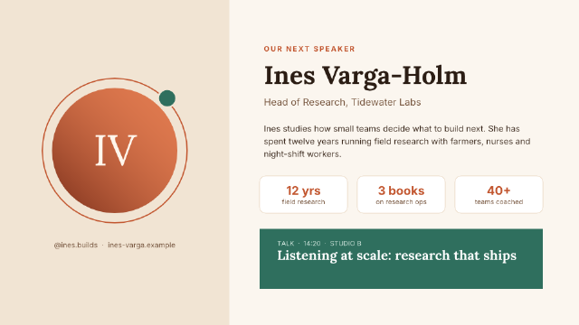</a> 
Slide 
<b><a href="speaker-introduction/">Speaker Introduction</a></b> 
A speaker card for a conference session, with a monogram portrait ring, a short bio, three credentials and the talk title, plus the host's notes. 
<i>1 slide; 960 × 540 pt</i> 
<code>event</code> <code>speaker</code> <code>shapes</code> <code>notes</code>
</td>
</tr>
<tr>
<td width="33%" valign="top">
<a href="thank-you-closing/">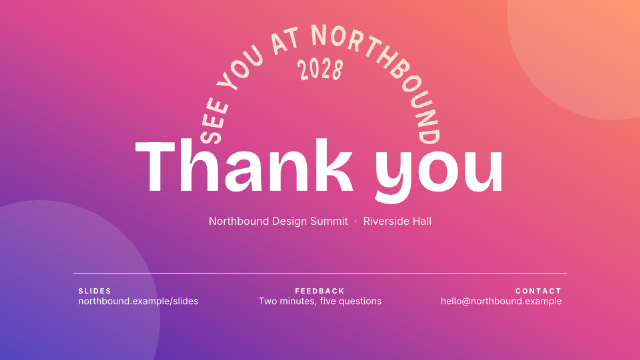</a> 
Slide 
<b><a href="thank-you-closing/">Thank-You Closing Slide</a></b> 
A conference closing slide with an arched WordArt line over a big Thank you, on a sunset gradient with feedback and contact details. 
<i>1 slide; 960 × 540 pt</i> 
<code>wordart</code> <code>closing</code> <code>gradient</code> <code>event</code>
</td>
<td width="33%" valign="top">
<a href="webinar-promo/">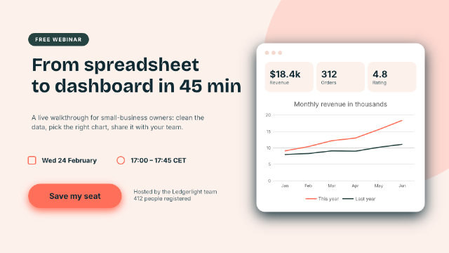</a> 
Slide 
<b><a href="webinar-promo/">Webinar Promo</a></b> 
A free-webinar promo slide in the built-in Coral Reef theme, with a dashboard mock-up and a pulsing Save my seat button. 
<i>1 slide; 960 × 540 pt</i> 
<code>webinar</code> <code>theme</code> <code>animation</code> <code>chart</code> <code>cta</code>
</td>
<td width="33%" valign="top">
<a href="workshop-schedule/">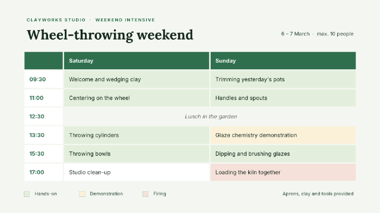</a> 
Slide 
<b><a href="workshop-schedule/">Weekend Workshop Schedule</a></b> 
A two-day ceramics workshop timetable in the Meadow theme, a table with a merged lunch row, shaded session cells and a materials note. 
<i>1 slide; 960 × 540 pt</i> 
<code>table</code> <code>schedule</code> <code>theme</code> <code>event</code>
</td>
</tr>
</table>

## Layouts & Themes

<table>
<tr>
<td width="33%" valign="top">
<a href="all-hands-sections/">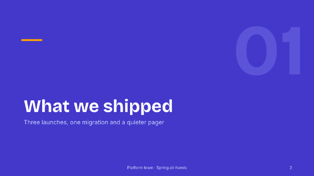</a> 
Slide 
<b><a href="all-hands-sections/">All-Hands with Sections</a></b> 
A team all-hands deck in the built-in Slate theme, organised in three sections with bold Section Header dividers, Two Content and Comparison slides. 
<i>5 slides; 960 × 540 pt</i> 
<code>sections</code> <code>layouts</code> <code>theme</code> <code>placeholders</code>
</td>
<td width="33%" valign="top">
<a href="layout-gallery/">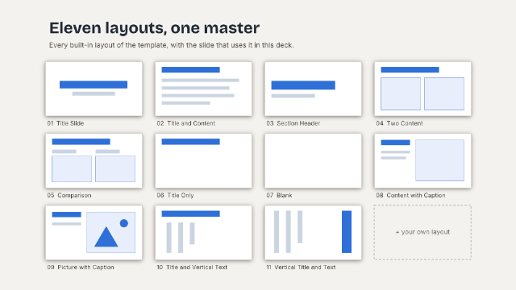</a> 
Slide 
<b><a href="layout-gallery/">Layout Gallery</a></b> 
A template guide whose first slide maps all eleven built-in layouts as wireframes, followed by one real slide in each layout. 
<i>12 slides; 960 × 540 pt</i> 
<code>layouts</code> <code>placeholders</code> <code>wireframes</code> <code>template</code>
</td>
<td width="33%" valign="top">
<a href="statistics-lecture-4x3/">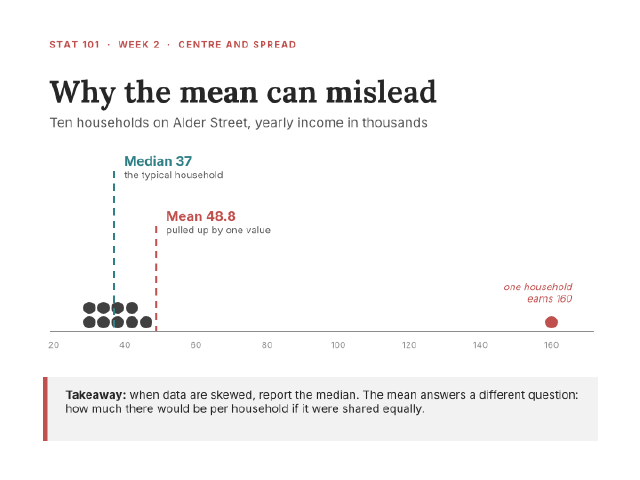</a> 
Slide 
<b><a href="statistics-lecture-4x3/">Statistics Lecture in 4:3</a></b> 
A classic 4:3 lecture slide in the built-in Paper theme, a dot plot of ten incomes showing how one outlier pulls the mean away from the median. 
<i>1 slide; 720 × 540 pt</i> 
<code>slide-size</code> <code>theme</code> <code>lesson</code> <code>diagram</code>
</td>
</tr>
<tr>
<td width="33%" valign="top">
<a href="studio-portfolio-grid/">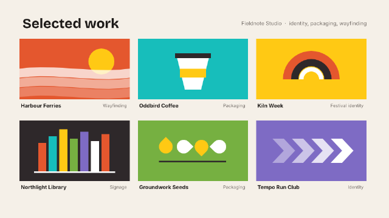</a> 
Slide 
<b><a href="studio-portfolio-grid/">Studio Portfolio Grid</a></b> 
A design studio's selected-work grid in a custom theme colour scheme, six project tiles drawn from shapes in the six accent colours. 
<i>1 slide; 960 × 540 pt</i> 
<code>theme-colors</code> <code>portfolio</code> <code>grid</code> <code>shapes</code>
</td>
<td width="33%"></td>
<td width="33%"></td>
</tr>
</table>

## Pitch Decks

<table>
<tr>
<td width="33%" valign="top">
<a href="before-after-solution/">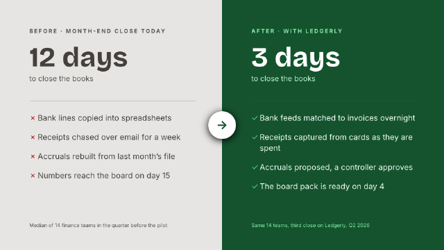</a> 
Slide 
<b><a href="before-after-solution/">Before and After Solution</a></b> 
A split problem-and-solution slide for a finance product, grey "before" against deep green "after", joined by a round arrow badge. 
<i>1 slide; 960 × 540 pt</i> 
<code>pitch-deck</code> <code>comparison</code> <code>bullets</code> <code>shapes</code> <code>split-layout</code>
</td>
<td width="33%" valign="top">
<a href="competitive-landscape-matrix/">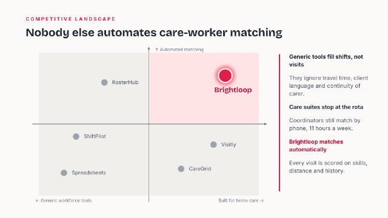</a> 
Slide 
<b><a href="competitive-landscape-matrix/">Competitive Landscape Matrix</a></b> 
A 2×2 positioning map for a home-care scheduling startup, with axis arrows, shaded quadrants and the company's own dot glowing in the top-right corner. 
<i>1 slide; 960 × 540 pt</i> 
<code>pitch-deck</code> <code>matrix</code> <code>shapes</code> <code>freeform</code> <code>glow</code>
</td>
<td width="33%" valign="top">
<a href="seed-pitch-deck/">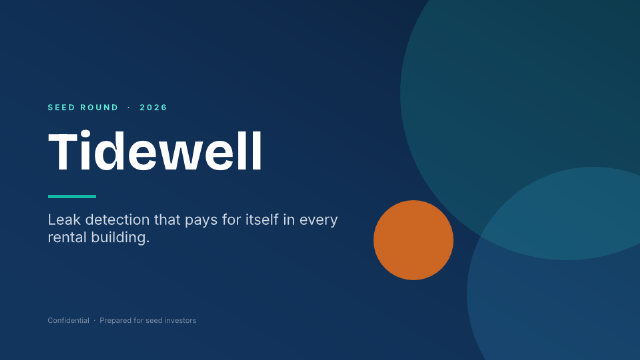</a> 
Slide 
<b><a href="seed-pitch-deck/">Seed Round Pitch Deck</a></b> 
A seven-slide investor deck for a leak-detection startup, from cover and problem to market size, traction, team and the ask. 
<i>7 slides; 960 × 540 pt</i> 
<code>pitch-deck</code> <code>multi-slide</code> <code>chart</code> <code>shapes</code> <code>connectors</code> <code>theme-fonts</code>
</td>
</tr>
<tr>
<td width="33%" valign="top">
<a href="traction-growth-line/">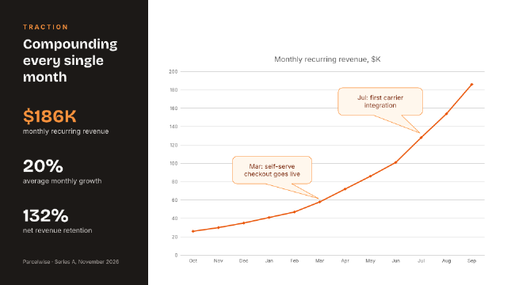</a> 
Slide 
<b><a href="traction-growth-line/">Traction Growth Line</a></b> 
A pitch-deck traction slide with twelve months of recurring revenue as a line with markers, two milestone callouts and the headline numbers in a side rail. 
<i>1 slide; 960 × 540 pt</i> 
<code>pitch-deck</code> <code>chart</code> <code>line</code> <code>callouts</code> <code>kpi</code>
</td>
<td width="33%" valign="top">
<a href="unit-economics-waterfall/">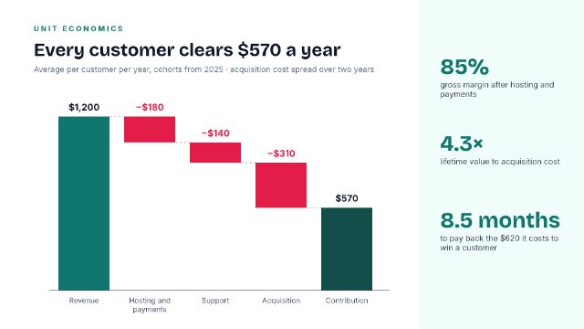</a> 
Slide 
<b><a href="unit-economics-waterfall/">Unit Economics Waterfall</a></b> 
A pitch-deck unit economics slide with a hand-built waterfall from yearly revenue per customer down to contribution, plus margin, LTV/CAC and payback figures. 
<i>1 slide; 960 × 540 pt</i> 
<code>pitch-deck</code> <code>waterfall</code> <code>shapes</code> <code>freeform</code> <code>kpi</code>
</td>
<td width="33%" valign="top">
<a href="why-we-win-radar/">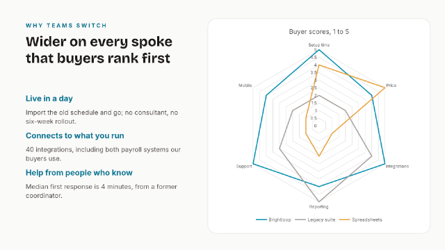</a> 
Slide 
<b><a href="why-we-win-radar/">Why We Win Radar</a></b> 
A pitch-deck comparison slide with a radar chart of the product against a legacy suite and spreadsheets on six buying criteria, beside three reasons teams switch. 
<i>1 slide; 960 × 540 pt</i> 
<code>pitch-deck</code> <code>chart</code> <code>radar</code> <code>theme-colors</code>
</td>
</tr>
</table>

## Tags

`agenda` 1 · `animation` 5 · `annual-report` 1 · `borders` 1 · `budget` 1 · `bullets` 3 · `callouts` 1 · `cell-fill` 3 · `chart` 10 · `chevrons` 1 · `closing` 1 · `comparison` 1 · `connectors` 4 · `cta` 1 · `dark` 2 · `dashboard` 2 · `diagram` 3 · `doughnut` 1 · `event` 4 · `finance` 1 · `flashcards` 1 · `freeform` 7 · `funnel` 1 · `glow` 2 · `gradient` 6 · `grid` 2 · `hierarchy` 1 · `history` 1 · `journey-map` 1 · `kiosk` 1 · `kpi` 6 · `launch` 1 · `layouts` 2 · `legend` 1 · `lesson` 9 · `line` 1 · `marketing` 1 · `matrix` 1 · `menu` 1 · `monospace` 1 · `morph` 1 · `motion-path` 1 · `multi-slide` 1 · `notes` 1 · `numbering` 2 · `okr` 1 · `org-chart` 1 · `percent-bar` 1 · `pitch-deck` 6 · `placeholders` 2 · `portfolio` 1 · `pricing` 1 · `progress-bars` 1 · `project-management` 1 · `pyramid` 1 · `quiz` 1 · `radar` 1 · `rag` 1 · `roadmap` 1 · `schedule` 1 · `sections` 1 · `serif` 2 · `service-design` 1 · `shapes` 20 · `slide-size` 1 · `smartart` 1 · `sparkline` 1 · `speaker` 1 · `split-layout` 1 · `stacked-column` 1 · `status` 1 · `strategy` 1 · `survey` 1 · `swot` 1 · `table` 5 · `template` 1 · `theme` 6 · `theme-colors` 6 · `theme-fonts` 2 · `timeline` 3 · `timing` 1 · `transitions` 2 · `waterfall` 1 · `webinar` 1 · `wireframes` 1 · `wordart` 1
