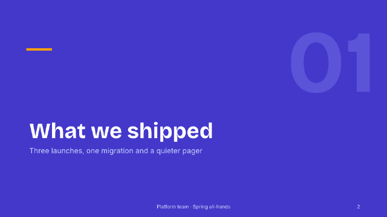

<!-- Generated by tools/gallery.mjs from showcase.yaml and build.json; do not edit. -->
# All-Hands with Sections

[Slide](../README.md) › [Layouts & Themes](../README.md#layouts--themes) · `sections` `layouts` `theme` `placeholders`

A team all-hands deck in the built-in Slate theme, organised in three sections with bold Section Header dividers, Two Content and Comparison slides.



| | |
|---|---|
| Document | [all-hands-sections.pptx](all-hands-sections.pptx) (28 KB) |
| Contents | 5 slides; 960 × 540 pt |
| Features | `slide.slides.sections`, `slide.slides.manage`, `slide.design.themes` |
| Built by | `kition-slide` @ `8309775c19`: 72 commands in 47 ms |

## About

Every slide comes from a layout of the Slate theme and fills its placeholders. The two section
dividers get their own background colour and an oversized number behind the title; sections
named Opening, Shipped and Learned group the slides, and the footer and slide numbers are
turned on for every slide except the title.

## Checks

- `inspect.slides`: `{"count":5}`
- `results.deck.theme`: `"Slate"`
- `results.deck.sections`: `[{"name":"Opening","slides":1},{"name":"Shipped","slides":2},{"name":"Learned","slides":2}]`
- `results.deck.slides.1.layout`: `"Section Header"`
- `results.deck.slides.2.layout`: `"Two Content"`
- `results.deck.slides.4.layout`: `"Comparison"`
- diagnostics: none (the kit's check finds nothing wrong)
- the saved document opens again; the thumbnail matches `thumb.png` within the `render` tolerance

## Steps

<details><summary>72 commands (from <a href="showcase.yaml">showcase.yaml</a>)</summary>

```yaml
- command: design.theme
  params:
    name: Slate
- command: design.fonts
  params:
    major: Bricolage Grotesque
    minor: Inter
- command: slide.inspect
  params:
    index: 0
  as: s0
- command: text.set
  params:
    id: $s0.shapes.0.id
    text: Spring all-hands
- command: text.set
  params:
    id: $s0.shapes.1.id
    text: Platform team  ·  shipped, learned, next
- command: format.bold
  params:
    ids:
      - $s0.shapes.0.id
    on: true
- command: slide.new
  params:
    layout: sectionHeader
- command: slide.inspect
  params:
    index: 1
  as: s1
- command: design.background
  params:
    color: "#4338CA"
- command: text.set
  params:
    id: $s1.shapes.0.id
    text: What we shipped
- command: text.set
  params:
    id: $s1.shapes.1.id
    text: Three launches, one migration and a quieter pager
- command: format.bold
  params:
    ids:
      - $s1.shapes.0.id
    on: true
- command: format.size
  params:
    ids:
      - $s1.shapes.0.id
    size: 54
- command: format.color
  params:
    ids:
      - $s1.shapes.0.id
    color: "#ffffff"
- command: format.color
  params:
    ids:
      - $s1.shapes.1.id
    color: "#c7d2fe"
- command: format.size
  params:
    ids:
      - $s1.shapes.1.id
    size: 18
- command: insert.textBox
  params:
    rect:
      - 560
      - 20
      - 380
      - 300
    text: "01"
  as: n1
- command: format.font
  params:
    ids:
      - $n1.id
    family: Bricolage Grotesque
- command: format.size
  params:
    ids:
      - $n1.id
    size: 220
- command: format.bold
  params:
    ids:
      - $n1.id
- command: format.align
  params:
    ids:
      - $n1.id
    align: right
- command: format.color
  params:
    ids:
      - $n1.id
    color: "#5b54d9"
- command: arrange.sendToBack
  params:
    ids:
      - $n1.id
- command: shape.insert
  params:
    preset: rect
    rect:
      - 65
      - 120
      - 64
      - 6
  as: bar1
- command: shape.fill
  params:
    ids:
      - $bar1.id
    color: "#F59E0B"
- command: shape.line
  params:
    ids:
      - $bar1.id
    none: true
- command: slide.new
  params:
    layout: twoContent
- command: slide.inspect
  params:
    index: 2
  as: s2
- command: text.set
  params:
    id: $s2.shapes.0.id
    text: Launches this quarter
- command: text.set
  params:
    id: $s2.shapes.1.id
    text: |-
      Self-serve workspaces
      Usage-based billing
      Audit log export
- command: text.set
  params:
    id: $s2.shapes.2.id
    text: |-
      Database moved to the new cluster
      Pages per week down from 31 to 9
      Build time halved
- command: format.bold
  params:
    ids:
      - $s2.shapes.0.id
    on: true
- command: slide.new
  params:
    layout: sectionHeader
- command: slide.inspect
  params:
    index: 3
  as: s3
- command: design.background
  params:
    color: "#0F766E"
- command: text.set
  params:
    id: $s3.shapes.0.id
    text: What we learned
- command: text.set
  params:
    id: $s3.shapes.1.id
    text: Notes from four retrospectives
- command: format.bold
  params:
    ids:
      - $s3.shapes.0.id
    on: true
- command: format.size
  params:
    ids:
      - $s3.shapes.0.id
    size: 54
- command: format.color
  params:
    ids:
      - $s3.shapes.0.id
    color: "#ffffff"
- command: format.color
  params:
    ids:
      - $s3.shapes.1.id
    color: "#c7d2fe"
- command: format.size
  params:
    ids:
      - $s3.shapes.1.id
    size: 18
- command: insert.textBox
  params:
    rect:
      - 560
      - 20
      - 380
      - 300
    text: "02"
  as: n3
- command: format.font
  params:
    ids:
      - $n3.id
    family: Bricolage Grotesque
- command: format.size
  params:
    ids:
      - $n3.id
    size: 220
- command: format.bold
  params:
    ids:
      - $n3.id
- command: format.align
  params:
    ids:
      - $n3.id
    align: right
- command: format.color
  params:
    ids:
      - $n3.id
    color: "#2a8a82"
- command: arrange.sendToBack
  params:
    ids:
      - $n3.id
- command: shape.insert
  params:
    preset: rect
    rect:
      - 65
      - 120
      - 64
      - 6
  as: bar3
- command: shape.fill
  params:
    ids:
      - $bar3.id
    color: "#F59E0B"
- command: shape.line
  params:
    ids:
      - $bar3.id
    none: true
- command: slide.new
  params:
    layout: comparison
- command: slide.inspect
  params:
    index: 4
  as: s4
- command: text.set
  params:
    id: $s4.shapes.0.id
    text: Keep doing, stop doing
- command: text.set
  params:
    id: $s4.shapes.1.id
    text: Keep
- command: text.set
  params:
    id: $s4.shapes.2.id
    text: |-
      Small pull requests
      Demo on Fridays
      Writing the rollback plan first
- command: text.set
  params:
    id: $s4.shapes.3.id
    text: Stop
- command: text.set
  params:
    id: $s4.shapes.4.id
    text: |-
      Friday-evening deploys
      Meetings without an agenda
      Alerts nobody acts on
- command: format.bold
  params:
    ids:
      - $s4.shapes.0.id
    on: true
- command: format.color
  params:
    ids:
      - $s4.shapes.1.id
    color: accent3
- command: format.color
  params:
    ids:
      - $s4.shapes.3.id
    color: accent5
- command: section.add
  params:
    name: Opening
    at: 0
- command: section.add
  params:
    name: Shipped
    at: 1
- command: section.add
  params:
    name: Learned
    at: 3
- command: design.headerFooter
  params:
    slideNumber: true
    footer: true
    footerText: Platform team · Spring all-hands
    hideOnTitle: true
    all: true
- command: slide.inspect
  params:
    index: 1
  as: f1
- command: format.color
  params:
    ids:
      - $f1.shapes.4.id
      - $f1.shapes.5.id
    color: "#e0e7ff"
    onSlide: 2
- command: slide.inspect
  params:
    index: 3
  as: f3
- command: format.color
  params:
    ids:
      - $f3.shapes.4.id
      - $f3.shapes.5.id
    color: "#e0e7ff"
    onSlide: 4
- command: slide.go
  params:
    index: 1
- command: document.inspect
  params: {}
  as: deck
```

</details>
