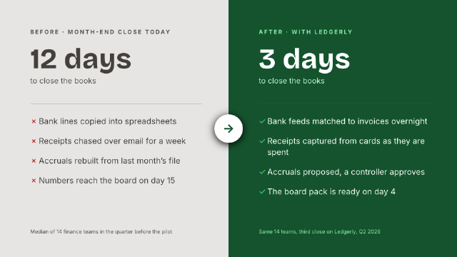

<!-- Generated by tools/gallery.mjs from showcase.yaml and build.json; do not edit. -->
# Before and After Solution

[Slide](../README.md) › [Pitch Decks](../README.md#pitch-decks) · `pitch-deck` `comparison` `bullets` `shapes` `split-layout`

A split problem-and-solution slide for a finance product, grey "before" against deep green "after", joined by a round arrow badge.



| | |
|---|---|
| Document | [before-after-solution.pptx](before-after-solution.pptx) (23 KB) |
| Contents | 1 slide; 960 × 540 pt |
| Features | `slide.shapes.edit`, `slide.format.paragraph`, `slide.format.character` |
| Built by | `kition-slide` @ `8309775c19`: 58 commands in 70 ms |

## About

Two full-height panels tell the story in one look: the left is the month-end close today, in
greys with cross bullets; the right is the close with the product, in deep green with check
bullets. The big number at the top of each side is the comparison; a white circle with an arrow
sits on the seam.

## Checks

- `inspect.slides`: `{"count":1}`
- `results.slide.shapes`: `{"count":13,"any":{"preset":"ellipse","text":"→"}}`
- `results.slide.design`: `{"none":{"code":"design.low-contrast"}}`
- diagnostics: none (the kit's check finds nothing wrong)
- the saved document opens again; the thumbnail matches `thumb.png` within the `render` tolerance

## Steps

<details><summary>58 commands (from <a href="showcase.yaml">showcase.yaml</a>)</summary>

```yaml
- command: design.fonts
  params:
    major: Bricolage Grotesque
    minor: Inter
- command: slide.layout
  params:
    layout: blank
    index: 0
- command: shape.insert
  params:
    preset: rect
    rect:
      - 0
      - 0
      - 480
      - 540
  as: left
- command: shape.insert
  params:
    preset: rect
    rect:
      - 480
      - 0
      - 480
      - 540
  as: right
- command: shape.fill
  params:
    ids:
      - $left.id
    color: "#e7e5e4"
- command: shape.fill
  params:
    ids:
      - $right.id
    color: "#14532d"
- command: shape.line
  params:
    ids:
      - $left.id
      - $right.id
    none: true
- command: insert.textBox
  params:
    rect:
      - 56
      - 56
      - 380
      - 22
    text: BEFORE · MONTH-END CLOSE TODAY
  as: le
- command: insert.textBox
  params:
    rect:
      - 536
      - 56
      - 380
      - 22
    text: AFTER · WITH LEDGERLY
  as: re
- command: format.size
  params:
    ids:
      - $le.id
      - $re.id
    size: 12
- command: format.bold
  params:
    ids:
      - $le.id
      - $re.id
- command: format.spacing
  params:
    ids:
      - $le.id
      - $re.id
    pt: 2.5
- command: format.color
  params:
    ids:
      - $le.id
    color: "#57534e"
- command: format.color
  params:
    ids:
      - $re.id
    color: "#86efac"
- command: insert.textBox
  params:
    rect:
      - 56
      - 84
      - 380
      - 110
    text: |-
      12 days
      to close the books
  as: ln
- command: insert.textBox
  params:
    rect:
      - 536
      - 84
      - 380
      - 110
    text: |-
      3 days
      to close the books
  as: rn
- command: format.size
  params:
    ids:
      - $ln.id
      - $rn.id
    size: 16
- command: format.color
  params:
    ids:
      - $ln.id
    color: "#57534e"
- command: format.color
  params:
    ids:
      - $rn.id
    color: "#bbf7d0"
- command: text.edit
  params:
    id: $ln.id
    at:
      - 0
      - 0
- command: text.selectParagraph
  params:
    at:
      - 0
      - 0
- command: format.size
  params:
    size: 60
- command: format.bold
  params: {}
- command: format.font
  params:
    family: Bricolage Grotesque
- command: format.color
  params:
    color: "#44403c"
- command: text.edit
  params:
    id: $rn.id
    at:
      - 0
      - 0
- command: text.selectParagraph
  params:
    at:
      - 0
      - 0
- command: format.size
  params:
    size: 60
- command: format.bold
  params: {}
- command: format.font
  params:
    family: Bricolage Grotesque
- command: format.color
  params:
    color: "#ffffff"
- command: text.exit
  params: {}
- command: shape.freeform
  params:
    points:
      - - 64
        - 218
      - - 424
        - 218
  as: lr
- command: shape.freeform
  params:
    points:
      - - 544
        - 218
      - - 904
        - 218
  as: rr
- command: shape.line
  params:
    ids:
      - $lr.id
    color: "#a8a29e"
    width: 1
- command: shape.line
  params:
    ids:
      - $rr.id
    color: "#166534"
    width: 1
- command: insert.textBox
  params:
    rect:
      - 56
      - 238
      - 380
      - 260
    text: |-
      Bank lines copied into spreadsheets
      Receipts chased over email for a week
      Accruals rebuilt from last month’s file
      Numbers reach the board on day 15
  as: lb
- command: insert.textBox
  params:
    rect:
      - 536
      - 238
      - 380
      - 260
    text: |-
      Bank feeds matched to invoices overnight
      Receipts captured from cards as they are spent
      Accruals proposed, a controller approves
      The board pack is ready on day 4
  as: rb
- command: format.size
  params:
    ids:
      - $lb.id
      - $rb.id
    size: 17
- command: format.paragraph
  params:
    ids:
      - $lb.id
      - $rb.id
    spaceAfter: 18
    lineSpacing: 1.15
- command: format.color
  params:
    ids:
      - $lb.id
    color: "#44403c"
- command: format.color
  params:
    ids:
      - $rb.id
    color: "#f0fdf4"
- command: format.bullets
  params:
    ids:
      - $lb.id
    char: ✗
    color: "#b91c1c"
- command: format.bullets
  params:
    ids:
      - $rb.id
    char: ✓
    color: "#4ade80"
- command: shape.insert
  params:
    preset: ellipse
    rect:
      - 450
      - 240
      - 60
      - 60
    text: →
  as: badge
- command: shape.fill
  params:
    ids:
      - $badge.id
    color: "#ffffff"
- command: shape.line
  params:
    ids:
      - $badge.id
    none: true
- command: shape.effects
  params:
    ids:
      - $badge.id
    shadow:
      color: "#000000"
      blur: 16
      dist: 3
      dir: 90
- command: format.size
  params:
    ids:
      - $badge.id
    size: 26
- command: format.bold
  params:
    ids:
      - $badge.id
- command: format.color
  params:
    ids:
      - $badge.id
    color: "#14532d"
- command: format.margins
  params:
    ids:
      - $badge.id
    left: 0
    right: 0
    top: 0
    bottom: 2
- command: insert.textBox
  params:
    rect:
      - 56
      - 476
      - 380
      - 22
    text: Median of 14 finance teams in the quarter before the pilot
  as: lf
- command: insert.textBox
  params:
    rect:
      - 536
      - 476
      - 380
      - 22
    text: Same 14 teams, third close on Ledgerly, Q2 2026
  as: rf
- command: format.size
  params:
    ids:
      - $lf.id
      - $rf.id
    size: 11
- command: format.color
  params:
    ids:
      - $lf.id
    color: "#57534e"
- command: format.color
  params:
    ids:
      - $rf.id
    color: "#86efac"
- command: slide.inspect
  params:
    index: 0
  as: slide
```

</details>
