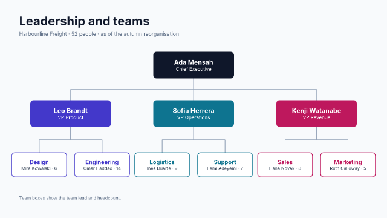

<!-- Generated by tools/gallery.mjs from showcase.yaml and build.json; do not edit. -->
# Company Org Chart

[Slide](../README.md) › [Business Reports](../README.md#business-reports) · `org-chart` `connectors` `shapes` `hierarchy`

A three-level organisation chart, with a chief executive, three department heads and six teams, joined by elbow lines drawn as freeform paths.



| | |
|---|---|
| Document | [company-org-chart.pptx](company-org-chart.pptx) (23 KB) |
| Contents | 1 slide; 960 × 540 pt |
| Features | `slide.shapes.edit`, `slide.drawing.objects`, `slide.text.edit` |
| Built by | `kition-slide` @ `8309775c19`: 131 commands in 84 ms |

## About

Every box is a rounded rectangle with a bold name over a smaller role, and every line is a
four-point freeform path that drops from the parent, runs along a shared rail and drops into
the child. Each department keeps one colour from its head down to its teams.

## Checks

- `inspect.slides`: `{"count":1}`
- `results.slide.shapes`: `{"count":22}`
- `results.link.shape.geom`: `{"kind":"custom"}`
- `results.slide.design`: `{"none":{"code":"design.low-contrast"}}`
- diagnostics: none (the kit's check finds nothing wrong)
- the saved document opens again; the thumbnail matches `thumb.png` within the `render` tolerance

## Steps

<details><summary>131 commands (from <a href="showcase.yaml">showcase.yaml</a>)</summary>

```yaml
- command: slide.layout
  params:
    layout: blank
    index: 0
- command: design.background
  params:
    color: "#f8fafc"
- command: insert.textBox
  params:
    rect:
      - 40
      - 30
      - 600
      - 46
    text: Leadership and teams
  as: title
- command: format.size
  params:
    ids:
      - $title.id
    size: 30
- command: format.bold
  params:
    ids:
      - $title.id
- command: format.color
  params:
    ids:
      - $title.id
    color: "#0f172a"
- command: insert.textBox
  params:
    rect:
      - 40
      - 72
      - 600
      - 26
    text: Harbourline Freight · 52 people · as of the autumn reorganisation
  as: lede
- command: format.size
  params:
    ids:
      - $lede.id
    size: 13
- command: format.color
  params:
    ids:
      - $lede.id
    color: "#64748b"
- command: shape.insert
  params:
    preset: roundRect
    rect:
      - 380
      - 128
      - 200
      - 66
    text: |-
      Ada Mensah
      Chief Executive
    adj:
      - 12000
  as: ceo
- command: shape.fill
  params:
    ids:
      - $ceo.id
    color: "#0f172a"
- command: shape.line
  params:
    ids:
      - $ceo.id
    none: true
- command: format.color
  params:
    ids:
      - $ceo.id
    color: "#ffffff"
- command: format.size
  params:
    ids:
      - $ceo.id
    size: 12
- command: text.edit
  params:
    id: $ceo.id
    at:
      - 0
      - 0
- command: text.selectParagraph
  params:
    at:
      - 0
      - 0
- command: format.size
  params:
    size: 16
- command: format.bold
  params: {}
- command: text.exit
  params: {}
- command: shape.insert
  params:
    preset: roundRect
    rect:
      - 75
      - 248
      - 200
      - 66
    text: |-
      Leo Brandt
      VP Product
    adj:
      - 12000
  as: vp1
- command: shape.fill
  params:
    ids:
      - $vp1.id
    color: "#4338ca"
- command: shape.line
  params:
    ids:
      - $vp1.id
    none: true
- command: format.color
  params:
    ids:
      - $vp1.id
    color: "#ffffff"
- command: format.size
  params:
    ids:
      - $vp1.id
    size: 12
- command: text.edit
  params:
    id: $vp1.id
    at:
      - 0
      - 0
- command: text.selectParagraph
  params:
    at:
      - 0
      - 0
- command: format.size
  params:
    size: 16
- command: format.bold
  params: {}
- command: text.exit
  params: {}
- command: shape.insert
  params:
    preset: roundRect
    rect:
      - 380
      - 248
      - 200
      - 66
    text: |-
      Sofia Herrera
      VP Operations
    adj:
      - 12000
  as: vp2
- command: shape.fill
  params:
    ids:
      - $vp2.id
    color: "#0e7490"
- command: shape.line
  params:
    ids:
      - $vp2.id
    none: true
- command: format.color
  params:
    ids:
      - $vp2.id
    color: "#ffffff"
- command: format.size
  params:
    ids:
      - $vp2.id
    size: 12
- command: text.edit
  params:
    id: $vp2.id
    at:
      - 0
      - 0
- command: text.selectParagraph
  params:
    at:
      - 0
      - 0
- command: format.size
  params:
    size: 16
- command: format.bold
  params: {}
- command: text.exit
  params: {}
- command: shape.insert
  params:
    preset: roundRect
    rect:
      - 685
      - 248
      - 200
      - 66
    text: |-
      Kenji Watanabe
      VP Revenue
    adj:
      - 12000
  as: vp3
- command: shape.fill
  params:
    ids:
      - $vp3.id
    color: "#be185d"
- command: shape.line
  params:
    ids:
      - $vp3.id
    none: true
- command: format.color
  params:
    ids:
      - $vp3.id
    color: "#ffffff"
- command: format.size
  params:
    ids:
      - $vp3.id
    size: 12
- command: text.edit
  params:
    id: $vp3.id
    at:
      - 0
      - 0
- command: text.selectParagraph
  params:
    at:
      - 0
      - 0
- command: format.size
  params:
    size: 16
- command: format.bold
  params: {}
- command: text.exit
  params: {}
- command: shape.insert
  params:
    preset: roundRect
    rect:
      - 29
      - 378
      - 136
      - 60
    text: |-
      Design
      Mira Kowalski · 6
    adj:
      - 12000
  as: t11
- command: shape.fill
  params:
    ids:
      - $t11.id
    color: "#ffffff"
- command: shape.line
  params:
    ids:
      - $t11.id
    color: "#4338ca"
    width: 1.5
- command: format.color
  params:
    ids:
      - $t11.id
    color: "#334155"
- command: format.size
  params:
    ids:
      - $t11.id
    size: 11
- command: text.edit
  params:
    id: $t11.id
    at:
      - 0
      - 0
- command: text.selectParagraph
  params:
    at:
      - 0
      - 0
- command: format.size
  params:
    size: 14
- command: format.bold
  params: {}
- command: format.color
  params:
    color: "#4338ca"
- command: text.exit
  params: {}
- command: shape.insert
  params:
    preset: roundRect
    rect:
      - 185
      - 378
      - 136
      - 60
    text: |-
      Engineering
      Omar Haddad · 14
    adj:
      - 12000
  as: t12
- command: shape.fill
  params:
    ids:
      - $t12.id
    color: "#ffffff"
- command: shape.line
  params:
    ids:
      - $t12.id
    color: "#4338ca"
    width: 1.5
- command: format.color
  params:
    ids:
      - $t12.id
    color: "#334155"
- command: format.size
  params:
    ids:
      - $t12.id
    size: 11
- command: text.edit
  params:
    id: $t12.id
    at:
      - 0
      - 0
- command: text.selectParagraph
  params:
    at:
      - 0
      - 0
- command: format.size
  params:
    size: 14
- command: format.bold
  params: {}
- command: format.color
  params:
    color: "#4338ca"
- command: text.exit
  params: {}
- command: shape.insert
  params:
    preset: roundRect
    rect:
      - 334
      - 378
      - 136
      - 60
    text: |-
      Logistics
      Ines Duarte · 9
    adj:
      - 12000
  as: t21
- command: shape.fill
  params:
    ids:
      - $t21.id
    color: "#ffffff"
- command: shape.line
  params:
    ids:
      - $t21.id
    color: "#0e7490"
    width: 1.5
- command: format.color
  params:
    ids:
      - $t21.id
    color: "#334155"
- command: format.size
  params:
    ids:
      - $t21.id
    size: 11
- command: text.edit
  params:
    id: $t21.id
    at:
      - 0
      - 0
- command: text.selectParagraph
  params:
    at:
      - 0
      - 0
- command: format.size
  params:
    size: 14
- command: format.bold
  params: {}
- command: format.color
  params:
    color: "#0e7490"
- command: text.exit
  params: {}
- command: shape.insert
  params:
    preset: roundRect
    rect:
      - 490
      - 378
      - 136
      - 60
    text: |-
      Support
      Femi Adeyemi · 7
    adj:
      - 12000
  as: t22
- command: shape.fill
  params:
    ids:
      - $t22.id
    color: "#ffffff"
- command: shape.line
  params:
    ids:
      - $t22.id
    color: "#0e7490"
    width: 1.5
- command: format.color
  params:
    ids:
      - $t22.id
    color: "#334155"
- command: format.size
  params:
    ids:
      - $t22.id
    size: 11
- command: text.edit
  params:
    id: $t22.id
    at:
      - 0
      - 0
- command: text.selectParagraph
  params:
    at:
      - 0
      - 0
- command: format.size
  params:
    size: 14
- command: format.bold
  params: {}
- command: format.color
  params:
    color: "#0e7490"
- command: text.exit
  params: {}
- command: shape.insert
  params:
    preset: roundRect
    rect:
      - 639
      - 378
      - 136
      - 60
    text: |-
      Sales
      Hana Novak · 8
    adj:
      - 12000
  as: t31
- command: shape.fill
  params:
    ids:
      - $t31.id
    color: "#ffffff"
- command: shape.line
  params:
    ids:
      - $t31.id
    color: "#be185d"
    width: 1.5
- command: format.color
  params:
    ids:
      - $t31.id
    color: "#334155"
- command: format.size
  params:
    ids:
      - $t31.id
    size: 11
- command: text.edit
  params:
    id: $t31.id
    at:
      - 0
      - 0
- command: text.selectParagraph
  params:
    at:
      - 0
      - 0
- command: format.size
  params:
    size: 14
- command: format.bold
  params: {}
- command: format.color
  params:
    color: "#be185d"
- command: text.exit
  params: {}
- command: shape.insert
  params:
    preset: roundRect
    rect:
      - 795
      - 378
      - 136
      - 60
    text: |-
      Marketing
      Ruth Calloway · 5
    adj:
      - 12000
  as: t32
- command: shape.fill
  params:
    ids:
      - $t32.id
    color: "#ffffff"
- command: shape.line
  params:
    ids:
      - $t32.id
    color: "#be185d"
    width: 1.5
- command: format.color
  params:
    ids:
      - $t32.id
    color: "#334155"
- command: format.size
  params:
    ids:
      - $t32.id
    size: 11
- command: text.edit
  params:
    id: $t32.id
    at:
      - 0
      - 0
- command: text.selectParagraph
  params:
    at:
      - 0
      - 0
- command: format.size
  params:
    size: 14
- command: format.bold
  params: {}
- command: format.color
  params:
    color: "#be185d"
- command: text.exit
  params: {}
- command: shape.freeform
  params:
    points:
      - - 480
        - 194
      - - 480
        - 221
      - - 175
        - 221
      - - 175
        - 248
  as: c_vp1
- command: shape.freeform
  params:
    points:
      - - 480
        - 194
      - - 480
        - 221
      - - 480
        - 221
      - - 480
        - 248
  as: c_vp2
- command: shape.freeform
  params:
    points:
      - - 480
        - 194
      - - 480
        - 221
      - - 785
        - 221
      - - 785
        - 248
  as: c_vp3
- command: shape.freeform
  params:
    points:
      - - 175
        - 314
      - - 175
        - 346
      - - 97
        - 346
      - - 97
        - 378
  as: c_t11
- command: shape.freeform
  params:
    points:
      - - 175
        - 314
      - - 175
        - 346
      - - 253
        - 346
      - - 253
        - 378
  as: c_t12
- command: shape.freeform
  params:
    points:
      - - 480
        - 314
      - - 480
        - 346
      - - 402
        - 346
      - - 402
        - 378
  as: c_t21
- command: shape.freeform
  params:
    points:
      - - 480
        - 314
      - - 480
        - 346
      - - 558
        - 346
      - - 558
        - 378
  as: c_t22
- command: shape.freeform
  params:
    points:
      - - 785
        - 314
      - - 785
        - 346
      - - 707
        - 346
      - - 707
        - 378
  as: c_t31
- command: shape.freeform
  params:
    points:
      - - 785
        - 314
      - - 785
        - 346
      - - 863
        - 346
      - - 863
        - 378
  as: c_t32
- command: shape.line
  params:
    ids:
      - $c_vp1.id
      - $c_vp2.id
      - $c_vp3.id
      - $c_t11.id
      - $c_t12.id
      - $c_t21.id
      - $c_t22.id
      - $c_t31.id
      - $c_t32.id
    color: "#94a3b8"
    width: 1.5
    join: round
- command: arrange.sendToBack
  params:
    ids:
      - $c_vp1.id
      - $c_vp2.id
      - $c_vp3.id
      - $c_t11.id
      - $c_t12.id
      - $c_t21.id
      - $c_t22.id
      - $c_t31.id
      - $c_t32.id
- command: insert.textBox
  params:
    rect:
      - 40
      - 480
      - 880
      - 24
    text: Team boxes show the team lead and headcount.
  as: foot
- command: format.size
  params:
    ids:
      - $foot.id
    size: 11
- command: format.color
  params:
    ids:
      - $foot.id
    color: "#64748b"
- command: shape.inspect
  params:
    id: $c_t32.id
  as: link
- command: slide.inspect
  params:
    index: 0
  as: slide
```

</details>
