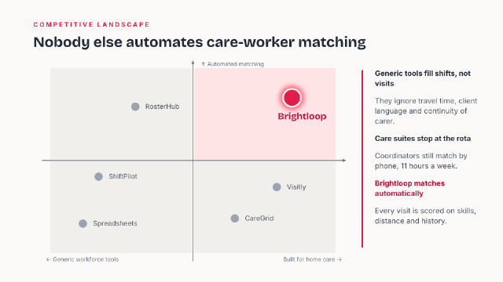

<!-- Generated by tools/gallery.mjs from showcase.yaml and build.json; do not edit. -->
# Competitive Landscape Matrix

[Slide](../README.md) › [Pitch Decks](../README.md#pitch-decks) · `pitch-deck` `matrix` `shapes` `freeform` `glow`

A 2×2 positioning map for a home-care scheduling startup, with axis arrows, shaded quadrants and the company's own dot glowing in the top-right corner.



| | |
|---|---|
| Document | [competitive-landscape-matrix.pptx](competitive-landscape-matrix.pptx) (23 KB) |
| Contents | 1 slide; 960 × 540 pt |
| Features | `slide.shapes.edit`, `slide.drawing.objects`, `slide.format.character` |
| Built by | `kition-slide` @ `8309775c19`: 73 commands in 113 ms |

## About

The classic competition slide: two axes drawn as freeform lines with arrowheads, four tinted
quadrants, competitors as small labelled dots and the company as a larger dot with a soft glow.
A narrow column on the right says what the map means.

## Checks

- `inspect.slides`: `{"count":1}`
- `results.slide.shapes`: `{"count":25,"any":{"name":{"matches":"^Freeform"}}}`
- `results.slide.design`: `{"none":{"code":"design.low-contrast"}}`
- `results.dot.shape.effects.glow.radius`: `12`
- diagnostics: none (the kit's check finds nothing wrong)
- the saved document opens again; the thumbnail matches `thumb.png` within the `render` tolerance

## Steps

<details><summary>73 commands (from <a href="showcase.yaml">showcase.yaml</a>)</summary>

```yaml
- command: design.fonts
  params:
    major: Bricolage Grotesque
    minor: Inter
- command: slide.layout
  params:
    layout: blank
    index: 0
- command: design.background
  params:
    color: "#fbfaf8"
- command: insert.textBox
  params:
    rect:
      - 56
      - 36
      - 600
      - 22
    text: COMPETITIVE LANDSCAPE
  as: eyebrow
- command: format.size
  params:
    ids:
      - $eyebrow.id
    size: 12
- command: format.bold
  params:
    ids:
      - $eyebrow.id
- command: format.spacing
  params:
    ids:
      - $eyebrow.id
    pt: 3
- command: format.color
  params:
    ids:
      - $eyebrow.id
    color: "#e11d48"
- command: insert.textBox
  params:
    rect:
      - 56
      - 60
      - 860
      - 50
    text: Nobody else automates care-worker matching
  as: title
- command: format.font
  params:
    ids:
      - $title.id
    family: Bricolage Grotesque
- command: format.size
  params:
    ids:
      - $title.id
    size: 28
- command: format.bold
  params:
    ids:
      - $title.id
- command: format.color
  params:
    ids:
      - $title.id
    color: "#1f2937"
- command: shape.insert
  params:
    preset: rect
    rect:
      - 96
      - 130
      - 270
      - 175
  as: q1
- command: shape.insert
  params:
    preset: rect
    rect:
      - 370
      - 130
      - 270
      - 175
  as: q2
- command: shape.insert
  params:
    preset: rect
    rect:
      - 96
      - 309
      - 270
      - 175
  as: q3
- command: shape.insert
  params:
    preset: rect
    rect:
      - 370
      - 309
      - 270
      - 175
  as: q4
- command: shape.fill
  params:
    ids:
      - $q1.id
      - $q3.id
      - $q4.id
    color: "#f1efeb"
- command: shape.fill
  params:
    ids:
      - $q2.id
    color: "#ffe4e6"
- command: shape.line
  params:
    ids:
      - $q1.id
      - $q2.id
      - $q3.id
      - $q4.id
    none: true
- command: shape.freeform
  params:
    points:
      - - 80
        - 307
      - - 660
        - 307
  as: xaxis
- command: shape.freeform
  params:
    points:
      - - 368
        - 500
      - - 368
        - 116
  as: yaxis
- command: shape.line
  params:
    ids:
      - $xaxis.id
      - $yaxis.id
    color: "#6b7280"
    width: 1.5
    tail: triangle
- command: insert.textBox
  params:
    rect:
      - 470
      - 486
      - 190
      - 20
    text: Built for home care →
  as: xl
- command: insert.textBox
  params:
    rect:
      - 80
      - 486
      - 190
      - 20
    text: ← Generic workforce tools
  as: xl2
- command: insert.textBox
  params:
    rect:
      - 376
      - 112
      - 180
      - 20
    text: ↑ Automated matching
  as: yl
- command: format.size
  params:
    ids:
      - $xl.id
      - $xl2.id
      - $yl.id
    size: 11
- command: format.color
  params:
    ids:
      - $xl.id
      - $xl2.id
      - $yl.id
    color: "#6b7280"
- command: format.align
  params:
    ids:
      - $xl.id
    align: right
- command: shape.insert
  params:
    preset: ellipse
    rect:
      - 150
      - 420
      - 16
      - 16
  as: d1
- command: shape.insert
  params:
    preset: ellipse
    rect:
      - 250
      - 196
      - 16
      - 16
  as: d2
- command: shape.insert
  params:
    preset: ellipse
    rect:
      - 440
      - 410
      - 16
      - 16
  as: d3
- command: shape.insert
  params:
    preset: ellipse
    rect:
      - 520
      - 350
      - 16
      - 16
  as: d4
- command: shape.insert
  params:
    preset: ellipse
    rect:
      - 180
      - 330
      - 16
      - 16
  as: d5
- command: shape.fill
  params:
    ids:
      - $d1.id
      - $d2.id
      - $d3.id
      - $d4.id
      - $d5.id
    color: "#9ca3af"
- command: shape.line
  params:
    ids:
      - $d1.id
      - $d2.id
      - $d3.id
      - $d4.id
      - $d5.id
    none: true
- command: insert.textBox
  params:
    rect:
      - 170
      - 416
      - 150
      - 24
    text: Spreadsheets
  as: l1
- command: insert.textBox
  params:
    rect:
      - 270
      - 192
      - 150
      - 24
    text: RosterHub
  as: l2
- command: insert.textBox
  params:
    rect:
      - 460
      - 406
      - 150
      - 24
    text: CareGrid
  as: l3
- command: insert.textBox
  params:
    rect:
      - 540
      - 346
      - 100
      - 24
    text: Visitly
  as: l4
- command: insert.textBox
  params:
    rect:
      - 200
      - 326
      - 150
      - 24
    text: ShiftPilot
  as: l5
- command: format.size
  params:
    ids:
      - $l1.id
      - $l2.id
      - $l3.id
      - $l4.id
      - $l5.id
    size: 13
- command: format.color
  params:
    ids:
      - $l1.id
      - $l2.id
      - $l3.id
      - $l4.id
      - $l5.id
    color: "#4b5563"
- command: shape.insert
  params:
    preset: ellipse
    rect:
      - 540
      - 170
      - 34
      - 34
  as: us
- command: shape.fill
  params:
    ids:
      - $us.id
    color: "#e11d48"
- command: shape.line
  params:
    ids:
      - $us.id
    color: "#ffffff"
    width: 3
- command: shape.effects
  params:
    ids:
      - $us.id
    glow:
      color: "#fb7185"
      radius: 12
- command: insert.textBox
  params:
    rect:
      - 460
      - 208
      - 170
      - 30
    text: Brightloop
  as: usl
- command: format.font
  params:
    ids:
      - $usl.id
    family: Bricolage Grotesque
- command: format.size
  params:
    ids:
      - $usl.id
    size: 18
- command: format.bold
  params:
    ids:
      - $usl.id
- command: format.color
  params:
    ids:
      - $usl.id
    color: "#be123c"
- command: format.align
  params:
    ids:
      - $usl.id
    align: right
- command: shape.insert
  params:
    preset: rect
    rect:
      - 690
      - 134
      - 3
      - 340
  as: bar
- command: shape.fill
  params:
    ids:
      - $bar.id
    color: "#e11d48"
- command: shape.line
  params:
    ids:
      - $bar.id
    none: true
- command: insert.textBox
  params:
    rect:
      - 708
      - 126
      - 220
      - 360
    text: |-
      Generic tools fill shifts, not visits
      They ignore travel time, client language and continuity of carer.
      Care suites stop at the rota
      Coordinators still match by phone, 11 hours a week.
      Brightloop matches automatically
      Every visit is scored on skills, distance and history.
  as: notes
- command: format.size
  params:
    ids:
      - $notes.id
    size: 14
- command: format.color
  params:
    ids:
      - $notes.id
    color: "#4b5563"
- command: format.paragraph
  params:
    ids:
      - $notes.id
    spaceAfter: 14
    lineSpacing: 1.15
- command: text.edit
  params:
    id: $notes.id
    at:
      - 0
      - 0
- command: text.selectParagraph
  params:
    at:
      - 0
      - 0
- command: format.bold
  params: {}
- command: format.color
  params:
    color: "#1f2937"
- command: text.selectParagraph
  params:
    at:
      - 2
      - 0
- command: format.bold
  params: {}
- command: format.color
  params:
    color: "#1f2937"
- command: text.selectParagraph
  params:
    at:
      - 4
      - 0
- command: format.bold
  params: {}
- command: format.color
  params:
    color: "#be123c"
- command: text.exit
  params: {}
- command: shape.inspect
  params:
    id: $us.id
  as: dot
- command: slide.inspect
  params:
    index: 0
  as: slide
```

</details>
