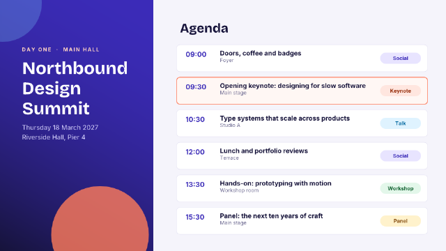

<!-- Generated by tools/gallery.mjs from showcase.yaml and build.json; do not edit. -->
# Conference Agenda

[Slide](../README.md) › [Events & Marketing](../README.md#events--marketing) · `agenda` `event` `shapes` `gradient`

A one-day design summit agenda with a gradient side panel, six session cards and coloured track tags, the keynote highlighted.



| | |
|---|---|
| Document | [conference-agenda.pptx](conference-agenda.pptx) (23 KB) |
| Contents | 1 slide; 960 × 540 pt |
| Features | `slide.shapes.edit`, `slide.format.character`, `slide.text.edit` |
| Built by | `kition-slide` @ `8309775c19`: 137 commands in 104 ms |

## Checks

- `inspect.slides`: `{"count":1}`
- `results.agenda.shapes`: `{"any":{"text":{"matches":"^Opening keynote"}}}`
- `results.agenda.shapes`: `{"any":{"preset":"roundRect","text":"Keynote","fill":"#FFE6DF"}}`
- diagnostics: none (the kit's check finds nothing wrong)
- the saved document opens again; the thumbnail matches `thumb.png` within the `render` tolerance

## Steps

<details><summary>137 commands (from <a href="showcase.yaml">showcase.yaml</a>)</summary>

```yaml
- command: design.fonts
  params:
    major: Bricolage Grotesque
    minor: Inter
- command: slide.layout
  params:
    layout: blank
    index: 0
- command: design.background
  params:
    color: "#f5f4fb"
- command: shape.insert
  params:
    preset: rect
    rect:
      - 0
      - 0
      - 330
      - 540
  as: side
- command: shape.fill
  params:
    ids:
      - $side.id
    gradient:
      stops:
        - - 0
          - "#3b2bb8"
        - - 1
          - "#16133a"
      angle: 120
- command: shape.line
  params:
    ids:
      - $side.id
    none: true
- command: shape.insert
  params:
    preset: ellipse
    rect:
      - 110
      - 400
      - 210
      - 210
  as: blob0
- command: shape.insert
  params:
    preset: ellipse
    rect:
      - -80
      - -80
      - 170
      - 170
  as: blob1
- command: shape.fill
  params:
    ids:
      - $blob0.id
    color: "#ff7a59"
    transparency: 0.2
- command: shape.line
  params:
    ids:
      - $blob0.id
      - $blob1.id
    none: true
- command: shape.fill
  params:
    ids:
      - $blob1.id
    color: "#7cd4ff"
    transparency: 0.75
- command: insert.textBox
  params:
    rect:
      - 40
      - 96
      - 260
      - 22
    text: DAY ONE  ·  MAIN HALL
  as: k
- command: format.size
  params:
    ids:
      - $k.id
    size: 11
- command: format.bold
  params:
    ids:
      - $k.id
- command: format.spacing
  params:
    ids:
      - $k.id
    pt: 2
- command: format.color
  params:
    ids:
      - $k.id
    color: "#ffd2c4"
- command: insert.textBox
  params:
    rect:
      - 40
      - 122
      - 270
      - 130
    text: Northbound Design Summit
  as: t
- command: format.font
  params:
    ids:
      - $t.id
    family: Bricolage Grotesque
- command: format.size
  params:
    ids:
      - $t.id
    size: 38
- command: format.bold
  params:
    ids:
      - $t.id
- command: format.color
  params:
    ids:
      - $t.id
    color: "#ffffff"
- command: format.lineSpacing
  params:
    ids:
      - $t.id
    lines: 0.95
- command: insert.textBox
  params:
    rect:
      - 40
      - 262
      - 250
      - 60
    text: |-
      Thursday 18 March 2027
      Riverside Hall, Pier 4
  as: d
- command: format.size
  params:
    ids:
      - $d.id
    size: 14
- command: format.color
  params:
    ids:
      - $d.id
    color: "#d9d5ff"
- command: format.paragraph
  params:
    ids:
      - $d.id
    spaceAfter: 4
- command: insert.textBox
  params:
    rect:
      - 380
      - 40
      - 300
      - 40
    text: Agenda
  as: a
- command: format.font
  params:
    ids:
      - $a.id
    family: Bricolage Grotesque
- command: format.size
  params:
    ids:
      - $a.id
    size: 28
- command: format.bold
  params:
    ids:
      - $a.id
- command: format.color
  params:
    ids:
      - $a.id
    color: "#16133a"
- command: shape.insert
  params:
    preset: roundRect
    rect:
      - 380
      - 96
      - 540
      - 58
  as: c0
- command: insert.textBox
  params:
    rect:
      - 392
      - 104
      - 70
      - 40
    text: 09:00
  as: tm0
- command: insert.textBox
  params:
    rect:
      - 466
      - 102
      - 330
      - 46
    text: |-
      Doors, coffee and badges
      Foyer
  as: ti0
- command: shape.insert
  params:
    preset: roundRect
    rect:
      - 818
      - 113
      - 88
      - 24
    text: Social
  as: g0
- command: shape.fill
  params:
    ids:
      - $g0.id
    color: "#e8e4ff"
- command: format.color
  params:
    ids:
      - $g0.id
    color: "#3b2bb8"
- command: format.size
  params:
    ids:
      - $ti0.id
    size: 14
- command: format.bold
  params:
    ids:
      - $ti0.id
- command: format.color
  params:
    ids:
      - $ti0.id
    color: "#16133a"
- command: text.edit
  params:
    id: $ti0.id
    at:
      - 1
      - 0
- command: text.select
  params:
    anchor:
      - 1
      - 0
    caret:
      - 1
      - 5
- command: format.size
  params:
    size: 11
- command: format.bold
  params:
    on: false
- command: format.color
  params:
    color: "#6b6890"
- command: text.exit
  params: {}
- command: shape.insert
  params:
    preset: roundRect
    rect:
      - 380
      - 166
      - 540
      - 58
  as: c1
- command: insert.textBox
  params:
    rect:
      - 392
      - 174
      - 70
      - 40
    text: 09:30
  as: tm1
- command: insert.textBox
  params:
    rect:
      - 466
      - 172
      - 330
      - 46
    text: |-
      Opening keynote: designing for slow software
      Main stage
  as: ti1
- command: shape.insert
  params:
    preset: roundRect
    rect:
      - 818
      - 183
      - 88
      - 24
    text: Keynote
  as: g1
- command: shape.fill
  params:
    ids:
      - $g1.id
    color: "#ffe6df"
- command: format.color
  params:
    ids:
      - $g1.id
    color: "#9a3412"
- command: format.size
  params:
    ids:
      - $ti1.id
    size: 14
- command: format.bold
  params:
    ids:
      - $ti1.id
- command: format.color
  params:
    ids:
      - $ti1.id
    color: "#16133a"
- command: text.edit
  params:
    id: $ti1.id
    at:
      - 1
      - 0
- command: text.select
  params:
    anchor:
      - 1
      - 0
    caret:
      - 1
      - 10
- command: format.size
  params:
    size: 11
- command: format.bold
  params:
    on: false
- command: format.color
  params:
    color: "#6b6890"
- command: text.exit
  params: {}
- command: shape.insert
  params:
    preset: roundRect
    rect:
      - 380
      - 236
      - 540
      - 58
  as: c2
- command: insert.textBox
  params:
    rect:
      - 392
      - 244
      - 70
      - 40
    text: 10:30
  as: tm2
- command: insert.textBox
  params:
    rect:
      - 466
      - 242
      - 330
      - 46
    text: |-
      Type systems that scale across products
      Studio A
  as: ti2
- command: shape.insert
  params:
    preset: roundRect
    rect:
      - 818
      - 253
      - 88
      - 24
    text: Talk
  as: g2
- command: shape.fill
  params:
    ids:
      - $g2.id
    color: "#dff3ff"
- command: format.color
  params:
    ids:
      - $g2.id
    color: "#0369a1"
- command: format.size
  params:
    ids:
      - $ti2.id
    size: 14
- command: format.bold
  params:
    ids:
      - $ti2.id
- command: format.color
  params:
    ids:
      - $ti2.id
    color: "#16133a"
- command: text.edit
  params:
    id: $ti2.id
    at:
      - 1
      - 0
- command: text.select
  params:
    anchor:
      - 1
      - 0
    caret:
      - 1
      - 8
- command: format.size
  params:
    size: 11
- command: format.bold
  params:
    on: false
- command: format.color
  params:
    color: "#6b6890"
- command: text.exit
  params: {}
- command: shape.insert
  params:
    preset: roundRect
    rect:
      - 380
      - 306
      - 540
      - 58
  as: c3
- command: insert.textBox
  params:
    rect:
      - 392
      - 314
      - 70
      - 40
    text: 12:00
  as: tm3
- command: insert.textBox
  params:
    rect:
      - 466
      - 312
      - 330
      - 46
    text: |-
      Lunch and portfolio reviews
      Terrace
  as: ti3
- command: shape.insert
  params:
    preset: roundRect
    rect:
      - 818
      - 323
      - 88
      - 24
    text: Social
  as: g3
- command: shape.fill
  params:
    ids:
      - $g3.id
    color: "#e8e4ff"
- command: format.color
  params:
    ids:
      - $g3.id
    color: "#3b2bb8"
- command: format.size
  params:
    ids:
      - $ti3.id
    size: 14
- command: format.bold
  params:
    ids:
      - $ti3.id
- command: format.color
  params:
    ids:
      - $ti3.id
    color: "#16133a"
- command: text.edit
  params:
    id: $ti3.id
    at:
      - 1
      - 0
- command: text.select
  params:
    anchor:
      - 1
      - 0
    caret:
      - 1
      - 7
- command: format.size
  params:
    size: 11
- command: format.bold
  params:
    on: false
- command: format.color
  params:
    color: "#6b6890"
- command: text.exit
  params: {}
- command: shape.insert
  params:
    preset: roundRect
    rect:
      - 380
      - 376
      - 540
      - 58
  as: c4
- command: insert.textBox
  params:
    rect:
      - 392
      - 384
      - 70
      - 40
    text: 13:30
  as: tm4
- command: insert.textBox
  params:
    rect:
      - 466
      - 382
      - 330
      - 46
    text: |-
      Hands-on: prototyping with motion
      Workshop room
  as: ti4
- command: shape.insert
  params:
    preset: roundRect
    rect:
      - 818
      - 393
      - 88
      - 24
    text: Workshop
  as: g4
- command: shape.fill
  params:
    ids:
      - $g4.id
    color: "#e3f7ea"
- command: format.color
  params:
    ids:
      - $g4.id
    color: "#166534"
- command: format.size
  params:
    ids:
      - $ti4.id
    size: 14
- command: format.bold
  params:
    ids:
      - $ti4.id
- command: format.color
  params:
    ids:
      - $ti4.id
    color: "#16133a"
- command: text.edit
  params:
    id: $ti4.id
    at:
      - 1
      - 0
- command: text.select
  params:
    anchor:
      - 1
      - 0
    caret:
      - 1
      - 13
- command: format.size
  params:
    size: 11
- command: format.bold
  params:
    on: false
- command: format.color
  params:
    color: "#6b6890"
- command: text.exit
  params: {}
- command: shape.insert
  params:
    preset: roundRect
    rect:
      - 380
      - 446
      - 540
      - 58
  as: c5
- command: insert.textBox
  params:
    rect:
      - 392
      - 454
      - 70
      - 40
    text: 15:30
  as: tm5
- command: insert.textBox
  params:
    rect:
      - 466
      - 452
      - 330
      - 46
    text: |-
      Panel: the next ten years of craft
      Main stage
  as: ti5
- command: shape.insert
  params:
    preset: roundRect
    rect:
      - 818
      - 463
      - 88
      - 24
    text: Panel
  as: g5
- command: shape.fill
  params:
    ids:
      - $g5.id
    color: "#fff2cc"
- command: format.color
  params:
    ids:
      - $g5.id
    color: "#854d0e"
- command: format.size
  params:
    ids:
      - $ti5.id
    size: 14
- command: format.bold
  params:
    ids:
      - $ti5.id
- command: format.color
  params:
    ids:
      - $ti5.id
    color: "#16133a"
- command: text.edit
  params:
    id: $ti5.id
    at:
      - 1
      - 0
- command: text.select
  params:
    anchor:
      - 1
      - 0
    caret:
      - 1
      - 10
- command: format.size
  params:
    size: 11
- command: format.bold
  params:
    on: false
- command: format.color
  params:
    color: "#6b6890"
- command: text.exit
  params: {}
- command: shape.fill
  params:
    ids:
      - $c0.id
      - $c1.id
      - $c2.id
      - $c3.id
      - $c4.id
      - $c5.id
    color: "#ffffff"
- command: shape.line
  params:
    ids:
      - $c0.id
      - $c1.id
      - $c2.id
      - $c3.id
      - $c4.id
      - $c5.id
    color: "#e4e1f3"
    width: 0.75
- command: shape.adjust
  params:
    ids:
      - $c0.id
      - $c1.id
      - $c2.id
      - $c3.id
      - $c4.id
      - $c5.id
    index: 0
    value: 12000
- command: shape.line
  params:
    ids:
      - $g0.id
      - $g1.id
      - $g2.id
      - $g3.id
      - $g4.id
      - $g5.id
    none: true
- command: shape.adjust
  params:
    ids:
      - $g0.id
      - $g1.id
      - $g2.id
      - $g3.id
      - $g4.id
      - $g5.id
    index: 0
    value: 50000
- command: format.size
  params:
    ids:
      - $g0.id
      - $g1.id
      - $g2.id
      - $g3.id
      - $g4.id
      - $g5.id
    size: 11
- command: format.bold
  params:
    ids:
      - $g0.id
      - $g1.id
      - $g2.id
      - $g3.id
      - $g4.id
      - $g5.id
- command: format.margins
  params:
    ids:
      - $g0.id
      - $g1.id
      - $g2.id
      - $g3.id
      - $g4.id
      - $g5.id
    left: 0
    right: 0
    top: 0
    bottom: 0
- command: format.size
  params:
    ids:
      - $tm0.id
      - $tm1.id
      - $tm2.id
      - $tm3.id
      - $tm4.id
      - $tm5.id
    size: 15
- command: format.bold
  params:
    ids:
      - $tm0.id
      - $tm1.id
      - $tm2.id
      - $tm3.id
      - $tm4.id
      - $tm5.id
- command: format.color
  params:
    ids:
      - $tm0.id
      - $tm1.id
      - $tm2.id
      - $tm3.id
      - $tm4.id
      - $tm5.id
    color: "#3b2bb8"
- command: format.anchor
  params:
    ids:
      - $tm0.id
      - $tm1.id
      - $tm2.id
      - $tm3.id
      - $tm4.id
      - $tm5.id
    anchor: middle
- command: format.anchor
  params:
    ids:
      - $ti0.id
      - $ti1.id
      - $ti2.id
      - $ti3.id
      - $ti4.id
      - $ti5.id
    anchor: middle
- command: shape.fill
  params:
    ids:
      - $c1.id
    color: "#fff7f4"
- command: shape.line
  params:
    ids:
      - $c1.id
    color: "#ff7a59"
    width: 1.5
- command: slide.inspect
  params:
    index: 0
  as: agenda
```

</details>
