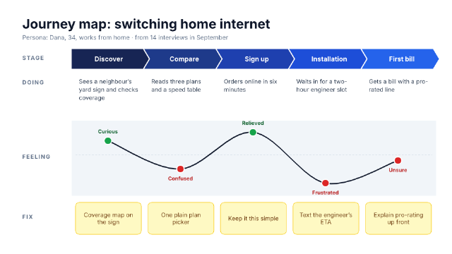

<!-- Generated by tools/gallery.mjs from showcase.yaml and build.json; do not edit. -->
# Customer Journey Map

[Slide](../README.md) › [Business Reports](../README.md#business-reports) · `journey-map` `freeform` `shapes` `chevrons` `service-design`

Five stages of switching home internet, with chevron headers, what the customer does, a smoothed emotion curve and the fix for each stage.



| | |
|---|---|
| Document | [customer-journey-map.pptx](customer-journey-map.pptx) (23 KB) |
| Contents | 1 slide; 960 × 540 pt |
| Features | `slide.drawing.objects`, `slide.shapes.edit`, `slide.format.character` |
| Built by | `kition-slide` @ `8309775c19`: 82 commands in 31 ms |

## About

A service-design staple in one slide. Chevrons name the stages; the emotion lane is a smooth
freeform curve through five points above or below a dashed neutral line, with green and red
dots and a word for each feeling; yellow sticky-note cards along the bottom say what to fix.

## Checks

- `inspect.slides`: `{"count":1}`
- `results.curve.shape.geom.kind`: `"custom"`
- `results.slide.shapes`: `{"any":{"preset":"chevron","text":"Installation"}}`
- `results.slide.design`: `{"none":{"code":"design.low-contrast"}}`
- diagnostics: none (the kit's check finds nothing wrong)
- the saved document opens again; the thumbnail matches `thumb.png` within the `render` tolerance

## Steps

<details><summary>82 commands (from <a href="showcase.yaml">showcase.yaml</a>)</summary>

```yaml
- command: slide.layout
  params:
    layout: blank
    index: 0
- command: insert.textBox
  params:
    rect:
      - 40
      - 30
      - 700
      - 44
    text: "Journey map: switching home internet"
  as: title
- command: format.size
  params:
    ids:
      - $title.id
    size: 28
- command: format.bold
  params:
    ids:
      - $title.id
- command: format.color
  params:
    ids:
      - $title.id
    color: "#0f172a"
- command: insert.textBox
  params:
    rect:
      - 40
      - 68
      - 700
      - 24
    text: "Persona: Dana, 34, works from home · from 14 interviews in September"
  as: lede
- command: format.size
  params:
    ids:
      - $lede.id
    size: 13
- command: format.color
  params:
    ids:
      - $lede.id
    color: "#64748b"
- command: shape.insert
  params:
    preset: homePlate
    rect:
      - 152
      - 104
      - 164
      - 42
    text: Discover
    adj:
      - 30000
  as: h0
- command: shape.fill
  params:
    ids:
      - $h0.id
    color: "#172554"
- command: insert.textBox
  params:
    rect:
      - 160
      - 160
      - 142
      - 84
    text: Sees a neighbour’s yard sign and checks coverage
  as: d0
- command: shape.insert
  params:
    preset: roundRect
    rect:
      - 160
      - 430
      - 140
      - 68
    text: Coverage map on the sign
    adj:
      - 12000
  as: o0
- command: shape.insert
  params:
    preset: chevron
    rect:
      - 306
      - 104
      - 164
      - 42
    text: Compare
    adj:
      - 30000
  as: h1
- command: shape.fill
  params:
    ids:
      - $h1.id
    color: "#1e3a8a"
- command: insert.textBox
  params:
    rect:
      - 314
      - 160
      - 142
      - 84
    text: Reads three plans and a speed table
  as: d1
- command: shape.insert
  params:
    preset: roundRect
    rect:
      - 314
      - 430
      - 140
      - 68
    text: One plain plan picker
    adj:
      - 12000
  as: o1
- command: shape.insert
  params:
    preset: chevron
    rect:
      - 460
      - 104
      - 164
      - 42
    text: Sign up
    adj:
      - 30000
  as: h2
- command: shape.fill
  params:
    ids:
      - $h2.id
    color: "#1e40af"
- command: insert.textBox
  params:
    rect:
      - 468
      - 160
      - 142
      - 84
    text: Orders online in six minutes
  as: d2
- command: shape.insert
  params:
    preset: roundRect
    rect:
      - 468
      - 430
      - 140
      - 68
    text: Keep it this simple
    adj:
      - 12000
  as: o2
- command: shape.insert
  params:
    preset: chevron
    rect:
      - 614
      - 104
      - 164
      - 42
    text: Installation
    adj:
      - 30000
  as: h3
- command: shape.fill
  params:
    ids:
      - $h3.id
    color: "#1d4ed8"
- command: insert.textBox
  params:
    rect:
      - 622
      - 160
      - 142
      - 84
    text: Waits in for a two-hour engineer slot
  as: d3
- command: shape.insert
  params:
    preset: roundRect
    rect:
      - 622
      - 430
      - 140
      - 68
    text: Text the engineer’s ETA
    adj:
      - 12000
  as: o3
- command: shape.insert
  params:
    preset: chevron
    rect:
      - 768
      - 104
      - 164
      - 42
    text: First bill
    adj:
      - 30000
  as: h4
- command: shape.fill
  params:
    ids:
      - $h4.id
    color: "#2563eb"
- command: insert.textBox
  params:
    rect:
      - 776
      - 160
      - 142
      - 84
    text: Gets a bill with a pro-rated line
  as: d4
- command: shape.insert
  params:
    preset: roundRect
    rect:
      - 776
      - 430
      - 140
      - 68
    text: Explain pro-rating up front
    adj:
      - 12000
  as: o4
- command: shape.line
  params:
    ids:
      - $h0.id
      - $h1.id
      - $h2.id
      - $h3.id
      - $h4.id
    none: true
- command: format.size
  params:
    ids:
      - $h0.id
      - $h1.id
      - $h2.id
      - $h3.id
      - $h4.id
    size: 14
- command: format.bold
  params:
    ids:
      - $h0.id
      - $h1.id
      - $h2.id
      - $h3.id
      - $h4.id
- command: format.color
  params:
    ids:
      - $h0.id
      - $h1.id
      - $h2.id
      - $h3.id
      - $h4.id
    color: "#ffffff"
- command: format.size
  params:
    ids:
      - $d0.id
      - $d1.id
      - $d2.id
      - $d3.id
      - $d4.id
    size: 12.5
- command: format.color
  params:
    ids:
      - $d0.id
      - $d1.id
      - $d2.id
      - $d3.id
      - $d4.id
    color: "#334155"
- command: format.lineSpacing
  params:
    ids:
      - $d0.id
      - $d1.id
      - $d2.id
      - $d3.id
      - $d4.id
    lines: 1.15
- command: shape.fill
  params:
    ids:
      - $o0.id
      - $o1.id
      - $o2.id
      - $o3.id
      - $o4.id
    color: "#fef9c3"
- command: shape.line
  params:
    ids:
      - $o0.id
      - $o1.id
      - $o2.id
      - $o3.id
      - $o4.id
    color: "#facc15"
    width: 1
- command: format.size
  params:
    ids:
      - $o0.id
      - $o1.id
      - $o2.id
      - $o3.id
      - $o4.id
    size: 12.5
- command: format.color
  params:
    ids:
      - $o0.id
      - $o1.id
      - $o2.id
      - $o3.id
      - $o4.id
    color: "#713f12"
- command: shape.insert
  params:
    preset: rect
    rect:
      - 152
      - 256
      - 774
      - 160
  as: lane
- command: shape.fill
  params:
    ids:
      - $lane.id
    color: "#f1f5f9"
- command: shape.line
  params:
    ids:
      - $lane.id
    none: true
- command: shape.freeform
  params:
    points:
      - - 160
        - 329
      - - 918
        - 329
  as: zero
- command: shape.line
  params:
    ids:
      - $zero.id
    color: "#cbd5e1"
    width: 1
    dash: dash
- command: shape.freeform
  params:
    points:
      - - 229
        - 299
      - - 383
        - 359
      - - 537
        - 281
      - - 691
        - 389
      - - 845
        - 341
    smooth: true
  as: curve
- command: shape.line
  params:
    ids:
      - $curve.id
    color: "#0f172a"
    width: 2.5
- command: shape.insert
  params:
    preset: ellipse
    rect:
      - 221
      - 291
      - 16
      - 16
  as: e0
- command: shape.fill
  params:
    ids:
      - $e0.id
    color: "#16a34a"
- command: insert.textBox
  params:
    rect:
      - 169
      - 269
      - 120
      - 22
    text: Curious
  as: ew0
- command: format.color
  params:
    ids:
      - $ew0.id
    color: "#166534"
- command: shape.insert
  params:
    preset: ellipse
    rect:
      - 375
      - 351
      - 16
      - 16
  as: e1
- command: shape.fill
  params:
    ids:
      - $e1.id
    color: "#dc2626"
- command: insert.textBox
  params:
    rect:
      - 323
      - 369
      - 120
      - 22
    text: Confused
  as: ew1
- command: format.color
  params:
    ids:
      - $ew1.id
    color: "#b91c1c"
- command: shape.insert
  params:
    preset: ellipse
    rect:
      - 529
      - 273
      - 16
      - 16
  as: e2
- command: shape.fill
  params:
    ids:
      - $e2.id
    color: "#16a34a"
- command: insert.textBox
  params:
    rect:
      - 477
      - 251
      - 120
      - 22
    text: Relieved
  as: ew2
- command: format.color
  params:
    ids:
      - $ew2.id
    color: "#166534"
- command: shape.insert
  params:
    preset: ellipse
    rect:
      - 683
      - 381
      - 16
      - 16
  as: e3
- command: shape.fill
  params:
    ids:
      - $e3.id
    color: "#dc2626"
- command: insert.textBox
  params:
    rect:
      - 631
      - 399
      - 120
      - 22
    text: Frustrated
  as: ew3
- command: format.color
  params:
    ids:
      - $ew3.id
    color: "#b91c1c"
- command: shape.insert
  params:
    preset: ellipse
    rect:
      - 837
      - 333
      - 16
      - 16
  as: e4
- command: shape.fill
  params:
    ids:
      - $e4.id
    color: "#dc2626"
- command: insert.textBox
  params:
    rect:
      - 785
      - 351
      - 120
      - 22
    text: Unsure
  as: ew4
- command: format.color
  params:
    ids:
      - $ew4.id
    color: "#b91c1c"
- command: shape.line
  params:
    ids:
      - $e0.id
      - $e1.id
      - $e2.id
      - $e3.id
      - $e4.id
    color: "#ffffff"
    width: 2
- command: format.size
  params:
    ids:
      - $ew0.id
      - $ew1.id
      - $ew2.id
      - $ew3.id
      - $ew4.id
    size: 11
- command: format.bold
  params:
    ids:
      - $ew0.id
      - $ew1.id
      - $ew2.id
      - $ew3.id
      - $ew4.id
- command: format.align
  params:
    ids:
      - $ew0.id
      - $ew1.id
      - $ew2.id
      - $ew3.id
      - $ew4.id
    align: center
- command: insert.textBox
  params:
    rect:
      - 40
      - 112
      - 104
      - 26
    text: Stage
  as: rl0
- command: insert.textBox
  params:
    rect:
      - 40
      - 164
      - 104
      - 26
    text: Doing
  as: rl1
- command: insert.textBox
  params:
    rect:
      - 40
      - 322
      - 104
      - 26
    text: Feeling
  as: rl2
- command: insert.textBox
  params:
    rect:
      - 40
      - 450
      - 104
      - 26
    text: Fix
  as: rl3
- command: format.size
  params:
    ids:
      - $rl0.id
      - $rl1.id
      - $rl2.id
      - $rl3.id
    size: 12
- command: format.bold
  params:
    ids:
      - $rl0.id
      - $rl1.id
      - $rl2.id
      - $rl3.id
- command: format.caps
  params:
    ids:
      - $rl0.id
      - $rl1.id
      - $rl2.id
      - $rl3.id
    caps: all
- command: format.spacing
  params:
    ids:
      - $rl0.id
      - $rl1.id
      - $rl2.id
      - $rl3.id
    pt: 1.5
- command: format.color
  params:
    ids:
      - $rl0.id
      - $rl1.id
      - $rl2.id
      - $rl3.id
    color: "#64748b"
- command: arrange.sendToBack
  params:
    ids:
      - $lane.id
- command: shape.inspect
  params:
    id: $curve.id
  as: curve
- command: slide.inspect
  params:
    index: 0
  as: slide
```

</details>
