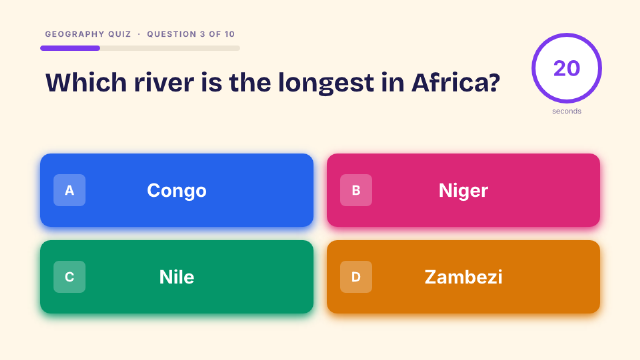

<!-- Generated by tools/gallery.mjs from showcase.yaml and build.json; do not edit. -->
# Geography Pop Quiz

[Slide](../README.md) › [Education](../README.md#education) · `quiz` `lesson` `animation` `shapes`

A classroom quiz question with four colour-coded answer tiles and a timer, followed by a reveal slide that greys out the wrong answers and pulses the right one.



| | |
|---|---|
| Document | [geography-pop-quiz.pptx](geography-pop-quiz.pptx) (29 KB) |
| Contents | 2 slides; 960 × 540 pt |
| Features | `slide.animations.set`, `slide.shapes.edit`, `slide.transitions.set` |
| Built by | `kition-slide` @ `8309775c19`: 172 commands in 144 ms |

## About

The question slide zooms its answer tiles in one after another; the reveal slide fades in, keeps
only the Nile in colour with a tick, and gives it a Pulse emphasis. The teacher's talking point is
in the notes of the reveal.

## Checks

- `inspect.slides`: `{"count":2}`
- `results.qa`: `{"count":8,"all":{"effect":"zoom","class":"entrance"}}`
- `results.qa.0.start`: `"afterPrevious"`
- `results.ra`: `{"count":1}`
- `results.ra.0`: `{"effect":"pulse","class":"emphasis"}`
- diagnostics: none (the kit's check finds nothing wrong)
- the saved document opens again; the thumbnail matches `thumb.png` within the `render` tolerance

## Steps

<details><summary>172 commands (from <a href="showcase.yaml">showcase.yaml</a>)</summary>

```yaml
- command: design.fonts
  params:
    major: Bricolage Grotesque
    minor: Inter
- command: slide.layout
  params:
    layout: blank
    index: 0
- command: design.background
  params:
    color: "#fff7e8"
- command: insert.textBox
  params:
    rect:
      - 60
      - 40
      - 400
      - 22
    text: GEOGRAPHY QUIZ  ·  QUESTION 3 OF 10
  as: k1
- command: format.size
  params:
    ids:
      - $k1.id
    size: 12
    onSlide: 1
- command: format.bold
  params:
    ids:
      - $k1.id
    onSlide: 1
- command: format.spacing
  params:
    ids:
      - $k1.id
    pt: 1.5
    onSlide: 1
- command: format.color
  params:
    ids:
      - $k1.id
    color: "#7c6f9b"
    onSlide: 1
- command: shape.insert
  params:
    preset: roundRect
    rect:
      - 60
      - 68
      - 300
      - 8
  as: pb1
- command: shape.insert
  params:
    preset: roundRect
    rect:
      - 60
      - 68
      - 90
      - 8
  as: pf1
- command: shape.fill
  params:
    ids:
      - $pb1.id
    color: "#ede4d3"
    onSlide: 1
- command: shape.fill
  params:
    ids:
      - $pf1.id
    color: "#7c3aed"
    onSlide: 1
- command: shape.adjust
  params:
    ids:
      - $pb1.id
      - $pf1.id
    index: 0
    value: 50000
    onSlide: 1
- command: shape.line
  params:
    ids:
      - $pb1.id
      - $pf1.id
    none: true
    onSlide: 1
- command: insert.textBox
  params:
    rect:
      - 60
      - 96
      - 700
      - 110
    text: Which river is the longest in Africa?
  as: q1
- command: format.font
  params:
    ids:
      - $q1.id
    family: Bricolage Grotesque
    onSlide: 1
- command: format.size
  params:
    ids:
      - $q1.id
    size: 40
    onSlide: 1
- command: format.bold
  params:
    ids:
      - $q1.id
    onSlide: 1
- command: format.color
  params:
    ids:
      - $q1.id
    color: "#1e1b4b"
    onSlide: 1
- command: shape.insert
  params:
    preset: ellipse
    rect:
      - 800
      - 52
      - 100
      - 100
    text: "20"
  as: timer
- command: shape.fill
  params:
    ids:
      - $timer.id
    color: "#ffffff"
    onSlide: 1
- command: shape.line
  params:
    ids:
      - $timer.id
    color: "#7c3aed"
    width: 6
    onSlide: 1
- command: format.size
  params:
    ids:
      - $timer.id
    size: 32
    onSlide: 1
- command: format.bold
  params:
    ids:
      - $timer.id
    onSlide: 1
- command: format.color
  params:
    ids:
      - $timer.id
    color: "#7c3aed"
    onSlide: 1
- command: insert.textBox
  params:
    rect:
      - 790
      - 156
      - 120
      - 20
    text: seconds
  as: sec
- command: format.size
  params:
    ids:
      - $sec.id
    size: 11
    onSlide: 1
- command: format.align
  params:
    ids:
      - $sec.id
    align: center
    onSlide: 1
- command: format.color
  params:
    ids:
      - $sec.id
    color: "#7c6f9b"
    onSlide: 1
- command: shape.insert
  params:
    preset: roundRect
    rect:
      - 60
      - 230
      - 410
      - 110
    text: Congo
  as: o1A
- command: shape.insert
  params:
    preset: roundRect
    rect:
      - 80
      - 261
      - 48
      - 48
    text: A
  as: b1A
- command: shape.fill
  params:
    ids:
      - $o1A.id
    color: "#2563eb"
    onSlide: 1
- command: format.color
  params:
    ids:
      - $o1A.id
    color: "#ffffff"
    onSlide: 1
- command: shape.fill
  params:
    ids:
      - $b1A.id
    color: "#ffffff"
    transparency: 0.75
    onSlide: 1
- command: format.color
  params:
    ids:
      - $b1A.id
    color: "#ffffff"
    onSlide: 1
- command: shape.effects
  params:
    ids:
      - $o1A.id
    shadow:
      color: "#2563eb"
      blur: 14
      dist: 5
      dir: 90
    onSlide: 1
- command: shape.line
  params:
    ids:
      - $o1A.id
      - $b1A.id
    none: true
    onSlide: 1
- command: shape.adjust
  params:
    ids:
      - $o1A.id
    index: 0
    value: 14000
    onSlide: 1
- command: format.size
  params:
    ids:
      - $o1A.id
    size: 28
    onSlide: 1
- command: format.bold
  params:
    ids:
      - $o1A.id
    onSlide: 1
- command: format.size
  params:
    ids:
      - $b1A.id
    size: 20
    onSlide: 1
- command: format.bold
  params:
    ids:
      - $b1A.id
    onSlide: 1
- command: format.margins
  params:
    ids:
      - $b1A.id
    left: 0
    right: 0
    top: 0
    bottom: 0
    onSlide: 1
- command: shape.insert
  params:
    preset: roundRect
    rect:
      - 490
      - 230
      - 410
      - 110
    text: Niger
  as: o1B
- command: shape.insert
  params:
    preset: roundRect
    rect:
      - 510
      - 261
      - 48
      - 48
    text: B
  as: b1B
- command: shape.fill
  params:
    ids:
      - $o1B.id
    color: "#db2777"
    onSlide: 1
- command: format.color
  params:
    ids:
      - $o1B.id
    color: "#ffffff"
    onSlide: 1
- command: shape.fill
  params:
    ids:
      - $b1B.id
    color: "#ffffff"
    transparency: 0.75
    onSlide: 1
- command: format.color
  params:
    ids:
      - $b1B.id
    color: "#ffffff"
    onSlide: 1
- command: shape.effects
  params:
    ids:
      - $o1B.id
    shadow:
      color: "#db2777"
      blur: 14
      dist: 5
      dir: 90
    onSlide: 1
- command: shape.line
  params:
    ids:
      - $o1B.id
      - $b1B.id
    none: true
    onSlide: 1
- command: shape.adjust
  params:
    ids:
      - $o1B.id
    index: 0
    value: 14000
    onSlide: 1
- command: format.size
  params:
    ids:
      - $o1B.id
    size: 28
    onSlide: 1
- command: format.bold
  params:
    ids:
      - $o1B.id
    onSlide: 1
- command: format.size
  params:
    ids:
      - $b1B.id
    size: 20
    onSlide: 1
- command: format.bold
  params:
    ids:
      - $b1B.id
    onSlide: 1
- command: format.margins
  params:
    ids:
      - $b1B.id
    left: 0
    right: 0
    top: 0
    bottom: 0
    onSlide: 1
- command: shape.insert
  params:
    preset: roundRect
    rect:
      - 60
      - 360
      - 410
      - 110
    text: Nile
  as: o1C
- command: shape.insert
  params:
    preset: roundRect
    rect:
      - 80
      - 391
      - 48
      - 48
    text: C
  as: b1C
- command: shape.fill
  params:
    ids:
      - $o1C.id
    color: "#059669"
    onSlide: 1
- command: format.color
  params:
    ids:
      - $o1C.id
    color: "#ffffff"
    onSlide: 1
- command: shape.fill
  params:
    ids:
      - $b1C.id
    color: "#ffffff"
    transparency: 0.75
    onSlide: 1
- command: format.color
  params:
    ids:
      - $b1C.id
    color: "#ffffff"
    onSlide: 1
- command: shape.effects
  params:
    ids:
      - $o1C.id
    shadow:
      color: "#059669"
      blur: 14
      dist: 5
      dir: 90
    onSlide: 1
- command: shape.line
  params:
    ids:
      - $o1C.id
      - $b1C.id
    none: true
    onSlide: 1
- command: shape.adjust
  params:
    ids:
      - $o1C.id
    index: 0
    value: 14000
    onSlide: 1
- command: format.size
  params:
    ids:
      - $o1C.id
    size: 28
    onSlide: 1
- command: format.bold
  params:
    ids:
      - $o1C.id
    onSlide: 1
- command: format.size
  params:
    ids:
      - $b1C.id
    size: 20
    onSlide: 1
- command: format.bold
  params:
    ids:
      - $b1C.id
    onSlide: 1
- command: format.margins
  params:
    ids:
      - $b1C.id
    left: 0
    right: 0
    top: 0
    bottom: 0
    onSlide: 1
- command: shape.insert
  params:
    preset: roundRect
    rect:
      - 490
      - 360
      - 410
      - 110
    text: Zambezi
  as: o1D
- command: shape.insert
  params:
    preset: roundRect
    rect:
      - 510
      - 391
      - 48
      - 48
    text: D
  as: b1D
- command: shape.fill
  params:
    ids:
      - $o1D.id
    color: "#d97706"
    onSlide: 1
- command: format.color
  params:
    ids:
      - $o1D.id
    color: "#ffffff"
    onSlide: 1
- command: shape.fill
  params:
    ids:
      - $b1D.id
    color: "#ffffff"
    transparency: 0.75
    onSlide: 1
- command: format.color
  params:
    ids:
      - $b1D.id
    color: "#ffffff"
    onSlide: 1
- command: shape.effects
  params:
    ids:
      - $o1D.id
    shadow:
      color: "#d97706"
      blur: 14
      dist: 5
      dir: 90
    onSlide: 1
- command: shape.line
  params:
    ids:
      - $o1D.id
      - $b1D.id
    none: true
    onSlide: 1
- command: shape.adjust
  params:
    ids:
      - $o1D.id
    index: 0
    value: 14000
    onSlide: 1
- command: format.size
  params:
    ids:
      - $o1D.id
    size: 28
    onSlide: 1
- command: format.bold
  params:
    ids:
      - $o1D.id
    onSlide: 1
- command: format.size
  params:
    ids:
      - $b1D.id
    size: 20
    onSlide: 1
- command: format.bold
  params:
    ids:
      - $b1D.id
    onSlide: 1
- command: format.margins
  params:
    ids:
      - $b1D.id
    left: 0
    right: 0
    top: 0
    bottom: 0
    onSlide: 1
- command: animation.add
  params:
    effect: zoom
    option: in
    ids:
      - $o1A.id
      - $o1B.id
      - $o1C.id
      - $o1D.id
    start: afterPrevious
    duration: 400
- command: animation.add
  params:
    effect: zoom
    option: in
    ids:
      - $b1A.id
      - $b1B.id
      - $b1C.id
      - $b1D.id
    start: withPrevious
    duration: 400
- command: slide.new
  params:
    layout: blank
- command: design.background
  params:
    color: "#fff7e8"
- command: insert.textBox
  params:
    rect:
      - 60
      - 40
      - 400
      - 22
    text: GEOGRAPHY QUIZ  ·  QUESTION 3 OF 10
  as: k2
- command: format.size
  params:
    ids:
      - $k2.id
    size: 12
    onSlide: 2
- command: format.bold
  params:
    ids:
      - $k2.id
    onSlide: 2
- command: format.spacing
  params:
    ids:
      - $k2.id
    pt: 1.5
    onSlide: 2
- command: format.color
  params:
    ids:
      - $k2.id
    color: "#7c6f9b"
    onSlide: 2
- command: shape.insert
  params:
    preset: roundRect
    rect:
      - 60
      - 68
      - 300
      - 8
  as: pb2
- command: shape.insert
  params:
    preset: roundRect
    rect:
      - 60
      - 68
      - 90
      - 8
  as: pf2
- command: shape.fill
  params:
    ids:
      - $pb2.id
    color: "#ede4d3"
    onSlide: 2
- command: shape.fill
  params:
    ids:
      - $pf2.id
    color: "#7c3aed"
    onSlide: 2
- command: shape.adjust
  params:
    ids:
      - $pb2.id
      - $pf2.id
    index: 0
    value: 50000
    onSlide: 2
- command: shape.line
  params:
    ids:
      - $pb2.id
      - $pf2.id
    none: true
    onSlide: 2
- command: insert.textBox
  params:
    rect:
      - 60
      - 96
      - 700
      - 110
    text: Which river is the longest in Africa?
  as: q2
- command: format.font
  params:
    ids:
      - $q2.id
    family: Bricolage Grotesque
    onSlide: 2
- command: format.size
  params:
    ids:
      - $q2.id
    size: 40
    onSlide: 2
- command: format.bold
  params:
    ids:
      - $q2.id
    onSlide: 2
- command: format.color
  params:
    ids:
      - $q2.id
    color: "#1e1b4b"
    onSlide: 2
- command: shape.insert
  params:
    preset: roundRect
    rect:
      - 60
      - 230
      - 410
      - 110
    text: Congo
  as: o2A
- command: shape.insert
  params:
    preset: roundRect
    rect:
      - 80
      - 261
      - 48
      - 48
    text: A
  as: b2A
- command: shape.fill
  params:
    ids:
      - $o2A.id
    color: "#ece6da"
    onSlide: 2
- command: format.color
  params:
    ids:
      - $o2A.id
    color: "#a39b8b"
    onSlide: 2
- command: shape.fill
  params:
    ids:
      - $b2A.id
    color: "#ddd5c6"
    onSlide: 2
- command: format.color
  params:
    ids:
      - $b2A.id
    color: "#a39b8b"
    onSlide: 2
- command: shape.line
  params:
    ids:
      - $o2A.id
      - $b2A.id
    none: true
    onSlide: 2
- command: shape.adjust
  params:
    ids:
      - $o2A.id
    index: 0
    value: 14000
    onSlide: 2
- command: format.size
  params:
    ids:
      - $o2A.id
    size: 28
    onSlide: 2
- command: format.bold
  params:
    ids:
      - $o2A.id
    onSlide: 2
- command: format.size
  params:
    ids:
      - $b2A.id
    size: 20
    onSlide: 2
- command: format.bold
  params:
    ids:
      - $b2A.id
    onSlide: 2
- command: format.margins
  params:
    ids:
      - $b2A.id
    left: 0
    right: 0
    top: 0
    bottom: 0
    onSlide: 2
- command: shape.insert
  params:
    preset: roundRect
    rect:
      - 490
      - 230
      - 410
      - 110
    text: Niger
  as: o2B
- command: shape.insert
  params:
    preset: roundRect
    rect:
      - 510
      - 261
      - 48
      - 48
    text: B
  as: b2B
- command: shape.fill
  params:
    ids:
      - $o2B.id
    color: "#ece6da"
    onSlide: 2
- command: format.color
  params:
    ids:
      - $o2B.id
    color: "#a39b8b"
    onSlide: 2
- command: shape.fill
  params:
    ids:
      - $b2B.id
    color: "#ddd5c6"
    onSlide: 2
- command: format.color
  params:
    ids:
      - $b2B.id
    color: "#a39b8b"
    onSlide: 2
- command: shape.line
  params:
    ids:
      - $o2B.id
      - $b2B.id
    none: true
    onSlide: 2
- command: shape.adjust
  params:
    ids:
      - $o2B.id
    index: 0
    value: 14000
    onSlide: 2
- command: format.size
  params:
    ids:
      - $o2B.id
    size: 28
    onSlide: 2
- command: format.bold
  params:
    ids:
      - $o2B.id
    onSlide: 2
- command: format.size
  params:
    ids:
      - $b2B.id
    size: 20
    onSlide: 2
- command: format.bold
  params:
    ids:
      - $b2B.id
    onSlide: 2
- command: format.margins
  params:
    ids:
      - $b2B.id
    left: 0
    right: 0
    top: 0
    bottom: 0
    onSlide: 2
- command: shape.insert
  params:
    preset: roundRect
    rect:
      - 60
      - 360
      - 410
      - 110
    text: Nile
  as: o2C
- command: shape.insert
  params:
    preset: roundRect
    rect:
      - 80
      - 391
      - 48
      - 48
    text: C
  as: b2C
- command: shape.fill
  params:
    ids:
      - $o2C.id
    color: "#059669"
    onSlide: 2
- command: format.color
  params:
    ids:
      - $o2C.id
    color: "#ffffff"
    onSlide: 2
- command: shape.fill
  params:
    ids:
      - $b2C.id
    color: "#ffffff"
    transparency: 0.75
    onSlide: 2
- command: format.color
  params:
    ids:
      - $b2C.id
    color: "#ffffff"
    onSlide: 2
- command: shape.effects
  params:
    ids:
      - $o2C.id
    shadow:
      color: "#059669"
      blur: 14
      dist: 5
      dir: 90
    onSlide: 2
- command: shape.line
  params:
    ids:
      - $o2C.id
      - $b2C.id
    none: true
    onSlide: 2
- command: shape.adjust
  params:
    ids:
      - $o2C.id
    index: 0
    value: 14000
    onSlide: 2
- command: format.size
  params:
    ids:
      - $o2C.id
    size: 28
    onSlide: 2
- command: format.bold
  params:
    ids:
      - $o2C.id
    onSlide: 2
- command: format.size
  params:
    ids:
      - $b2C.id
    size: 20
    onSlide: 2
- command: format.bold
  params:
    ids:
      - $b2C.id
    onSlide: 2
- command: format.margins
  params:
    ids:
      - $b2C.id
    left: 0
    right: 0
    top: 0
    bottom: 0
    onSlide: 2
- command: shape.insert
  params:
    preset: ellipse
    rect:
      - 412
      - 391
      - 48
      - 48
    text: ✓
  as: tick
- command: shape.fill
  params:
    ids:
      - $tick.id
    color: "#ffffff"
    onSlide: 2
- command: shape.line
  params:
    ids:
      - $tick.id
    none: true
    onSlide: 2
- command: format.color
  params:
    ids:
      - $tick.id
    color: "#059669"
    onSlide: 2
- command: format.size
  params:
    ids:
      - $tick.id
    size: 22
    onSlide: 2
- command: format.bold
  params:
    ids:
      - $tick.id
    onSlide: 2
- command: format.margins
  params:
    ids:
      - $tick.id
    left: 0
    right: 0
    top: 0
    bottom: 0
    onSlide: 2
- command: shape.insert
  params:
    preset: roundRect
    rect:
      - 490
      - 360
      - 410
      - 110
    text: Zambezi
  as: o2D
- command: shape.insert
  params:
    preset: roundRect
    rect:
      - 510
      - 391
      - 48
      - 48
    text: D
  as: b2D
- command: shape.fill
  params:
    ids:
      - $o2D.id
    color: "#ece6da"
    onSlide: 2
- command: format.color
  params:
    ids:
      - $o2D.id
    color: "#a39b8b"
    onSlide: 2
- command: shape.fill
  params:
    ids:
      - $b2D.id
    color: "#ddd5c6"
    onSlide: 2
- command: format.color
  params:
    ids:
      - $b2D.id
    color: "#a39b8b"
    onSlide: 2
- command: shape.line
  params:
    ids:
      - $o2D.id
      - $b2D.id
    none: true
    onSlide: 2
- command: shape.adjust
  params:
    ids:
      - $o2D.id
    index: 0
    value: 14000
    onSlide: 2
- command: format.size
  params:
    ids:
      - $o2D.id
    size: 28
    onSlide: 2
- command: format.bold
  params:
    ids:
      - $o2D.id
    onSlide: 2
- command: format.size
  params:
    ids:
      - $b2D.id
    size: 20
    onSlide: 2
- command: format.bold
  params:
    ids:
      - $b2D.id
    onSlide: 2
- command: format.margins
  params:
    ids:
      - $b2D.id
    left: 0
    right: 0
    top: 0
    bottom: 0
    onSlide: 2
- command: text.set
  params:
    id: $q2.id
    text: "The Nile: about 6,650 km from Lake Victoria’s basin to the Mediterranean."
    onSlide: 2
- command: format.size
  params:
    ids:
      - $q2.id
    size: 30
    onSlide: 2
- command: animation.add
  params:
    effect: pulse
    class: emphasis
    ids:
      - $o2C.id
    start: afterPrevious
    duration: 700
- command: transition.set
  params:
    kind: fade
    duration: 500
    index: 1
- command: slide.notes
  params:
    index: 1
    text: Most classes split between the Nile and the Congo. The Congo carries far more water, but the Nile is longer.
- command: animation.get
  params:
    slide: 0
  as: qa
- command: animation.get
  params:
    slide: 1
  as: ra
```

</details>
