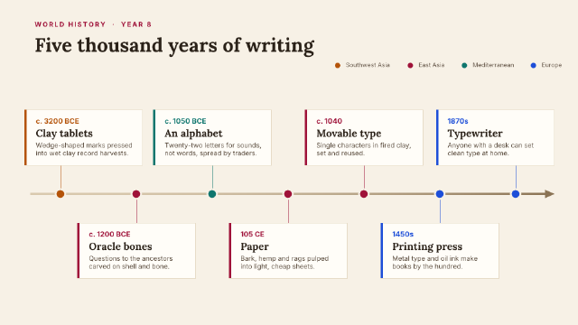

<!-- Generated by tools/gallery.mjs from showcase.yaml and build.json; do not edit. -->
# History of Writing Timeline

[Slide](../README.md) › [Education](../README.md#education) · `timeline` `lesson` `shapes` `history`

A history-class timeline of seven milestones in writing, from clay tablets to the typewriter, with cards alternating above and below a dated axis.



| | |
|---|---|
| Document | [history-of-writing-timeline.pptx](history-of-writing-timeline.pptx) (23 KB) |
| Contents | 1 slide; 960 × 540 pt |
| Features | `slide.shapes.edit`, `slide.format.paragraph`, `slide.format.character` |
| Built by | `kition-slide` @ `8309775c19`: 209 commands in 217 ms |

## About

The axis is a gradient bar ending in a rotated triangle; each milestone is a dot, a stem line
and a card whose date, title and sentence are three paragraphs of one text box. Colours mark the
region, explained by the legend under the title.

## Checks

- `inspect.slides`: `{"count":1}`
- `results.timeline.shapes`: `{"any":{"text":{"matches":"^c. 3200 BCE"}}}`
- diagnostics: none (the kit's check finds nothing wrong)
- the saved document opens again; the thumbnail matches `thumb.png` within the `render` tolerance

## Steps

<details><summary>209 commands (from <a href="showcase.yaml">showcase.yaml</a>)</summary>

```yaml
- command: design.fonts
  params:
    major: Lora
    minor: Inter
- command: slide.layout
  params:
    layout: blank
    index: 0
- command: design.background
  params:
    color: "#f7f1e6"
- command: insert.textBox
  params:
    rect:
      - 50
      - 30
      - 500
      - 22
    text: WORLD HISTORY  ·  YEAR 8
  as: k
- command: format.size
  params:
    ids:
      - $k.id
    size: 11
- command: format.bold
  params:
    ids:
      - $k.id
- command: format.spacing
  params:
    ids:
      - $k.id
    pt: 2
- command: format.color
  params:
    ids:
      - $k.id
    color: "#9f1239"
- command: insert.textBox
  params:
    rect:
      - 50
      - 52
      - 620
      - 50
    text: Five thousand years of writing
  as: t
- command: format.font
  params:
    ids:
      - $t.id
    family: Lora
- command: format.size
  params:
    ids:
      - $t.id
    size: 32
- command: format.bold
  params:
    ids:
      - $t.id
- command: format.color
  params:
    ids:
      - $t.id
    color: "#2a2118"
- command: shape.insert
  params:
    preset: ellipse
    rect:
      - 556
      - 104
      - 9
      - 9
  as: ld0
- command: shape.fill
  params:
    ids:
      - $ld0.id
    color: "#b45309"
- command: shape.line
  params:
    ids:
      - $ld0.id
    none: true
- command: insert.textBox
  params:
    rect:
      - 567
      - 98
      - 102.8
      - 20
    text: Southwest Asia
  as: lt0
- command: format.size
  params:
    ids:
      - $lt0.id
    size: 10
- command: format.color
  params:
    ids:
      - $lt0.id
    color: "#6b5d4f"
- command: shape.insert
  params:
    preset: ellipse
    rect:
      - 676.8
      - 104
      - 9
      - 9
  as: ld1
- command: shape.fill
  params:
    ids:
      - $ld1.id
    color: "#9f1239"
- command: shape.line
  params:
    ids:
      - $ld1.id
    none: true
- command: insert.textBox
  params:
    rect:
      - 687.8
      - 98
      - 71.80000000000001
      - 20
    text: East Asia
  as: lt1
- command: format.size
  params:
    ids:
      - $lt1.id
    size: 10
- command: format.color
  params:
    ids:
      - $lt1.id
    color: "#6b5d4f"
- command: shape.insert
  params:
    preset: ellipse
    rect:
      - 766.5999999999999
      - 104
      - 9
      - 9
  as: ld2
- command: shape.fill
  params:
    ids:
      - $ld2.id
    color: "#0f766e"
- command: shape.line
  params:
    ids:
      - $ld2.id
    none: true
- command: insert.textBox
  params:
    rect:
      - 777.5999999999999
      - 98
      - 96.60000000000001
      - 20
    text: Mediterranean
  as: lt2
- command: format.size
  params:
    ids:
      - $lt2.id
    size: 10
- command: format.color
  params:
    ids:
      - $lt2.id
    color: "#6b5d4f"
- command: shape.insert
  params:
    preset: ellipse
    rect:
      - 881.1999999999999
      - 104
      - 9
      - 9
  as: ld3
- command: shape.fill
  params:
    ids:
      - $ld3.id
    color: "#1d4ed8"
- command: shape.line
  params:
    ids:
      - $ld3.id
    none: true
- command: insert.textBox
  params:
    rect:
      - 892.1999999999999
      - 98
      - 53.2
      - 20
    text: Europe
  as: lt3
- command: format.size
  params:
    ids:
      - $lt3.id
    size: 10
- command: format.color
  params:
    ids:
      - $lt3.id
    color: "#6b5d4f"
- command: shape.insert
  params:
    preset: rect
    rect:
      - 50
      - 320
      - 860
      - 4
  as: axis
- command: shape.fill
  params:
    ids:
      - $axis.id
    gradient:
      stops:
        - - 0
          - "#d9c9ae"
        - - 1
          - "#8a7354"
      angle: 0
- command: shape.line
  params:
    ids:
      - $axis.id
    none: true
- command: shape.insert
  params:
    preset: triangle
    rect:
      - 906
      - 314
      - 14
      - 16
  as: head
- command: shape.rotate
  params:
    ids:
      - $head.id
    deg: 90
- command: shape.fill
  params:
    ids:
      - $head.id
    color: "#8a7354"
- command: shape.line
  params:
    ids:
      - $head.id
    none: true
- command: shape.insert
  params:
    preset: line
    rect:
      - 100
      - 274
      - 0
      - 48
  as: st0
- command: shape.line
  params:
    ids:
      - $st0.id
    color: "#b45309"
    width: 1.25
- command: shape.insert
  params:
    preset: ellipse
    rect:
      - 92
      - 314
      - 16
      - 16
  as: d0
- command: shape.fill
  params:
    ids:
      - $d0.id
    color: "#b45309"
- command: shape.line
  params:
    ids:
      - $d0.id
    color: "#f7f1e6"
    width: 3
- command: shape.insert
  params:
    preset: rect
    rect:
      - 40
      - 182
      - 196
      - 92
  as: c0
- command: shape.insert
  params:
    preset: rect
    rect:
      - 40
      - 182
      - 4
      - 92
  as: b0
- command: shape.fill
  params:
    ids:
      - $b0.id
    color: "#b45309"
- command: shape.line
  params:
    ids:
      - $b0.id
    none: true
- command: insert.textBox
  params:
    rect:
      - 52
      - 190
      - 178
      - 78
    text: |-
      c. 3200 BCE
      Clay tablets
      Wedge-shaped marks pressed into wet clay record harvests.
  as: x0
- command: format.size
  params:
    ids:
      - $x0.id
    size: 11
- command: format.color
  params:
    ids:
      - $x0.id
    color: "#5b4d3f"
- command: text.edit
  params:
    id: $x0.id
    at:
      - 0
      - 0
- command: text.selectParagraph
  params:
    at:
      - 0
      - 0
- command: format.bold
  params:
    on: true
- command: format.color
  params:
    color: "#b45309"
- command: format.size
  params:
    size: 12
- command: text.selectParagraph
  params:
    at:
      - 1
      - 0
- command: format.font
  params:
    family: Lora
- command: format.bold
  params:
    on: true
- command: format.size
  params:
    size: 17
- command: format.color
  params:
    color: "#2a2118"
- command: text.exit
  params: {}
- command: shape.insert
  params:
    preset: line
    rect:
      - 226
      - 322
      - 0
      - 48
  as: st1
- command: shape.line
  params:
    ids:
      - $st1.id
    color: "#9f1239"
    width: 1.25
- command: shape.insert
  params:
    preset: ellipse
    rect:
      - 218
      - 314
      - 16
      - 16
  as: d1
- command: shape.fill
  params:
    ids:
      - $d1.id
    color: "#9f1239"
- command: shape.line
  params:
    ids:
      - $d1.id
    color: "#f7f1e6"
    width: 3
- command: shape.insert
  params:
    preset: rect
    rect:
      - 128
      - 370
      - 196
      - 92
  as: c1
- command: shape.insert
  params:
    preset: rect
    rect:
      - 128
      - 370
      - 4
      - 92
  as: b1
- command: shape.fill
  params:
    ids:
      - $b1.id
    color: "#9f1239"
- command: shape.line
  params:
    ids:
      - $b1.id
    none: true
- command: insert.textBox
  params:
    rect:
      - 140
      - 378
      - 178
      - 78
    text: |-
      c. 1200 BCE
      Oracle bones
      Questions to the ancestors carved on shell and bone.
  as: x1
- command: format.size
  params:
    ids:
      - $x1.id
    size: 11
- command: format.color
  params:
    ids:
      - $x1.id
    color: "#5b4d3f"
- command: text.edit
  params:
    id: $x1.id
    at:
      - 0
      - 0
- command: text.selectParagraph
  params:
    at:
      - 0
      - 0
- command: format.bold
  params:
    on: true
- command: format.color
  params:
    color: "#9f1239"
- command: format.size
  params:
    size: 12
- command: text.selectParagraph
  params:
    at:
      - 1
      - 0
- command: format.font
  params:
    family: Lora
- command: format.bold
  params:
    on: true
- command: format.size
  params:
    size: 17
- command: format.color
  params:
    color: "#2a2118"
- command: text.exit
  params: {}
- command: shape.insert
  params:
    preset: line
    rect:
      - 352
      - 274
      - 0
      - 48
  as: st2
- command: shape.line
  params:
    ids:
      - $st2.id
    color: "#0f766e"
    width: 1.25
- command: shape.insert
  params:
    preset: ellipse
    rect:
      - 344
      - 314
      - 16
      - 16
  as: d2
- command: shape.fill
  params:
    ids:
      - $d2.id
    color: "#0f766e"
- command: shape.line
  params:
    ids:
      - $d2.id
    color: "#f7f1e6"
    width: 3
- command: shape.insert
  params:
    preset: rect
    rect:
      - 254
      - 182
      - 196
      - 92
  as: c2
- command: shape.insert
  params:
    preset: rect
    rect:
      - 254
      - 182
      - 4
      - 92
  as: b2
- command: shape.fill
  params:
    ids:
      - $b2.id
    color: "#0f766e"
- command: shape.line
  params:
    ids:
      - $b2.id
    none: true
- command: insert.textBox
  params:
    rect:
      - 266
      - 190
      - 178
      - 78
    text: |-
      c. 1050 BCE
      An alphabet
      Twenty-two letters for sounds, not words, spread by traders.
  as: x2
- command: format.size
  params:
    ids:
      - $x2.id
    size: 11
- command: format.color
  params:
    ids:
      - $x2.id
    color: "#5b4d3f"
- command: text.edit
  params:
    id: $x2.id
    at:
      - 0
      - 0
- command: text.selectParagraph
  params:
    at:
      - 0
      - 0
- command: format.bold
  params:
    on: true
- command: format.color
  params:
    color: "#0f766e"
- command: format.size
  params:
    size: 12
- command: text.selectParagraph
  params:
    at:
      - 1
      - 0
- command: format.font
  params:
    family: Lora
- command: format.bold
  params:
    on: true
- command: format.size
  params:
    size: 17
- command: format.color
  params:
    color: "#2a2118"
- command: text.exit
  params: {}
- command: shape.insert
  params:
    preset: line
    rect:
      - 478
      - 322
      - 0
      - 48
  as: st3
- command: shape.line
  params:
    ids:
      - $st3.id
    color: "#9f1239"
    width: 1.25
- command: shape.insert
  params:
    preset: ellipse
    rect:
      - 470
      - 314
      - 16
      - 16
  as: d3
- command: shape.fill
  params:
    ids:
      - $d3.id
    color: "#9f1239"
- command: shape.line
  params:
    ids:
      - $d3.id
    color: "#f7f1e6"
    width: 3
- command: shape.insert
  params:
    preset: rect
    rect:
      - 380
      - 370
      - 196
      - 92
  as: c3
- command: shape.insert
  params:
    preset: rect
    rect:
      - 380
      - 370
      - 4
      - 92
  as: b3
- command: shape.fill
  params:
    ids:
      - $b3.id
    color: "#9f1239"
- command: shape.line
  params:
    ids:
      - $b3.id
    none: true
- command: insert.textBox
  params:
    rect:
      - 392
      - 378
      - 178
      - 78
    text: |-
      105 CE
      Paper
      Bark, hemp and rags pulped into light, cheap sheets.
  as: x3
- command: format.size
  params:
    ids:
      - $x3.id
    size: 11
- command: format.color
  params:
    ids:
      - $x3.id
    color: "#5b4d3f"
- command: text.edit
  params:
    id: $x3.id
    at:
      - 0
      - 0
- command: text.selectParagraph
  params:
    at:
      - 0
      - 0
- command: format.bold
  params:
    on: true
- command: format.color
  params:
    color: "#9f1239"
- command: format.size
  params:
    size: 12
- command: text.selectParagraph
  params:
    at:
      - 1
      - 0
- command: format.font
  params:
    family: Lora
- command: format.bold
  params:
    on: true
- command: format.size
  params:
    size: 17
- command: format.color
  params:
    color: "#2a2118"
- command: text.exit
  params: {}
- command: shape.insert
  params:
    preset: line
    rect:
      - 604
      - 274
      - 0
      - 48
  as: st4
- command: shape.line
  params:
    ids:
      - $st4.id
    color: "#9f1239"
    width: 1.25
- command: shape.insert
  params:
    preset: ellipse
    rect:
      - 596
      - 314
      - 16
      - 16
  as: d4
- command: shape.fill
  params:
    ids:
      - $d4.id
    color: "#9f1239"
- command: shape.line
  params:
    ids:
      - $d4.id
    color: "#f7f1e6"
    width: 3
- command: shape.insert
  params:
    preset: rect
    rect:
      - 506
      - 182
      - 196
      - 92
  as: c4
- command: shape.insert
  params:
    preset: rect
    rect:
      - 506
      - 182
      - 4
      - 92
  as: b4
- command: shape.fill
  params:
    ids:
      - $b4.id
    color: "#9f1239"
- command: shape.line
  params:
    ids:
      - $b4.id
    none: true
- command: insert.textBox
  params:
    rect:
      - 518
      - 190
      - 178
      - 78
    text: |-
      c. 1040
      Movable type
      Single characters in fired clay, set and reused.
  as: x4
- command: format.size
  params:
    ids:
      - $x4.id
    size: 11
- command: format.color
  params:
    ids:
      - $x4.id
    color: "#5b4d3f"
- command: text.edit
  params:
    id: $x4.id
    at:
      - 0
      - 0
- command: text.selectParagraph
  params:
    at:
      - 0
      - 0
- command: format.bold
  params:
    on: true
- command: format.color
  params:
    color: "#9f1239"
- command: format.size
  params:
    size: 12
- command: text.selectParagraph
  params:
    at:
      - 1
      - 0
- command: format.font
  params:
    family: Lora
- command: format.bold
  params:
    on: true
- command: format.size
  params:
    size: 17
- command: format.color
  params:
    color: "#2a2118"
- command: text.exit
  params: {}
- command: shape.insert
  params:
    preset: line
    rect:
      - 730
      - 322
      - 0
      - 48
  as: st5
- command: shape.line
  params:
    ids:
      - $st5.id
    color: "#1d4ed8"
    width: 1.25
- command: shape.insert
  params:
    preset: ellipse
    rect:
      - 722
      - 314
      - 16
      - 16
  as: d5
- command: shape.fill
  params:
    ids:
      - $d5.id
    color: "#1d4ed8"
- command: shape.line
  params:
    ids:
      - $d5.id
    color: "#f7f1e6"
    width: 3
- command: shape.insert
  params:
    preset: rect
    rect:
      - 632
      - 370
      - 196
      - 92
  as: c5
- command: shape.insert
  params:
    preset: rect
    rect:
      - 632
      - 370
      - 4
      - 92
  as: b5
- command: shape.fill
  params:
    ids:
      - $b5.id
    color: "#1d4ed8"
- command: shape.line
  params:
    ids:
      - $b5.id
    none: true
- command: insert.textBox
  params:
    rect:
      - 644
      - 378
      - 178
      - 78
    text: |-
      1450s
      Printing press
      Metal type and oil ink make books by the hundred.
  as: x5
- command: format.size
  params:
    ids:
      - $x5.id
    size: 11
- command: format.color
  params:
    ids:
      - $x5.id
    color: "#5b4d3f"
- command: text.edit
  params:
    id: $x5.id
    at:
      - 0
      - 0
- command: text.selectParagraph
  params:
    at:
      - 0
      - 0
- command: format.bold
  params:
    on: true
- command: format.color
  params:
    color: "#1d4ed8"
- command: format.size
  params:
    size: 12
- command: text.selectParagraph
  params:
    at:
      - 1
      - 0
- command: format.font
  params:
    family: Lora
- command: format.bold
  params:
    on: true
- command: format.size
  params:
    size: 17
- command: format.color
  params:
    color: "#2a2118"
- command: text.exit
  params: {}
- command: shape.insert
  params:
    preset: line
    rect:
      - 856
      - 274
      - 0
      - 48
  as: st6
- command: shape.line
  params:
    ids:
      - $st6.id
    color: "#1d4ed8"
    width: 1.25
- command: shape.insert
  params:
    preset: ellipse
    rect:
      - 848
      - 314
      - 16
      - 16
  as: d6
- command: shape.fill
  params:
    ids:
      - $d6.id
    color: "#1d4ed8"
- command: shape.line
  params:
    ids:
      - $d6.id
    color: "#f7f1e6"
    width: 3
- command: shape.insert
  params:
    preset: rect
    rect:
      - 724
      - 182
      - 196
      - 92
  as: c6
- command: shape.insert
  params:
    preset: rect
    rect:
      - 724
      - 182
      - 4
      - 92
  as: b6
- command: shape.fill
  params:
    ids:
      - $b6.id
    color: "#1d4ed8"
- command: shape.line
  params:
    ids:
      - $b6.id
    none: true
- command: insert.textBox
  params:
    rect:
      - 736
      - 190
      - 178
      - 78
    text: |-
      1870s
      Typewriter
      Anyone with a desk can set clean type at home.
  as: x6
- command: format.size
  params:
    ids:
      - $x6.id
    size: 11
- command: format.color
  params:
    ids:
      - $x6.id
    color: "#5b4d3f"
- command: text.edit
  params:
    id: $x6.id
    at:
      - 0
      - 0
- command: text.selectParagraph
  params:
    at:
      - 0
      - 0
- command: format.bold
  params:
    on: true
- command: format.color
  params:
    color: "#1d4ed8"
- command: format.size
  params:
    size: 12
- command: text.selectParagraph
  params:
    at:
      - 1
      - 0
- command: format.font
  params:
    family: Lora
- command: format.bold
  params:
    on: true
- command: format.size
  params:
    size: 17
- command: format.color
  params:
    color: "#2a2118"
- command: text.exit
  params: {}
- command: shape.fill
  params:
    ids:
      - $c0.id
      - $c1.id
      - $c2.id
      - $c3.id
      - $c4.id
      - $c5.id
      - $c6.id
    color: "#fffdf8"
- command: shape.line
  params:
    ids:
      - $c0.id
      - $c1.id
      - $c2.id
      - $c3.id
      - $c4.id
      - $c5.id
      - $c6.id
    color: "#e7dcc8"
    width: 0.75
- command: format.paragraph
  params:
    ids:
      - $x0.id
      - $x1.id
      - $x2.id
      - $x3.id
      - $x4.id
      - $x5.id
      - $x6.id
    spaceAfter: 3
- command: slide.inspect
  params:
    index: 0
  as: timeline
```

</details>
