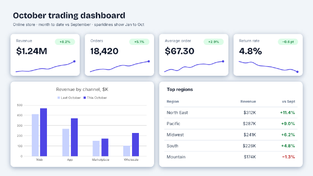

<!-- Generated by tools/gallery.mjs from showcase.yaml and build.json; do not edit. -->
# KPI Dashboard with Sparklines

[Slide](../README.md) › [Charts & Tables](../README.md#charts--tables) · `dashboard` `kpi` `sparkline` `chart` `table` `freeform`

A monthly e-commerce dashboard with four KPI tiles carrying freeform sparklines and change pills, a channel column chart and a regional table.



| | |
|---|---|
| Document | [kpi-dashboard-sparklines.pptx](kpi-dashboard-sparklines.pptx) (28 KB) |
| Contents | 1 slide; 960 × 540 pt |
| Features | `slide.charts.edit`, `slide.tables.edit`, `slide.drawing.objects`, `slide.shapes.edit` |
| Built by | `kition-slide` @ `8309775c19`: 85 commands in 117 ms |

## About

Everything a weekly business review needs on one slide. Each tile's sparkline is a smooth
freeform path through ten months of values with a dot on the latest; green pills show the change.
Below, a clustered column chart compares channels with last year and a light table ranks regions.

## Checks

- `inspect.slides`: `{"count":1}`
- `results.spark.shape.geom.kind`: `"custom"`
- `results.slide.shapes`: `{"all":{"kind":{"oneOf":["shape","textBox","chart","table"]}},"any":{"kind":"table","table":{"rows":6,"cols":3}}}`
- `results.slide.design`: `{"none":{"code":"design.low-contrast"}}`
- diagnostics: none (the kit's check finds nothing wrong)
- the saved document opens again; the thumbnail matches `thumb.png` within the `render` tolerance

## Steps

<details><summary>85 commands (from <a href="showcase.yaml">showcase.yaml</a>)</summary>

```yaml
- command: design.colors
  params:
    colors:
      accent1: "#c7d2fe"
      accent2: "#4f46e5"
- command: design.fonts
  params:
    major: Bricolage Grotesque
    minor: Inter
- command: slide.layout
  params:
    layout: blank
    index: 0
- command: design.background
  params:
    color: "#f1f5f9"
- command: insert.textBox
  params:
    rect:
      - 32
      - 28
      - 600
      - 40
    text: October trading dashboard
  as: title
- command: format.font
  params:
    ids:
      - $title.id
    family: Bricolage Grotesque
- command: format.size
  params:
    ids:
      - $title.id
    size: 26
- command: format.bold
  params:
    ids:
      - $title.id
- command: format.color
  params:
    ids:
      - $title.id
    color: "#0f172a"
- command: insert.textBox
  params:
    rect:
      - 32
      - 64
      - 600
      - 24
    text: Online store · month to date vs September · sparklines show Jan to Oct
  as: lede
- command: format.size
  params:
    ids:
      - $lede.id
    size: 12
- command: format.color
  params:
    ids:
      - $lede.id
    color: "#475569"
- command: shape.insert
  params:
    preset: roundRect
    rect:
      - 32
      - 104
      - 212
      - 128
    adj:
      - 7000
  as: tile0
- command: insert.textBox
  params:
    rect:
      - 42
      - 114
      - 140
      - 22
    text: Revenue
  as: lab0
- command: insert.textBox
  params:
    rect:
      - 42
      - 136
      - 190
      - 44
    text: $$1.24M
  as: val0
- command: shape.insert
  params:
    preset: roundRect
    rect:
      - 168
      - 118
      - 62
      - 20
    text: +8.2%
    adj:
      - 50000
  as: dp0
- command: shape.freeform
  params:
    points:
      - - 48
        - 220
      - - 68
        - 217.7
      - - 88
        - 218.5
      - - 108
        - 213.9
      - - 128
        - 210.1
      - - 148
        - 211.6
      - - 168
        - 204.8
      - - 188
        - 200.2
      - - 208
        - 197.1
      - - 228
        - 188
    smooth: true
  as: sp0
- command: shape.insert
  params:
    preset: ellipse
    rect:
      - 224.5
      - 184.5
      - 7
      - 7
  as: dot0
- command: shape.insert
  params:
    preset: roundRect
    rect:
      - 260
      - 104
      - 212
      - 128
    adj:
      - 7000
  as: tile1
- command: insert.textBox
  params:
    rect:
      - 270
      - 114
      - 140
      - 22
    text: Orders
  as: lab1
- command: insert.textBox
  params:
    rect:
      - 270
      - 136
      - 190
      - 44
    text: 18,420
  as: val1
- command: shape.insert
  params:
    preset: roundRect
    rect:
      - 396
      - 118
      - 62
      - 20
    text: +5.1%
    adj:
      - 50000
  as: dp1
- command: shape.freeform
  params:
    points:
      - - 276
        - 220
      - - 296
        - 214
      - - 316
        - 211.8
      - - 336
        - 213.3
      - - 356
        - 205.1
      - - 376
        - 199.9
      - - 396
        - 202.1
      - - 416
        - 196.2
      - - 436
        - 191.7
      - - 456
        - 188
    smooth: true
  as: sp1
- command: shape.insert
  params:
    preset: ellipse
    rect:
      - 452.5
      - 184.5
      - 7
      - 7
  as: dot1
- command: shape.insert
  params:
    preset: roundRect
    rect:
      - 488
      - 104
      - 212
      - 128
    adj:
      - 7000
  as: tile2
- command: insert.textBox
  params:
    rect:
      - 498
      - 114
      - 140
      - 22
    text: Average order
  as: lab2
- command: insert.textBox
  params:
    rect:
      - 498
      - 136
      - 190
      - 44
    text: $$67.30
  as: val2
- command: shape.insert
  params:
    preset: roundRect
    rect:
      - 624
      - 118
      - 62
      - 20
    text: +2.9%
    adj:
      - 50000
  as: dp2
- command: shape.freeform
  params:
    points:
      - - 504
        - 220
      - - 524
        - 212.6
      - - 544
        - 216.3
      - - 564
        - 205.1
      - - 584
        - 206.6
      - - 604
        - 198.4
      - - 624
        - 196.2
      - - 644
        - 197.7
      - - 664
        - 191
      - - 684
        - 188
    smooth: true
  as: sp2
- command: shape.insert
  params:
    preset: ellipse
    rect:
      - 680.5
      - 184.5
      - 7
      - 7
  as: dot2
- command: shape.insert
  params:
    preset: roundRect
    rect:
      - 716
      - 104
      - 212
      - 128
    adj:
      - 7000
  as: tile3
- command: insert.textBox
  params:
    rect:
      - 726
      - 114
      - 140
      - 22
    text: Return rate
  as: lab3
- command: insert.textBox
  params:
    rect:
      - 726
      - 136
      - 190
      - 44
    text: 4.8%
  as: val3
- command: shape.insert
  params:
    preset: roundRect
    rect:
      - 852
      - 118
      - 62
      - 20
    text: −0.6 pt
    adj:
      - 50000
  as: dp3
- command: shape.freeform
  params:
    points:
      - - 732
        - 188
      - - 752
        - 192.9
      - - 772
        - 190.5
      - - 792
        - 200.3
      - - 812
        - 202.8
      - - 832
        - 205.2
      - - 852
        - 210.2
      - - 872
        - 215.1
      - - 892
        - 212.6
      - - 912
        - 220
    smooth: true
  as: sp3
- command: shape.insert
  params:
    preset: ellipse
    rect:
      - 908.5
      - 216.5
      - 7
      - 7
  as: dot3
- command: shape.fill
  params:
    ids:
      - $tile0.id
      - $tile1.id
      - $tile2.id
      - $tile3.id
    color: "#ffffff"
- command: shape.line
  params:
    ids:
      - $tile0.id
      - $tile1.id
      - $tile2.id
      - $tile3.id
      - $dp0.id
      - $dp1.id
      - $dp2.id
      - $dp3.id
      - $dot0.id
      - $dot1.id
      - $dot2.id
      - $dot3.id
    none: true
- command: shape.effects
  params:
    ids:
      - $tile0.id
      - $tile1.id
      - $tile2.id
      - $tile3.id
    shadow:
      color: "#94a3b8"
      blur: 14
      dist: 3
      dir: 90
- command: format.size
  params:
    ids:
      - $lab0.id
      - $lab1.id
      - $lab2.id
      - $lab3.id
    size: 12
- command: format.color
  params:
    ids:
      - $lab0.id
      - $lab1.id
      - $lab2.id
      - $lab3.id
    color: "#64748b"
- command: format.size
  params:
    ids:
      - $val0.id
      - $val1.id
      - $val2.id
      - $val3.id
    size: 28
- command: format.bold
  params:
    ids:
      - $val0.id
      - $val1.id
      - $val2.id
      - $val3.id
      - $dp0.id
      - $dp1.id
      - $dp2.id
      - $dp3.id
- command: format.font
  params:
    ids:
      - $val0.id
      - $val1.id
      - $val2.id
      - $val3.id
    family: Bricolage Grotesque
- command: format.color
  params:
    ids:
      - $val0.id
      - $val1.id
      - $val2.id
      - $val3.id
    color: "#0f172a"
- command: shape.fill
  params:
    ids:
      - $dp0.id
      - $dp1.id
      - $dp2.id
      - $dp3.id
    color: "#dcfce7"
- command: format.size
  params:
    ids:
      - $dp0.id
      - $dp1.id
      - $dp2.id
      - $dp3.id
    size: 10
- command: format.color
  params:
    ids:
      - $dp0.id
      - $dp1.id
      - $dp2.id
      - $dp3.id
    color: "#15803d"
- command: format.margins
  params:
    ids:
      - $dp0.id
      - $dp1.id
      - $dp2.id
      - $dp3.id
    left: 0
    right: 0
    top: 0
    bottom: 0
- command: shape.line
  params:
    ids:
      - $sp0.id
      - $sp1.id
      - $sp2.id
      - $sp3.id
    color: "#4f46e5"
    width: 2
- command: shape.fill
  params:
    ids:
      - $dot0.id
      - $dot1.id
      - $dot2.id
      - $dot3.id
    color: "#4f46e5"
- command: shape.insert
  params:
    preset: roundRect
    rect:
      - 32
      - 250
      - 440
      - 262
    adj:
      - 4000
  as: card1
- command: shape.insert
  params:
    preset: roundRect
    rect:
      - 488
      - 250
      - 440
      - 262
    adj:
      - 4000
  as: card2
- command: shape.fill
  params:
    ids:
      - $card1.id
      - $card2.id
    color: "#ffffff"
- command: shape.line
  params:
    ids:
      - $card1.id
      - $card2.id
    none: true
- command: shape.effects
  params:
    ids:
      - $card1.id
      - $card2.id
    shadow:
      color: "#94a3b8"
      blur: 14
      dist: 3
      dir: 90
- command: insert.chart
  params:
    type: column
    rect:
      - 44
      - 258
      - 416
      - 246
    categories:
      - Web
      - App
      - Marketplace
      - Wholesale
    series:
      - name: Last October
        values:
          - 412
          - 268
          - 151
          - 102
      - name: This October
        values:
          - 468
          - 371
          - 173
          - 228
    title: Revenue by channel, $K
  as: chart
- command: chart.options
  params:
    id: $chart.id
    legend: t
    dataLabels: false
    gridlines: true
- command: insert.textBox
  params:
    rect:
      - 504
      - 262
      - 400
      - 26
    text: Top regions
  as: ttitle
- command: format.size
  params:
    ids:
      - $ttitle.id
    size: 14
- command: format.bold
  params:
    ids:
      - $ttitle.id
- command: format.color
  params:
    ids:
      - $ttitle.id
    color: "#0f172a"
- command: insert.table
  params:
    rows: 6
    cols: 3
    rect:
      - 504
      - 294
      - 408
      - 204
    data:
      - - Region
        - Revenue
        - vs Sept
      - - North East
        - $$312K
        - +11.4%
      - - Pacific
        - $$287K
        - +9.0%
      - - Midwest
        - $$241K
        - +6.2%
      - - South
        - $$226K
        - +4.8%
      - - Mountain
        - $$174K
        - −1.3%
  as: tb
- command: table.style
  params:
    id: $tb.id
    style: none
- command: table.cellFormat
  params:
    id: $tb.id
    anchor: center
- command: format.size
  params:
    ids:
      - $tb.id
    size: 13
- command: format.color
  params:
    ids:
      - $tb.id
    color: "#334155"
- command: table.border
  params:
    id: $tb.id
    edges: insideH
    color: "#e2e8f0"
    width: 1
    from:
      - 0
      - 0
    to:
      - 5
      - 2
- command: table.selectCells
  params:
    id: $tb.id
    from:
      - 0
      - 0
    to:
      - 0
      - 2
- command: format.size
  params:
    size: 11
- command: format.bold
  params: {}
- command: format.color
  params:
    color: "#64748b"
- command: table.selectCells
  params:
    id: $tb.id
    from:
      - 0
      - 1
    to:
      - 5
      - 2
- command: format.align
  params:
    align: right
- command: table.selectCells
  params:
    id: $tb.id
    from:
      - 1
      - 2
    to:
      - 4
      - 2
- command: format.color
  params:
    color: "#15803d"
- command: format.bold
  params: {}
- command: table.selectCells
  params:
    id: $tb.id
    from:
      - 5
      - 2
    to:
      - 5
      - 2
- command: format.color
  params:
    color: "#b91c1c"
- command: format.bold
  params: {}
- command: table.columnWidth
  params:
    id: $tb.id
    col: 0
    width: 168
- command: table.columnWidth
  params:
    id: $tb.id
    col: 1
    width: 120
- command: table.columnWidth
  params:
    id: $tb.id
    col: 2
    width: 120
- command: shape.inspect
  params:
    id: $sp0.id
  as: spark
- command: slide.inspect
  params:
    index: 0
  as: slide
```

</details>
