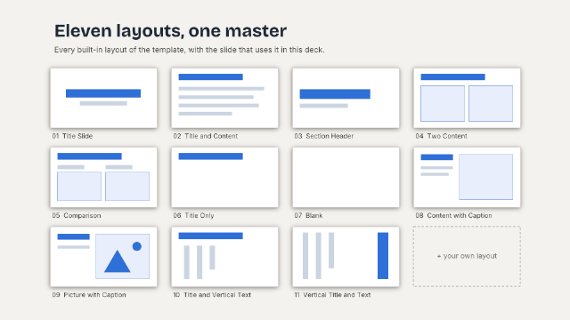

<!-- Generated by tools/gallery.mjs from showcase.yaml and build.json; do not edit. -->
# Layout Gallery

[Slide](../README.md) › [Layouts & Themes](../README.md#layouts--themes) · `layouts` `placeholders` `wireframes` `template`

A template guide whose first slide maps all eleven built-in layouts as wireframes, followed by one real slide in each layout.



| | |
|---|---|
| Document | [layout-gallery.pptx](layout-gallery.pptx) (111 KB) |
| Contents | 12 slides; 960 × 540 pt |
| Features | `slide.slides.manage`, `slide.insert.objects`, `slide.file.export` |
| Built by | `kition-slide` @ `8309775c19`: 154 commands in 184 ms |

## About

The overview is drawn from rectangles, a triangle and a circle: one wireframe per layout of the
master. The eleven slides after it are made with `slide.new` in each layout and fill its title,
body, content and caption placeholders; the Picture with Caption slide shows a picture of the
overview that the kit rendered itself.

## Checks

- `inspect.slides`: `{"count":12}`
- `results.deck.slides.0.layout`: `"Blank"`
- `results.deck.slides.1.layout`: `"Title Slide"`
- `results.deck.slides.2.layout`: `"Title and Content"`
- `results.deck.slides.3.layout`: `"Section Header"`
- `results.deck.slides.4.layout`: `"Two Content"`
- `results.deck.slides.5.layout`: `"Comparison"`
- `results.deck.slides.6.layout`: `"Title Only"`
- `results.deck.slides.7.layout`: `"Blank"`
- `results.deck.slides.8.layout`: `"Content with Caption"`
- `results.deck.slides.9.layout`: `"Picture with Caption"`
- `results.deck.slides.10.layout`: `"Title and Vertical Text"`
- `results.deck.slides.11.layout`: `"Vertical Title and Text"`
- `results.deck.layouts`: `{"count":11}`
- diagnostics: none (the kit's check finds nothing wrong)
- the saved document opens again; the thumbnail matches `thumb.png` within the `render` tolerance

## Steps

<details><summary>154 commands (from <a href="showcase.yaml">showcase.yaml</a>)</summary>

```yaml
- command: design.fonts
  params:
    major: Bricolage Grotesque
    minor: Inter
- command: slide.layout
  params:
    layout: blank
    index: 0
- command: design.background
  params:
    color: "#f4f2ee"
- command: insert.textBox
  params:
    rect:
      - 84
      - 30
      - 600
      - 46
    text: Eleven layouts, one master
  as: h
- command: format.font
  params:
    ids:
      - $h.id
    family: Bricolage Grotesque
- command: format.size
  params:
    ids:
      - $h.id
    size: 30
- command: format.bold
  params:
    ids:
      - $h.id
- command: format.color
  params:
    ids:
      - $h.id
    color: "#1f2937"
- command: insert.textBox
  params:
    rect:
      - 84
      - 72
      - 700
      - 24
    text: Every built-in layout of the template, with the slide that uses it in this deck.
  as: sub
- command: format.size
  params:
    ids:
      - $sub.id
    size: 13
- command: format.color
  params:
    ids:
      - $sub.id
    color: "#57534e"
- command: shape.insert
  params:
    preset: rect
    rect:
      - 84
      - 114
      - 180
      - 101
  as: t0
- command: shape.insert
  params:
    preset: rect
    rect:
      - 111
      - 150.4
      - 126
      - 14.1
  as: e0_0
- command: shape.insert
  params:
    preset: rect
    rect:
      - 134.4
      - 170.6
      - 79.2
      - 7.1
  as: e0_1
- command: insert.textBox
  params:
    rect:
      - 80
      - 219
      - 188
      - 20
    text: 01  Title Slide
  as: l0
- command: shape.insert
  params:
    preset: rect
    rect:
      - 288
      - 114
      - 180
      - 101
  as: t1
- command: shape.insert
  params:
    preset: rect
    rect:
      - 300.6
      - 124.1
      - 108
      - 11.1
  as: e1_0
- command: shape.insert
  params:
    preset: rect
    rect:
      - 300.6
      - 146.3
      - 144
      - 6.1
  as: e1_1
- command: shape.insert
  params:
    preset: rect
    rect:
      - 300.6
      - 160.5
      - 126
      - 6.1
  as: e1_2
- command: shape.insert
  params:
    preset: rect
    rect:
      - 300.6
      - 174.6
      - 135
      - 6.1
  as: e1_3
- command: shape.insert
  params:
    preset: rect
    rect:
      - 300.6
      - 188.7
      - 90
      - 6.1
  as: e1_4
- command: insert.textBox
  params:
    rect:
      - 284
      - 219
      - 188
      - 20
    text: 02  Title and Content
  as: l1
- command: shape.insert
  params:
    preset: rect
    rect:
      - 492
      - 114
      - 180
      - 101
  as: t2
- command: shape.insert
  params:
    preset: rect
    rect:
      - 504.6
      - 150.4
      - 118.8
      - 16.2
  as: e2_0
- command: shape.insert
  params:
    preset: rect
    rect:
      - 504.6
      - 174.6
      - 81
      - 7.1
  as: e2_1
- command: insert.textBox
  params:
    rect:
      - 488
      - 219
      - 188
      - 20
    text: 03  Section Header
  as: l2
- command: shape.insert
  params:
    preset: rect
    rect:
      - 696
      - 114
      - 180
      - 101
  as: t3
- command: shape.insert
  params:
    preset: rect
    rect:
      - 708.6
      - 124.1
      - 108
      - 11.1
  as: e3_0
- command: shape.insert
  params:
    preset: rect
    rect:
      - 708.6
      - 144.3
      - 73.8
      - 60.6
  as: e3_1
- command: shape.insert
  params:
    preset: rect
    rect:
      - 789.6
      - 144.3
      - 73.8
      - 60.6
  as: e3_2
- command: insert.textBox
  params:
    rect:
      - 692
      - 219
      - 188
      - 20
    text: 04  Two Content
  as: l3
- command: shape.insert
  params:
    preset: rect
    rect:
      - 84
      - 248
      - 180
      - 101
  as: t4
- command: shape.insert
  params:
    preset: rect
    rect:
      - 96.6
      - 258.1
      - 108
      - 11.1
  as: e4_0
- command: shape.insert
  params:
    preset: rect
    rect:
      - 96.6
      - 278.3
      - 45
      - 7.1
  as: e4_1
- command: shape.insert
  params:
    preset: rect
    rect:
      - 177.6
      - 278.3
      - 45
      - 7.1
  as: e4_2
- command: shape.insert
  params:
    preset: rect
    rect:
      - 96.6
      - 290.4
      - 73.8
      - 48.5
  as: e4_3
- command: shape.insert
  params:
    preset: rect
    rect:
      - 177.6
      - 290.4
      - 73.8
      - 48.5
  as: e4_4
- command: insert.textBox
  params:
    rect:
      - 80
      - 353
      - 188
      - 20
    text: 05  Comparison
  as: l4
- command: shape.insert
  params:
    preset: rect
    rect:
      - 288
      - 248
      - 180
      - 101
  as: t5
- command: shape.insert
  params:
    preset: rect
    rect:
      - 300.6
      - 258.1
      - 108
      - 11.1
  as: e5_0
- command: insert.textBox
  params:
    rect:
      - 284
      - 353
      - 188
      - 20
    text: 06  Title Only
  as: l5
- command: shape.insert
  params:
    preset: rect
    rect:
      - 492
      - 248
      - 180
      - 101
  as: t6
- command: insert.textBox
  params:
    rect:
      - 488
      - 353
      - 188
      - 20
    text: 07  Blank
  as: l6
- command: shape.insert
  params:
    preset: rect
    rect:
      - 696
      - 248
      - 180
      - 101
  as: t7
- command: shape.insert
  params:
    preset: rect
    rect:
      - 708.6
      - 260.1
      - 54
      - 10.1
  as: e7_0
- command: shape.insert
  params:
    preset: rect
    rect:
      - 708.6
      - 280.3
      - 54
      - 5.1
  as: e7_1
- command: shape.insert
  params:
    preset: rect
    rect:
      - 708.6
      - 291.4
      - 46.8
      - 5.1
  as: e7_2
- command: shape.insert
  params:
    preset: rect
    rect:
      - 773.4
      - 260.1
      - 90
      - 76.8
  as: e7_3
- command: insert.textBox
  params:
    rect:
      - 692
      - 353
      - 188
      - 20
    text: 08  Content with Caption
  as: l7
- command: shape.insert
  params:
    preset: rect
    rect:
      - 84
      - 382
      - 180
      - 101
  as: t8
- command: shape.insert
  params:
    preset: rect
    rect:
      - 96.6
      - 394.1
      - 54
      - 10.1
  as: e8_0
- command: shape.insert
  params:
    preset: rect
    rect:
      - 96.6
      - 414.3
      - 54
      - 5.1
  as: e8_1
- command: shape.insert
  params:
    preset: rect
    rect:
      - 161.4
      - 394.1
      - 90
      - 76.8
  as: p8
- command: shape.insert
  params:
    preset: triangle
    rect:
      - 174.9
      - 420.98
      - 45
      - 38.4
  as: m8
- command: shape.insert
  params:
    preset: ellipse
    rect:
      - 222.60000000000002
      - 407.92400000000004
      - 15.36
      - 15.36
  as: o8
- command: insert.textBox
  params:
    rect:
      - 80
      - 487
      - 188
      - 20
    text: 09  Picture with Caption
  as: l8
- command: shape.insert
  params:
    preset: rect
    rect:
      - 288
      - 382
      - 180
      - 101
  as: t9
- command: shape.insert
  params:
    preset: rect
    rect:
      - 300.6
      - 392.1
      - 108
      - 11.1
  as: e9_0
- command: shape.insert
  params:
    preset: rect
    rect:
      - 309.6
      - 414.3
      - 9
      - 56.6
  as: e9_1
- command: shape.insert
  params:
    preset: rect
    rect:
      - 331.2
      - 414.3
      - 9
      - 56.6
  as: e9_2
- command: shape.insert
  params:
    preset: rect
    rect:
      - 352.8
      - 414.3
      - 9
      - 40.4
  as: e9_3
- command: insert.textBox
  params:
    rect:
      - 284
      - 487
      - 188
      - 20
    text: 10  Title and Vertical Text
  as: l9
- command: shape.insert
  params:
    preset: rect
    rect:
      - 492
      - 382
      - 180
      - 101
  as: t10
- command: shape.insert
  params:
    preset: rect
    rect:
      - 636
      - 392.1
      - 18
      - 78.8
  as: e10_0
- command: shape.insert
  params:
    preset: rect
    rect:
      - 510
      - 392.1
      - 9
      - 78.8
  as: e10_1
- command: shape.insert
  params:
    preset: rect
    rect:
      - 531.6
      - 392.1
      - 9
      - 78.8
  as: e10_2
- command: shape.insert
  params:
    preset: rect
    rect:
      - 553.2
      - 392.1
      - 9
      - 60.6
  as: e10_3
- command: insert.textBox
  params:
    rect:
      - 488
      - 487
      - 188
      - 20
    text: 11  Vertical Title and Text
  as: l10
- command: shape.insert
  params:
    preset: rect
    rect:
      - 696
      - 382
      - 180
      - 101
  as: t11
- command: insert.textBox
  params:
    rect:
      - 696
      - 420.5
      - 180
      - 24
    text: + your own layout
  as: own
- command: format.align
  params:
    ids:
      - $own.id
    align: center
- command: format.size
  params:
    ids:
      - $own.id
    size: 12
- command: format.color
  params:
    ids:
      - $own.id
    color: "#78716c"
- command: shape.fill
  params:
    ids:
      - $t0.id
      - $t1.id
      - $t2.id
      - $t3.id
      - $t4.id
      - $t5.id
      - $t6.id
      - $t7.id
      - $t8.id
      - $t9.id
      - $t10.id
    color: "#ffffff"
- command: shape.line
  params:
    ids:
      - $t0.id
      - $t1.id
      - $t2.id
      - $t3.id
      - $t4.id
      - $t5.id
      - $t6.id
      - $t7.id
      - $t8.id
      - $t9.id
      - $t10.id
    color: "#d6d3d1"
    width: 0.75
- command: shape.effects
  params:
    ids:
      - $t0.id
      - $t1.id
      - $t2.id
      - $t3.id
      - $t4.id
      - $t5.id
      - $t6.id
      - $t7.id
      - $t8.id
      - $t9.id
      - $t10.id
    shadow:
      color: "#78716c"
      blur: 8
      dist: 2
      dir: 90
- command: shape.fill
  params:
    ids:
      - $t11.id
    none: true
- command: shape.line
  params:
    ids:
      - $t11.id
    color: "#a8a29e"
    width: 1
    dash: dash
- command: shape.fill
  params:
    ids:
      - $e0_0.id
      - $e1_0.id
      - $e2_0.id
      - $e3_0.id
      - $e4_0.id
      - $e5_0.id
      - $e7_0.id
      - $e8_0.id
      - $m8.id
      - $o8.id
      - $e9_0.id
      - $e10_0.id
    color: "#2E6FD8"
- command: shape.line
  params:
    ids:
      - $e0_0.id
      - $e1_0.id
      - $e2_0.id
      - $e3_0.id
      - $e4_0.id
      - $e5_0.id
      - $e7_0.id
      - $e8_0.id
      - $m8.id
      - $o8.id
      - $e9_0.id
      - $e10_0.id
    none: true
- command: shape.fill
  params:
    ids:
      - $e0_1.id
      - $e1_1.id
      - $e1_2.id
      - $e1_3.id
      - $e1_4.id
      - $e2_1.id
      - $e4_1.id
      - $e4_2.id
      - $e7_1.id
      - $e7_2.id
      - $e8_1.id
      - $e9_1.id
      - $e9_2.id
      - $e9_3.id
      - $e10_1.id
      - $e10_2.id
      - $e10_3.id
    color: "#cbd5e1"
- command: shape.line
  params:
    ids:
      - $e0_1.id
      - $e1_1.id
      - $e1_2.id
      - $e1_3.id
      - $e1_4.id
      - $e2_1.id
      - $e4_1.id
      - $e4_2.id
      - $e7_1.id
      - $e7_2.id
      - $e8_1.id
      - $e9_1.id
      - $e9_2.id
      - $e9_3.id
      - $e10_1.id
      - $e10_2.id
      - $e10_3.id
    none: true
- command: shape.fill
  params:
    ids:
      - $e3_1.id
      - $e3_2.id
      - $e4_3.id
      - $e4_4.id
      - $e7_3.id
      - $p8.id
    color: "#e8eefb"
- command: shape.line
  params:
    ids:
      - $e3_1.id
      - $e3_2.id
      - $e4_3.id
      - $e4_4.id
      - $e7_3.id
      - $p8.id
    color: "#9db8ea"
    width: 0.75
- command: format.size
  params:
    ids:
      - $l0.id
      - $l1.id
      - $l2.id
      - $l3.id
      - $l4.id
      - $l5.id
      - $l6.id
      - $l7.id
      - $l8.id
      - $l9.id
      - $l10.id
    size: 11
- command: format.color
  params:
    ids:
      - $l0.id
      - $l1.id
      - $l2.id
      - $l3.id
      - $l4.id
      - $l5.id
      - $l6.id
      - $l7.id
      - $l8.id
      - $l9.id
      - $l10.id
    color: "#44403c"
- command: slide.new
  params:
    layout: title
- command: slide.inspect
  params:
    index: 1
  as: s1
- command: text.set
  params:
    id: $s1.shapes.0.id
    text: Larkspur Studio Template
- command: text.set
  params:
    id: $s1.shapes.1.id
    text: Eleven layouts and when to reach for each one
- command: format.bold
  params:
    ids:
      - $s1.shapes.0.id
    on: true
- command: slide.new
  params:
    layout: titleAndContent
- command: slide.inspect
  params:
    index: 2
  as: s2
- command: text.set
  params:
    id: $s2.shapes.0.id
    text: Title and Content
- command: text.set
  params:
    id: $s2.shapes.1.id
    text: |-
      The workhorse: one idea per slide
      Up to five bullets, ten words each
      Agendas, findings and next steps
- command: format.bold
  params:
    ids:
      - $s2.shapes.0.id
    on: true
- command: slide.new
  params:
    layout: sectionHeader
- command: slide.inspect
  params:
    index: 3
  as: s3
- command: text.set
  params:
    id: $s3.shapes.0.id
    text: "Part Two: Results"
- command: text.set
  params:
    id: $s3.shapes.1.id
    text: A section header gives the room a breath between topics
- command: format.bold
  params:
    ids:
      - $s3.shapes.0.id
    on: true
- command: slide.new
  params:
    layout: twoContent
- command: slide.inspect
  params:
    index: 4
  as: s4
- command: text.set
  params:
    id: $s4.shapes.0.id
    text: Two ways to ship
- command: text.set
  params:
    id: $s4.shapes.1.id
    text: |-
      Weekly releases
      Small, low-risk changes
      Feedback within days
- command: text.set
  params:
    id: $s4.shapes.2.id
    text: |-
      Quarterly releases
      Bundled features
      Longer test cycles
- command: format.bold
  params:
    ids:
      - $s4.shapes.0.id
    on: true
- command: slide.new
  params:
    layout: comparison
- command: slide.inspect
  params:
    index: 5
  as: s5
- command: text.set
  params:
    id: $s5.shapes.0.id
    text: Rent or buy the studio?
- command: text.set
  params:
    id: $s5.shapes.1.id
    text: Rent
- command: text.set
  params:
    id: $s5.shapes.2.id
    text: |-
      Flexible lease, three-year term
      Landlord handles repairs
      No upfront capital
- command: text.set
  params:
    id: $s5.shapes.3.id
    text: Buy
- command: text.set
  params:
    id: $s5.shapes.4.id
    text: |-
      Equity builds every month
      Free to renovate
      Large deposit up front
- command: format.bold
  params:
    ids:
      - $s5.shapes.0.id
    on: true
- command: slide.new
  params:
    layout: titleOnly
- command: slide.inspect
  params:
    index: 6
  as: s6
- command: text.set
  params:
    id: $s6.shapes.0.id
    text: Title Only leaves room for one big visual
- command: format.bold
  params:
    ids:
      - $s6.shapes.0.id
    on: true
- command: insert.chart
  params:
    type: column
    rect:
      - 60
      - 140
      - 840
      - 350
    categories:
      - Mon
      - Tue
      - Wed
      - Thu
      - Fri
    series:
      - name: Visitors
        values:
          - 42
          - 58
          - 51
          - 77
          - 96
    title: Studio visitors this week
  as: ch
- command: slide.new
  params:
    layout: blank
- command: slide.inspect
  params:
    index: 7
  as: s7
- command: design.background
  params:
    color: "#2E6FD8"
- command: insert.textBox
  params:
    rect:
      - 90
      - 170
      - 780
      - 200
    text: “Blank is for the one sentence you want the room to remember.”
  as: q
- command: format.font
  params:
    ids:
      - $q.id
    family: Bricolage Grotesque
- command: format.size
  params:
    ids:
      - $q.id
    size: 40
- command: format.bold
  params:
    ids:
      - $q.id
- command: format.color
  params:
    ids:
      - $q.id
    color: "#ffffff"
- command: format.align
  params:
    ids:
      - $q.id
    align: center
- command: slide.new
  params:
    layout: contentWithCaption
- command: slide.inspect
  params:
    index: 8
  as: s8
- command: text.set
  params:
    id: $s8.shapes.0.id
    text: Content with Caption
- command: text.set
  params:
    id: $s8.shapes.1.id
    text: |-
      Studio hours: 9–6
      Critique: Thursdays
      Showcase: last Friday
- command: text.set
  params:
    id: $s8.shapes.2.id
    text: Use the caption column for context the audience reads while you talk.
- command: format.bold
  params:
    ids:
      - $s8.shapes.0.id
    on: true
- command: slide.new
  params:
    layout: pictureWithCaption
- command: slide.inspect
  params:
    index: 9
  as: s9
- command: text.set
  params:
    id: $s9.shapes.0.id
    text: Picture with Caption
- command: text.set
  params:
    id: $s9.shapes.2.id
    text: A picture fills the right side; this caption explains what to look at.
- command: format.bold
  params:
    ids:
      - $s9.shapes.0.id
    on: true
- command: file.exportBytes
  params:
    format: png
    slide: 0
    scale: 1
  as: png
- command: edit.delete
  params:
    ids:
      - $s9.shapes.1.id
- command: insert.picture
  params:
    data: $png.data
    name: overview.png
    rect:
      - 412
      - 133
      - 488
      - 274.5
  as: pic
- command: slide.new
  params:
    layout: Title and Vertical Text
- command: slide.inspect
  params:
    index: 10
  as: s10
- command: text.set
  params:
    id: $s10.shapes.0.id
    text: Title and Vertical Text
- command: text.set
  params:
    id: $s10.shapes.1.id
    text: |-
      Read top to bottom
      Useful for narrow labels
      And East Asian scripts
- command: format.bold
  params:
    ids:
      - $s10.shapes.0.id
    on: true
- command: slide.new
  params:
    layout: Vertical Title and Text
- command: slide.inspect
  params:
    index: 11
  as: s11
- command: text.set
  params:
    id: $s11.shapes.0.id
    text: Vertical Title
- command: text.set
  params:
    id: $s11.shapes.1.id
    text: The title runs down the right edge while the body keeps the full height of the slide for longer text.
- command: format.bold
  params:
    ids:
      - $s11.shapes.0.id
    on: true
- command: document.inspect
  params: {}
  as: deck
```

</details>
