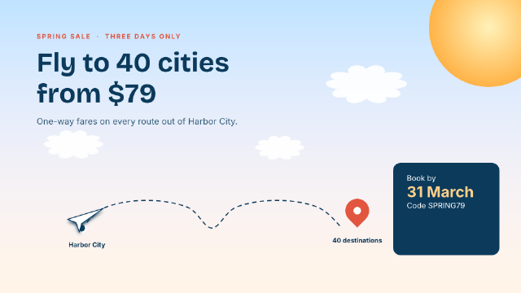

<!-- Generated by tools/gallery.mjs from showcase.yaml and build.json; do not edit. -->
# Paper Plane Motion Path

[Slide](../README.md) › [Animations & Transitions](../README.md#animations--transitions) · `animation` `motion-path` `freeform` `marketing`

A travel-sale slide where a paper plane drawn as a freeform flies two chained arc motion paths along a dashed route to the destination pin.



| | |
|---|---|
| Document | [paper-plane-motion-path.pptx](paper-plane-motion-path.pptx) (24 KB) |
| Contents | 1 slide; 960 × 540 pt |
| Features | `slide.animations.set`, `slide.shapes.edit` |
| Built by | `kition-slide` @ `8309775c19`: 67 commands in 140 ms |

## About

The plane is a closed freeform polygon. Two Arcs motion paths, the second set to start after the
first, carry it across the slide; the dashed trail is a smoothed freeform through the same curve,
so the slide reads in print too. The headline fades in with the slide.

## Checks

- `inspect.slides`: `{"count":1}`
- `results.anims`: `{"count":4}`
- `results.anims.1`: `{"class":"path","effect":"arcs","option":"right","start":"onClick","path":{"matches":"^M 0 0 C"}}`
- `results.anims.2`: `{"class":"path","effect":"arcs","start":"afterPrevious"}`
- `results.anims.3`: `{"class":"emphasis","effect":"pulse"}`
- diagnostics: none (the kit's check finds nothing wrong)
- the saved document opens again; the thumbnail matches `thumb.png` within the `render` tolerance

## Steps

<details><summary>67 commands (from <a href="showcase.yaml">showcase.yaml</a>)</summary>

```yaml
- command: design.fonts
  params:
    major: Bricolage Grotesque
    minor: Inter
- command: slide.layout
  params:
    layout: blank
    index: 0
- command: design.background
  params:
    gradient:
      stops:
        - - 0
          - "#bfe3ff"
        - - 1
          - "#fff4e6"
      angle: 90
- command: shape.insert
  params:
    preset: ellipse
    rect:
      - 790
      - -60
      - 220
      - 220
  as: sun
- command: shape.fill
  params:
    ids:
      - $sun.id
    gradient:
      stops:
        - - 0
          - "#fff1b8"
        - - 0.7
          - "#ffb347"
      kind: radial
- command: shape.line
  params:
    ids:
      - $sun.id
    none: true
- command: shape.insert
  params:
    preset: cloud
    rect:
      - 600
      - 120
      - 150
      - 70
  as: cloud1
- command: shape.insert
  params:
    preset: cloud
    rect:
      - 80
      - 240
      - 110
      - 52
  as: cloud2
- command: shape.insert
  params:
    preset: cloud
    rect:
      - 470
      - 250
      - 90
      - 44
  as: cloud3
- command: shape.fill
  params:
    ids:
      - $cloud1.id
      - $cloud2.id
      - $cloud3.id
    color: "#ffffff"
    transparency: 0.1
- command: shape.line
  params:
    ids:
      - $cloud1.id
      - $cloud2.id
      - $cloud3.id
    none: true
- command: insert.textBox
  params:
    rect:
      - 60
      - 56
      - 520
      - 24
    text: SPRING SALE  ·  THREE DAYS ONLY
  as: kicker
- command: format.size
  params:
    ids:
      - $kicker.id
    size: 12
- command: format.bold
  params:
    ids:
      - $kicker.id
- command: format.spacing
  params:
    ids:
      - $kicker.id
    pt: 2
- command: format.color
  params:
    ids:
      - $kicker.id
    color: "#e2553f"
- command: insert.textBox
  params:
    rect:
      - 60
      - 84
      - 560
      - 130
    text: |-
      Fly to 40 cities
      from $79
  as: title
- command: format.font
  params:
    ids:
      - $title.id
    family: Bricolage Grotesque
- command: format.size
  params:
    ids:
      - $title.id
    size: 50
- command: format.bold
  params:
    ids:
      - $title.id
- command: format.color
  params:
    ids:
      - $title.id
    color: "#0b3a5b"
- command: format.lineSpacing
  params:
    ids:
      - $title.id
    lines: 0.95
- command: insert.textBox
  params:
    rect:
      - 60
      - 210
      - 420
      - 30
    text: One-way fares on every route out of Harbor City.
  as: sub
- command: format.size
  params:
    ids:
      - $sub.id
    size: 16
- command: format.color
  params:
    ids:
      - $sub.id
    color: "#335c7a"
- command: shape.freeform
  params:
    points:
      - - 150
        - 420
      - - 194
        - 382
      - - 270
        - 369
      - - 346
        - 382
      - - 390
        - 420
      - - 434
        - 382
      - - 510
        - 369
      - - 586
        - 382
      - - 630
        - 420
    smooth: true
  as: trail
- command: shape.line
  params:
    ids:
      - $trail.id
    color: "#0b3a5b"
    width: 2
    dash: dash
- command: shape.insert
  params:
    preset: ellipse
    rect:
      - 142
      - 412
      - 16
      - 16
  as: origin
- command: shape.fill
  params:
    ids:
      - $origin.id
    color: "#0b3a5b"
- command: shape.line
  params:
    ids:
      - $origin.id
    color: "#ffffff"
    width: 3
- command: insert.textBox
  params:
    rect:
      - 100
      - 440
      - 120
      - 22
    text: Harbor City
  as: from
- command: shape.insert
  params:
    preset: teardrop
    rect:
      - 636
      - 366
      - 44
      - 44
  as: pin
- command: shape.rotate
  params:
    ids:
      - $pin.id
    deg: 135
- command: shape.fill
  params:
    ids:
      - $pin.id
    color: "#e2553f"
- command: shape.line
  params:
    ids:
      - $pin.id
    none: true
- command: shape.insert
  params:
    preset: ellipse
    rect:
      - 651
      - 381
      - 14
      - 14
  as: pinDot
- command: shape.fill
  params:
    ids:
      - $pinDot.id
    color: "#ffffff"
- command: shape.line
  params:
    ids:
      - $pinDot.id
    none: true
- command: insert.textBox
  params:
    rect:
      - 598
      - 432
      - 120
      - 22
    text: 40 destinations
  as: to
- command: format.size
  params:
    ids:
      - $from.id
      - $to.id
    size: 12
- command: format.bold
  params:
    ids:
      - $from.id
      - $to.id
- command: format.align
  params:
    ids:
      - $from.id
      - $to.id
    align: center
- command: format.color
  params:
    ids:
      - $from.id
      - $to.id
    color: "#0b3a5b"
- command: shape.freeform
  params:
    points:
      - - 124
        - 404
      - - 190
        - 384
      - - 150
        - 412
      - - 146
        - 428
      - - 140
        - 410
    closed: true
  as: plane
- command: shape.fill
  params:
    ids:
      - $plane.id
    color: "#ffffff"
- command: shape.line
  params:
    ids:
      - $plane.id
    color: "#0b3a5b"
    width: 1.5
    join: round
- command: shape.effects
  params:
    ids:
      - $plane.id
    shadow:
      color: "#0b3a5b"
      blur: 6
      dist: 4
      dir: 90
- command: shape.rename
  params:
    id: $plane.id
    name: Paper plane
- command: shape.insert
  params:
    preset: roundRect
    rect:
      - 724
      - 300
      - 196
      - 170
  as: ticket
- command: shape.fill
  params:
    ids:
      - $ticket.id
    color: "#0b3a5b"
- command: shape.line
  params:
    ids:
      - $ticket.id
    none: true
- command: shape.adjust
  params:
    ids:
      - $ticket.id
    index: 0
    value: 8000
- command: insert.textBox
  params:
    rect:
      - 742
      - 316
      - 168
      - 140
    text: |-
      Book by
      31 March
      Code SPRING79
  as: tix
- command: format.color
  params:
    ids:
      - $tix.id
    color: "#ffffff"
- command: format.size
  params:
    ids:
      - $tix.id
    size: 14
- command: format.anchor
  params:
    ids:
      - $tix.id
    anchor: middle
- command: text.edit
  params:
    id: $tix.id
    at:
      - 1
      - 0
- command: text.select
  params:
    anchor:
      - 1
      - 0
    caret:
      - 1
      - 8
- command: format.size
  params:
    size: 28
- command: format.bold
  params:
    on: true
- command: format.color
  params:
    color: "#ffd08a"
- command: text.exit
  params: {}
- command: animation.add
  params:
    effect: fade
    ids:
      - $title.id
    start: withPrevious
    duration: 700
- command: animation.add
  params:
    effect: arcs
    class: path
    option: right
    ids:
      - $plane.id
    start: onClick
    duration: 1500
- command: animation.add
  params:
    effect: arcs
    class: path
    option: right
    ids:
      - $plane.id
    start: afterPrevious
    duration: 1500
- command: animation.add
  params:
    effect: pulse
    class: emphasis
    ids:
      - $pin.id
    start: afterPrevious
    duration: 600
- command: animation.get
  params:
    slide: 0
  as: anims
```

</details>
