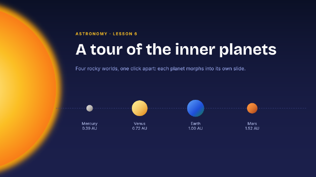

<!-- Generated by tools/gallery.mjs from showcase.yaml and build.json; do not edit. -->
# Planet Tour with Morph

[Slide](../README.md) › [Animations & Transitions](../README.md#animations--transitions) · `transitions` `morph` `lesson` `shapes` `gradient`

A four-slide science tour of the inner planets where Morph transitions grow each planet from the overview into its own fact slide.



| | |
|---|---|
| Document | [planet-tour-morph.pptx](planet-tour-morph.pptx) (27 KB) |
| Contents | 4 slides; 960 × 540 pt |
| Features | `slide.transitions.set`, `slide.shapes.edit`, `slide.slides.manage` |
| Built by | `kition-slide` @ `8309775c19`: 96 commands in 117 ms |

## About

The planets keep the same `!!` names from slide to slide, which is how Morph pairs them: Earth
grows from a dot on the overview into the hero of slide two, then hands over to Mars. The last
slide fades in. The checks read every slide's transition back from the document.

## Checks

- `inspect.slides`: `{"count":4}`
- `results.deck.slides.0.transition`: `null`
- `results.deck.slides.1.transition`: `"morph"`
- `results.deck.slides.2.transition`: `"morph"`
- `results.deck.slides.3.transition`: `"fade"`
- `results.earthSlide.transition`: `{"kind":"morph","option":"objects","durationMs":1600}`
- `results.earthSlide.shapes`: `{"any":{"name":"!!Earth","box":[520,70,400,400]}}`
- diagnostics: none (the kit's check finds nothing wrong)
- the saved document opens again; the thumbnail matches `thumb.png` within the `render` tolerance

## Steps

<details><summary>96 commands (from <a href="showcase.yaml">showcase.yaml</a>)</summary>

```yaml
- command: design.fonts
  params:
    major: Bricolage Grotesque
    minor: Inter
- command: slide.layout
  params:
    layout: blank
    index: 0
- command: shape.insert
  params:
    preset: ellipse
    rect:
      - -330
      - 20
      - 500
      - 500
  as: sun
- command: shape.fill
  params:
    ids:
      - $sun.id
    gradient:
      stops:
        - - 0
          - "#fff3b0"
        - - 0.4
          - "#fbbf24"
        - - 0.75
          - "#f97316"
      kind: radial
- command: shape.line
  params:
    ids:
      - $sun.id
    none: true
- command: shape.effects
  params:
    ids:
      - $sun.id
    glow:
      color: "#f59e0b"
      radius: 24
- command: shape.rename
  params:
    id: $sun.id
    name: "!!Sun"
- command: shape.insert
  params:
    preset: line
    rect:
      - 170
      - 330
      - 760
      - 0
  as: axis
- command: shape.line
  params:
    ids:
      - $axis.id
    color: "#3b4380"
    width: 1
    dash: dash
- command: shape.insert
  params:
    preset: ellipse
    rect:
      - 262
      - 320
      - 20
      - 20
  as: mercury
- command: shape.insert
  params:
    preset: ellipse
    rect:
      - 400
      - 306
      - 48
      - 48
  as: venus
- command: shape.insert
  params:
    preset: ellipse
    rect:
      - 568
      - 304
      - 52
      - 52
  as: earth
- command: shape.insert
  params:
    preset: ellipse
    rect:
      - 750
      - 314
      - 32
      - 32
  as: mars
- command: shape.fill
  params:
    ids:
      - $mercury.id
    gradient:
      stops:
        - - 0
          - "#d6d3d1"
        - - 1
          - "#78716c"
      angle: 45
- command: shape.fill
  params:
    ids:
      - $venus.id
    gradient:
      stops:
        - - 0
          - "#fde68a"
        - - 1
          - "#d97706"
      angle: 45
- command: shape.fill
  params:
    ids:
      - $earth.id
    gradient:
      stops:
        - - 0
          - "#60a5fa"
        - - 0.6
          - "#1d4ed8"
        - - 1
          - "#15803d"
      angle: 45
- command: shape.fill
  params:
    ids:
      - $mars.id
    gradient:
      stops:
        - - 0
          - "#fb923c"
        - - 1
          - "#9a3412"
      angle: 45
- command: shape.line
  params:
    ids:
      - $mercury.id
      - $venus.id
      - $earth.id
      - $mars.id
    none: true
- command: shape.rename
  params:
    id: $earth.id
    name: "!!Earth"
- command: shape.rename
  params:
    id: $mars.id
    name: "!!Mars"
- command: insert.textBox
  params:
    rect:
      - 222
      - 366
      - 100
      - 40
    text: |-
      Mercury
      0.39 AU
  as: l1
- command: insert.textBox
  params:
    rect:
      - 374
      - 366
      - 100
      - 40
    text: |-
      Venus
      0.72 AU
  as: l2
- command: insert.textBox
  params:
    rect:
      - 544
      - 366
      - 100
      - 40
    text: |-
      Earth
      1.00 AU
  as: l3
- command: insert.textBox
  params:
    rect:
      - 716
      - 366
      - 100
      - 40
    text: |-
      Mars
      1.52 AU
  as: l4
- command: format.size
  params:
    ids:
      - $l1.id
      - $l2.id
      - $l3.id
      - $l4.id
    size: 12
- command: format.color
  params:
    ids:
      - $l1.id
      - $l2.id
      - $l3.id
      - $l4.id
    color: "#c7d2fe"
- command: format.align
  params:
    ids:
      - $l1.id
      - $l2.id
      - $l3.id
      - $l4.id
    align: center
- command: insert.textBox
  params:
    rect:
      - 222
      - 92
      - 600
      - 24
    text: ASTRONOMY · LESSON 6
  as: kicker
- command: format.size
  params:
    ids:
      - $kicker.id
    size: 12
- command: format.bold
  params:
    ids:
      - $kicker.id
- command: format.spacing
  params:
    ids:
      - $kicker.id
    pt: 2
- command: format.color
  params:
    ids:
      - $kicker.id
    color: "#fbbf24"
- command: insert.textBox
  params:
    rect:
      - 222
      - 118
      - 640
      - 110
    text: A tour of the inner planets
  as: title
- command: format.font
  params:
    ids:
      - $title.id
    family: Bricolage Grotesque
- command: format.size
  params:
    ids:
      - $title.id
    size: 48
- command: format.bold
  params:
    ids:
      - $title.id
- command: format.color
  params:
    ids:
      - $title.id
    color: "#ffffff"
- command: insert.textBox
  params:
    rect:
      - 222
      - 196
      - 600
      - 30
    text: "Four rocky worlds, one click apart: each planet morphs into its own slide."
  as: lede
- command: format.size
  params:
    ids:
      - $lede.id
    size: 15
- command: format.color
  params:
    ids:
      - $lede.id
    color: "#a5b4fc"
- command: slide.new
  params:
    layout: blank
- command: shape.insert
  params:
    preset: ellipse
    rect:
      - -420
      - 20
      - 500
      - 500
  as: sun2
- command: shape.fill
  params:
    ids:
      - $sun2.id
    gradient:
      stops:
        - - 0
          - "#fff3b0"
        - - 0.4
          - "#fbbf24"
        - - 0.75
          - "#f97316"
      kind: radial
- command: shape.line
  params:
    ids:
      - $sun2.id
    none: true
- command: shape.rename
  params:
    id: $sun2.id
    name: "!!Sun"
- command: shape.insert
  params:
    preset: ellipse
    rect:
      - 520
      - 70
      - 400
      - 400
  as: earth2
- command: shape.fill
  params:
    ids:
      - $earth2.id
    gradient:
      stops:
        - - 0
          - "#60a5fa"
        - - 0.6
          - "#1d4ed8"
        - - 1
          - "#15803d"
      angle: 45
- command: shape.line
  params:
    ids:
      - $earth2.id
    none: true
- command: shape.effects
  params:
    ids:
      - $earth2.id
    glow:
      color: "#3b82f6"
      radius: 16
- command: shape.rename
  params:
    id: $earth2.id
    name: "!!Earth"
- command: insert.textBox
  params:
    rect:
      - 120
      - 130
      - 380
      - 70
    text: Earth
  as: t2
- command: insert.textBox
  params:
    rect:
      - 120
      - 210
      - 360
      - 160
    text: |-
      Third planet from the Sun
      One natural moon
      A day lasts 24 hours
      The only world known to hold liquid oceans on its surface
  as: b2
- command: slide.new
  params:
    layout: blank
- command: shape.insert
  params:
    preset: ellipse
    rect:
      - -80
      - 120
      - 300
      - 300
  as: earth3
- command: shape.fill
  params:
    ids:
      - $earth3.id
    gradient:
      stops:
        - - 0
          - "#60a5fa"
        - - 0.6
          - "#1d4ed8"
        - - 1
          - "#15803d"
      angle: 45
- command: shape.line
  params:
    ids:
      - $earth3.id
    none: true
- command: shape.rename
  params:
    id: $earth3.id
    name: "!!Earth"
- command: shape.insert
  params:
    preset: ellipse
    rect:
      - 540
      - 90
      - 360
      - 360
  as: mars3
- command: shape.fill
  params:
    ids:
      - $mars3.id
    gradient:
      stops:
        - - 0
          - "#fb923c"
        - - 1
          - "#9a3412"
      angle: 45
- command: shape.line
  params:
    ids:
      - $mars3.id
    none: true
- command: shape.effects
  params:
    ids:
      - $mars3.id
    glow:
      color: "#ea580c"
      radius: 16
- command: shape.rename
  params:
    id: $mars3.id
    name: "!!Mars"
- command: insert.textBox
  params:
    rect:
      - 250
      - 130
      - 300
      - 70
    text: Mars
  as: t3
- command: insert.textBox
  params:
    rect:
      - 250
      - 210
      - 290
      - 160
    text: |-
      Fourth planet from the Sun
      Two small moons
      A day lasts 24 h 37 min
      Home of the tallest volcano we know
  as: b3
- command: slide.new
  params:
    layout: blank
- command: insert.textBox
  params:
    rect:
      - 120
      - 190
      - 720
      - 80
    text: Which planet would you visit first?
  as: t4
- command: insert.textBox
  params:
    rect:
      - 120
      - 280
      - 720
      - 30
    text: Write one reason on your exit card before the bell.
  as: b4
- command: format.align
  params:
    ids:
      - $t4.id
      - $b4.id
    align: center
    onSlide: 4
- command: format.font
  params:
    ids:
      - $t2.id
    family: Bricolage Grotesque
    onSlide: 2
- command: format.size
  params:
    ids:
      - $t2.id
    size: 54
    onSlide: 2
- command: format.bold
  params:
    ids:
      - $t2.id
    onSlide: 2
- command: format.color
  params:
    ids:
      - $t2.id
    color: "#ffffff"
    onSlide: 2
- command: format.size
  params:
    ids:
      - $b2.id
    size: 17
    onSlide: 2
- command: format.color
  params:
    ids:
      - $b2.id
    color: "#c7d2fe"
    onSlide: 2
- command: format.bullets
  params:
    ids:
      - $b2.id
    char: •
    color: "#60a5fa"
    onSlide: 2
- command: format.paragraph
  params:
    ids:
      - $b2.id
    spaceAfter: 8
    onSlide: 2
- command: format.font
  params:
    ids:
      - $t3.id
    family: Bricolage Grotesque
    onSlide: 3
- command: format.size
  params:
    ids:
      - $t3.id
    size: 54
    onSlide: 3
- command: format.bold
  params:
    ids:
      - $t3.id
    onSlide: 3
- command: format.color
  params:
    ids:
      - $t3.id
    color: "#ffffff"
    onSlide: 3
- command: format.size
  params:
    ids:
      - $b3.id
    size: 17
    onSlide: 3
- command: format.color
  params:
    ids:
      - $b3.id
    color: "#fed7aa"
    onSlide: 3
- command: format.bullets
  params:
    ids:
      - $b3.id
    char: •
    color: "#fb923c"
    onSlide: 3
- command: format.paragraph
  params:
    ids:
      - $b3.id
    spaceAfter: 8
    onSlide: 3
- command: format.font
  params:
    ids:
      - $t4.id
    family: Bricolage Grotesque
    onSlide: 4
- command: format.size
  params:
    ids:
      - $t4.id
    size: 40
    onSlide: 4
- command: format.bold
  params:
    ids:
      - $t4.id
    onSlide: 4
- command: format.color
  params:
    ids:
      - $t4.id
    color: "#ffffff"
    onSlide: 4
- command: format.size
  params:
    ids:
      - $b4.id
    size: 18
    onSlide: 4
- command: format.color
  params:
    ids:
      - $b4.id
    color: "#a5b4fc"
    onSlide: 4
- command: design.background
  params:
    all: true
    gradient:
      stops:
        - - 0
          - "#0b1026"
        - - 1
          - "#1b1f4b"
      angle: 90
- command: transition.set
  params:
    kind: morph
    option: objects
    duration: 1600
    index: 1
- command: transition.set
  params:
    kind: morph
    option: objects
    duration: 1600
    index: 2
- command: transition.set
  params:
    kind: fade
    option: smoothly
    duration: 900
    index: 3
- command: slide.inspect
  params:
    index: 1
    select: false
  as: earthSlide
- command: document.inspect
  params: {}
  as: deck
```

</details>
