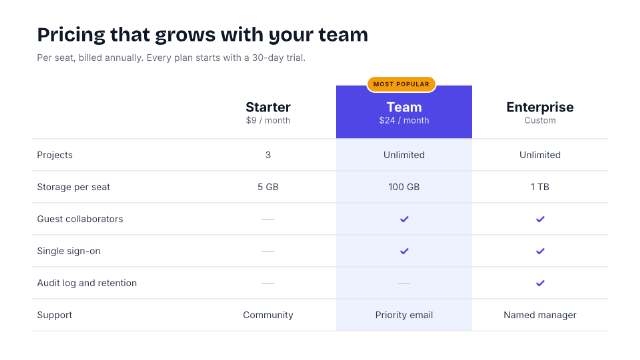

<!-- Generated by tools/gallery.mjs from showcase.yaml and build.json; do not edit. -->
# Pricing Plan Comparison

[Slide](../README.md) › [Charts & Tables](../README.md#charts--tables) · `table` `pricing` `cell-fill` `borders`

A three-tier pricing table with a highlighted recommended column, a "Most popular" badge, check marks and right-sized rows.



| | |
|---|---|
| Document | [pricing-plan-comparison.pptx](pricing-plan-comparison.pptx) (23 KB) |
| Contents | 1 slide; 960 × 540 pt |
| Features | `slide.tables.edit`, `slide.format.character`, `slide.shapes.edit` |
| Built by | `kition-slide` @ `8309775c19`: 82 commands in 535 ms |

## About

One table does all the work: the style is cleared, cells are selected in ranges to centre and
colour them, the recommended plan's column gets its own fill, the header row is taller, and only
thin horizontal rules separate the features. A pill-shaped badge sits on the highlighted column.

## Checks

- `inspect.slides`: `{"count":1}`
- `results.state`: `{"rows":7,"cols":4,"style":"none"}`
- `results.slide.shapes`: `{"any":{"kind":"table","table":{"rows":7,"cols":4,"widths":[252,204,204,204]}}}`
- diagnostics: none (the kit's check finds nothing wrong)
- the saved document opens again; the thumbnail matches `thumb.png` within the `render` tolerance

## Steps

<details><summary>82 commands (from <a href="showcase.yaml">showcase.yaml</a>)</summary>

```yaml
- command: design.fonts
  params:
    major: Bricolage Grotesque
    minor: Inter
- command: slide.layout
  params:
    layout: blank
    index: 0
- command: design.background
  params:
    color: "#ffffff"
- command: insert.textBox
  params:
    rect:
      - 48
      - 30
      - 560
      - 46
    text: Pricing that grows with your team
  as: title
- command: format.font
  params:
    ids:
      - $title.id
    family: Bricolage Grotesque
- command: format.size
  params:
    ids:
      - $title.id
    size: 30
- command: format.bold
  params:
    ids:
      - $title.id
- command: format.color
  params:
    ids:
      - $title.id
    color: "#111827"
- command: insert.textBox
  params:
    rect:
      - 48
      - 74
      - 560
      - 24
    text: Per seat, billed annually. Every plan starts with a 30-day trial.
  as: lede
- command: format.size
  params:
    ids:
      - $lede.id
    size: 14
- command: format.color
  params:
    ids:
      - $lede.id
    color: "#6b7280"
- command: insert.table
  params:
    rows: 7
    cols: 4
    rect:
      - 48
      - 128
      - 864
      - 380
    data:
      - - ""
        - |-
          Starter
          $9 / month
        - |-
          Team
          $24 / month
        - |-
          Enterprise
          Custom
      - - Projects
        - "3"
        - Unlimited
        - Unlimited
      - - Storage per seat
        - 5 GB
        - 100 GB
        - 1 TB
      - - Guest collaborators
        - —
        - ✓
        - ✓
      - - Single sign-on
        - —
        - ✓
        - ✓
      - - Audit log and retention
        - —
        - —
        - ✓
      - - Support
        - Community
        - Priority email
        - Named manager
  as: tb
- command: table.style
  params:
    id: $tb.id
    style: none
- command: table.options
  params:
    id: $tb.id
    headerRow: true
    bandedRows: false
- command: table.columnWidth
  params:
    id: $tb.id
    col: 0
    width: 252
- command: table.columnWidth
  params:
    id: $tb.id
    col: 1
    width: 204
- command: table.columnWidth
  params:
    id: $tb.id
    col: 2
    width: 204
- command: table.columnWidth
  params:
    id: $tb.id
    col: 3
    width: 204
- command: table.rowHeight
  params:
    id: $tb.id
    row: 0
    height: 80
- command: table.rowHeight
  params:
    id: $tb.id
    row: 1
    height: 48
- command: table.rowHeight
  params:
    id: $tb.id
    row: 2
    height: 48
- command: table.rowHeight
  params:
    id: $tb.id
    row: 3
    height: 48
- command: table.rowHeight
  params:
    id: $tb.id
    row: 4
    height: 48
- command: table.rowHeight
  params:
    id: $tb.id
    row: 5
    height: 48
- command: table.rowHeight
  params:
    id: $tb.id
    row: 6
    height: 48
- command: table.cellFormat
  params:
    id: $tb.id
    anchor: center
- command: format.size
  params:
    ids:
      - $tb.id
    size: 14
- command: format.color
  params:
    ids:
      - $tb.id
    color: "#374151"
- command: table.selectCells
  params:
    id: $tb.id
    from:
      - 0
      - 1
    to:
      - 6
      - 3
- command: format.align
  params:
    align: center
- command: table.selectCells
  params:
    id: $tb.id
    from:
      - 0
      - 1
    to:
      - 0
      - 3
- command: format.size
  params:
    size: 13
- command: format.color
  params:
    color: "#6b7280"
- command: table.selectCells
  params:
    id: $tb.id
    from:
      - 3
      - 1
    to:
      - 5
      - 3
- command: format.size
  params:
    size: 18
- command: format.bold
  params: {}
- command: format.color
  params:
    color: "#4f46e5"
- command: table.selectCells
  params:
    id: $tb.id
    from:
      - 3
      - 1
    to:
      - 3
      - 1
- command: format.bold
  params:
    on: false
- command: format.color
  params:
    color: "#c7cbd3"
- command: table.selectCells
  params:
    id: $tb.id
    from:
      - 4
      - 1
    to:
      - 4
      - 1
- command: format.bold
  params:
    on: false
- command: format.color
  params:
    color: "#c7cbd3"
- command: table.selectCells
  params:
    id: $tb.id
    from:
      - 5
      - 1
    to:
      - 5
      - 1
- command: format.bold
  params:
    on: false
- command: format.color
  params:
    color: "#c7cbd3"
- command: table.selectCells
  params:
    id: $tb.id
    from:
      - 5
      - 2
    to:
      - 5
      - 2
- command: format.bold
  params:
    on: false
- command: format.color
  params:
    color: "#c7cbd3"
- command: table.selectCells
  params:
    id: $tb.id
    from:
      - 0
      - 2
    to:
      - 6
      - 2
- command: table.cellFill
  params:
    id: $tb.id
    color: "#eef2ff"
- command: table.selectCells
  params:
    id: $tb.id
    from:
      - 0
      - 2
    to:
      - 0
      - 2
- command: table.cellFill
  params:
    id: $tb.id
    color: "#4f46e5"
- command: format.color
  params:
    color: "#e0e7ff"
- command: table.border
  params:
    id: $tb.id
    edges: insideH
    color: "#e5e7eb"
    width: 1
    from:
      - 0
      - 0
    to:
      - 6
      - 3
- command: table.border
  params:
    id: $tb.id
    edges: bottom
    color: "#e5e7eb"
    width: 1
    from:
      - 6
      - 0
    to:
      - 6
      - 3
- command: text.edit
  params:
    id: $tb.id
    cell:
      - 0
      - 1
    at:
      - 0
      - 0
- command: text.selectParagraph
  params:
    at:
      - 0
      - 0
- command: format.size
  params:
    size: 20
- command: format.bold
  params: {}
- command: format.color
  params:
    color: "#111827"
- command: text.edit
  params:
    id: $tb.id
    cell:
      - 0
      - 2
    at:
      - 0
      - 0
- command: text.selectParagraph
  params:
    at:
      - 0
      - 0
- command: format.size
  params:
    size: 20
- command: format.bold
  params: {}
- command: format.color
  params:
    color: "#ffffff"
- command: text.edit
  params:
    id: $tb.id
    cell:
      - 0
      - 3
    at:
      - 0
      - 0
- command: text.selectParagraph
  params:
    at:
      - 0
      - 0
- command: format.size
  params:
    size: 20
- command: format.bold
  params: {}
- command: format.color
  params:
    color: "#111827"
- command: text.exit
  params: {}
- command: shape.insert
  params:
    preset: roundRect
    rect:
      - 550
      - 114
      - 104
      - 24
    text: MOST POPULAR
    adj:
      - 50000
  as: badge
- command: shape.fill
  params:
    ids:
      - $badge.id
    color: "#f59e0b"
- command: shape.line
  params:
    ids:
      - $badge.id
    color: "#ffffff"
    width: 2
- command: format.size
  params:
    ids:
      - $badge.id
    size: 9
- command: format.bold
  params:
    ids:
      - $badge.id
- command: format.spacing
  params:
    ids:
      - $badge.id
    pt: 1
- command: format.color
  params:
    ids:
      - $badge.id
    color: "#451a03"
- command: format.margins
  params:
    ids:
      - $badge.id
    left: 0
    right: 0
    top: 0
    bottom: 0
- command: table.state
  params:
    id: $tb.id
  as: state
- command: slide.inspect
  params:
    index: 0
  as: slide
```

</details>
