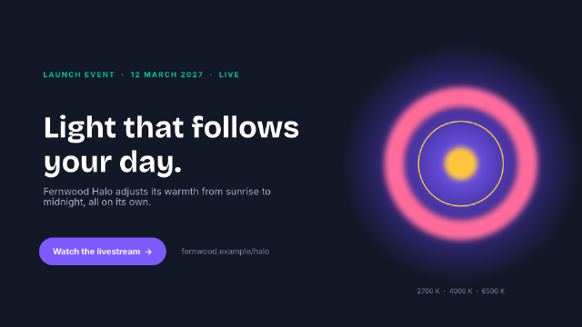

<!-- Generated by tools/gallery.mjs from showcase.yaml and build.json; do not edit. -->
# Product Launch Keynote

[Slide](../README.md) › [Events & Marketing](../README.md#events--marketing) · `launch` `theme` `dark` `glow` `gradient`

A dark keynote opener in the built-in Nocturne theme, with a glowing product ring, a launch-date kicker and a call to action.



| | |
|---|---|
| Document | [product-launch-keynote.pptx](product-launch-keynote.pptx) (24 KB) |
| Contents | 2 slides; 960 × 540 pt |
| Features | `slide.design.themes`, `slide.shapes.edit`, `slide.format.character` |
| Built by | `kition-slide` @ `8309775c19`: 65 commands in 111 ms |

## About

Nocturne swaps the light and dark theme colours, so the title placeholders are already white on
near-black. The product is drawn from shapes: a donut with a radial gradient and a soft glow
over a blurred halo. The second slide carries the event's running order.

## Checks

- `inspect.slides`: `{"count":2}`
- `results.deck.theme`: `"Nocturne"`
- `results.deck.fonts`: `{"major":"Bricolage Grotesque","minor":"Inter"}`
- `results.opener.layout`: `"Title Slide"`
- `results.deck.slides.1.transition`: `"fade"`
- diagnostics: none (the kit's check finds nothing wrong)
- the saved document opens again; the thumbnail matches `thumb.png` within the `render` tolerance

## Steps

<details><summary>65 commands (from <a href="showcase.yaml">showcase.yaml</a>)</summary>

```yaml
- command: design.theme
  params:
    name: Nocturne
- command: design.fonts
  params:
    major: Bricolage Grotesque
    minor: Inter
- command: slide.inspect
  params:
    index: 0
  as: opener
- command: text.set
  params:
    id: $opener.shapes.0.id
    text: Light that follows your day.
- command: text.set
  params:
    id: $opener.shapes.1.id
    text: Fernwood Halo adjusts its warmth from sunrise to midnight, all on its own.
- command: shape.setBounds
  params:
    ids:
      - $opener.shapes.0.id
    x: 64
    y: 150
    w: 470
    h: 150
- command: shape.setBounds
  params:
    ids:
      - $opener.shapes.1.id
    x: 64
    y: 304
    w: 420
    h: 60
- command: format.align
  params:
    ids:
      - $opener.shapes.0.id
      - $opener.shapes.1.id
    align: left
- command: format.anchor
  params:
    ids:
      - $opener.shapes.0.id
    anchor: bottom
- command: format.anchor
  params:
    ids:
      - $opener.shapes.1.id
    anchor: top
- command: format.size
  params:
    ids:
      - $opener.shapes.0.id
    size: 50
- command: format.bold
  params:
    ids:
      - $opener.shapes.0.id
    on: true
- command: format.lineSpacing
  params:
    ids:
      - $opener.shapes.0.id
    lines: 0.95
- command: format.size
  params:
    ids:
      - $opener.shapes.1.id
    size: 16
- command: format.color
  params:
    ids:
      - $opener.shapes.1.id
    color: "#a5b0c8"
- command: insert.textBox
  params:
    rect:
      - 64
      - 112
      - 420
      - 24
    text: LAUNCH EVENT  ·  12 MARCH 2027  ·  LIVE
  as: kicker
- command: format.size
  params:
    ids:
      - $kicker.id
    size: 12
- command: format.bold
  params:
    ids:
      - $kicker.id
- command: format.spacing
  params:
    ids:
      - $kicker.id
    pt: 2
- command: format.color
  params:
    ids:
      - $kicker.id
    color: accent2
- command: shape.insert
  params:
    preset: roundRect
    rect:
      - 64
      - 392
      - 210
      - 46
    text: Watch the livestream  →
  as: cta
- command: shape.adjust
  params:
    ids:
      - $cta.id
    index: 0
    value: 50000
- command: shape.fill
  params:
    ids:
      - $cta.id
    color: accent1
- command: shape.line
  params:
    ids:
      - $cta.id
    none: true
- command: format.size
  params:
    ids:
      - $cta.id
    size: 14
- command: format.bold
  params:
    ids:
      - $cta.id
- command: format.color
  params:
    ids:
      - $cta.id
    color: "#ffffff"
- command: insert.textBox
  params:
    rect:
      - 292
      - 403
      - 240
      - 24
    text: fernwood.example/halo
  as: url
- command: format.size
  params:
    ids:
      - $url.id
    size: 13
- command: format.color
  params:
    ids:
      - $url.id
    color: "#7d879c"
- command: shape.insert
  params:
    preset: ellipse
    rect:
      - 560
      - 70
      - 400
      - 400
  as: halo
- command: shape.fill
  params:
    ids:
      - $halo.id
    gradient:
      stops:
        - - 0
          - "#7C5CFF"
        - - 0.35
          - "#3a2b8f"
        - - 0.7
          - "#121826"
      kind: radial
- command: shape.line
  params:
    ids:
      - $halo.id
    none: true
- command: shape.insert
  params:
    preset: ellipse
    rect:
      - 650
      - 160
      - 220
      - 220
  as: ring
- command: shape.fill
  params:
    ids:
      - $ring.id
    none: true
- command: shape.line
  params:
    ids:
      - $ring.id
    color: "#FF6B9A"
    width: 16
- command: shape.effects
  params:
    ids:
      - $ring.id
    glow:
      color: "#FF6B9A"
      radius: 14
- command: shape.insert
  params:
    preset: ellipse
    rect:
      - 690
      - 200
      - 140
      - 140
  as: inner
- command: shape.fill
  params:
    ids:
      - $inner.id
    none: true
- command: shape.line
  params:
    ids:
      - $inner.id
    color: "#FFC53D"
    width: 2
- command: shape.insert
  params:
    preset: ellipse
    rect:
      - 740
      - 250
      - 40
      - 40
  as: dot
- command: shape.fill
  params:
    ids:
      - $dot.id
    color: "#FFC53D"
- command: shape.line
  params:
    ids:
      - $dot.id
    none: true
- command: shape.effects
  params:
    ids:
      - $dot.id
    glow:
      color: "#FFC53D"
      radius: 12
- command: insert.textBox
  params:
    rect:
      - 640
      - 470
      - 240
      - 22
    text: 2700 K  ·  4000 K  ·  6500 K
  as: temps
- command: format.size
  params:
    ids:
      - $temps.id
    size: 11
- command: format.align
  params:
    ids:
      - $temps.id
    align: center
- command: format.color
  params:
    ids:
      - $temps.id
    color: "#7d879c"
- command: slide.new
  params:
    layout: titleOnly
- command: slide.inspect
  params:
    index: 1
  as: order
- command: text.set
  params:
    id: $order.shapes.0.id
    text: Running order
- command: format.bold
  params:
    ids:
      - $order.shapes.0.id
    on: true
- command: insert.table
  params:
    rows: 5
    cols: 3
    rect:
      - 60
      - 150
      - 840
      - 300
    data:
      - - Time
        - Session
        - Host
      - - 18:00
        - Doors open and demo tables
        - Product team
      - - 18:30
        - "Keynote: light that follows your day"
        - Founder
      - - 19:10
        - Design deep dive
        - Industrial design lead
      - - 19:40
        - Questions and first orders
        - Everyone
  as: table
- command: table.style
  params:
    id: $table.id
    style: medium2-accent1
- command: table.cellFill
  params:
    id: $table.id
    color: "#1E2638"
    cells:
      - - 1
        - 0
      - - 1
        - 1
      - - 1
        - 2
      - - 3
        - 0
      - - 3
        - 1
      - - 3
        - 2
- command: table.cellFill
  params:
    id: $table.id
    color: "#262f45"
    cells:
      - - 2
        - 0
      - - 2
        - 1
      - - 2
        - 2
      - - 4
        - 0
      - - 4
        - 1
      - - 4
        - 2
- command: table.border
  params:
    id: $table.id
    edges: all
    color: "#121826"
    width: 1.5
- command: table.cellFormat
  params:
    id: $table.id
    anchor: center
    margins:
      - 14
      - 14
      - 6
      - 6
- command: format.color
  params:
    ids:
      - $table.id
    color: "#e5e9f2"
- command: format.size
  params:
    ids:
      - $table.id
    size: 16
- command: table.columnWidth
  params:
    id: $table.id
    col: 0
    width: 140
- command: table.columnWidth
  params:
    id: $table.id
    col: 1
    width: 440
- command: table.columnWidth
  params:
    id: $table.id
    col: 2
    width: 260
- command: transition.set
  params:
    kind: fade
    index: 1
    duration: 700
- command: document.inspect
  params: {}
  as: deck
```

</details>
