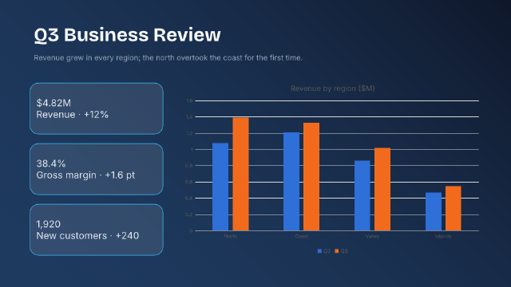

<!-- Generated by tools/gallery.mjs from showcase.yaml and build.json; do not edit. -->
# Quarterly Business Review

[Slide](../README.md) › [Business Reports](../README.md#business-reports) · `chart` `shapes` `gradient` `kpi` `theme-fonts`

A results slide with a gradient background, three KPI cards and a clustered column chart of revenue by region.



| | |
|---|---|
| Document | [quarterly-review.pptx](quarterly-review.pptx) (26 KB) |
| Contents | 1 slide; 960 × 540 pt |
| Features | `slide.shapes.edit`, `slide.text.edit`, `slide.format.character` |
| Built by | `kition-slide` @ `8309775c19`: 20 commands in 84 ms |

## Checks

- `inspect.slides`: `{"count":1}`
- `inspect.slideSize`: `{"width":960,"height":540}`
- diagnostics: none (the kit's check finds nothing wrong)
- the saved document opens again; the thumbnail matches `thumb.png` within the `render` tolerance

## Steps

<details><summary>20 commands (from <a href="showcase.yaml">showcase.yaml</a>)</summary>

```yaml
- command: design.fonts
  params:
    major: Bricolage Grotesque
    minor: Inter
- command: slide.layout
  params:
    layout: blank
    index: 0
- command: design.background
  params:
    gradient:
      stops:
        - - 0
          - "#0f172a"
        - - 1
          - "#1e3a5f"
      angle: 135
- command: insert.textBox
  params:
    rect:
      - 56
      - 40
      - 620
      - 60
    text: Q3 Business Review
  as: title
- command: format.font
  params:
    ids:
      - $title.id
    family: Bricolage Grotesque
- command: format.size
  params:
    ids:
      - $title.id
    size: 36
- command: format.bold
  params:
    ids:
      - $title.id
- command: format.color
  params:
    ids:
      - $title.id
    color: "#f8fafc"
- command: insert.textBox
  params:
    rect:
      - 56
      - 96
      - 620
      - 30
    text: Revenue grew in every region; the north overtook the coast for the first time.
  as: lede
- command: format.size
  params:
    ids:
      - $lede.id
    size: 14
- command: format.color
  params:
    ids:
      - $lede.id
    color: "#94a3b8"
- command: shape.insert
  params:
    preset: roundRect
    rect:
      - 56
      - 156
      - 250
      - 96
    text: |-
      $$4.82M
      Revenue · +12%
  as: kpi1
- command: shape.insert
  params:
    preset: roundRect
    rect:
      - 56
      - 270
      - 250
      - 96
    text: |-
      38.4%
      Gross margin · +1.6 pt
  as: kpi2
- command: shape.insert
  params:
    preset: roundRect
    rect:
      - 56
      - 384
      - 250
      - 96
    text: |-
      1,920
      New customers · +240
  as: kpi3
- command: shape.fill
  params:
    ids:
      - $kpi1.id
      - $kpi2.id
      - $kpi3.id
    color: "#f8fafc"
    transparency: 0.9
- command: shape.line
  params:
    ids:
      - $kpi1.id
      - $kpi2.id
      - $kpi3.id
    color: "#38bdf8"
    width: 1
- command: format.color
  params:
    ids:
      - $kpi1.id
      - $kpi2.id
      - $kpi3.id
    color: "#e2e8f0"
- command: format.align
  params:
    ids:
      - $kpi1.id
      - $kpi2.id
      - $kpi3.id
    align: left
- command: insert.chart
  params:
    type: column
    rect:
      - 340
      - 150
      - 570
      - 340
    categories:
      - North
      - Coast
      - Valley
      - Islands
    series:
      - name: Q2
        values:
          - 1.08
          - 1.21
          - 0.86
          - 0.47
      - name: Q3
        values:
          - 1.39
          - 1.33
          - 1.02
          - 0.55
    title: Revenue by region ($M)
  as: chart
- command: chart.options
  params:
    id: $chart.id
    legend: b
    dataLabels: false
    gridlines: true
```

</details>
