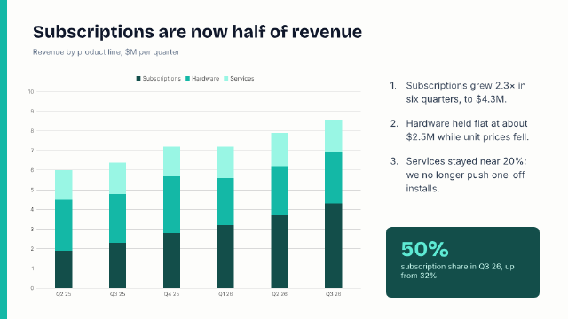

<!-- Generated by tools/gallery.mjs from showcase.yaml and build.json; do not edit. -->
# Revenue Mix Stacked Columns

[Slide](../README.md) › [Charts & Tables](../README.md#charts--tables) · `chart` `stacked-column` `theme-colors` `numbering`

Six quarters of revenue stacked by product line in one colour family, with a headline that states the shift and three numbered takeaways.



| | |
|---|---|
| Document | [revenue-mix-stacked-column.pptx](revenue-mix-stacked-column.pptx) (26 KB) |
| Contents | 1 slide; 960 × 540 pt |
| Features | `slide.charts.edit`, `slide.design.themes`, `slide.format.paragraph` |
| Built by | `kition-slide` @ `8309775c19`: 37 commands in 90 ms |

## About

A stacked column chart whose series take three shades of teal from the deck's colour scheme,
so the stack reads as one total split into parts. The legend sits on top, gridlines stay light,
and a numbered list beside the chart explains the mix shift the headline announces.

## Checks

- `inspect.slides`: `{"count":1}`
- `results.c.shape.kind`: `{"kind":"stackedColumn","legend":"t","title":null,"series":{"count":3}}`
- `results.slide.design`: `{"none":{"code":"design.low-contrast"}}`
- diagnostics: none (the kit's check finds nothing wrong)
- the saved document opens again; the thumbnail matches `thumb.png` within the `render` tolerance

## Steps

<details><summary>37 commands (from <a href="showcase.yaml">showcase.yaml</a>)</summary>

```yaml
- command: design.colors
  params:
    colors:
      accent1: "#134e4a"
      accent2: "#14b8a6"
      accent3: "#99f6e4"
- command: design.fonts
  params:
    major: Bricolage Grotesque
    minor: Inter
- command: slide.layout
  params:
    layout: blank
    index: 0
- command: design.background
  params:
    color: "#fdfdfb"
- command: shape.insert
  params:
    preset: rect
    rect:
      - 0
      - 0
      - 12
      - 540
  as: edge
- command: shape.fill
  params:
    ids:
      - $edge.id
    color: "#14b8a6"
- command: shape.line
  params:
    ids:
      - $edge.id
    none: true
- command: insert.textBox
  params:
    rect:
      - 48
      - 32
      - 860
      - 46
    text: Subscriptions are now half of revenue
  as: title
- command: format.font
  params:
    ids:
      - $title.id
    family: Bricolage Grotesque
- command: format.size
  params:
    ids:
      - $title.id
    size: 30
- command: format.bold
  params:
    ids:
      - $title.id
- command: format.color
  params:
    ids:
      - $title.id
    color: "#0f172a"
- command: insert.textBox
  params:
    rect:
      - 48
      - 76
      - 860
      - 24
    text: Revenue by product line, $M per quarter
  as: lede
- command: format.size
  params:
    ids:
      - $lede.id
    size: 13
- command: format.color
  params:
    ids:
      - $lede.id
    color: "#64748b"
- command: insert.chart
  params:
    type: stackedColumn
    rect:
      - 40
      - 116
      - 580
      - 396
    categories:
      - Q2 25
      - Q3 25
      - Q4 25
      - Q1 26
      - Q2 26
      - Q3 26
    series:
      - name: Subscriptions
        values:
          - 1.9
          - 2.3
          - 2.8
          - 3.2
          - 3.7
          - 4.3
      - name: Hardware
        values:
          - 2.6
          - 2.5
          - 2.9
          - 2.4
          - 2.5
          - 2.6
      - name: Services
        values:
          - 1.5
          - 1.6
          - 1.5
          - 1.6
          - 1.7
          - 1.7
  as: chart
- command: chart.options
  params:
    id: $chart.id
    title: null
    legend: t
    dataLabels: false
    gridlines: true
- command: insert.textBox
  params:
    rect:
      - 652
      - 128
      - 260
      - 360
    text: |-
      Subscriptions grew 2.3× in six quarters, to $4.3M.
      Hardware held flat at about $2.5M while unit prices fell.
      Services stayed near 20%; we no longer push one-off installs.
  as: points
- command: format.numbering
  params:
    ids:
      - $points.id
    scheme: arabicPeriod
- command: format.size
  params:
    ids:
      - $points.id
    size: 16
- command: format.color
  params:
    ids:
      - $points.id
    color: "#334155"
- command: format.paragraph
  params:
    ids:
      - $points.id
    spaceAfter: 18
    lineSpacing: 1.2
- command: shape.insert
  params:
    preset: roundRect
    rect:
      - 652
      - 384
      - 260
      - 120
    adj:
      - 8000
  as: card
- command: shape.fill
  params:
    ids:
      - $card.id
    color: "#134e4a"
- command: shape.line
  params:
    ids:
      - $card.id
    none: true
- command: insert.textBox
  params:
    rect:
      - 670
      - 396
      - 230
      - 96
    text: |-
      50%
      subscription share in Q3 26, up from 32%
  as: kpi
- command: format.size
  params:
    ids:
      - $kpi.id
    size: 13
- command: format.color
  params:
    ids:
      - $kpi.id
    color: "#ccfbf1"
- command: text.edit
  params:
    id: $kpi.id
    at:
      - 0
      - 0
- command: text.selectParagraph
  params:
    at:
      - 0
      - 0
- command: format.size
  params:
    size: 36
- command: format.bold
  params: {}
- command: format.font
  params:
    family: Bricolage Grotesque
- command: format.color
  params:
    color: "#5eead4"
- command: text.exit
  params: {}
- command: shape.inspect
  params:
    id: $chart.id
  as: c
- command: slide.inspect
  params:
    index: 0
  as: slide
```

</details>
