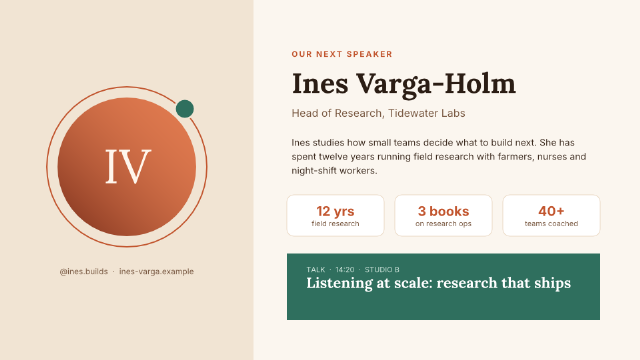

<!-- Generated by tools/gallery.mjs from showcase.yaml and build.json; do not edit. -->
# Speaker Introduction

[Slide](../README.md) › [Events & Marketing](../README.md#events--marketing) · `event` `speaker` `shapes` `notes`

A speaker card for a conference session, with a monogram portrait ring, a short bio, three credentials and the talk title, plus the host's notes.



| | |
|---|---|
| Document | [speaker-introduction.pptx](speaker-introduction.pptx) (26 KB) |
| Contents | 1 slide; 960 × 540 pt |
| Features | `slide.shapes.edit`, `slide.format.character`, `slide.slides.manage` |
| Built by | `kition-slide` @ `8309775c19`: 79 commands in 92 ms |

## About

No photographs: the portrait is a monogram on a gradient circle inside a thin accent ring. The
host's introduction script is in the speaker notes, where the presenter view shows it.

## Checks

- `inspect.slides`: `{"count":1}`
- `results.card.notes`: `{"matches":"^Please welcome Ines"}`
- `results.card.transition`: `{"kind":"fade"}`
- `results.card.shapes`: `{"any":{"preset":"ellipse","text":"IV"}}`
- diagnostics: none (the kit's check finds nothing wrong)
- the saved document opens again; the thumbnail matches `thumb.png` within the `render` tolerance

## Steps

<details><summary>79 commands (from <a href="showcase.yaml">showcase.yaml</a>)</summary>

```yaml
- command: design.fonts
  params:
    major: Lora
    minor: Inter
- command: slide.layout
  params:
    layout: blank
    index: 0
- command: design.background
  params:
    color: "#fbf6ef"
- command: shape.insert
  params:
    preset: rect
    rect:
      - 0
      - 0
      - 380
      - 540
  as: panel
- command: shape.fill
  params:
    ids:
      - $panel.id
    color: "#f1e4d3"
- command: shape.line
  params:
    ids:
      - $panel.id
    none: true
- command: shape.insert
  params:
    preset: ellipse
    rect:
      - 70
      - 130
      - 240
      - 240
  as: ring
- command: shape.fill
  params:
    ids:
      - $ring.id
    none: true
- command: shape.line
  params:
    ids:
      - $ring.id
    color: "#c2562f"
    width: 2
- command: shape.insert
  params:
    preset: ellipse
    rect:
      - 86
      - 146
      - 208
      - 208
    text: IV
  as: portrait
- command: shape.fill
  params:
    ids:
      - $portrait.id
    gradient:
      stops:
        - - 0
          - "#e07a4f"
        - - 1
          - "#7a2e1a"
      angle: 135
- command: shape.line
  params:
    ids:
      - $portrait.id
    none: true
- command: format.font
  params:
    ids:
      - $portrait.id
    family: Lora
- command: format.size
  params:
    ids:
      - $portrait.id
    size: 72
- command: format.color
  params:
    ids:
      - $portrait.id
    color: "#fff6ec"
- command: shape.insert
  params:
    preset: ellipse
    rect:
      - 262
      - 148
      - 30
      - 30
  as: dot
- command: shape.fill
  params:
    ids:
      - $dot.id
    color: "#2f6f5e"
- command: shape.line
  params:
    ids:
      - $dot.id
    color: "#f1e4d3"
    width: 3
- command: insert.textBox
  params:
    rect:
      - 40
      - 396
      - 300
      - 24
    text: "@ines.builds  ·  ines-varga.example"
  as: handle
- command: format.size
  params:
    ids:
      - $handle.id
    size: 12
- command: format.align
  params:
    ids:
      - $handle.id
    align: center
- command: format.color
  params:
    ids:
      - $handle.id
    color: "#7a5a43"
- command: insert.textBox
  params:
    rect:
      - 430
      - 70
      - 460
      - 22
    text: OUR NEXT SPEAKER
  as: kicker
- command: format.size
  params:
    ids:
      - $kicker.id
    size: 12
- command: format.bold
  params:
    ids:
      - $kicker.id
- command: format.spacing
  params:
    ids:
      - $kicker.id
    pt: 2
- command: format.color
  params:
    ids:
      - $kicker.id
    color: "#c2562f"
- command: insert.textBox
  params:
    rect:
      - 430
      - 96
      - 480
      - 60
    text: Ines Varga-Holm
  as: name
- command: format.font
  params:
    ids:
      - $name.id
    family: Lora
- command: format.size
  params:
    ids:
      - $name.id
    size: 42
- command: format.bold
  params:
    ids:
      - $name.id
- command: format.color
  params:
    ids:
      - $name.id
    color: "#2b1d14"
- command: insert.textBox
  params:
    rect:
      - 430
      - 156
      - 480
      - 26
    text: Head of Research, Tidewater Labs
  as: role
- command: format.size
  params:
    ids:
      - $role.id
    size: 16
- command: format.color
  params:
    ids:
      - $role.id
    color: "#7a5a43"
- command: insert.textBox
  params:
    rect:
      - 430
      - 198
      - 470
      - 80
    text: Ines studies how small teams decide what to build next. She has spent twelve years running field research with farmers, nurses and night-shift workers.
  as: bio
- command: format.size
  params:
    ids:
      - $bio.id
    size: 14
- command: format.color
  params:
    ids:
      - $bio.id
    color: "#3d2c20"
- command: format.lineSpacing
  params:
    ids:
      - $bio.id
    lines: 1.25
- command: shape.insert
  params:
    preset: roundRect
    rect:
      - 430
      - 292
      - 146
      - 62
    text: |-
      12 yrs
      field research
  as: f1
- command: shape.insert
  params:
    preset: roundRect
    rect:
      - 592
      - 292
      - 146
      - 62
    text: |-
      3 books
      on research ops
  as: f2
- command: shape.insert
  params:
    preset: roundRect
    rect:
      - 754
      - 292
      - 146
      - 62
    text: |-
      40+
      teams coached
  as: f3
- command: shape.fill
  params:
    ids:
      - $f1.id
      - $f2.id
      - $f3.id
    color: "#ffffff"
- command: shape.line
  params:
    ids:
      - $f1.id
      - $f2.id
      - $f3.id
    color: "#ead8c3"
    width: 1
- command: format.size
  params:
    ids:
      - $f1.id
      - $f2.id
      - $f3.id
    size: 11
- command: format.color
  params:
    ids:
      - $f1.id
      - $f2.id
      - $f3.id
    color: "#7a5a43"
- command: text.edit
  params:
    id: $f1.id
    at:
      - 0
      - 0
- command: text.selectParagraph
  params:
    at:
      - 0
      - 0
- command: format.size
  params:
    size: 20
- command: format.bold
  params:
    on: true
- command: format.color
  params:
    color: "#c2562f"
- command: text.edit
  params:
    id: $f2.id
    at:
      - 0
      - 0
- command: text.selectParagraph
  params:
    at:
      - 0
      - 0
- command: format.size
  params:
    size: 20
- command: format.bold
  params:
    on: true
- command: format.color
  params:
    color: "#c2562f"
- command: text.edit
  params:
    id: $f3.id
    at:
      - 0
      - 0
- command: text.selectParagraph
  params:
    at:
      - 0
      - 0
- command: format.size
  params:
    size: 20
- command: format.bold
  params:
    on: true
- command: format.color
  params:
    color: "#c2562f"
- command: text.exit
  params: {}
- command: shape.insert
  params:
    preset: rect
    rect:
      - 430
      - 380
      - 470
      - 100
  as: talk
- command: shape.fill
  params:
    ids:
      - $talk.id
    color: "#2f6f5e"
- command: shape.line
  params:
    ids:
      - $talk.id
    none: true
- command: insert.textBox
  params:
    rect:
      - 452
      - 394
      - 430
      - 74
    text: |-
      TALK  ·  14:20  ·  STUDIO B
      Listening at scale: research that ships
  as: talkText
- command: format.size
  params:
    ids:
      - $talkText.id
    size: 11
- command: format.color
  params:
    ids:
      - $talkText.id
    color: "#cfe5dc"
- command: format.anchor
  params:
    ids:
      - $talkText.id
    anchor: middle
- command: text.edit
  params:
    id: $talkText.id
    at:
      - 1
      - 0
- command: text.selectParagraph
  params:
    at:
      - 1
      - 0
- command: format.font
  params:
    family: Lora
- command: format.size
  params:
    size: 22
- command: format.bold
  params:
    on: true
- command: format.color
  params:
    color: "#ffffff"
- command: text.exit
  params: {}
- command: slide.notes
  params:
    index: 0
    text: Please welcome Ines. Mention the night-shift study, then hand over the clicker; she will take questions at the end.
- command: transition.set
  params:
    kind: fade
    index: 0
- command: slide.inspect
  params:
    index: 0
  as: card
```

</details>
