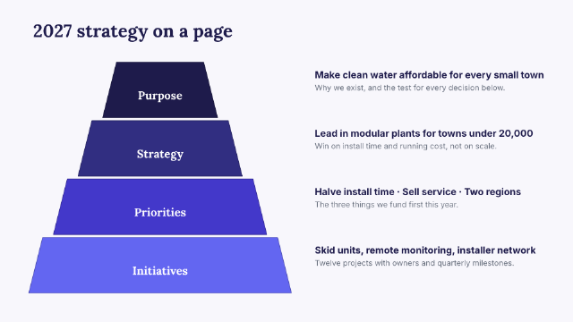

<!-- Generated by tools/gallery.mjs from showcase.yaml and build.json; do not edit. -->
# Strategy Pyramid

[Slide](../README.md) › [Business Reports](../README.md#business-reports) · `smartart` `pyramid` `theme-colors` `strategy`

A four-level strategy pyramid from purpose down to initiatives, built as a SmartArt diagram, resized into place and coloured from the theme.



| | |
|---|---|
| Document | [strategy-pyramid.pptx](strategy-pyramid.pptx) (22 KB) |
| Contents | 1 slide; 960 × 540 pt |
| Features | `slide.insert.objects`, `slide.design.themes`, `slide.shapes.edit` |
| Built by | `kition-slide` @ `8309775c19`: 46 commands in 161 ms |

## About

One `insert.smartArt` call makes the pyramid; `shape.setBounds` scales the whole group into the
left half of the slide, and its four levels take accents 1 to 4 of a custom indigo scheme, from
darkest at the top to lightest at the base. The levels' labels are set in bold Lora through the
child shape ids that `shape.inspect` reports. Each level has its explanation alongside.

## Checks

- `inspect.slides`: `{"count":1}`
- `results.group.box`: `{"x":48,"y":104,"w":440,"h":392}`
- `results.group.shape.kind.children`: `{"count":4,"all":{"geom":{"name":"trapezoid"}}}`
- `results.group.shape.kind.children.0.text.paragraphs.0.runs.0.props`: `{"size":19,"bold":true}`
- diagnostics: none (the kit's check finds nothing wrong)
- the saved document opens again; the thumbnail matches `thumb.png` within the `render` tolerance

## Steps

<details><summary>46 commands (from <a href="showcase.yaml">showcase.yaml</a>)</summary>

```yaml
- command: design.colors
  params:
    colors:
      accent1: "#1e1b4b"
      accent2: "#312e81"
      accent3: "#4338ca"
      accent4: "#6366f1"
- command: design.fonts
  params:
    major: Lora
    minor: Inter
- command: slide.layout
  params:
    layout: blank
    index: 0
- command: design.background
  params:
    color: "#f8f7fc"
- command: insert.textBox
  params:
    rect:
      - 48
      - 30
      - 860
      - 46
    text: 2027 strategy on a page
  as: title
- command: format.font
  params:
    ids:
      - $title.id
    family: Lora
- command: format.size
  params:
    ids:
      - $title.id
    size: 30
- command: format.bold
  params:
    ids:
      - $title.id
- command: format.color
  params:
    ids:
      - $title.id
    color: "#1e1b4b"
- command: insert.smartArt
  params:
    kind: pyramid
    items:
      - Purpose
      - Strategy
      - Priorities
      - Initiatives
  as: pyramid
- command: shape.setBounds
  params:
    ids:
      - $pyramid.id
    x: 48
    y: 104
    w: 440
    h: 392
- command: shape.inspect
  params:
    id: $pyramid.id
  as: parts
- command: format.size
  params:
    ids:
      - $parts.shape.kind.children.0.id
      - $parts.shape.kind.children.1.id
      - $parts.shape.kind.children.2.id
      - $parts.shape.kind.children.3.id
    size: 19
- command: format.bold
  params:
    ids:
      - $parts.shape.kind.children.0.id
      - $parts.shape.kind.children.1.id
      - $parts.shape.kind.children.2.id
      - $parts.shape.kind.children.3.id
- command: format.font
  params:
    ids:
      - $parts.shape.kind.children.0.id
      - $parts.shape.kind.children.1.id
      - $parts.shape.kind.children.2.id
      - $parts.shape.kind.children.3.id
    family: Lora
- command: insert.textBox
  params:
    rect:
      - 520
      - 112
      - 400
      - 84
    text: |-
      Make clean water affordable for every small town
      Why we exist, and the test for every decision below.
  as: l1
- command: insert.textBox
  params:
    rect:
      - 520
      - 210
      - 400
      - 84
    text: |-
      Lead in modular plants for towns under 20,000
      Win on install time and running cost, not on scale.
  as: l2
- command: insert.textBox
  params:
    rect:
      - 520
      - 308
      - 400
      - 84
    text: |-
      Halve install time · Sell service · Two regions
      The three things we fund first this year.
  as: l3
- command: insert.textBox
  params:
    rect:
      - 520
      - 406
      - 400
      - 84
    text: |-
      Skid units, remote monitoring, installer network
      Twelve projects with owners and quarterly milestones.
  as: l4
- command: format.size
  params:
    ids:
      - $l1.id
      - $l2.id
      - $l3.id
      - $l4.id
    size: 13
- command: format.color
  params:
    ids:
      - $l1.id
      - $l2.id
      - $l3.id
      - $l4.id
    color: "#6b7280"
- command: format.anchor
  params:
    ids:
      - $l1.id
      - $l2.id
      - $l3.id
      - $l4.id
    anchor: middle
- command: format.paragraph
  params:
    ids:
      - $l1.id
      - $l2.id
      - $l3.id
      - $l4.id
    spaceAfter: 4
- command: text.edit
  params:
    id: $l1.id
    at:
      - 0
      - 0
- command: text.selectParagraph
  params:
    at:
      - 0
      - 0
- command: format.size
  params:
    size: 16
- command: format.bold
  params: {}
- command: format.color
  params:
    color: "#1e1b4b"
- command: text.edit
  params:
    id: $l2.id
    at:
      - 0
      - 0
- command: text.selectParagraph
  params:
    at:
      - 0
      - 0
- command: format.size
  params:
    size: 16
- command: format.bold
  params: {}
- command: format.color
  params:
    color: "#1e1b4b"
- command: text.edit
  params:
    id: $l3.id
    at:
      - 0
      - 0
- command: text.selectParagraph
  params:
    at:
      - 0
      - 0
- command: format.size
  params:
    size: 16
- command: format.bold
  params: {}
- command: format.color
  params:
    color: "#1e1b4b"
- command: text.edit
  params:
    id: $l4.id
    at:
      - 0
      - 0
- command: text.selectParagraph
  params:
    at:
      - 0
      - 0
- command: format.size
  params:
    size: 16
- command: format.bold
  params: {}
- command: format.color
  params:
    color: "#1e1b4b"
- command: text.exit
  params: {}
- command: shape.inspect
  params:
    id: $pyramid.id
  as: group
- command: slide.inspect
  params:
    index: 0
  as: slide
```

</details>
