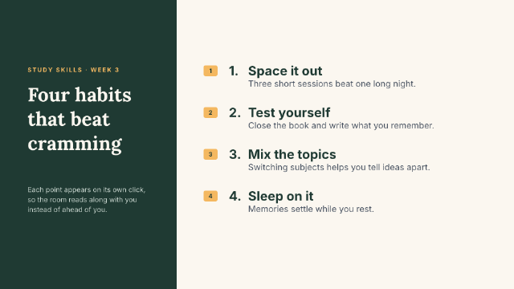

<!-- Generated by tools/gallery.mjs from showcase.yaml and build.json; do not edit. -->
# Bullet Build by Paragraph

[Slide](../README.md) › [Animations & Transitions](../README.md#animations--transitions) · `animation` `bullets` `numbering` `lesson`

A study-skills slide whose four numbered points fly in one paragraph per click, marked with animation-order badges.



| | |
|---|---|
| Document | [study-habits-bullet-build.pptx](study-habits-bullet-build.pptx) (23 KB) |
| Contents | 1 slide; 960 × 540 pt |
| Features | `slide.animations.set`, `slide.format.paragraph`, `slide.format.character` |
| Built by | `kition-slide` @ `8309775c19`: 58 commands in 122 ms |

## About

One text box holds the four habits as numbered paragraphs. A single Fly In effect with the text
build set to by paragraph turns them into four clicks, and the badges at the margin repeat the
order the animation pane shows. The title rises in with the slide.

## Checks

- `inspect.slides`: `{"count":1}`
- `results.anims`: `{"count":2}`
- `results.anims.0`: `{"effect":"rise","class":"entrance","start":"withPrevious"}`
- `results.anims.1`: `{"effect":"fly","option":"r","start":"onClick","textBuild":"byParagraph","durationMs":600}`
- diagnostics: none (the kit's check finds nothing wrong)
- the saved document opens again; the thumbnail matches `thumb.png` within the `render` tolerance

## Steps

<details><summary>58 commands (from <a href="showcase.yaml">showcase.yaml</a>)</summary>

```yaml
- command: design.fonts
  params:
    major: Lora
    minor: Inter
- command: slide.layout
  params:
    layout: blank
    index: 0
- command: design.background
  params:
    color: "#fbf7f0"
- command: shape.insert
  params:
    preset: rect
    rect:
      - 0
      - 0
      - 330
      - 540
  as: band
- command: shape.fill
  params:
    ids:
      - $band.id
    color: "#1f3a33"
- command: shape.line
  params:
    ids:
      - $band.id
    none: true
- command: insert.textBox
  params:
    rect:
      - 44
      - 120
      - 260
      - 24
    text: STUDY SKILLS · WEEK 3
  as: kicker
- command: format.size
  params:
    ids:
      - $kicker.id
    size: 11
- command: format.bold
  params:
    ids:
      - $kicker.id
- command: format.spacing
  params:
    ids:
      - $kicker.id
    pt: 2
- command: format.color
  params:
    ids:
      - $kicker.id
    color: "#f4b860"
- command: insert.textBox
  params:
    rect:
      - 44
      - 150
      - 260
      - 170
    text: Four habits that beat cramming
  as: title
- command: format.font
  params:
    ids:
      - $title.id
    family: Lora
- command: format.size
  params:
    ids:
      - $title.id
    size: 36
- command: format.bold
  params:
    ids:
      - $title.id
- command: format.color
  params:
    ids:
      - $title.id
    color: "#fbf7f0"
- command: format.lineSpacing
  params:
    ids:
      - $title.id
    lines: 1.05
- command: insert.textBox
  params:
    rect:
      - 44
      - 340
      - 250
      - 80
    text: Each point appears on its own click, so the room reads along with you instead of ahead of you.
  as: lede
- command: format.size
  params:
    ids:
      - $lede.id
    size: 13
- command: format.color
  params:
    ids:
      - $lede.id
    color: "#c9d6cf"
- command: format.lineSpacing
  params:
    ids:
      - $lede.id
    lines: 1.2
- command: insert.textBox
  params:
    rect:
      - 420
      - 114
      - 500
      - 380
    text: "Space it out\vThree short sessions beat one long night.

      Test yourself\vClose the book and write what you remember.

      Mix the topics\vSwitching subjects helps you tell ideas apart.

      Sleep on it\vMemories settle while you rest."
  as: points
- command: format.size
  params:
    ids:
      - $points.id
    size: 16
- command: format.color
  params:
    ids:
      - $points.id
    color: "#4b5563"
- command: format.numbering
  params:
    ids:
      - $points.id
    scheme: arabicPeriod
- command: format.paragraph
  params:
    ids:
      - $points.id
    spaceAfter: 30
    indentLeft: 36
    indentFirst: -36
- command: text.edit
  params:
    id: $points.id
    at:
      - 0
      - 0
- command: text.select
  params:
    anchor:
      - 0
      - 0
    caret:
      - 0
      - 12
- command: format.bold
  params:
    on: true
- command: format.size
  params:
    size: 24
- command: format.color
  params:
    color: "#1f3a33"
- command: text.select
  params:
    anchor:
      - 1
      - 0
    caret:
      - 1
      - 13
- command: format.bold
  params:
    on: true
- command: format.size
  params:
    size: 24
- command: format.color
  params:
    color: "#1f3a33"
- command: text.select
  params:
    anchor:
      - 2
      - 0
    caret:
      - 2
      - 14
- command: format.bold
  params:
    on: true
- command: format.size
  params:
    size: 24
- command: format.color
  params:
    color: "#1f3a33"
- command: text.select
  params:
    anchor:
      - 3
      - 0
    caret:
      - 3
      - 11
- command: format.bold
  params:
    on: true
- command: format.size
  params:
    size: 24
- command: format.color
  params:
    color: "#1f3a33"
- command: text.exit
  params: {}
- command: shape.insert
  params:
    preset: roundRect
    rect:
      - 380
      - 122
      - 26
      - 20
    text: "1"
  as: k1
- command: shape.insert
  params:
    preset: roundRect
    rect:
      - 380
      - 200
      - 26
      - 20
    text: "2"
  as: k2
- command: shape.insert
  params:
    preset: roundRect
    rect:
      - 380
      - 278
      - 26
      - 20
    text: "3"
  as: k3
- command: shape.insert
  params:
    preset: roundRect
    rect:
      - 380
      - 356
      - 26
      - 20
    text: "4"
  as: k4
- command: shape.fill
  params:
    ids:
      - $k1.id
      - $k2.id
      - $k3.id
      - $k4.id
    color: "#f4b860"
- command: shape.line
  params:
    ids:
      - $k1.id
      - $k2.id
      - $k3.id
      - $k4.id
    none: true
- command: format.margins
  params:
    ids:
      - $k1.id
      - $k2.id
      - $k3.id
      - $k4.id
    left: 0
    right: 0
    top: 0
    bottom: 0
- command: format.size
  params:
    ids:
      - $k1.id
      - $k2.id
      - $k3.id
      - $k4.id
    size: 11
- command: format.bold
  params:
    ids:
      - $k1.id
      - $k2.id
      - $k3.id
      - $k4.id
- command: format.color
  params:
    ids:
      - $k1.id
      - $k2.id
      - $k3.id
      - $k4.id
    color: "#1f3a33"
- command: animation.add
  params:
    effect: rise
    ids:
      - $title.id
    start: withPrevious
    duration: 800
- command: animation.add
  params:
    effect: fly
    option: r
    ids:
      - $points.id
    start: onClick
    duration: 600
- command: animation.options
  params:
    index: 1
    textBuild: byParagraph
- command: animation.get
  params:
    slide: 0
  as: anims
```

</details>
