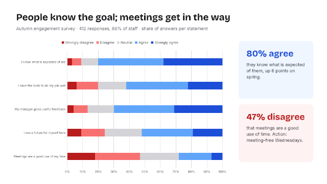

<!-- Generated by tools/gallery.mjs from showcase.yaml and build.json; do not edit. -->
# Survey Results Likert Bars

[Slide](../README.md) › [Charts & Tables](../README.md#charts--tables) · `chart` `percent-bar` `survey` `theme-colors`

An employee survey shown as 100% stacked bars, five answers per statement in a red-to-blue diverging palette taken from the theme.



| | |
|---|---|
| Document | [survey-results-likert.pptx](survey-results-likert.pptx) (26 KB) |
| Contents | 1 slide; 960 × 540 pt |
| Features | `slide.charts.edit`, `slide.design.themes`, `slide.shapes.edit` |
| Built by | `kition-slide` @ `8309775c19`: 38 commands in 93 ms |

## About

A percent-stacked bar chart is the honest way to show agree/disagree answers: every bar is 100%
and the eye compares where the blue begins. The five theme accents are set to a diverging
palette so the series take their colours from the deck, and two cards name the strongest and
weakest statement.

## Checks

- `inspect.slides`: `{"count":1}`
- `results.c.shape.kind`: `{"kind":"percentBar","series":{"count":5},"categories":{"count":5}}`
- `results.c.shape.kind.series.4`: `{"name":"Strongly agree","values":[7,19,31,22,38]}`
- `results.slide.design`: `{"none":{"code":"design.low-contrast"}}`
- diagnostics: none (the kit's check finds nothing wrong)
- the saved document opens again; the thumbnail matches `thumb.png` within the `render` tolerance

## Steps

<details><summary>38 commands (from <a href="showcase.yaml">showcase.yaml</a>)</summary>

```yaml
- command: design.colors
  params:
    colors:
      accent1: "#b91c1c"
      accent2: "#f87171"
      accent3: "#d4d4d8"
      accent4: "#60a5fa"
      accent5: "#1d4ed8"
- command: design.fonts
  params:
    major: Bricolage Grotesque
    minor: Inter
- command: slide.layout
  params:
    layout: blank
    index: 0
- command: insert.textBox
  params:
    rect:
      - 40
      - 30
      - 880
      - 46
    text: People know the goal; meetings get in the way
  as: title
- command: format.font
  params:
    ids:
      - $title.id
    family: Bricolage Grotesque
- command: format.size
  params:
    ids:
      - $title.id
    size: 28
- command: format.bold
  params:
    ids:
      - $title.id
- command: format.color
  params:
    ids:
      - $title.id
    color: "#18181b"
- command: insert.textBox
  params:
    rect:
      - 40
      - 72
      - 880
      - 24
    text: Autumn engagement survey · 412 responses, 86% of staff · share of answers per statement
  as: lede
- command: format.size
  params:
    ids:
      - $lede.id
    size: 13
- command: format.color
  params:
    ids:
      - $lede.id
    color: "#71717a"
- command: insert.chart
  params:
    type: percentBar
    rect:
      - 32
      - 108
      - 640
      - 410
    categories:
      - Meetings are a good use of my time
      - I see a future for myself here
      - My manager gives useful feedback
      - I have the tools to do my job well
      - I know what is expected of me
    series:
      - name: Strongly disagree
        values:
          - 18
          - 9
          - 4
          - 6
          - 3
      - name: Disagree
        values:
          - 29
          - 15
          - 9
          - 14
          - 6
      - name: Neutral
        values:
          - 25
          - 24
          - 17
          - 18
          - 11
      - name: Agree
        values:
          - 21
          - 33
          - 39
          - 40
          - 42
      - name: Strongly agree
        values:
          - 7
          - 19
          - 31
          - 22
          - 38
  as: chart
- command: chart.options
  params:
    id: $chart.id
    title: null
    legend: t
    dataLabels: false
    gridlines: true
- command: shape.insert
  params:
    preset: roundRect
    rect:
      - 700
      - 120
      - 220
      - 170
    adj:
      - 7000
  as: good
- command: shape.insert
  params:
    preset: roundRect
    rect:
      - 700
      - 306
      - 220
      - 170
    adj:
      - 7000
  as: bad
- command: shape.fill
  params:
    ids:
      - $good.id
    color: "#eff6ff"
- command: shape.fill
  params:
    ids:
      - $bad.id
    color: "#fef2f2"
- command: shape.line
  params:
    ids:
      - $good.id
      - $bad.id
    none: true
- command: insert.textBox
  params:
    rect:
      - 716
      - 134
      - 190
      - 146
    text: |-
      80% agree
      they know what is expected of them, up 6 points on spring.
  as: gt
- command: insert.textBox
  params:
    rect:
      - 716
      - 320
      - 190
      - 146
    text: |-
      47% disagree
      that meetings are a good use of time. Action: meeting-free Wednesdays.
  as: bt
- command: format.size
  params:
    ids:
      - $gt.id
      - $bt.id
    size: 13
- command: format.color
  params:
    ids:
      - $gt.id
      - $bt.id
    color: "#3f3f46"
- command: format.paragraph
  params:
    ids:
      - $gt.id
      - $bt.id
    spaceAfter: 6
    lineSpacing: 1.15
- command: text.edit
  params:
    id: $gt.id
    at:
      - 0
      - 0
- command: text.selectParagraph
  params:
    at:
      - 0
      - 0
- command: format.size
  params:
    size: 26
- command: format.bold
  params: {}
- command: format.font
  params:
    family: Bricolage Grotesque
- command: format.color
  params:
    color: "#1d4ed8"
- command: text.edit
  params:
    id: $bt.id
    at:
      - 0
      - 0
- command: text.selectParagraph
  params:
    at:
      - 0
      - 0
- command: format.size
  params:
    size: 26
- command: format.bold
  params: {}
- command: format.font
  params:
    family: Bricolage Grotesque
- command: format.color
  params:
    color: "#b91c1c"
- command: text.exit
  params: {}
- command: shape.inspect
  params:
    id: $chart.id
  as: c
- command: slide.inspect
  params:
    index: 0
  as: slide
```

</details>
