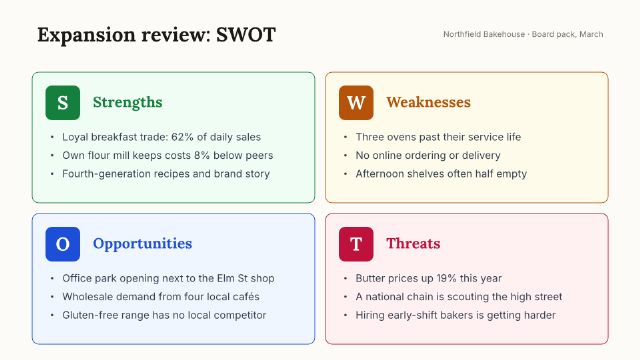

<!-- Generated by tools/gallery.mjs from showcase.yaml and build.json; do not edit. -->
# SWOT Analysis Grid

[Slide](../README.md) › [Business Reports](../README.md#business-reports) · `swot` `grid` `shapes` `bullets` `serif`

A strengths, weaknesses, opportunities and threats grid for a family bakery's expansion review, with tinted cards and lettered badges.



| | |
|---|---|
| Document | [swot-analysis-grid.pptx](swot-analysis-grid.pptx) (23 KB) |
| Contents | 1 slide; 960 × 540 pt |
| Features | `slide.shapes.edit`, `slide.format.paragraph`, `slide.format.character` |
| Built by | `kition-slide` @ `8309775c19`: 58 commands in 91 ms |

## About

Four tinted cards in a two-by-two grid, each with a coloured letter badge, a serif heading and a
bulleted list. Each quadrant keeps one colour for its border, badge and heading so the grid
reads at a glance.

## Checks

- `inspect.slides`: `{"count":1}`
- `results.slide.shapes`: `{"count":18,"any":{"text":"Opportunities"}}`
- `results.slide.design`: `{"none":{"code":"design.low-contrast"}}`
- diagnostics: none (the kit's check finds nothing wrong)
- the saved document opens again; the thumbnail matches `thumb.png` within the `render` tolerance

## Steps

<details><summary>58 commands (from <a href="showcase.yaml">showcase.yaml</a>)</summary>

```yaml
- command: design.fonts
  params:
    major: Lora
    minor: Inter
- command: slide.layout
  params:
    layout: blank
    index: 0
- command: design.background
  params:
    color: "#fcfbf7"
- command: insert.textBox
  params:
    rect:
      - 48
      - 30
      - 600
      - 46
    text: "Expansion review: SWOT"
  as: title
- command: format.font
  params:
    ids:
      - $title.id
    family: Lora
- command: format.size
  params:
    ids:
      - $title.id
    size: 30
- command: format.bold
  params:
    ids:
      - $title.id
- command: format.color
  params:
    ids:
      - $title.id
    color: "#1c1917"
- command: insert.textBox
  params:
    rect:
      - 560
      - 40
      - 352
      - 30
    text: Northfield Bakehouse · Board pack, March
  as: tag
- command: format.size
  params:
    ids:
      - $tag.id
    size: 12
- command: format.color
  params:
    ids:
      - $tag.id
    color: "#78716c"
- command: format.align
  params:
    ids:
      - $tag.id
    align: right
- command: shape.insert
  params:
    preset: roundRect
    rect:
      - 48
      - 108
      - 424
      - 196
    adj:
      - 5000
  as: card0
- command: shape.fill
  params:
    ids:
      - $card0.id
    color: "#f0fdf4"
- command: shape.line
  params:
    ids:
      - $card0.id
    color: "#15803d"
    width: 1
- command: shape.insert
  params:
    preset: roundRect
    rect:
      - 68
      - 128
      - 52
      - 52
    text: S
    adj:
      - 18000
  as: badge0
- command: shape.fill
  params:
    ids:
      - $badge0.id
    color: "#15803d"
- command: shape.line
  params:
    ids:
      - $badge0.id
    none: true
- command: insert.textBox
  params:
    rect:
      - 132
      - 136
      - 300
      - 36
    text: Strengths
  as: head0
- command: format.color
  params:
    ids:
      - $head0.id
    color: "#15803d"
- command: insert.textBox
  params:
    rect:
      - 68
      - 192
      - 390
      - 104
    text: |-
      Loyal breakfast trade: 62% of daily sales
      Own flour mill keeps costs 8% below peers
      Fourth-generation recipes and brand story
  as: body0
- command: shape.insert
  params:
    preset: roundRect
    rect:
      - 488
      - 108
      - 424
      - 196
    adj:
      - 5000
  as: card1
- command: shape.fill
  params:
    ids:
      - $card1.id
    color: "#fffbeb"
- command: shape.line
  params:
    ids:
      - $card1.id
    color: "#b45309"
    width: 1
- command: shape.insert
  params:
    preset: roundRect
    rect:
      - 508
      - 128
      - 52
      - 52
    text: W
    adj:
      - 18000
  as: badge1
- command: shape.fill
  params:
    ids:
      - $badge1.id
    color: "#b45309"
- command: shape.line
  params:
    ids:
      - $badge1.id
    none: true
- command: insert.textBox
  params:
    rect:
      - 572
      - 136
      - 300
      - 36
    text: Weaknesses
  as: head1
- command: format.color
  params:
    ids:
      - $head1.id
    color: "#b45309"
- command: insert.textBox
  params:
    rect:
      - 508
      - 192
      - 390
      - 104
    text: |-
      Three ovens past their service life
      No online ordering or delivery
      Afternoon shelves often half empty
  as: body1
- command: shape.insert
  params:
    preset: roundRect
    rect:
      - 48
      - 320
      - 424
      - 196
    adj:
      - 5000
  as: card2
- command: shape.fill
  params:
    ids:
      - $card2.id
    color: "#eff6ff"
- command: shape.line
  params:
    ids:
      - $card2.id
    color: "#1d4ed8"
    width: 1
- command: shape.insert
  params:
    preset: roundRect
    rect:
      - 68
      - 340
      - 52
      - 52
    text: O
    adj:
      - 18000
  as: badge2
- command: shape.fill
  params:
    ids:
      - $badge2.id
    color: "#1d4ed8"
- command: shape.line
  params:
    ids:
      - $badge2.id
    none: true
- command: insert.textBox
  params:
    rect:
      - 132
      - 348
      - 300
      - 36
    text: Opportunities
  as: head2
- command: format.color
  params:
    ids:
      - $head2.id
    color: "#1d4ed8"
- command: insert.textBox
  params:
    rect:
      - 68
      - 404
      - 390
      - 104
    text: |-
      Office park opening next to the Elm St shop
      Wholesale demand from four local cafés
      Gluten-free range has no local competitor
  as: body2
- command: shape.insert
  params:
    preset: roundRect
    rect:
      - 488
      - 320
      - 424
      - 196
    adj:
      - 5000
  as: card3
- command: shape.fill
  params:
    ids:
      - $card3.id
    color: "#fff1f2"
- command: shape.line
  params:
    ids:
      - $card3.id
    color: "#be123c"
    width: 1
- command: shape.insert
  params:
    preset: roundRect
    rect:
      - 508
      - 340
      - 52
      - 52
    text: T
    adj:
      - 18000
  as: badge3
- command: shape.fill
  params:
    ids:
      - $badge3.id
    color: "#be123c"
- command: shape.line
  params:
    ids:
      - $badge3.id
    none: true
- command: insert.textBox
  params:
    rect:
      - 572
      - 348
      - 300
      - 36
    text: Threats
  as: head3
- command: format.color
  params:
    ids:
      - $head3.id
    color: "#be123c"
- command: insert.textBox
  params:
    rect:
      - 508
      - 404
      - 390
      - 104
    text: |-
      Butter prices up 19% this year
      A national chain is scouting the high street
      Hiring early-shift bakers is getting harder
  as: body3
- command: format.font
  params:
    ids:
      - $badge0.id
      - $badge1.id
      - $badge2.id
      - $badge3.id
      - $head0.id
      - $head1.id
      - $head2.id
      - $head3.id
    family: Lora
- command: format.size
  params:
    ids:
      - $badge0.id
      - $badge1.id
      - $badge2.id
      - $badge3.id
    size: 28
- command: format.size
  params:
    ids:
      - $head0.id
      - $head1.id
      - $head2.id
      - $head3.id
    size: 22
- command: format.bold
  params:
    ids:
      - $badge0.id
      - $badge1.id
      - $badge2.id
      - $badge3.id
      - $head0.id
      - $head1.id
      - $head2.id
      - $head3.id
- command: format.color
  params:
    ids:
      - $badge0.id
      - $badge1.id
      - $badge2.id
      - $badge3.id
    color: "#ffffff"
- command: format.size
  params:
    ids:
      - $body0.id
      - $body1.id
      - $body2.id
      - $body3.id
    size: 15.5
- command: format.color
  params:
    ids:
      - $body0.id
      - $body1.id
      - $body2.id
      - $body3.id
    color: "#374151"
- command: format.bullets
  params:
    ids:
      - $body0.id
      - $body1.id
      - $body2.id
      - $body3.id
    char: •
- command: format.paragraph
  params:
    ids:
      - $body0.id
      - $body1.id
      - $body2.id
      - $body3.id
    spaceAfter: 9
- command: slide.inspect
  params:
    index: 0
  as: slide
```

</details>
