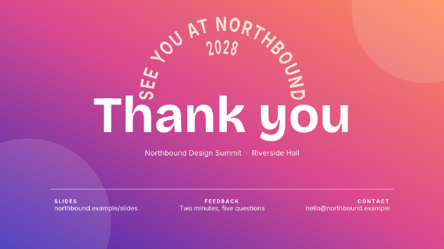

<!-- Generated by tools/gallery.mjs from showcase.yaml and build.json; do not edit. -->
# Thank-You Closing Slide

[Slide](../README.md) › [Events & Marketing](../README.md#events--marketing) · `wordart` `closing` `gradient` `event`

A conference closing slide with an arched WordArt line over a big Thank you, on a sunset gradient with feedback and contact details.



| | |
|---|---|
| Document | [thank-you-closing.pptx](thank-you-closing.pptx) (22 KB) |
| Contents | 1 slide; 960 × 540 pt |
| Features | `slide.format.character`, `slide.shapes.edit`, `slide.insert.objects` |
| Built by | `kition-slide` @ `8309775c19`: 56 commands in 66 ms |

## About

"Thank you" starts as a WordArt from the gallery and is restyled; the line above it is a text box
warped with the Arch Up transform (its box is square and fixed in size, as an arch needs). The
footer gives the room three things to do next.

## Checks

- `inspect.slides`: `{"count":1}`
- `results.archShape.shape.text.body.warp`: `"textArchUp"`
- `results.closing.transition`: `{"kind":"fade","option":"throughBlack"}`
- `results.closing.shapes`: `{"any":{"text":"Thank you"}}`
- diagnostics: none (the kit's check finds nothing wrong)
- the saved document opens again; the thumbnail matches `thumb.png` within the `render` tolerance

## Steps

<details><summary>56 commands (from <a href="showcase.yaml">showcase.yaml</a>)</summary>

```yaml
- command: design.fonts
  params:
    major: Bricolage Grotesque
    minor: Inter
- command: slide.layout
  params:
    layout: blank
    index: 0
- command: design.background
  params:
    gradient:
      stops:
        - - 0
          - "#ff8a5b"
        - - 0.5
          - "#d9488f"
        - - 1
          - "#3b2bb8"
      angle: 120
- command: shape.insert
  params:
    preset: ellipse
    rect:
      - -120
      - 300
      - 360
      - 360
  as: c1
- command: shape.insert
  params:
    preset: ellipse
    rect:
      - 760
      - -140
      - 320
      - 320
  as: c2
- command: shape.fill
  params:
    ids:
      - $c1.id
      - $c2.id
    color: "#ffffff"
    transparency: 0.88
- command: shape.line
  params:
    ids:
      - $c1.id
      - $c2.id
    none: true
- command: insert.textBox
  params:
    rect:
      - 300
      - 36
      - 360
      - 360
    text: |-
      SEE YOU AT NORTHBOUND
      2028
  as: arch
- command: format.autofit
  params:
    ids:
      - $arch.id
    mode: none
- command: format.wrap
  params:
    ids:
      - $arch.id
    on: false
- command: format.align
  params:
    ids:
      - $arch.id
    align: center
- command: shape.setBounds
  params:
    ids:
      - $arch.id
    x: 300
    y: 36
    w: 360
    h: 360
- command: format.transform
  params:
    ids:
      - $arch.id
    preset: textArchUp
- command: format.font
  params:
    ids:
      - $arch.id
    family: Inter
- command: format.size
  params:
    ids:
      - $arch.id
    size: 22
- command: format.spacing
  params:
    ids:
      - $arch.id
    pt: 3
- command: format.bold
  params:
    ids:
      - $arch.id
- command: format.color
  params:
    ids:
      - $arch.id
    color: "#ffe3d3"
- command: insert.wordArt
  params:
    text: Thank you
    style: 3
  as: thanks
- command: shape.setBounds
  params:
    ids:
      - $thanks.id
    x: 130
    y: 180
    w: 700
    h: 140
- command: format.font
  params:
    ids:
      - $thanks.id
    family: Bricolage Grotesque
- command: format.size
  params:
    ids:
      - $thanks.id
    size: 110
- command: format.color
  params:
    ids:
      - $thanks.id
    color: "#ffffff"
- command: shape.effects
  params:
    ids:
      - $thanks.id
    shadow:
      color: "#3b0f4d"
      blur: 24
      dist: 8
      dir: 90
- command: insert.textBox
  params:
    rect:
      - 180
      - 318
      - 600
      - 30
    text: Northbound Design Summit  ·  Riverside Hall
  as: sub
- command: format.size
  params:
    ids:
      - $sub.id
    size: 16
- command: format.align
  params:
    ids:
      - $sub.id
    align: center
- command: format.color
  params:
    ids:
      - $sub.id
    color: "#fff1ea"
- command: shape.insert
  params:
    preset: line
    rect:
      - 110
      - 410
      - 740
      - 0
  as: rule
- command: shape.line
  params:
    ids:
      - $rule.id
    color: "#ffffff"
    width: 0.75
- command: insert.textBox
  params:
    rect:
      - 110
      - 426
      - 230
      - 60
    text: |-
      SLIDES
      northbound.example/slides
  as: f1
- command: insert.textBox
  params:
    rect:
      - 365
      - 426
      - 230
      - 60
    text: |-
      FEEDBACK
      Two minutes, five questions
  as: f2
- command: insert.textBox
  params:
    rect:
      - 620
      - 426
      - 230
      - 60
    text: |-
      CONTACT
      hello@northbound.example
  as: f3
- command: format.size
  params:
    ids:
      - $f1.id
      - $f2.id
      - $f3.id
    size: 14
- command: format.color
  params:
    ids:
      - $f1.id
      - $f2.id
      - $f3.id
    color: "#ffffff"
- command: format.align
  params:
    ids:
      - $f2.id
    align: center
- command: format.align
  params:
    ids:
      - $f3.id
    align: right
- command: text.edit
  params:
    id: $f1.id
    at:
      - 0
      - 0
- command: text.selectParagraph
  params:
    at:
      - 0
      - 0
- command: format.size
  params:
    size: 11
- command: format.bold
  params:
    on: true
- command: format.spacing
  params:
    pt: 2
- command: text.edit
  params:
    id: $f2.id
    at:
      - 0
      - 0
- command: text.selectParagraph
  params:
    at:
      - 0
      - 0
- command: format.size
  params:
    size: 11
- command: format.bold
  params:
    on: true
- command: format.spacing
  params:
    pt: 2
- command: text.edit
  params:
    id: $f3.id
    at:
      - 0
      - 0
- command: text.selectParagraph
  params:
    at:
      - 0
      - 0
- command: format.size
  params:
    size: 11
- command: format.bold
  params:
    on: true
- command: format.spacing
  params:
    pt: 2
- command: text.exit
  params: {}
- command: transition.set
  params:
    kind: fade
    option: throughBlack
    duration: 1200
- command: shape.inspect
  params:
    id: $arch.id
  as: archShape
- command: slide.inspect
  params:
    index: 0
  as: closing
```

</details>
