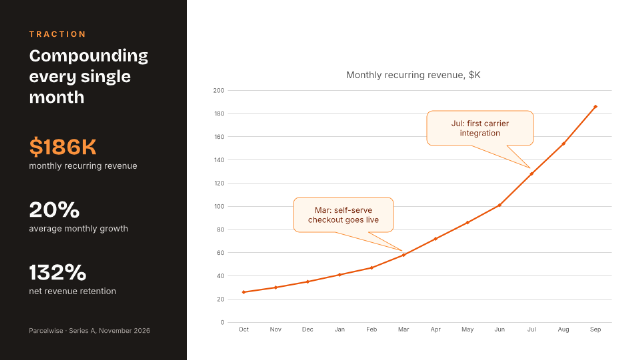

<!-- Generated by tools/gallery.mjs from showcase.yaml and build.json; do not edit. -->
# Traction Growth Line

[Slide](../README.md) › [Pitch Decks](../README.md#pitch-decks) · `pitch-deck` `chart` `line` `callouts` `kpi`

A pitch-deck traction slide with twelve months of recurring revenue as a line with markers, two milestone callouts and the headline numbers in a side rail.



| | |
|---|---|
| Document | [traction-growth-line.pptx](traction-growth-line.pptx) (26 KB) |
| Contents | 1 slide; 960 × 540 pt |
| Features | `slide.charts.edit`, `slide.shapes.edit`, `slide.format.character` |
| Built by | `kition-slide` @ `8309775c19`: 53 commands in 106 ms |

## About

The slide investors look at longest. A line-with-markers chart of monthly recurring revenue
fills most of the slide; two rounded callouts with pointers mark the launches that bent the
curve, and a dark rail on the left carries the numbers worth remembering.

## Checks

- `inspect.slides`: `{"count":1}`
- `results.c.shape.kind`: `{"kind":"lineMarkers","legend":null}`
- `results.c.shape.kind.series.0.values`: `{"count":12}`
- `results.slide.shapes`: `{"any":{"preset":"wedgeRoundRectCallout"}}`
- `results.slide.design`: `{"none":{"code":"design.low-contrast"}}`
- diagnostics: none (the kit's check finds nothing wrong)
- the saved document opens again; the thumbnail matches `thumb.png` within the `render` tolerance

## Steps

<details><summary>53 commands (from <a href="showcase.yaml">showcase.yaml</a>)</summary>

```yaml
- command: design.colors
  params:
    colors:
      accent1: "#ea580c"
- command: design.fonts
  params:
    major: Bricolage Grotesque
    minor: Inter
- command: slide.layout
  params:
    layout: blank
    index: 0
- command: shape.insert
  params:
    preset: rect
    rect:
      - 0
      - 0
      - 280
      - 540
  as: rail
- command: shape.fill
  params:
    ids:
      - $rail.id
    color: "#1c1917"
- command: shape.line
  params:
    ids:
      - $rail.id
    none: true
- command: insert.textBox
  params:
    rect:
      - 36
      - 40
      - 220
      - 22
    text: TRACTION
  as: eyebrow
- command: format.size
  params:
    ids:
      - $eyebrow.id
    size: 12
- command: format.bold
  params:
    ids:
      - $eyebrow.id
- command: format.spacing
  params:
    ids:
      - $eyebrow.id
    pt: 3
- command: format.color
  params:
    ids:
      - $eyebrow.id
    color: "#fb923c"
- command: insert.textBox
  params:
    rect:
      - 36
      - 64
      - 220
      - 100
    text: Compounding every single month
  as: title
- command: format.font
  params:
    ids:
      - $title.id
    family: Bricolage Grotesque
- command: format.size
  params:
    ids:
      - $title.id
    size: 26
- command: format.bold
  params:
    ids:
      - $title.id
- command: format.color
  params:
    ids:
      - $title.id
    color: "#fafaf9"
- command: insert.textBox
  params:
    rect:
      - 36
      - 196
      - 220
      - 80
    text: |-
      $$186K
      monthly recurring revenue
  as: s1
- command: insert.textBox
  params:
    rect:
      - 36
      - 290
      - 220
      - 80
    text: |-
      20%
      average monthly growth
  as: s2
- command: insert.textBox
  params:
    rect:
      - 36
      - 384
      - 220
      - 80
    text: |-
      132%
      net revenue retention
  as: s3
- command: format.size
  params:
    ids:
      - $s1.id
      - $s2.id
      - $s3.id
    size: 13
- command: format.color
  params:
    ids:
      - $s1.id
      - $s2.id
      - $s3.id
    color: "#d6d3d1"
- command: text.edit
  params:
    id: $s1.id
    at:
      - 0
      - 0
- command: text.selectParagraph
  params:
    at:
      - 0
      - 0
- command: format.size
  params:
    size: 34
- command: format.bold
  params: {}
- command: format.font
  params:
    family: Bricolage Grotesque
- command: format.color
  params:
    color: "#fb923c"
- command: text.edit
  params:
    id: $s2.id
    at:
      - 0
      - 0
- command: text.selectParagraph
  params:
    at:
      - 0
      - 0
- command: format.size
  params:
    size: 34
- command: format.bold
  params: {}
- command: format.font
  params:
    family: Bricolage Grotesque
- command: format.color
  params:
    color: "#fafaf9"
- command: text.edit
  params:
    id: $s3.id
    at:
      - 0
      - 0
- command: text.selectParagraph
  params:
    at:
      - 0
      - 0
- command: format.size
  params:
    size: 34
- command: format.bold
  params: {}
- command: format.font
  params:
    family: Bricolage Grotesque
- command: format.color
  params:
    color: "#fafaf9"
- command: text.exit
  params: {}
- command: insert.textBox
  params:
    rect:
      - 36
      - 486
      - 220
      - 24
    text: Parcelwise · Series A, November 2026
  as: foot
- command: format.size
  params:
    ids:
      - $foot.id
    size: 10
- command: format.color
  params:
    ids:
      - $foot.id
    color: "#a8a29e"
- command: insert.chart
  params:
    type: lineMarkers
    rect:
      - 312
      - 96
      - 616
      - 412
    categories:
      - Oct
      - Nov
      - Dec
      - Jan
      - Feb
      - Mar
      - Apr
      - May
      - Jun
      - Jul
      - Aug
      - Sep
    series:
      - name: MRR ($K)
        values:
          - 26
          - 30
          - 35
          - 41
          - 47
          - 58
          - 72
          - 86
          - 101
          - 128
          - 154
          - 186
    title: Monthly recurring revenue, $K
  as: chart
- command: chart.options
  params:
    id: $chart.id
    legend: null
    dataLabels: false
    gridlines: true
- command: shape.insert
  params:
    preset: wedgeRoundRectCallout
    rect:
      - 440
      - 296
      - 150
      - 52
    text: "Mar: self-serve checkout goes live"
    adj:
      - 58667
      - 103846
      - 16667
  as: m1
- command: shape.insert
  params:
    preset: wedgeRoundRectCallout
    rect:
      - 640
      - 166
      - 160
      - 52
    text: "Jul: first carrier integration"
    adj:
      - 46875
      - 115385
      - 16667
  as: m2
- command: shape.fill
  params:
    ids:
      - $m1.id
      - $m2.id
    color: "#fff7ed"
- command: shape.line
  params:
    ids:
      - $m1.id
      - $m2.id
    color: "#fb923c"
    width: 1
- command: format.size
  params:
    ids:
      - $m1.id
      - $m2.id
    size: 12
- command: format.color
  params:
    ids:
      - $m1.id
      - $m2.id
    color: "#7c2d12"
- command: shape.inspect
  params:
    id: $chart.id
  as: c
- command: slide.inspect
  params:
    index: 0
  as: slide
```

</details>
