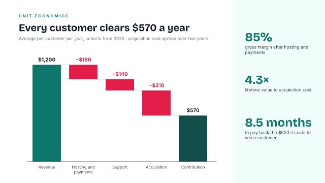

<!-- Generated by tools/gallery.mjs from showcase.yaml and build.json; do not edit. -->
# Unit Economics Waterfall

[Slide](../README.md) › [Pitch Decks](../README.md#pitch-decks) · `pitch-deck` `waterfall` `shapes` `freeform` `kpi`

A pitch-deck unit economics slide with a hand-built waterfall from yearly revenue per customer down to contribution, plus margin, LTV/CAC and payback figures.



| | |
|---|---|
| Document | [unit-economics-waterfall.pptx](unit-economics-waterfall.pptx) (23 KB) |
| Contents | 1 slide; 960 × 540 pt |
| Features | `slide.shapes.edit`, `slide.drawing.objects`, `slide.format.character` |
| Built by | `kition-slide` @ `8309775c19`: 81 commands in 149 ms |

## About

A bridge chart drawn from rectangles: the first and last bars stand on the axis, the costs float
where the running total leaves them, and dashed freeform links carry each level to the next bar.
Values sit above the bars in the bar's colour; the side panel turns the bridge into the three
ratios investors ask for.

## Checks

- `inspect.slides`: `{"count":1}`
- `results.slide.shapes`: `{"any":{"preset":"rect","fill":"#E11D48","box":[420,267,84,73.7]}}`
- `results.slide.design`: `{"none":{"code":"design.low-contrast"}}`
- diagnostics: none (the kit's check finds nothing wrong)
- the saved document opens again; the thumbnail matches `thumb.png` within the `render` tolerance

## Steps

<details><summary>81 commands (from <a href="showcase.yaml">showcase.yaml</a>)</summary>

```yaml
- command: design.fonts
  params:
    major: Bricolage Grotesque
    minor: Inter
- command: slide.layout
  params:
    layout: blank
    index: 0
- command: insert.textBox
  params:
    rect:
      - 48
      - 36
      - 300
      - 22
    text: UNIT ECONOMICS
  as: eyebrow
- command: format.size
  params:
    ids:
      - $eyebrow.id
    size: 12
- command: format.bold
  params:
    ids:
      - $eyebrow.id
- command: format.spacing
  params:
    ids:
      - $eyebrow.id
    pt: 3
- command: format.color
  params:
    ids:
      - $eyebrow.id
    color: "#0f766e"
- command: insert.textBox
  params:
    rect:
      - 48
      - 60
      - 620
      - 50
    text: Every customer clears $570 a year
  as: title
- command: format.font
  params:
    ids:
      - $title.id
    family: Bricolage Grotesque
- command: format.size
  params:
    ids:
      - $title.id
    size: 30
- command: format.bold
  params:
    ids:
      - $title.id
- command: format.color
  params:
    ids:
      - $title.id
    color: "#0f172a"
- command: insert.textBox
  params:
    rect:
      - 48
      - 102
      - 620
      - 24
    text: Average per customer per year, cohorts from 2025 · acquisition cost spread over two years
  as: lede
- command: format.size
  params:
    ids:
      - $lede.id
    size: 13
- command: format.color
  params:
    ids:
      - $lede.id
    color: "#64748b"
- command: shape.insert
  params:
    preset: rect
    rect:
      - 96
      - 191
      - 84
      - 285
  as: bar0
- command: shape.fill
  params:
    ids:
      - $bar0.id
    color: "#0f766e"
- command: insert.textBox
  params:
    rect:
      - 86
      - 163
      - 104
      - 24
    text: $$1,200
  as: val0
- command: format.color
  params:
    ids:
      - $val0.id
    color: "#0f172a"
- command: insert.textBox
  params:
    rect:
      - 84
      - 482
      - 108
      - 40
    text: Revenue
  as: cat0
- command: shape.freeform
  params:
    points:
      - - 180
        - 191
      - - 204
        - 191
  as: lk0
- command: shape.insert
  params:
    preset: rect
    rect:
      - 204
      - 191
      - 84
      - 42.7
  as: bar1
- command: shape.fill
  params:
    ids:
      - $bar1.id
    color: "#e11d48"
- command: insert.textBox
  params:
    rect:
      - 194
      - 163
      - 104
      - 24
    text: −$180
  as: val1
- command: format.color
  params:
    ids:
      - $val1.id
    color: "#e11d48"
- command: insert.textBox
  params:
    rect:
      - 192
      - 482
      - 108
      - 40
    text: Hosting and payments
  as: cat1
- command: shape.freeform
  params:
    points:
      - - 288
        - 233.8
      - - 312
        - 233.8
  as: lk1
- command: shape.insert
  params:
    preset: rect
    rect:
      - 312
      - 233.8
      - 84
      - 33.2
  as: bar2
- command: shape.fill
  params:
    ids:
      - $bar2.id
    color: "#e11d48"
- command: insert.textBox
  params:
    rect:
      - 302
      - 205.8
      - 104
      - 24
    text: −$140
  as: val2
- command: format.color
  params:
    ids:
      - $val2.id
    color: "#e11d48"
- command: insert.textBox
  params:
    rect:
      - 300
      - 482
      - 108
      - 40
    text: Support
  as: cat2
- command: shape.freeform
  params:
    points:
      - - 396
        - 267
      - - 420
        - 267
  as: lk2
- command: shape.insert
  params:
    preset: rect
    rect:
      - 420
      - 267
      - 84
      - 73.7
  as: bar3
- command: shape.fill
  params:
    ids:
      - $bar3.id
    color: "#e11d48"
- command: insert.textBox
  params:
    rect:
      - 410
      - 239
      - 104
      - 24
    text: −$310
  as: val3
- command: format.color
  params:
    ids:
      - $val3.id
    color: "#e11d48"
- command: insert.textBox
  params:
    rect:
      - 408
      - 482
      - 108
      - 40
    text: Acquisition
  as: cat3
- command: shape.freeform
  params:
    points:
      - - 504
        - 340.6
      - - 528
        - 340.6
  as: lk3
- command: shape.insert
  params:
    preset: rect
    rect:
      - 528
      - 340.6
      - 84
      - 135.4
  as: bar4
- command: shape.fill
  params:
    ids:
      - $bar4.id
    color: "#134e4a"
- command: insert.textBox
  params:
    rect:
      - 518
      - 312.6
      - 104
      - 24
    text: $$570
  as: val4
- command: format.color
  params:
    ids:
      - $val4.id
    color: "#0f172a"
- command: insert.textBox
  params:
    rect:
      - 516
      - 482
      - 108
      - 40
    text: Contribution
  as: cat4
- command: shape.line
  params:
    ids:
      - $bar0.id
      - $bar1.id
      - $bar2.id
      - $bar3.id
      - $bar4.id
    none: true
- command: shape.line
  params:
    ids:
      - $lk0.id
      - $lk1.id
      - $lk2.id
      - $lk3.id
    color: "#94a3b8"
    width: 1
    dash: dash
- command: shape.freeform
  params:
    points:
      - - 80
        - 476
      - - 640
        - 476
  as: axis
- command: shape.line
  params:
    ids:
      - $axis.id
    color: "#334155"
    width: 1.25
- command: format.size
  params:
    ids:
      - $val0.id
      - $val1.id
      - $val2.id
      - $val3.id
      - $val4.id
    size: 15
- command: format.bold
  params:
    ids:
      - $val0.id
      - $val1.id
      - $val2.id
      - $val3.id
      - $val4.id
- command: format.align
  params:
    ids:
      - $val0.id
      - $val1.id
      - $val2.id
      - $val3.id
      - $val4.id
      - $cat0.id
      - $cat1.id
      - $cat2.id
      - $cat3.id
      - $cat4.id
    align: center
- command: format.size
  params:
    ids:
      - $cat0.id
      - $cat1.id
      - $cat2.id
      - $cat3.id
      - $cat4.id
    size: 12
- command: format.color
  params:
    ids:
      - $cat0.id
      - $cat1.id
      - $cat2.id
      - $cat3.id
      - $cat4.id
    color: "#475569"
- command: shape.insert
  params:
    preset: rect
    rect:
      - 688
      - 0
      - 272
      - 540
  as: panel
- command: shape.fill
  params:
    ids:
      - $panel.id
    color: "#f0fdfa"
- command: shape.line
  params:
    ids:
      - $panel.id
    none: true
- command: insert.textBox
  params:
    rect:
      - 716
      - 84
      - 220
      - 100
    text: |-
      85%
      gross margin after hosting and payments
  as: m1
- command: insert.textBox
  params:
    rect:
      - 716
      - 210
      - 220
      - 100
    text: |-
      4.3×
      lifetime value to acquisition cost
  as: m2
- command: insert.textBox
  params:
    rect:
      - 716
      - 336
      - 220
      - 100
    text: |-
      8.5 months
      to pay back the $620 it costs to win a customer
  as: m3
- command: format.size
  params:
    ids:
      - $m1.id
      - $m2.id
      - $m3.id
    size: 13
- command: format.color
  params:
    ids:
      - $m1.id
      - $m2.id
      - $m3.id
    color: "#334155"
- command: text.edit
  params:
    id: $m1.id
    at:
      - 0
      - 0
- command: text.selectParagraph
  params:
    at:
      - 0
      - 0
- command: format.size
  params:
    size: 36
- command: format.bold
  params: {}
- command: format.font
  params:
    family: Bricolage Grotesque
- command: format.color
  params:
    color: "#0f766e"
- command: text.edit
  params:
    id: $m2.id
    at:
      - 0
      - 0
- command: text.selectParagraph
  params:
    at:
      - 0
      - 0
- command: format.size
  params:
    size: 36
- command: format.bold
  params: {}
- command: format.font
  params:
    family: Bricolage Grotesque
- command: format.color
  params:
    color: "#0f766e"
- command: text.edit
  params:
    id: $m3.id
    at:
      - 0
      - 0
- command: text.selectParagraph
  params:
    at:
      - 0
      - 0
- command: format.size
  params:
    size: 36
- command: format.bold
  params: {}
- command: format.font
  params:
    family: Bricolage Grotesque
- command: format.color
  params:
    color: "#0f766e"
- command: text.exit
  params: {}
- command: slide.inspect
  params:
    index: 0
  as: slide
```

</details>
