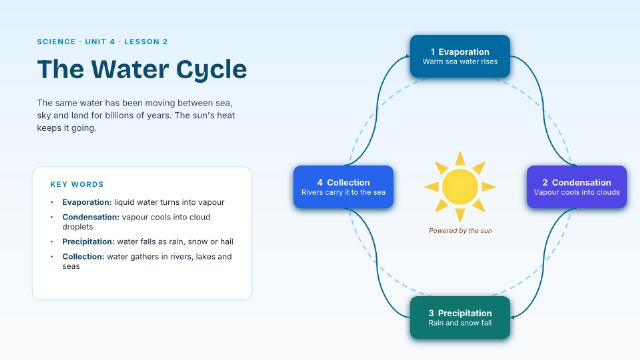

<!-- Generated by tools/gallery.mjs from showcase.yaml and build.json; do not edit. -->
# Water Cycle Lesson

[Slide](../README.md) › [Education](../README.md#education) · `lesson` `diagram` `connectors` `shapes` `gradient`

A grade-school science slide that walks the four stages of the water cycle around a sun, with curved connector arrows.



| | |
|---|---|
| Document | [water-cycle-lesson.pptx](water-cycle-lesson.pptx) (26 KB) |
| Contents | 1 slide; 960 × 540 pt |
| Features | `slide.shapes.edit`, `slide.insert.objects`, `slide.format.character` |
| Built by | `kition-slide` @ `8309775c19`: 101 commands in 101 ms |

## About

Four stage cards sit on a ring around the sun and are joined by curved connectors with arrowheads,
so the cycle still reads after a card is moved. A key-words panel on the left and speaker notes
for the teacher make it a slide a class would actually see.

## Checks

- `results.lesson.layout`: `"Blank"`
- `results.lesson.notes`: `{"matches":"^Ask the class"}`
- `results.lesson.shapes`: `{"any":{"preset":"curvedConnector3"}}`
- diagnostics: none (the kit's check finds nothing wrong)
- the saved document opens again; the thumbnail matches `thumb.png` within the `render` tolerance

## Steps

<details><summary>101 commands (from <a href="showcase.yaml">showcase.yaml</a>)</summary>

```yaml
- command: design.fonts
  params:
    major: Bricolage Grotesque
    minor: Inter
- command: slide.layout
  params:
    layout: blank
    index: 0
- command: design.background
  params:
    gradient:
      stops:
        - - 0
          - "#e0f2fe"
        - - 1
          - "#f8fafc"
      angle: 90
- command: insert.textBox
  params:
    rect:
      - 48
      - 52
      - 340
      - 22
    text: SCIENCE · UNIT 4 · LESSON 2
  as: kicker
- command: format.size
  params:
    ids:
      - $kicker.id
    size: 11
- command: format.bold
  params:
    ids:
      - $kicker.id
- command: format.spacing
  params:
    ids:
      - $kicker.id
    pt: 1.5
- command: format.color
  params:
    ids:
      - $kicker.id
    color: "#0284c7"
- command: insert.textBox
  params:
    rect:
      - 48
      - 76
      - 360
      - 60
    text: The Water Cycle
  as: title
- command: format.font
  params:
    ids:
      - $title.id
    family: Bricolage Grotesque
- command: format.size
  params:
    ids:
      - $title.id
    size: 40
- command: format.bold
  params:
    ids:
      - $title.id
- command: format.color
  params:
    ids:
      - $title.id
    color: "#0c4a6e"
- command: insert.textBox
  params:
    rect:
      - 48
      - 140
      - 330
      - 70
    text: The same water has been moving between sea, sky and land for billions of years. The sun's heat keeps it going.
  as: lede
- command: format.size
  params:
    ids:
      - $lede.id
    size: 13
- command: format.color
  params:
    ids:
      - $lede.id
    color: "#334155"
- command: format.lineSpacing
  params:
    ids:
      - $lede.id
    lines: 1.2
- command: shape.insert
  params:
    preset: roundRect
    rect:
      - 48
      - 250
      - 330
      - 200
  as: panel
- command: shape.fill
  params:
    ids:
      - $panel.id
    color: "#ffffff"
- command: shape.line
  params:
    ids:
      - $panel.id
    color: "#bae6fd"
    width: 1
- command: shape.adjust
  params:
    ids:
      - $panel.id
    index: 0
    value: 6000
- command: insert.textBox
  params:
    rect:
      - 68
      - 266
      - 300
      - 22
    text: KEY WORDS
  as: kw
- command: format.size
  params:
    ids:
      - $kw.id
    size: 11
- command: format.bold
  params:
    ids:
      - $kw.id
- command: format.spacing
  params:
    ids:
      - $kw.id
    pt: 1.5
- command: format.color
  params:
    ids:
      - $kw.id
    color: "#0284c7"
- command: insert.textBox
  params:
    rect:
      - 68
      - 292
      - 296
      - 180
    text: |-
      Evaporation: liquid water turns into vapour
      Condensation: vapour cools into cloud droplets
      Precipitation: water falls as rain, snow or hail
      Collection: water gathers in rivers, lakes and seas
  as: words
- command: format.size
  params:
    ids:
      - $words.id
    size: 12
- command: format.color
  params:
    ids:
      - $words.id
    color: "#1e293b"
- command: format.bullets
  params:
    ids:
      - $words.id
    char: •
    color: "#0369a1"
- command: format.paragraph
  params:
    ids:
      - $words.id
    spaceAfter: 8
- command: shape.insert
  params:
    preset: ellipse
    rect:
      - 520
      - 110
      - 340
      - 340
  as: ring
- command: shape.fill
  params:
    ids:
      - $ring.id
    none: true
- command: shape.line
  params:
    ids:
      - $ring.id
    color: "#7dd3fc"
    width: 2
    dash: dash
- command: shape.insert
  params:
    preset: sun
    rect:
      - 636
      - 226
      - 108
      - 108
  as: sun
- command: shape.fill
  params:
    ids:
      - $sun.id
    gradient:
      stops:
        - - 0
          - "#fde047"
        - - 1
          - "#f59e0b"
      angle: 90
      kind: radial
- command: shape.line
  params:
    ids:
      - $sun.id
    none: true
- command: insert.textBox
  params:
    rect:
      - 610
      - 336
      - 160
      - 20
    text: Powered by the sun
  as: sunCap
- command: format.size
  params:
    ids:
      - $sunCap.id
    size: 10
- command: format.italic
  params:
    ids:
      - $sunCap.id
- command: format.color
  params:
    ids:
      - $sunCap.id
    color: "#92400e"
- command: format.align
  params:
    ids:
      - $sunCap.id
    align: center
- command: shape.insert
  params:
    preset: roundRect
    rect:
      - 615
      - 52
      - 150
      - 64
    text: |-
      1  Evaporation
      Warm sea water rises
  as: s1
- command: shape.insert
  params:
    preset: roundRect
    rect:
      - 790
      - 248
      - 150
      - 64
    text: |-
      2  Condensation
      Vapour cools into clouds
  as: s2
- command: shape.insert
  params:
    preset: roundRect
    rect:
      - 615
      - 444
      - 150
      - 64
    text: |-
      3  Precipitation
      Rain and snow fall
  as: s3
- command: shape.insert
  params:
    preset: roundRect
    rect:
      - 440
      - 248
      - 150
      - 64
    text: |-
      4  Collection
      Rivers carry it to the sea
  as: s4
- command: shape.fill
  params:
    ids:
      - $s1.id
    color: "#0369a1"
- command: shape.fill
  params:
    ids:
      - $s2.id
    color: "#4f46e5"
- command: shape.fill
  params:
    ids:
      - $s3.id
    color: "#0f766e"
- command: shape.fill
  params:
    ids:
      - $s4.id
    color: "#2563eb"
- command: shape.line
  params:
    ids:
      - $s1.id
      - $s2.id
      - $s3.id
      - $s4.id
    none: true
- command: shape.effects
  params:
    ids:
      - $s1.id
      - $s2.id
      - $s3.id
      - $s4.id
    shadow:
      color: "#0c4a6e"
      blur: 10
      dist: 3
      dir: 90
- command: format.size
  params:
    ids:
      - $s1.id
      - $s2.id
      - $s3.id
      - $s4.id
    size: 11
- command: format.color
  params:
    ids:
      - $s1.id
      - $s2.id
      - $s3.id
      - $s4.id
    color: "#ffffff"
- command: shape.connect
  params:
    from: $s1.id
    to: $s2.id
    fromSite: 3
    toSite: 0
    preset: curvedConnector3
  as: c1
- command: shape.connect
  params:
    from: $s2.id
    to: $s3.id
    fromSite: 2
    toSite: 3
    preset: curvedConnector3
  as: c2
- command: shape.connect
  params:
    from: $s3.id
    to: $s4.id
    fromSite: 1
    toSite: 2
    preset: curvedConnector3
  as: c3
- command: shape.connect
  params:
    from: $s4.id
    to: $s1.id
    fromSite: 0
    toSite: 1
    preset: curvedConnector3
  as: c4
- command: shape.line
  params:
    ids:
      - $c1.id
      - $c2.id
      - $c3.id
      - $c4.id
    color: "#0369a1"
    width: 2
    tail: triangle
- command: text.edit
  params:
    id: $s1.id
    at:
      - 0
      - 0
- command: text.select
  params:
    anchor:
      - 0
      - 0
    caret:
      - 0
      - 14
- command: format.bold
  params:
    on: true
- command: format.size
  params:
    size: 13
- command: text.exit
  params: {}
- command: text.edit
  params:
    id: $s2.id
    at:
      - 0
      - 0
- command: text.select
  params:
    anchor:
      - 0
      - 0
    caret:
      - 0
      - 15
- command: format.bold
  params:
    on: true
- command: format.size
  params:
    size: 13
- command: text.exit
  params: {}
- command: text.edit
  params:
    id: $s3.id
    at:
      - 0
      - 0
- command: text.select
  params:
    anchor:
      - 0
      - 0
    caret:
      - 0
      - 16
- command: format.bold
  params:
    on: true
- command: format.size
  params:
    size: 13
- command: text.exit
  params: {}
- command: text.edit
  params:
    id: $s4.id
    at:
      - 0
      - 0
- command: text.select
  params:
    anchor:
      - 0
      - 0
    caret:
      - 0
      - 13
- command: format.bold
  params:
    on: true
- command: format.size
  params:
    size: 13
- command: text.exit
  params: {}
- command: text.edit
  params:
    id: $words.id
    at:
      - 0
      - 0
- command: text.select
  params:
    anchor:
      - 0
      - 0
    caret:
      - 0
      - 12
- command: format.bold
  params:
    on: true
- command: format.color
  params:
    color: "#0c4a6e"
- command: text.exit
  params: {}
- command: text.edit
  params:
    id: $words.id
    at:
      - 1
      - 0
- command: text.select
  params:
    anchor:
      - 1
      - 0
    caret:
      - 1
      - 13
- command: format.bold
  params:
    on: true
- command: format.color
  params:
    color: "#0c4a6e"
- command: text.exit
  params: {}
- command: text.edit
  params:
    id: $words.id
    at:
      - 2
      - 0
- command: text.select
  params:
    anchor:
      - 2
      - 0
    caret:
      - 2
      - 14
- command: format.bold
  params:
    on: true
- command: format.color
  params:
    color: "#0c4a6e"
- command: text.exit
  params: {}
- command: text.edit
  params:
    id: $words.id
    at:
      - 3
      - 0
- command: text.select
  params:
    anchor:
      - 3
      - 0
    caret:
      - 3
      - 11
- command: format.bold
  params:
    on: true
- command: format.color
  params:
    color: "#0c4a6e"
- command: text.exit
  params: {}
- command: slide.notes
  params:
    index: 0
    text: Ask the class where the water in their glass was a week ago. Trace one droplet around the ring, then hand out the worksheet.
- command: slide.inspect
  params:
    index: 0
  as: lesson
```

</details>
