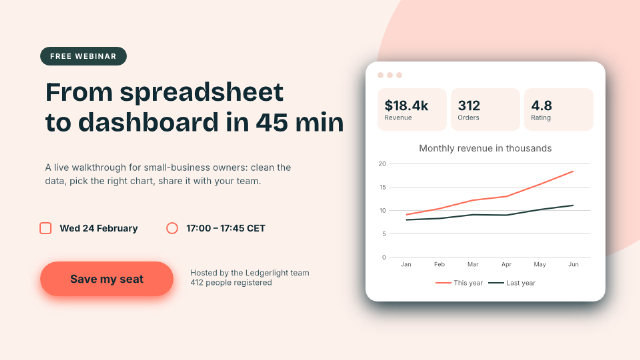

<!-- Generated by tools/gallery.mjs from showcase.yaml and build.json; do not edit. -->
# Webinar Promo

[Slide](../README.md) › [Events & Marketing](../README.md#events--marketing) · `webinar` `theme` `animation` `chart` `cta`

A free-webinar promo slide in the built-in Coral Reef theme, with a dashboard mock-up and a pulsing Save my seat button.



| | |
|---|---|
| Document | [webinar-promo.pptx](webinar-promo.pptx) (27 KB) |
| Contents | 1 slide; 960 × 540 pt |
| Features | `slide.design.themes`, `slide.animations.set`, `slide.charts.edit` |
| Built by | `kition-slide` @ `8309775c19`: 86 commands in 67 ms |

## About

Coral Reef supplies the palette (coral accent, deep teal text, blush background); its fonts are
swapped for Bricolage Grotesque and Inter. The call to action uses a Pulse emphasis that repeats
three times after the slide appears, and the mock dashboard is a real line chart.

## Checks

- `inspect.slides`: `{"count":1}`
- `results.deck.theme`: `"Coral Reef"`
- `results.anims`: `{"count":1}`
- `results.anims.0`: `{"class":"emphasis","effect":"pulse","start":"afterPrevious","repeat":3,"delayMs":500}`
- diagnostics: none (the kit's check finds nothing wrong)
- the saved document opens again; the thumbnail matches `thumb.png` within the `render` tolerance

## Steps

<details><summary>86 commands (from <a href="showcase.yaml">showcase.yaml</a>)</summary>

```yaml
- command: design.theme
  params:
    name: Coral Reef
- command: design.fonts
  params:
    major: Bricolage Grotesque
    minor: Inter
- command: slide.layout
  params:
    layout: blank
    index: 0
- command: design.background
  params:
    color: "#FDF1EC"
- command: shape.insert
  params:
    preset: ellipse
    rect:
      - 560
      - -120
      - 520
      - 520
  as: blob
- command: shape.fill
  params:
    ids:
      - $blob.id
    color: "#FF6F59"
    transparency: 0.82
- command: shape.line
  params:
    ids:
      - $blob.id
    none: true
- command: shape.insert
  params:
    preset: roundRect
    rect:
      - 60
      - 70
      - 130
      - 28
    text: FREE WEBINAR
  as: pill
- command: shape.adjust
  params:
    ids:
      - $pill.id
    index: 0
    value: 50000
- command: shape.fill
  params:
    ids:
      - $pill.id
    color: "#254441"
- command: shape.line
  params:
    ids:
      - $pill.id
    none: true
- command: format.size
  params:
    ids:
      - $pill.id
    size: 11
- command: format.bold
  params:
    ids:
      - $pill.id
- command: format.spacing
  params:
    ids:
      - $pill.id
    pt: 1.5
- command: format.margins
  params:
    ids:
      - $pill.id
    top: 0
    bottom: 0
- command: format.color
  params:
    ids:
      - $pill.id
    color: "#ffffff"
- command: insert.textBox
  params:
    rect:
      - 60
      - 112
      - 480
      - 110
    text: |-
      From spreadsheet
      to dashboard in 45 min
  as: title
- command: format.font
  params:
    ids:
      - $title.id
    family: Bricolage Grotesque
- command: format.size
  params:
    ids:
      - $title.id
    size: 40
- command: format.bold
  params:
    ids:
      - $title.id
- command: format.color
  params:
    ids:
      - $title.id
    color: tx1
- command: format.lineSpacing
  params:
    ids:
      - $title.id
    lines: 0.95
- command: insert.textBox
  params:
    rect:
      - 60
      - 236
      - 420
      - 50
    text: "A live walkthrough for small-business owners: clean the data, pick the right chart, share it with your team."
  as: lede
- command: format.size
  params:
    ids:
      - $lede.id
    size: 14
- command: format.color
  params:
    ids:
      - $lede.id
    color: "#3f5b63"
- command: format.lineSpacing
  params:
    ids:
      - $lede.id
    lines: 1.2
- command: shape.insert
  params:
    preset: roundRect
    rect:
      - 60
      - 334
      - 16
      - 16
  as: icoCal
- command: shape.insert
  params:
    preset: ellipse
    rect:
      - 250
      - 334
      - 16
      - 16
  as: icoClock
- command: shape.fill
  params:
    ids:
      - $icoCal.id
      - $icoClock.id
    none: true
- command: shape.line
  params:
    ids:
      - $icoCal.id
      - $icoClock.id
    color: "#FF6F59"
    width: 2
- command: insert.textBox
  params:
    rect:
      - 82
      - 330
      - 160
      - 24
    text: Wed 24 February
  as: date
- command: insert.textBox
  params:
    rect:
      - 272
      - 330
      - 200
      - 24
    text: 17:00 – 17:45 CET
  as: time
- command: format.size
  params:
    ids:
      - $date.id
      - $time.id
    size: 14
- command: format.bold
  params:
    ids:
      - $date.id
      - $time.id
- command: format.color
  params:
    ids:
      - $date.id
      - $time.id
    color: tx1
- command: shape.insert
  params:
    preset: roundRect
    rect:
      - 60
      - 392
      - 200
      - 52
    text: Save my seat
  as: cta
- command: shape.adjust
  params:
    ids:
      - $cta.id
    index: 0
    value: 50000
- command: shape.fill
  params:
    ids:
      - $cta.id
    color: accent1
- command: shape.line
  params:
    ids:
      - $cta.id
    none: true
- command: shape.effects
  params:
    ids:
      - $cta.id
    shadow:
      color: "#FF6F59"
      blur: 16
      dist: 6
      dir: 90
- command: format.size
  params:
    ids:
      - $cta.id
    size: 17
- command: format.bold
  params:
    ids:
      - $cta.id
- command: format.color
  params:
    ids:
      - $cta.id
    color: "#0F2A33"
- command: insert.textBox
  params:
    rect:
      - 278
      - 398
      - 220
      - 40
    text: |-
      Hosted by the Ledgerlight team
      412 people registered
  as: host
- command: format.size
  params:
    ids:
      - $host.id
    size: 12
- command: format.color
  params:
    ids:
      - $host.id
    color: "#3f5b63"
- command: shape.insert
  params:
    preset: roundRect
    rect:
      - 548
      - 92
      - 360
      - 360
  as: board
- command: shape.adjust
  params:
    ids:
      - $board.id
    index: 0
    value: 5000
- command: shape.fill
  params:
    ids:
      - $board.id
    color: "#ffffff"
- command: shape.line
  params:
    ids:
      - $board.id
    none: true
- command: shape.effects
  params:
    ids:
      - $board.id
    shadow:
      color: "#0F2A33"
      blur: 30
      dist: 10
      dir: 90
- command: shape.insert
  params:
    preset: ellipse
    rect:
      - 566
      - 108
      - 9
      - 9
  as: w1
- command: shape.insert
  params:
    preset: ellipse
    rect:
      - 580
      - 108
      - 9
      - 9
  as: w2
- command: shape.insert
  params:
    preset: ellipse
    rect:
      - 594
      - 108
      - 9
      - 9
  as: w3
- command: shape.fill
  params:
    ids:
      - $w1.id
      - $w2.id
      - $w3.id
    color: "#f3d9cf"
- command: shape.line
  params:
    ids:
      - $w1.id
      - $w2.id
      - $w3.id
    none: true
- command: shape.insert
  params:
    preset: roundRect
    rect:
      - 566
      - 132
      - 104
      - 64
    text: |-
      $$18.4k
      Revenue
  as: m1
- command: shape.insert
  params:
    preset: roundRect
    rect:
      - 676
      - 132
      - 104
      - 64
    text: |-
      312
      Orders
  as: m2
- command: shape.insert
  params:
    preset: roundRect
    rect:
      - 786
      - 132
      - 104
      - 64
    text: |-
      4.8
      Rating
  as: m3
- command: shape.fill
  params:
    ids:
      - $m1.id
      - $m2.id
      - $m3.id
    color: "#FDF1EC"
- command: shape.line
  params:
    ids:
      - $m1.id
      - $m2.id
      - $m3.id
    none: true
- command: format.size
  params:
    ids:
      - $m1.id
      - $m2.id
      - $m3.id
    size: 10
- command: format.color
  params:
    ids:
      - $m1.id
      - $m2.id
      - $m3.id
    color: "#3f5b63"
- command: format.align
  params:
    ids:
      - $m1.id
      - $m2.id
      - $m3.id
    align: left
- command: text.edit
  params:
    id: $m1.id
    at:
      - 0
      - 0
- command: text.selectParagraph
  params:
    at:
      - 0
      - 0
- command: format.size
  params:
    size: 20
- command: format.bold
  params:
    on: true
- command: format.color
  params:
    color: "#0F2A33"
- command: text.edit
  params:
    id: $m2.id
    at:
      - 0
      - 0
- command: text.selectParagraph
  params:
    at:
      - 0
      - 0
- command: format.size
  params:
    size: 20
- command: format.bold
  params:
    on: true
- command: format.color
  params:
    color: "#0F2A33"
- command: text.edit
  params:
    id: $m3.id
    at:
      - 0
      - 0
- command: text.selectParagraph
  params:
    at:
      - 0
      - 0
- command: format.size
  params:
    size: 20
- command: format.bold
  params:
    on: true
- command: format.color
  params:
    color: "#0F2A33"
- command: text.exit
  params: {}
- command: insert.chart
  params:
    type: line
    rect:
      - 560
      - 206
      - 336
      - 236
    categories:
      - Jan
      - Feb
      - Mar
      - Apr
      - May
      - Jun
    series:
      - name: This year
        values:
          - 9.1
          - 10.4
          - 12.2
          - 13
          - 15.6
          - 18.4
      - name: Last year
        values:
          - 8
          - 8.3
          - 9.1
          - 9
          - 10.2
          - 11.1
    title: Monthly revenue in thousands
  as: chart
- command: chart.options
  params:
    id: $chart.id
    legend: b
    gridlines: true
    dataLabels: false
- command: animation.add
  params:
    effect: pulse
    class: emphasis
    ids:
      - $cta.id
    start: afterPrevious
    delay: 500
    duration: 800
- command: animation.timing
  params:
    index: 0
    repeat: 3
- command: animation.get
  params:
    slide: 0
  as: anims
- command: document.inspect
  params: {}
  as: deck
```

</details>
