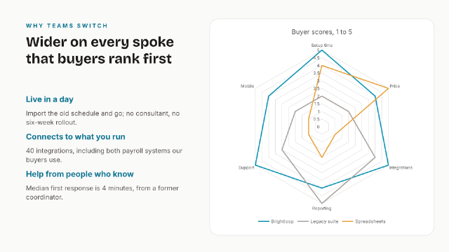

<!-- Generated by tools/gallery.mjs from showcase.yaml and build.json; do not edit. -->
# Why We Win Radar

[Slide](../README.md) › [Pitch Decks](../README.md#pitch-decks) · `pitch-deck` `chart` `radar` `theme-colors`

A pitch-deck comparison slide with a radar chart of the product against a legacy suite and spreadsheets on six buying criteria, beside three reasons teams switch.



| | |
|---|---|
| Document | [why-we-win-radar.pptx](why-we-win-radar.pptx) (26 KB) |
| Contents | 1 slide; 960 × 540 pt |
| Features | `slide.charts.edit`, `slide.design.themes`, `slide.format.paragraph` |
| Built by | `kition-slide` @ `8309775c19`: 39 commands in 55 ms |

## About

A radar chart makes the shape of an advantage visible: the product's outline is the widest on
almost every spoke. The first accent is a strong cyan and the others are warm greys, so the
alternatives sit quietly behind it; the left column turns the chart into three sentences.

## Checks

- `inspect.slides`: `{"count":1}`
- `results.c.shape.kind`: `{"kind":"radar","series":{"count":3},"categories":{"count":6}}`
- `results.c.shape.kind.series.0.name`: `"Brightloop"`
- `results.slide.design`: `{"none":{"code":"design.low-contrast"}}`
- diagnostics: none (the kit's check finds nothing wrong)
- the saved document opens again; the thumbnail matches `thumb.png` within the `render` tolerance

## Steps

<details><summary>39 commands (from <a href="showcase.yaml">showcase.yaml</a>)</summary>

```yaml
- command: design.colors
  params:
    colors:
      accent1: "#0891b2"
      accent2: "#a8a29e"
      accent3: "#e7a33e"
- command: design.fonts
  params:
    major: Bricolage Grotesque
    minor: Inter
- command: slide.layout
  params:
    layout: blank
    index: 0
- command: design.background
  params:
    color: "#fafaf9"
- command: insert.textBox
  params:
    rect:
      - 48
      - 44
      - 360
      - 22
    text: WHY TEAMS SWITCH
  as: eyebrow
- command: format.size
  params:
    ids:
      - $eyebrow.id
    size: 12
- command: format.bold
  params:
    ids:
      - $eyebrow.id
- command: format.spacing
  params:
    ids:
      - $eyebrow.id
    pt: 3
- command: format.color
  params:
    ids:
      - $eyebrow.id
    color: "#0e7490"
- command: insert.textBox
  params:
    rect:
      - 48
      - 68
      - 380
      - 100
    text: Wider on every spoke that buyers rank first
  as: title
- command: format.font
  params:
    ids:
      - $title.id
    family: Bricolage Grotesque
- command: format.size
  params:
    ids:
      - $title.id
    size: 30
- command: format.bold
  params:
    ids:
      - $title.id
- command: format.color
  params:
    ids:
      - $title.id
    color: "#1c1917"
- command: insert.textBox
  params:
    rect:
      - 48
      - 196
      - 360
      - 300
    text: |-
      Live in a day
      Import the old schedule and go; no consultant, no six-week rollout.
      Connects to what you run
      40 integrations, including both payroll systems our buyers use.
      Help from people who know
      Median first response is 4 minutes, from a former coordinator.
  as: body
- command: format.size
  params:
    ids:
      - $body.id
    size: 14
- command: format.color
  params:
    ids:
      - $body.id
    color: "#57534e"
- command: format.paragraph
  params:
    ids:
      - $body.id
    spaceAfter: 9
    lineSpacing: 1.15
- command: text.edit
  params:
    id: $body.id
    at:
      - 0
      - 0
- command: text.selectParagraph
  params:
    at:
      - 0
      - 0
- command: format.bold
  params: {}
- command: format.size
  params:
    size: 17
- command: format.color
  params:
    color: "#0e7490"
- command: text.selectParagraph
  params:
    at:
      - 2
      - 0
- command: format.bold
  params: {}
- command: format.size
  params:
    size: 17
- command: format.color
  params:
    color: "#0e7490"
- command: text.selectParagraph
  params:
    at:
      - 4
      - 0
- command: format.bold
  params: {}
- command: format.size
  params:
    size: 17
- command: format.color
  params:
    color: "#0e7490"
- command: text.exit
  params: {}
- command: shape.insert
  params:
    preset: roundRect
    rect:
      - 448
      - 40
      - 480
      - 464
    adj:
      - 4000
  as: card
- command: shape.fill
  params:
    ids:
      - $card.id
    color: "#ffffff"
- command: shape.line
  params:
    ids:
      - $card.id
    color: "#e7e5e4"
    width: 1
- command: insert.chart
  params:
    type: radar
    rect:
      - 460
      - 52
      - 456
      - 440
    categories:
      - Setup time
      - Price
      - Integrations
      - Reporting
      - Support
      - Mobile
    series:
      - name: Brightloop
        values:
          - 5
          - 4
          - 5
          - 4
          - 5
          - 4
      - name: Legacy suite
        values:
          - 2
          - 2
          - 4
          - 5
          - 3
          - 2
      - name: Spreadsheets
        values:
          - 4
          - 5
          - 1
          - 2
          - 1
          - 1
    title: Buyer scores, 1 to 5
  as: chart
- command: chart.options
  params:
    id: $chart.id
    legend: b
    dataLabels: false
- command: shape.inspect
  params:
    id: $chart.id
  as: c
- command: slide.inspect
  params:
    index: 0
  as: slide
```

</details>
