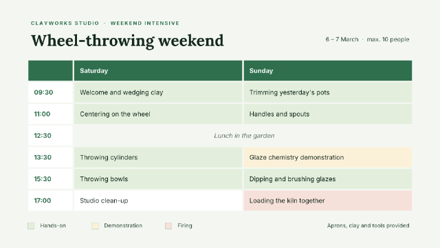

<!-- Generated by tools/gallery.mjs from showcase.yaml and build.json; do not edit. -->
# Weekend Workshop Schedule

[Slide](../README.md) › [Events & Marketing](../README.md#events--marketing) · `table` `schedule` `theme` `event`

A two-day ceramics workshop timetable in the Meadow theme, a table with a merged lunch row, shaded session cells and a materials note.



| | |
|---|---|
| Document | [workshop-schedule.pptx](workshop-schedule.pptx) (23 KB) |
| Contents | 1 slide; 960 × 540 pt |
| Features | `slide.tables.edit`, `slide.design.themes`, `slide.format.character` |
| Built by | `kition-slide` @ `8309775c19`: 60 commands in 233 ms |

## About

The timetable is one table: the header row and time column are styled by hand, the lunch break
is merged across both days, and sessions are shaded by kind (hands-on, demonstration, firing).
Meadow supplies the greens; Lora and Inter replace its fonts.

## Checks

- `inspect.slides`: `{"count":1}`
- `results.deck.theme`: `"Meadow"`
- `results.deck.fonts`: `{"major":"Lora","minor":"Inter"}`
- `results.tstate`: `{"rows":7,"cols":3,"style":"none"}`
- diagnostics: none (the kit's check finds nothing wrong)
- the saved document opens again; the thumbnail matches `thumb.png` within the `render` tolerance

## Steps

<details><summary>60 commands (from <a href="showcase.yaml">showcase.yaml</a>)</summary>

```yaml
- command: design.theme
  params:
    name: Meadow
- command: design.fonts
  params:
    major: Lora
    minor: Inter
- command: slide.layout
  params:
    layout: blank
    index: 0
- command: design.background
  params:
    color: "#f4f7f1"
- command: insert.textBox
  params:
    rect:
      - 60
      - 40
      - 560
      - 24
    text: CLAYWORKS STUDIO  ·  WEEKEND INTENSIVE
  as: kicker
- command: format.size
  params:
    ids:
      - $kicker.id
    size: 11
- command: format.bold
  params:
    ids:
      - $kicker.id
- command: format.spacing
  params:
    ids:
      - $kicker.id
    pt: 2
- command: format.color
  params:
    ids:
      - $kicker.id
    color: accent3
- command: insert.textBox
  params:
    rect:
      - 60
      - 64
      - 600
      - 52
    text: Wheel-throwing weekend
  as: title
- command: format.font
  params:
    ids:
      - $title.id
    family: Lora
- command: format.size
  params:
    ids:
      - $title.id
    size: 34
- command: format.bold
  params:
    ids:
      - $title.id
- command: format.color
  params:
    ids:
      - $title.id
    color: "#14281D"
- command: insert.textBox
  params:
    rect:
      - 640
      - 74
      - 260
      - 40
    text: 6 – 7 March  ·  max. 10 people
  as: when
- command: format.size
  params:
    ids:
      - $when.id
    size: 13
- command: format.align
  params:
    ids:
      - $when.id
    align: right
- command: format.color
  params:
    ids:
      - $when.id
    color: "#2D4A37"
- command: insert.table
  params:
    rows: 7
    cols: 3
    rect:
      - 60
      - 130
      - 840
      - 330
    data:
      - - ""
        - Saturday
        - Sunday
      - - 09:30
        - Welcome and wedging clay
        - Trimming yesterday's pots
      - - 11:00
        - Centering on the wheel
        - Handles and spouts
      - - 12:30
        - Lunch in the garden
        - ""
      - - 13:30
        - Throwing cylinders
        - Glaze chemistry demonstration
      - - 15:30
        - Throwing bowls
        - Dipping and brushing glazes
      - - 17:00
        - Studio clean-up
        - Loading the kiln together
  as: table
- command: table.style
  params:
    id: $table.id
    style: none
- command: table.merge
  params:
    id: $table.id
    from:
      - 3
      - 1
    to:
      - 3
      - 2
- command: table.columnWidth
  params:
    id: $table.id
    col: 0
    width: 100
- command: table.columnWidth
  params:
    id: $table.id
    col: 1
    width: 370
- command: table.columnWidth
  params:
    id: $table.id
    col: 2
    width: 370
- command: table.cellFill
  params:
    id: $table.id
    color: "#ffffff"
- command: table.cellFill
  params:
    id: $table.id
    color: "#2F6F4E"
    cells:
      - - 0
        - 0
      - - 0
        - 1
      - - 0
        - 2
- command: table.cellFill
  params:
    id: $table.id
    color: "#e3efdc"
    cells:
      - - 1
        - 1
      - - 1
        - 2
      - - 2
        - 1
      - - 2
        - 2
      - - 4
        - 1
      - - 5
        - 1
      - - 5
        - 2
- command: table.cellFill
  params:
    id: $table.id
    color: "#fbf1d9"
    cells:
      - - 4
        - 2
- command: table.cellFill
  params:
    id: $table.id
    color: "#f6e1da"
    cells:
      - - 6
        - 2
- command: table.cellFill
  params:
    id: $table.id
    color: "#f4f7f1"
    cells:
      - - 3
        - 1
- command: table.border
  params:
    id: $table.id
    edges: all
    color: "#f4f7f1"
    width: 3
- command: table.cellFormat
  params:
    id: $table.id
    anchor: center
    margins:
      - 14
      - 10
      - 4
      - 4
- command: format.size
  params:
    ids:
      - $table.id
    size: 14
- command: format.color
  params:
    ids:
      - $table.id
    color: "#14281D"
- command: table.selectCells
  params:
    id: $table.id
    from:
      - 0
      - 0
    to:
      - 0
      - 2
- command: format.bold
  params:
    on: true
- command: format.color
  params:
    color: "#ffffff"
- command: table.selectCells
  params:
    id: $table.id
    from:
      - 1
      - 0
    to:
      - 6
      - 0
- command: format.bold
  params:
    on: true
- command: format.color
  params:
    color: "#2F6F4E"
- command: table.selectCells
  params:
    id: $table.id
    from:
      - 3
      - 1
    to:
      - 3
      - 1
- command: format.italic
  params:
    on: true
- command: format.color
  params:
    color: "#5b6b5f"
- command: format.align
  params:
    align: center
- command: shape.insert
  params:
    preset: rect
    rect:
      - 60
      - 484
      - 14
      - 14
  as: k1
- command: shape.insert
  params:
    preset: rect
    rect:
      - 200
      - 484
      - 14
      - 14
  as: k2
- command: shape.insert
  params:
    preset: rect
    rect:
      - 360
      - 484
      - 14
      - 14
  as: k3
- command: shape.fill
  params:
    ids:
      - $k1.id
    color: "#e3efdc"
- command: shape.fill
  params:
    ids:
      - $k2.id
    color: "#fbf1d9"
- command: shape.fill
  params:
    ids:
      - $k3.id
    color: "#f6e1da"
- command: shape.line
  params:
    ids:
      - $k1.id
      - $k2.id
      - $k3.id
    color: "#c9d6c3"
    width: 0.75
- command: insert.textBox
  params:
    rect:
      - 80
      - 480
      - 110
      - 22
    text: Hands-on
  as: l1
- command: insert.textBox
  params:
    rect:
      - 220
      - 480
      - 130
      - 22
    text: Demonstration
  as: l2
- command: insert.textBox
  params:
    rect:
      - 380
      - 480
      - 110
      - 22
    text: Firing
  as: l3
- command: insert.textBox
  params:
    rect:
      - 560
      - 480
      - 340
      - 22
    text: Aprons, clay and tools provided
  as: note
- command: format.size
  params:
    ids:
      - $l1.id
      - $l2.id
      - $l3.id
      - $note.id
    size: 12
- command: format.color
  params:
    ids:
      - $l1.id
      - $l2.id
      - $l3.id
      - $note.id
    color: "#2D4A37"
- command: format.align
  params:
    ids:
      - $note.id
    align: right
- command: table.state
  params:
    id: $table.id
  as: tstate
- command: document.inspect
  params: {}
  as: deck
```

</details>
