<!-- Generated by tools/gallery.mjs from showcase.yaml and build.json; do not edit. -->
# Table showcase

Relational tables: typed fields, linked records, views, filters, sorts and grouping. Saved as .ktable. Every sample is built from `showcase.yaml` by the kit's own commands and drawn by its own engine (`kition-table`).

**11 samples** · 5 categories · 7 features of `kition-table/features.yaml` · [all kits](../README.md)

[Content Calendars](#content-calendars) (2) · [CRM & Sales](#crm--sales) (2) · [Databases](#databases) (3) · [Inventory](#inventory) (2) · [Projects & Tasks](#projects--tasks) (2)

## Content Calendars

<table>
<tr>
<td width="33%" valign="top">
<a href="garden-brand-content-calendar/">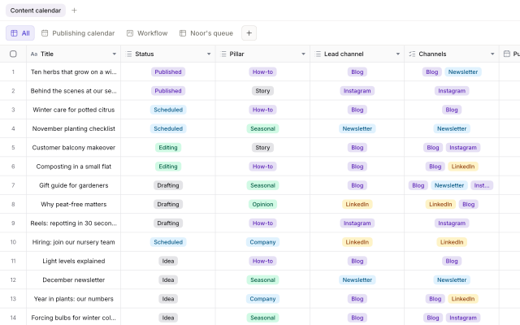</a> 
Table 
<b><a href="garden-brand-content-calendar/">Garden Brand Content Calendar</a></b> 
Sixteen posts across blog, newsletter and social channels, with status, pillar, author, publish dates and read time. 
<i>1 table</i> 
<code>content-calendar</code> <code>calendar</code> <code>kanban</code> <code>multi-select</code> <code>formula</code>
</td>
<td width="33%" valign="top">
<a href="podcast-episode-planner/">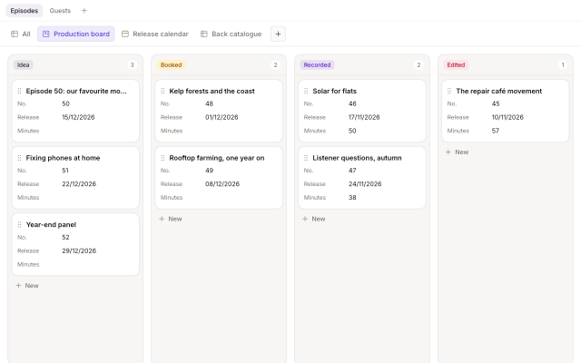</a> 
Table 
<b><a href="podcast-episode-planner/">Podcast Episode Planner</a></b> 
Twelve episodes of an interview podcast from idea to published, with release dates, runtimes and guests looked up from a second table. 
<i>2 tables</i> 
<code>podcast</code> <code>kanban</code> <code>calendar</code> <code>lookup</code> <code>linked-records</code>
</td>
<td width="33%"></td>
</tr>
</table>

## CRM & Sales

<table>
<tr>
<td width="33%" valign="top">
<a href="b2b-sales-pipeline/">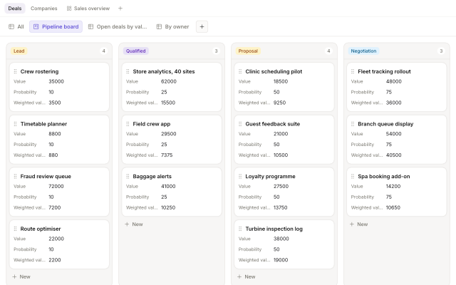</a> 
Table 
<b><a href="b2b-sales-pipeline/">B2B Sales Pipeline</a></b> 
Eighteen deals with stages, weighted values and owners, linked to eight companies that roll up their pipeline. 
<i>2 tables; 1 dashboard</i> 
<code>crm</code> <code>linked-records</code> <code>rollup</code> <code>formula</code> <code>kanban</code> <code>dashboard</code>
</td>
<td width="33%" valign="top">
<a href="estate-agency-listings/">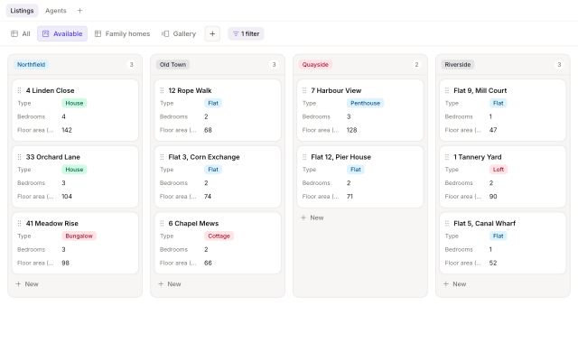</a> 
Table 
<b><a href="estate-agency-listings/">Estate Agency Listings</a></b> 
Fourteen homes for sale with size, asking price and a price-per-square-metre formula, and three agents whose books roll up. 
<i>2 tables</i> 
<code>crm</code> <code>listings</code> <code>formula</code> <code>rollup</code> <code>kanban</code>
</td>
<td width="33%"></td>
</tr>
</table>

## Databases

<table>
<tr>
<td width="33%" valign="top">
<a href="design-conference-registrations/">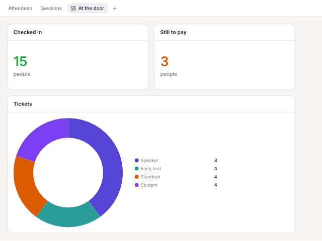</a> 
Table 
<b><a href="design-conference-registrations/">Conference Registrations</a></b> 
Twenty attendees with tickets, payment and check-in, linked to five sessions whose seats left come from a rollup and a formula. 
<i>2 tables; 1 dashboard</i> 
<code>event</code> <code>registrations</code> <code>rollup</code> <code>formula</code> <code>dashboard</code> <code>calendar</code>
</td>
<td width="33%" valign="top">
<a href="family-recipe-box/">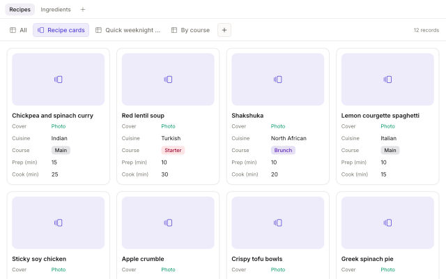</a> 
Table 
<b><a href="family-recipe-box/">Family Recipe Box</a></b> 
Twelve recipes with cuisine, course, timings, heart ratings and diets, linked to ingredients for a shopping-cost rollup. 
<i>2 tables</i> 
<code>recipes</code> <code>gallery</code> <code>rating</code> <code>rollup</code> <code>linked-records</code>
</td>
<td width="33%" valign="top">
<a href="feedback-inbox-data-check/">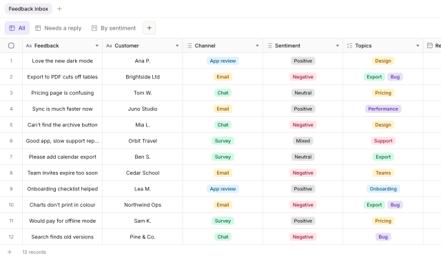</a> 
Table 
<b><a href="feedback-inbox-data-check/">Feedback Inbox Data Check</a></b> 
A customer feedback inbox where the kit's check finds a sentiment that is not one of the options and a required owner left empty. 
<i>1 table</i> 
<code>feedback</code> <code>data-quality</code> <code>diagnostics</code> <code>kanban</code>
</td>
</tr>
</table>

## Inventory

<table>
<tr>
<td width="33%" valign="top">
<a href="bike-shop-parts-inventory/">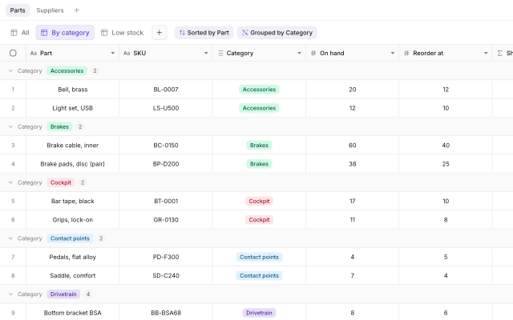</a> 
Table 
<b><a href="bike-shop-parts-inventory/">Bike Shop Parts Inventory</a></b> 
Eighteen workshop parts with stock levels, a shortfall formula and stock value, each linked to a supplier with a lead-time lookup. 
<i>2 tables</i> 
<code>inventory</code> <code>formula</code> <code>lookup</code> <code>linked-records</code>
</td>
<td width="33%" valign="top">
<a href="camera-gear-rentals/">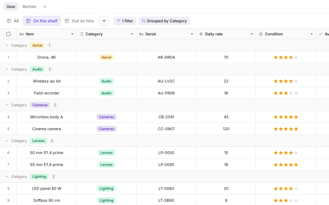</a> 
Table 
<b><a href="camera-gear-rentals/">Camera Gear Rentals</a></b> 
Sixteen items of film kit with daily rates, condition ratings and availability, and four rentals that price themselves. 
<i>2 tables</i> 
<code>inventory</code> <code>rentals</code> <code>rollup</code> <code>formula</code> <code>rating</code>
</td>
<td width="33%"></td>
</tr>
</table>

## Projects & Tasks

<table>
<tr>
<td width="33%" valign="top">
<a href="app-launch-task-tracker/">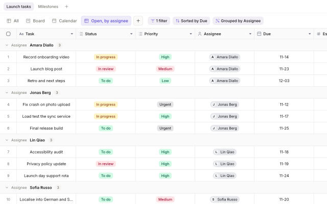</a> 
Table 
<b><a href="app-launch-task-tracker/">App Launch Task Tracker</a></b> 
Sixteen launch tasks with status, priority, assignees and due dates, rolled up into three milestones. 
<i>2 tables</i> 
<code>tasks</code> <code>kanban</code> <code>calendar</code> <code>rollup</code> <code>linked-records</code>
</td>
<td width="33%" valign="top">
<a href="mobile-bug-tracker/">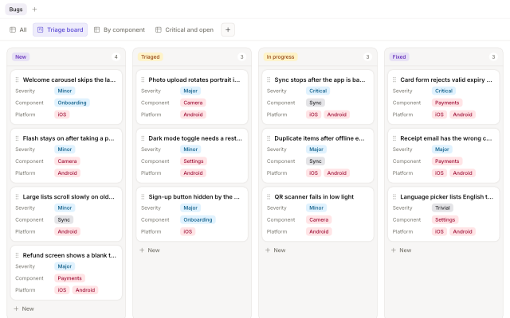</a> 
Table 
<b><a href="mobile-bug-tracker/">Mobile App Bug Tracker</a></b> 
Fourteen bugs imported from CSV, with severity, status, component, platforms and a five-star user-impact rating. 
<i>1 table</i> 
<code>bug-tracker</code> <code>csv-import</code> <code>kanban</code> <code>rating</code> <code>grouping</code>
</td>
<td width="33%"></td>
</tr>
</table>

## Tags

`bug-tracker` 1 · `calendar` 4 · `content-calendar` 1 · `crm` 2 · `csv-import` 1 · `dashboard` 2 · `data-quality` 1 · `diagnostics` 1 · `event` 1 · `feedback` 1 · `formula` 6 · `gallery` 1 · `grouping` 1 · `inventory` 2 · `kanban` 7 · `linked-records` 5 · `listings` 1 · `lookup` 2 · `multi-select` 1 · `podcast` 1 · `rating` 3 · `recipes` 1 · `registrations` 1 · `rentals` 1 · `rollup` 6 · `tasks` 1
