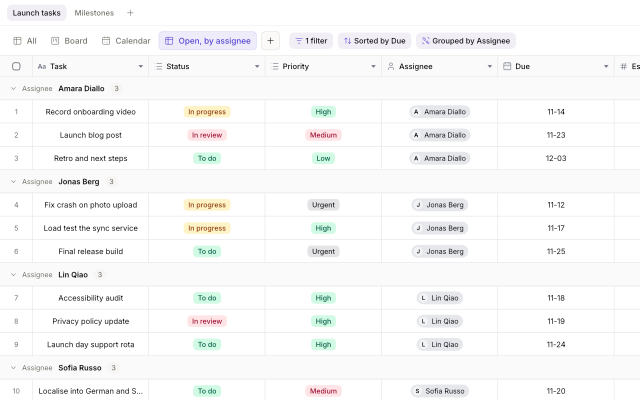

<!-- Generated by tools/gallery.mjs from showcase.yaml and build.json; do not edit. -->
# App Launch Task Tracker

[Table](../README.md) › [Projects & Tasks](../README.md#projects--tasks) · `tasks` `kanban` `calendar` `rollup` `linked-records`

Sixteen launch tasks with status, priority, assignees and due dates, rolled up into three milestones.



| | |
|---|---|
| Document | [app-launch-task-tracker.ktable](app-launch-task-tracker.ktable) (244 KB) |
| Contents | 2 tables |
| Features | `table.schema`, `table.records`, `table.links`, `table.views` |
| Built by | `kition-table` @ `4660b37040`: 17 commands in 17 ms |

## About

A team's launch plan: tasks with a status, a priority, a user field for the assignee, a due date,
an estimate and tags. Milestones link to their tasks; rollups add up the planned hours and say
whether every task is done. Views show a kanban board, a calendar on the due date and open work
grouped by assignee.

## Checks

- `inspect.tables`: `[{"title":"Launch tasks"},{"title":"Milestones"}]`
- `results.shown.result`: `{"view":"Open, by assignee","viewType":"grid","records":12}`
- `results.taskrecs.result.total`: `16`
- `results.taskrecs.result.items.1.values.assignee`: `{"name":"Amara Diallo"}`
- `results.msrecs.result.items.0.values`: `{"milestone":"Beta wrap-up","hours":19,"all_done":false}`
- `results.msrecs.result.items.2.values.hours`: `17`
- `results.cal.result.type`: `"calendar"`
- `results.board.result.type`: `"kanban"`
- diagnostics: none (the kit's check finds nothing wrong)
- the saved document opens again; the thumbnail matches `thumb.png` within the `render` tolerance

## Steps

<details><summary>17 commands (from <a href="showcase.yaml">showcase.yaml</a>)</summary>

```yaml
- command: table.tables.delete
  params:
    tableId: 1
- command: table.tables.create
  params:
    title: Launch tasks
    name: tasks
    fields:
      - name: task
        title: Task
        type: text
        primary: true
      - name: status
        title: Status
        type: single_select
        options:
          choices:
            - To do
            - In progress
            - In review
            - Done
      - name: priority
        title: Priority
        type: single_select
        options:
          choices:
            - Urgent
            - High
            - Medium
            - Low
      - name: assignee
        title: Assignee
        type: user
      - name: due
        title: Due
        type: date
        options:
          date_format: month_day_dash
      - name: estimate
        title: Estimate (h)
        type: number
      - name: done
        title: Done
        type: checkbox
      - name: tags
        title: Tags
        type: multi_select
        options:
          choices:
            - Backend
            - Bug
            - Content
            - Design
            - Legal
            - Marketing
            - QA
            - Research
            - Support
            - Team
  as: t_tasks
- command: table.transact
  params:
    ops:
      - op: records.create
        tableId: $t_tasks.result.id
        records:
          - task: Write App Store description
            status: Done
            priority: Medium
            assignee:
              id: u-sofia
              name: Sofia Russo
            due: 2026-11-10
            estimate: 3
            done: true
            tags:
              - Marketing
          - task: Record onboarding video
            status: In progress
            priority: High
            assignee:
              id: u-amara
              name: Amara Diallo
            due: 2026-11-14
            estimate: 8
            done: false
            tags:
              - Marketing
              - Design
          - task: Fix crash on photo upload
            status: In progress
            priority: Urgent
            assignee:
              id: u-jonas
              name: Jonas Berg
            due: 2026-11-12
            estimate: 5
            done: false
            tags:
              - Bug
          - task: Accessibility audit
            status: To do
            priority: High
            assignee:
              id: u-lin
              name: Lin Qiao
            due: 2026-11-18
            estimate: 6
            done: false
            tags:
              - Design
              - QA
          - task: Localise into German and Spanish
            status: To do
            priority: Medium
            assignee:
              id: u-sofia
              name: Sofia Russo
            due: 2026-11-20
            estimate: 10
            done: false
            tags:
              - Content
          - task: Load test the sync service
            status: In progress
            priority: High
            assignee:
              id: u-jonas
              name: Jonas Berg
            due: 2026-11-17
            estimate: 6
            done: false
            tags:
              - Backend
              - QA
          - task: Press kit and screenshots
            status: Done
            priority: Medium
            assignee:
              id: u-amara
              name: Amara Diallo
            due: 2026-11-09
            estimate: 4
            done: true
            tags:
              - Marketing
              - Design
          - task: Set up crash reporting alerts
            status: Done
            priority: High
            assignee:
              id: u-jonas
              name: Jonas Berg
            due: 2026-11-06
            estimate: 2
            done: true
            tags:
              - Backend
          - task: Beta tester survey
            status: Done
            priority: Low
            assignee:
              id: u-lin
              name: Lin Qiao
            due: 2026-11-05
            estimate: 2
            done: true
            tags:
              - Research
          - task: Pricing page copy
            status: To do
            priority: Medium
            assignee:
              id: u-sofia
              name: Sofia Russo
            due: 2026-11-21
            estimate: 3
            done: false
            tags:
              - Content
              - Marketing
          - task: Launch day support rota
            status: To do
            priority: High
            assignee:
              id: u-lin
              name: Lin Qiao
            due: 2026-11-24
            estimate: 2
            done: false
            tags:
              - Support
          - task: Final release build
            status: To do
            priority: Urgent
            assignee:
              id: u-jonas
              name: Jonas Berg
            due: 2026-11-25
            estimate: 4
            done: false
            tags:
              - Backend
          - task: Launch blog post
            status: In review
            priority: Medium
            assignee:
              id: u-amara
              name: Amara Diallo
            due: 2026-11-23
            estimate: 5
            done: false
            tags:
              - Content
          - task: Privacy policy update
            status: In review
            priority: High
            assignee:
              id: u-lin
              name: Lin Qiao
            due: 2026-11-19
            estimate: 3
            done: false
            tags:
              - Legal
          - task: Email to waiting list
            status: To do
            priority: Medium
            assignee:
              id: u-sofia
              name: Sofia Russo
            due: 2026-11-26
            estimate: 2
            done: false
            tags:
              - Marketing
          - task: Retro and next steps
            status: To do
            priority: Low
            assignee:
              id: u-amara
              name: Amara Diallo
            due: 2026-12-03
            estimate: 1
            done: false
            tags:
              - Team
  as: tx_tasks_0
- command: table.tables.create
  params:
    title: Milestones
    name: milestones
    fields:
      - name: milestone
        title: Milestone
        type: text
        primary: true
      - name: date
        title: Date
        type: date
  as: t_milestones
- command: table.transact
  params:
    ops:
      - op: records.create
        tableId: $t_milestones.result.id
        records:
          - milestone: Beta wrap-up
            date: 2026-11-10
          - milestone: Release candidate
            date: 2026-11-20
          - milestone: Public launch
            date: 2026-11-26
  as: tx_milestones_0
- command: table.fields.create
  params:
    tableId: $t_milestones.result.id
    name: tasks
    title: Tasks
    type: link_to_record
    options:
      target_table_id: $t_tasks.result.id
      allow_multiple: true
  as: f_milestones_tasks
- command: table.transact
  params:
    ops:
      - op: cells.set
        tableId: $t_milestones.result.id
        records:
          - rowKey: $tx_milestones_0.result.created.0
            values:
              tasks:
                - $tx_tasks_0.result.created.0
                - $tx_tasks_0.result.created.1
                - $tx_tasks_0.result.created.6
                - $tx_tasks_0.result.created.7
                - $tx_tasks_0.result.created.8
          - rowKey: $tx_milestones_0.result.created.1
            values:
              tasks:
                - $tx_tasks_0.result.created.2
                - $tx_tasks_0.result.created.3
                - $tx_tasks_0.result.created.4
                - $tx_tasks_0.result.created.5
                - $tx_tasks_0.result.created.13
          - rowKey: $tx_milestones_0.result.created.2
            values:
              tasks:
                - $tx_tasks_0.result.created.9
                - $tx_tasks_0.result.created.10
                - $tx_tasks_0.result.created.11
                - $tx_tasks_0.result.created.12
                - $tx_tasks_0.result.created.14
                - $tx_tasks_0.result.created.15
- command: table.fields.create
  params:
    tableId: $t_milestones.result.id
    name: hours
    title: Planned hours
    type: rollup
    options:
      link_field_id: $f_milestones_tasks.result.id
      target_field_id: $t_tasks.result.fields.5.id
      aggregation: sum
  as: f_milestones_hours
- command: table.fields.create
  params:
    tableId: $t_milestones.result.id
    name: all_done
    title: All done
    type: rollup
    options:
      link_field_id: $f_milestones_tasks.result.id
      target_field_id: $t_tasks.result.fields.6.id
      aggregation: and
  as: f_milestones_all_done
- command: table.views.create
  params:
    tableId: $t_tasks.result.id
    title: Board
    type: kanban
    config:
      group_field_name: status
  as: board
- command: table.views.create
  params:
    tableId: $t_tasks.result.id
    title: Calendar
    type: calendar
  as: cal
- command: table.views.create
  params:
    tableId: $t_tasks.result.id
    title: Open, by assignee
    type: grid
  as: open
- command: table.views.putFilterTree
  params:
    tableId: $t_tasks.result.id
    viewId: $open.result.id
    tree:
      conjunction: and
      children:
        - condition:
            field_id: $t_tasks.result.fields.6.id
            operator: eq
            value: false
- command: table.views.putSorts
  params:
    tableId: $t_tasks.result.id
    viewId: $open.result.id
    items:
      - field_id: $t_tasks.result.fields.4.id
        direction: asc
- command: table.views.putGroups
  params:
    tableId: $t_tasks.result.id
    viewId: $open.result.id
    items:
      - field_id: $t_tasks.result.fields.3.id
        direction: asc
- command: table.records.list
  params:
    tableId: $t_tasks.result.id
    limit: 100
  as: taskrecs
- command: table.records.list
  params:
    tableId: $t_milestones.result.id
    limit: 100
  as: msrecs
```

</details>
