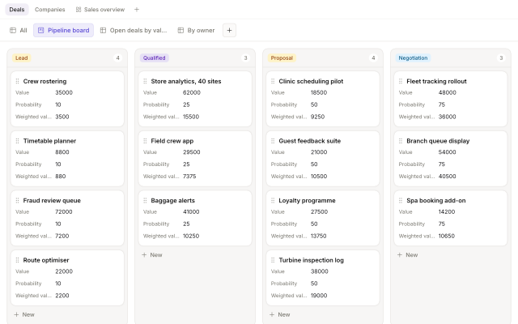

<!-- Generated by tools/gallery.mjs from showcase.yaml and build.json; do not edit. -->
# B2B Sales Pipeline

[Table](../README.md) › [CRM & Sales](../README.md#crm--sales) · `crm` `linked-records` `rollup` `formula` `kanban` `dashboard`

Eighteen deals with stages, weighted values and owners, linked to eight companies that roll up their pipeline.



| | |
|---|---|
| Document | [b2b-sales-pipeline.ktable](b2b-sales-pipeline.ktable) (252 KB) |
| Contents | 2 tables; 1 dashboard |
| Features | `table.schema`, `table.records`, `table.links`, `table.views`, `table.dashboards` |
| Built by | `kition-table` @ `4660b37040`: 20 commands in 51 ms |

## About

A small CRM in two tables. Deals carry a stage, a value and a probability; a formula field works out
the weighted value. Companies link to their deals and two rollups sum the pipeline and count the
deals. Views add a kanban board by stage, open deals by value and deals grouped by owner, and a
dashboard counts open and won deals.

## Checks

- `inspect.tables`: `{"count":2,"all":{"title":{"oneOf":["Deals","Companies"]}}}`
- `inspect.dashboards`: `[{"id":"sales-overview","title":"Sales overview"}]`
- `results.shown.result`: `{"view":"Pipeline board","viewType":"kanban","records":18}`
- `results.dealrecs.result.total`: `18`
- `results.dealrecs.result.items.0.values`: `{"deal":"Fleet tracking rollout","weighted":36000}`
- `results.corecs.result.items.0.values`: `{"company":"Harbour Logistics","pipeline":86000,"deal_count":3}`
- `results.corecs.result.items.6.values.pipeline`: `126000`
- `results.board.result`: `{"type":"kanban","title":"Pipeline board"}`
- diagnostics: none (the kit's check finds nothing wrong)
- the saved document opens again; the thumbnail matches `thumb.png` within the `render` tolerance

## Steps

<details><summary>20 commands (from <a href="showcase.yaml">showcase.yaml</a>)</summary>

```yaml
- command: table.tables.delete
  params:
    tableId: 1
- command: table.tables.create
  params:
    title: Deals
    name: deals
    fields:
      - name: deal
        title: Deal
        type: text
        primary: true
      - name: stage
        title: Stage
        type: single_select
        options:
          choices:
            - Lead
            - Qualified
            - Proposal
            - Negotiation
            - Won
            - Lost
      - name: value
        title: Value
        type: number
      - name: probability
        title: Probability
        type: number
      - name: weighted
        title: Weighted value
        type: formula
        formula: "{value} * {probability} / 100"
      - name: owner
        title: Owner
        type: single_select
        options:
          choices:
            - Ines
            - Marcus
            - Yuki
      - name: close_date
        title: Close date
        type: date
        options:
          date_format: year_month_day_dash
      - name: next_step
        title: Next step
        type: text
    description: Every open and closed deal, with its stage and weighted value.
  as: t_deals
- command: table.transact
  params:
    ops:
      - op: records.create
        tableId: $t_deals.result.id
        records:
          - deal: Fleet tracking rollout
            stage: Negotiation
            value: 48000
            probability: 75
            owner: Ines
            close_date: 2026-11-28
            next_step: Send revised terms
          - deal: Clinic scheduling pilot
            stage: Proposal
            value: 18500
            probability: 50
            owner: Marcus
            close_date: 2026-12-05
            next_step: Demo for clinical leads
          - deal: Store analytics, 40 sites
            stage: Qualified
            value: 62000
            probability: 25
            owner: Yuki
            close_date: 2027-01-15
            next_step: Map data sources
          - deal: Crew rostering
            stage: Lead
            value: 35000
            probability: 10
            owner: Ines
            close_date: 2027-02-01
            next_step: Intro call booked
          - deal: Parent portal
            stage: Won
            value: 12400
            probability: 100
            owner: Marcus
            close_date: 2026-10-30
            next_step: Kick-off on Monday
          - deal: Guest feedback suite
            stage: Proposal
            value: 21000
            probability: 50
            owner: Yuki
            close_date: 2026-12-12
            next_step: Price for 6 hotels
          - deal: Branch queue display
            stage: Negotiation
            value: 54000
            probability: 75
            owner: Ines
            close_date: 2026-11-21
            next_step: Legal review
          - deal: Field crew app
            stage: Qualified
            value: 29500
            probability: 25
            owner: Marcus
            close_date: 2027-01-08
            next_step: Site visit
          - deal: Warehouse dashboards
            stage: Won
            value: 16000
            probability: 100
            owner: Yuki
            close_date: 2026-10-12
            next_step: Invoice sent
          - deal: Patient reminders
            stage: Lost
            value: 9000
            probability: 0
            owner: Ines
            close_date: 2026-10-05
            next_step: Chose in-house tool
          - deal: Loyalty programme
            stage: Proposal
            value: 27500
            probability: 50
            owner: Marcus
            close_date: 2026-12-19
            next_step: Workshop with marketing
          - deal: Baggage alerts
            stage: Qualified
            value: 41000
            probability: 25
            owner: Yuki
            close_date: 2027-01-22
            next_step: Security questionnaire
          - deal: Timetable planner
            stage: Lead
            value: 8800
            probability: 10
            owner: Ines
            close_date: 2027-02-14
            next_step: Share case study
          - deal: Spa booking add-on
            stage: Negotiation
            value: 14200
            probability: 75
            owner: Marcus
            close_date: 2026-11-30
            next_step: Final discount
          - deal: Fraud review queue
            stage: Lead
            value: 72000
            probability: 10
            owner: Yuki
            close_date: 2027-03-01
            next_step: Find a sponsor
          - deal: Turbine inspection log
            stage: Proposal
            value: 38000
            probability: 50
            owner: Ines
            close_date: 2026-12-22
            next_step: Pilot scope
          - deal: Route optimiser
            stage: Lead
            value: 22000
            probability: 10
            owner: Marcus
            close_date: 2027-02-20
            next_step: Discovery call
          - deal: Staff training videos
            stage: Won
            value: 6400
            probability: 100
            owner: Yuki
            close_date: 2026-10-20
            next_step: Done
  as: tx_deals_0
- command: table.tables.create
  params:
    title: Companies
    name: companies
    fields:
      - name: company
        title: Company
        type: text
        primary: true
      - name: industry
        title: Industry
        type: single_select
        options:
          choices:
            - Education
            - Energy
            - Finance
            - Healthcare
            - Hospitality
            - Logistics
            - Retail
            - Travel
      - name: city
        title: City
        type: text
  as: t_companies
- command: table.transact
  params:
    ops:
      - op: records.create
        tableId: $t_companies.result.id
        records:
          - company: Harbour Logistics
            industry: Logistics
            city: Rotterdam
          - company: Brightwell Clinics
            industry: Healthcare
            city: Leeds
          - company: Fernhill Foods
            industry: Retail
            city: Lyon
          - company: Kestrel Air
            industry: Travel
            city: Dublin
          - company: Oakmont Schools
            industry: Education
            city: Austin
          - company: Quayside Hotels
            industry: Hospitality
            city: Lisbon
          - company: Northgate Bank
            industry: Finance
            city: Oslo
          - company: Tidewater Energy
            industry: Energy
            city: Aberdeen
  as: tx_companies_0
- command: table.fields.create
  params:
    tableId: $t_companies.result.id
    name: deals
    title: Deals
    type: link_to_record
    options:
      target_table_id: $t_deals.result.id
      allow_multiple: true
  as: f_companies_deals
- command: table.transact
  params:
    ops:
      - op: cells.set
        tableId: $t_companies.result.id
        records:
          - rowKey: $tx_companies_0.result.created.0
            values:
              deals:
                - $tx_deals_0.result.created.0
                - $tx_deals_0.result.created.8
                - $tx_deals_0.result.created.16
          - rowKey: $tx_companies_0.result.created.1
            values:
              deals:
                - $tx_deals_0.result.created.1
                - $tx_deals_0.result.created.9
          - rowKey: $tx_companies_0.result.created.2
            values:
              deals:
                - $tx_deals_0.result.created.2
                - $tx_deals_0.result.created.10
          - rowKey: $tx_companies_0.result.created.3
            values:
              deals:
                - $tx_deals_0.result.created.3
                - $tx_deals_0.result.created.11
          - rowKey: $tx_companies_0.result.created.4
            values:
              deals:
                - $tx_deals_0.result.created.4
                - $tx_deals_0.result.created.12
          - rowKey: $tx_companies_0.result.created.5
            values:
              deals:
                - $tx_deals_0.result.created.5
                - $tx_deals_0.result.created.13
                - $tx_deals_0.result.created.17
          - rowKey: $tx_companies_0.result.created.6
            values:
              deals:
                - $tx_deals_0.result.created.6
                - $tx_deals_0.result.created.14
          - rowKey: $tx_companies_0.result.created.7
            values:
              deals:
                - $tx_deals_0.result.created.7
                - $tx_deals_0.result.created.15
- command: table.fields.create
  params:
    tableId: $t_companies.result.id
    name: pipeline
    title: Pipeline value
    type: rollup
    options:
      link_field_id: $f_companies_deals.result.id
      target_field_id: $t_deals.result.fields.2.id
      aggregation: sum
  as: f_companies_pipeline
- command: table.fields.create
  params:
    tableId: $t_companies.result.id
    name: deal_count
    title: Deals
    type: rollup
    options:
      link_field_id: $f_companies_deals.result.id
      target_field_id: $t_deals.result.fields.0.id
      aggregation: count
  as: f_companies_deal_count
- command: table.views.create
  params:
    tableId: $t_deals.result.id
    title: Pipeline board
    type: kanban
    config:
      group_field_name: stage
  as: board
- command: table.views.create
  params:
    tableId: $t_deals.result.id
    title: Open deals by value
    type: grid
  as: open
- command: table.views.putFilterTree
  params:
    tableId: $t_deals.result.id
    viewId: $open.result.id
    tree:
      conjunction: and
      children:
        - condition:
            field_id: $t_deals.result.fields.1.id
            operator: neq
            value: Won
        - condition:
            field_id: $t_deals.result.fields.1.id
            operator: neq
            value: Lost
- command: table.views.putSorts
  params:
    tableId: $t_deals.result.id
    viewId: $open.result.id
    items:
      - field_id: $t_deals.result.fields.2.id
        direction: desc
- command: table.views.patchField
  params:
    tableId: $t_deals.result.id
    viewId: $open.result.id
    fieldId: $t_deals.result.fields.0.id
    width: 220
- command: table.views.patchField
  params:
    tableId: $t_deals.result.id
    viewId: $open.result.id
    fieldId: $t_deals.result.fields.7.id
    width: 200
- command: table.views.create
  params:
    tableId: $t_deals.result.id
    title: By owner
    type: grid
  as: byowner
- command: table.views.putGroups
  params:
    tableId: $t_deals.result.id
    viewId: $byowner.result.id
    items:
      - field_id: $t_deals.result.fields.5.id
        direction: asc
- command: table.dashboards.upsert
  params:
    dashboardId: sales-overview
    title: Sales overview
    order: 0
    source_table_id: $t_deals.result.id
    layout:
      - widget_id: open
        x: 0
        y: 0
        w: 4
        h: 2
      - widget_id: won
        x: 4
        y: 0
        w: 4
        h: 2
      - widget_id: by-stage
        x: 0
        y: 2
        w: 8
        h: 4
      - widget_id: by-owner
        x: 8
        y: 0
        w: 4
        h: 6
    widgets:
      - id: open
        title: Open deals
        type: metric
        query:
          aggregation: count
          filters:
            - field_name: stage
              operator: not_equals
              value: Won
        config:
          value_label: deals
          color: "#5645d4"
      - id: won
        title: Won this quarter
        type: metric
        query:
          aggregation: count
          filters:
            - field_name: stage
              operator: equals
              value: Won
        config:
          value_label: deals
          color: "#1aae39"
      - id: by-stage
        title: Deals by stage
        type: bar
        query:
          aggregation: count
          group_by_field_name: stage
        config:
          category_order:
            - Lead
            - Qualified
            - Proposal
            - Negotiation
            - Won
            - Lost
      - id: by-owner
        title: Deals by owner
        type: pie
        query:
          aggregation: count
          group_by_field_name: owner
- command: table.records.list
  params:
    tableId: $t_deals.result.id
    limit: 100
  as: dealrecs
- command: table.records.list
  params:
    tableId: $t_companies.result.id
    limit: 100
  as: corecs
```

</details>
