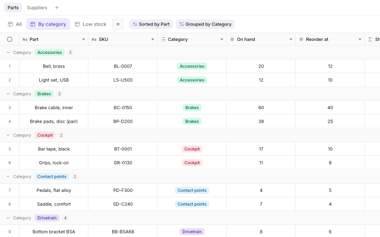

<!-- Generated by tools/gallery.mjs from showcase.yaml and build.json; do not edit. -->
# Bike Shop Parts Inventory

[Table](../README.md) › [Inventory](../README.md#inventory) · `inventory` `formula` `lookup` `linked-records`

Eighteen workshop parts with stock levels, a shortfall formula and stock value, each linked to a supplier with a lead-time lookup.



| | |
|---|---|
| Document | [bike-shop-parts-inventory.ktable](bike-shop-parts-inventory.ktable) (236 KB) |
| Contents | 2 tables |
| Features | `table.schema`, `table.records`, `table.links`, `table.views` |
| Built by | `kition-table` @ `4660b37040`: 15 commands in 56 ms |

## About

Parts carry what is on hand, the reorder point and the unit cost; formula fields work out the
shortfall and the value of the stock. Each part links to one supplier and a lookup brings in that
supplier's lead time. A grouped view sorts parts by category and a filtered one lists low stock.

## Checks

- `inspect.tables`: `[{"title":"Parts"},{"title":"Suppliers"}]`
- `results.shown.result`: `{"view":"By category","viewType":"grid","records":18}`
- `results.partrecs.result.total`: `18`
- `results.partrecs.result.items.4.values`: `{"part":"Inner tube 700×28","shortfall":8,"stock_value":92.4}`
- `results.partrecs.result.items.11.values`: `{"shortfall":3,"lead_time":"28"}`
- `results.partrecs.result.items.0.values.supplier`: `[{"display":"Velotech Components"}]`
- diagnostics: none (the kit's check finds nothing wrong)
- the saved document opens again; the thumbnail matches `thumb.png` within the `render` tolerance

## Steps

<details><summary>15 commands (from <a href="showcase.yaml">showcase.yaml</a>)</summary>

```yaml
- command: table.tables.delete
  params:
    tableId: 1
- command: table.tables.create
  params:
    title: Parts
    name: parts
    fields:
      - name: part
        title: Part
        type: text
        primary: true
      - name: sku
        title: SKU
        type: text
      - name: category
        title: Category
        type: single_select
        options:
          choices:
            - Accessories
            - Brakes
            - Cockpit
            - Contact points
            - Drivetrain
            - Frame parts
            - Tyres
            - Wheels
      - name: on_hand
        title: On hand
        type: number
      - name: reorder_at
        title: Reorder at
        type: number
      - name: shortfall
        title: Shortfall
        type: formula
        formula: "{reorder_at} - {on_hand}"
      - name: unit_cost
        title: Unit cost
        type: number
      - name: stock_value
        title: Stock value
        type: formula
        formula: "{on_hand} * {unit_cost}"
  as: t_parts
- command: table.transact
  params:
    ops:
      - op: records.create
        tableId: $t_parts.result.id
        records:
          - part: Chain, 11-speed
            sku: CH-1101
            category: Drivetrain
            on_hand: 14
            reorder_at: 10
            unit_cost: 18.5
          - part: Cassette 11–34
            sku: CS-1134
            category: Drivetrain
            on_hand: 6
            reorder_at: 5
            unit_cost: 42
          - part: Brake pads, disc (pair)
            sku: BP-D200
            category: Brakes
            on_hand: 38
            reorder_at: 25
            unit_cost: 7.8
          - part: Brake cable, inner
            sku: BC-0150
            category: Brakes
            on_hand: 60
            reorder_at: 40
            unit_cost: 1.9
          - part: Inner tube 700×28
            sku: IT-7028
            category: Tyres
            on_hand: 22
            reorder_at: 30
            unit_cost: 4.2
          - part: Tyre 700×32 gravel
            sku: TY-7032
            category: Tyres
            on_hand: 9
            reorder_at: 8
            unit_cost: 31
          - part: Tubeless sealant 1 l
            sku: TS-1000
            category: Tyres
            on_hand: 5
            reorder_at: 6
            unit_cost: 19.9
          - part: Bar tape, black
            sku: BT-0001
            category: Cockpit
            on_hand: 17
            reorder_at: 10
            unit_cost: 12.5
          - part: Grips, lock-on
            sku: GR-0130
            category: Cockpit
            on_hand: 11
            reorder_at: 8
            unit_cost: 15
          - part: Pedals, flat alloy
            sku: PD-F300
            category: Contact points
            on_hand: 4
            reorder_at: 5
            unit_cost: 38
          - part: Saddle, comfort
            sku: SD-C240
            category: Contact points
            on_hand: 7
            reorder_at: 4
            unit_cost: 44
          - part: "Derailleur hanger #12"
            sku: DH-0012
            category: Frame parts
            on_hand: 3
            reorder_at: 6
            unit_cost: 14
          - part: Bottom bracket BSA
            sku: BB-BSA68
            category: Drivetrain
            on_hand: 8
            reorder_at: 6
            unit_cost: 24
          - part: Spoke 2.0 × 292
            sku: SP-2292
            category: Wheels
            on_hand: 240
            reorder_at: 200
            unit_cost: 0.65
          - part: Rim tape 21 mm
            sku: RT-0021
            category: Wheels
            on_hand: 30
            reorder_at: 20
            unit_cost: 3.1
          - part: Shift cable set
            sku: SC-0300
            category: Drivetrain
            on_hand: 25
            reorder_at: 20
            unit_cost: 9.4
          - part: Light set, USB
            sku: LS-U500
            category: Accessories
            on_hand: 12
            reorder_at: 10
            unit_cost: 29
          - part: Bell, brass
            sku: BL-0007
            category: Accessories
            on_hand: 20
            reorder_at: 12
            unit_cost: 8.5
  as: tx_parts_0
- command: table.tables.create
  params:
    title: Suppliers
    name: suppliers
    fields:
      - name: supplier
        title: Supplier
        type: text
        primary: true
      - name: country
        title: Country
        type: text
      - name: lead_time
        title: Lead time (days)
        type: number
      - name: email
        title: Order email
        type: text
  as: t_suppliers
- command: table.transact
  params:
    ops:
      - op: records.create
        tableId: $t_suppliers.result.id
        records:
          - supplier: Velotech Components
            country: Taiwan
            lead_time: 28
            email: orders@velotech.example
          - supplier: Alpen Rad Teile
            country: Austria
            lead_time: 9
            email: sales@alpenrad.example
          - supplier: Northern Spoke Co.
            country: UK
            lead_time: 4
            email: trade@northernspoke.example
          - supplier: Cascade Tyres
            country: Portugal
            lead_time: 12
            email: b2b@cascadetyres.example
  as: tx_suppliers_0
- command: table.fields.create
  params:
    tableId: $t_parts.result.id
    name: supplier
    title: Supplier
    type: link_to_record
    options:
      target_table_id: $t_suppliers.result.id
      allow_multiple: false
  as: f_parts_supplier
- command: table.transact
  params:
    ops:
      - op: cells.set
        tableId: $t_parts.result.id
        records:
          - rowKey: $tx_parts_0.result.created.0
            values:
              supplier:
                - $tx_suppliers_0.result.created.0
          - rowKey: $tx_parts_0.result.created.1
            values:
              supplier:
                - $tx_suppliers_0.result.created.0
          - rowKey: $tx_parts_0.result.created.2
            values:
              supplier:
                - $tx_suppliers_0.result.created.1
          - rowKey: $tx_parts_0.result.created.3
            values:
              supplier:
                - $tx_suppliers_0.result.created.2
          - rowKey: $tx_parts_0.result.created.4
            values:
              supplier:
                - $tx_suppliers_0.result.created.3
          - rowKey: $tx_parts_0.result.created.5
            values:
              supplier:
                - $tx_suppliers_0.result.created.3
          - rowKey: $tx_parts_0.result.created.6
            values:
              supplier:
                - $tx_suppliers_0.result.created.3
          - rowKey: $tx_parts_0.result.created.7
            values:
              supplier:
                - $tx_suppliers_0.result.created.2
          - rowKey: $tx_parts_0.result.created.8
            values:
              supplier:
                - $tx_suppliers_0.result.created.1
          - rowKey: $tx_parts_0.result.created.9
            values:
              supplier:
                - $tx_suppliers_0.result.created.0
          - rowKey: $tx_parts_0.result.created.10
            values:
              supplier:
                - $tx_suppliers_0.result.created.1
          - rowKey: $tx_parts_0.result.created.11
            values:
              supplier:
                - $tx_suppliers_0.result.created.0
          - rowKey: $tx_parts_0.result.created.12
            values:
              supplier:
                - $tx_suppliers_0.result.created.0
          - rowKey: $tx_parts_0.result.created.13
            values:
              supplier:
                - $tx_suppliers_0.result.created.2
          - rowKey: $tx_parts_0.result.created.14
            values:
              supplier:
                - $tx_suppliers_0.result.created.2
          - rowKey: $tx_parts_0.result.created.15
            values:
              supplier:
                - $tx_suppliers_0.result.created.1
          - rowKey: $tx_parts_0.result.created.16
            values:
              supplier:
                - $tx_suppliers_0.result.created.1
          - rowKey: $tx_parts_0.result.created.17
            values:
              supplier:
                - $tx_suppliers_0.result.created.2
- command: table.fields.create
  params:
    tableId: $t_parts.result.id
    name: lead_time
    title: Lead time
    type: lookup
    options:
      link_field_id: $f_parts_supplier.result.id
      target_field_id: $t_suppliers.result.fields.2.id
      multi_value_mode: concat
  as: f_parts_lead_time
- command: table.views.create
  params:
    tableId: $t_parts.result.id
    title: By category
    type: grid
  as: bycat
- command: table.views.putSorts
  params:
    tableId: $t_parts.result.id
    viewId: $bycat.result.id
    items:
      - field_id: $t_parts.result.fields.0.id
        direction: asc
- command: table.views.putGroups
  params:
    tableId: $t_parts.result.id
    viewId: $bycat.result.id
    items:
      - field_id: $t_parts.result.fields.2.id
        direction: asc
- command: table.views.create
  params:
    tableId: $t_parts.result.id
    title: Low stock
    type: grid
  as: low
- command: table.views.putFilterTree
  params:
    tableId: $t_parts.result.id
    viewId: $low.result.id
    tree:
      conjunction: and
      children:
        - condition:
            field_id: $t_parts.result.fields.5.id
            operator: gt
            value: 0
- command: table.views.putSorts
  params:
    tableId: $t_parts.result.id
    viewId: $low.result.id
    items:
      - field_id: $t_parts.result.fields.5.id
        direction: desc
- command: table.records.list
  params:
    tableId: $t_parts.result.id
    limit: 100
  as: partrecs
```

</details>
