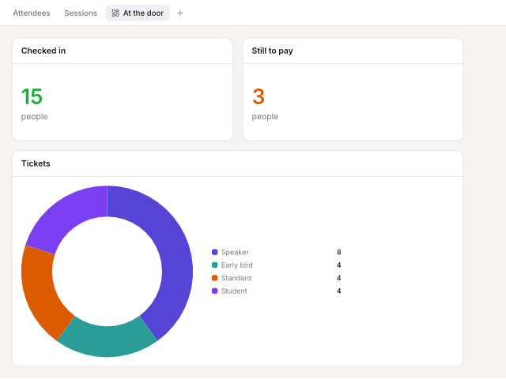

<!-- Generated by tools/gallery.mjs from showcase.yaml and build.json; do not edit. -->
# Conference Registrations

[Table](../README.md) › [Databases](../README.md#databases) · `event` `registrations` `rollup` `formula` `dashboard` `calendar`

Twenty attendees with tickets, payment and check-in, linked to five sessions whose seats left come from a rollup and a formula.



| | |
|---|---|
| Document | [design-conference-registrations.ktable](design-conference-registrations.ktable) (260 KB) |
| Contents | 2 tables; 1 dashboard |
| Features | `table.schema`, `table.records`, `table.links`, `table.views`, `table.dashboards` |
| Built by | `kition-table` @ `4660b37040`: 18 commands in 89 ms |

## About

Registrations for a one-day design conference. Sessions link to the people who signed up; a rollup
counts them and a formula subtracts that from the room's capacity. A dashboard for the front desk
counts check-ins and unpaid tickets, and a calendar view lays out the schedule.

## Checks

- `inspect.tables`: `[{"title":"Attendees"},{"title":"Sessions"}]`
- `inspect.dashboards`: `[{"id":"door","title":"At the door"}]`
- `results.shown.result`: `{"dashboardId":"door","dashboard":"At the door"}`
- `results.people.result.total`: `20`
- `results.sess.result.items.0.values`: `{"registered":20,"seats_left":0}`
- `results.sess.result.items.1.values`: `{"registered":8,"seats_left":0}`
- `results.sess.result.items.2.values`: `{"registered":6,"seats_left":6}`
- `results.sess.result.items.4.values.seats_left`: `1`
- diagnostics: none (the kit's check finds nothing wrong)
- the saved document opens again; the thumbnail matches `thumb.png` within the `render` tolerance

## Steps

<details><summary>18 commands (from <a href="showcase.yaml">showcase.yaml</a>)</summary>

```yaml
- command: table.tables.delete
  params:
    tableId: 1
- command: table.tables.create
  params:
    title: Attendees
    name: attendees
    fields:
      - name: name
        title: Name
        type: text
        primary: true
      - name: email
        title: Email
        type: text
      - name: company
        title: Company
        type: text
      - name: ticket
        title: Ticket
        type: single_select
        options:
          choices:
            - Early bird
            - Standard
            - Student
            - Speaker
      - name: paid
        title: Paid
        type: checkbox
      - name: diet
        title: Dietary needs
        type: single_select
        options:
          choices:
            - None
            - Vegetarian
            - Vegan
            - Halal
            - Gluten-free
      - name: country
        title: Country
        type: text
      - name: checked_in
        title: Checked in
        type: checkbox
  as: t_attendees
- command: table.transact
  params:
    ops:
      - op: records.create
        tableId: $t_attendees.result.id
        records:
          - name: Aiko Mori
            email: aiko@pixelhaus.example
            company: Pixelhaus
            ticket: Speaker
            paid: true
            diet: None
            country: Japan
            checked_in: true
          - name: Bruno Alves
            email: bruno@northwind.example
            company: Northwind Studio
            ticket: Speaker
            paid: true
            diet: Vegan
            country: Brazil
            checked_in: false
          - name: Chiara Conti
            email: chiara@fable.example
            company: Fable & Co.
            ticket: Student
            paid: true
            diet: Gluten-free
            country: Italy
            checked_in: true
          - name: Dmitri Petrov
            email: dmitri@lumen.example
            company: Lumen Labs
            ticket: Standard
            paid: false
            diet: Vegetarian
            country: Bulgaria
            checked_in: true
          - name: Esi Owusu
            email: esi@paperkite.example
            company: Paperkite
            ticket: Early bird
            paid: true
            diet: Halal
            country: Ghana
            checked_in: true
          - name: Farah Haddad
            email: farah@pixelhaus.example
            company: Pixelhaus
            ticket: Speaker
            paid: true
            diet: None
            country: Lebanon
            checked_in: false
          - name: Gustav Lund
            email: gustav@northwind.example
            company: Northwind Studio
            ticket: Student
            paid: true
            diet: Vegan
            country: Sweden
            checked_in: true
          - name: Hye-jin Kang
            email: hyejin@fable.example
            company: Fable & Co.
            ticket: Speaker
            paid: true
            diet: Gluten-free
            country: Korea
            checked_in: true
          - name: Isaac Levy
            email: isaac@lumen.example
            company: Lumen Labs
            ticket: Early bird
            paid: false
            diet: Vegetarian
            country: Israel
            checked_in: true
          - name: Jana Novak
            email: jana@paperkite.example
            company: Paperkite
            ticket: Speaker
            paid: true
            diet: Halal
            country: Czechia
            checked_in: false
          - name: Kofi Asante
            email: kofi@pixelhaus.example
            company: Pixelhaus
            ticket: Student
            paid: true
            diet: None
            country: Ghana
            checked_in: true
          - name: Leila Karimi
            email: leila@northwind.example
            company: Northwind Studio
            ticket: Standard
            paid: true
            diet: Vegan
            country: Iran
            checked_in: true
          - name: Mateo Ruiz
            email: mateo@fable.example
            company: Fable & Co.
            ticket: Early bird
            paid: true
            diet: Gluten-free
            country: Spain
            checked_in: true
          - name: Nadia Sato
            email: nadia@lumen.example
            company: Lumen Labs
            ticket: Speaker
            paid: true
            diet: Vegetarian
            country: Japan
            checked_in: false
          - name: Oskar Nilsson
            email: oskar@paperkite.example
            company: Paperkite
            ticket: Speaker
            paid: true
            diet: Halal
            country: Sweden
            checked_in: true
          - name: Priya Iyer
            email: priya@pixelhaus.example
            company: Pixelhaus
            ticket: Standard
            paid: true
            diet: None
            country: India
            checked_in: true
          - name: Quinn Walsh
            email: quinn@northwind.example
            company: Northwind Studio
            ticket: Early bird
            paid: true
            diet: Vegan
            country: Ireland
            checked_in: true
          - name: Rania Aziz
            email: rania@fable.example
            company: Fable & Co.
            ticket: Speaker
            paid: true
            diet: Gluten-free
            country: Egypt
            checked_in: false
          - name: Samuel Okoro
            email: samuel@lumen.example
            company: Lumen Labs
            ticket: Student
            paid: false
            diet: Vegetarian
            country: Nigeria
            checked_in: true
          - name: Tove Berg
            email: tove@paperkite.example
            company: Paperkite
            ticket: Standard
            paid: true
            diet: Halal
            country: Norway
            checked_in: true
  as: tx_attendees_0
- command: table.tables.create
  params:
    title: Sessions
    name: sessions
    fields:
      - name: session
        title: Session
        type: text
        primary: true
      - name: room
        title: Room
        type: single_select
        options:
          choices:
            - Main hall
            - Room A
            - Room B
      - name: starts
        title: Starts
        type: datetime
        options:
          date_format: year_month_day_time_dash
      - name: capacity
        title: Capacity
        type: number
  as: t_sessions
- command: table.transact
  params:
    ops:
      - op: records.create
        tableId: $t_sessions.result.id
        records:
          - session: "Opening keynote: design at scale"
            room: Main hall
            starts: 2026-11-19T09:00:00Z
            capacity: 20
          - session: "Workshop: accessible colour"
            room: Room A
            starts: 2026-11-19T11:00:00Z
            capacity: 8
          - session: Type on screens
            room: Room B
            starts: 2026-11-19T11:00:00Z
            capacity: 12
          - session: Research ops panel
            room: Main hall
            starts: 2026-11-19T14:00:00Z
            capacity: 16
          - session: "Workshop: motion basics"
            room: Room A
            starts: 2026-11-19T15:30:00Z
            capacity: 8
  as: tx_sessions_0
- command: table.fields.create
  params:
    tableId: $t_sessions.result.id
    name: attendees
    title: Attendees
    type: link_to_record
    options:
      target_table_id: $t_attendees.result.id
      allow_multiple: true
  as: f_sessions_attendees
- command: table.transact
  params:
    ops:
      - op: cells.set
        tableId: $t_sessions.result.id
        records:
          - rowKey: $tx_sessions_0.result.created.0
            values:
              attendees:
                - $tx_attendees_0.result.created.0
                - $tx_attendees_0.result.created.1
                - $tx_attendees_0.result.created.2
                - $tx_attendees_0.result.created.3
                - $tx_attendees_0.result.created.4
                - $tx_attendees_0.result.created.5
                - $tx_attendees_0.result.created.6
                - $tx_attendees_0.result.created.7
                - $tx_attendees_0.result.created.8
                - $tx_attendees_0.result.created.9
                - $tx_attendees_0.result.created.10
                - $tx_attendees_0.result.created.11
                - $tx_attendees_0.result.created.12
                - $tx_attendees_0.result.created.13
                - $tx_attendees_0.result.created.14
                - $tx_attendees_0.result.created.15
                - $tx_attendees_0.result.created.16
                - $tx_attendees_0.result.created.17
                - $tx_attendees_0.result.created.18
                - $tx_attendees_0.result.created.19
          - rowKey: $tx_sessions_0.result.created.1
            values:
              attendees:
                - $tx_attendees_0.result.created.0
                - $tx_attendees_0.result.created.2
                - $tx_attendees_0.result.created.4
                - $tx_attendees_0.result.created.6
                - $tx_attendees_0.result.created.9
                - $tx_attendees_0.result.created.12
                - $tx_attendees_0.result.created.15
                - $tx_attendees_0.result.created.18
          - rowKey: $tx_sessions_0.result.created.2
            values:
              attendees:
                - $tx_attendees_0.result.created.1
                - $tx_attendees_0.result.created.3
                - $tx_attendees_0.result.created.5
                - $tx_attendees_0.result.created.7
                - $tx_attendees_0.result.created.10
                - $tx_attendees_0.result.created.13
          - rowKey: $tx_sessions_0.result.created.3
            values:
              attendees:
                - $tx_attendees_0.result.created.2
                - $tx_attendees_0.result.created.8
                - $tx_attendees_0.result.created.11
                - $tx_attendees_0.result.created.14
                - $tx_attendees_0.result.created.16
                - $tx_attendees_0.result.created.17
                - $tx_attendees_0.result.created.19
          - rowKey: $tx_sessions_0.result.created.4
            values:
              attendees:
                - $tx_attendees_0.result.created.3
                - $tx_attendees_0.result.created.5
                - $tx_attendees_0.result.created.9
                - $tx_attendees_0.result.created.12
                - $tx_attendees_0.result.created.13
                - $tx_attendees_0.result.created.18
                - $tx_attendees_0.result.created.19
- command: table.fields.create
  params:
    tableId: $t_sessions.result.id
    name: registered
    title: Registered
    type: rollup
    options:
      link_field_id: $f_sessions_attendees.result.id
      target_field_id: $t_attendees.result.fields.0.id
      aggregation: count
  as: f_sessions_registered
- command: table.fields.create
  params:
    tableId: $t_sessions.result.id
    name: seats_left
    title: Seats left
    type: formula
    formula: "{capacity} - {registered}"
  as: f_sessions_seats_left
- command: table.views.create
  params:
    tableId: $t_attendees.result.id
    title: Unpaid
    type: grid
  as: unpaid
- command: table.views.putFilterTree
  params:
    tableId: $t_attendees.result.id
    viewId: $unpaid.result.id
    tree:
      conjunction: and
      children:
        - condition:
            field_id: $t_attendees.result.fields.4.id
            operator: eq
            value: false
- command: table.views.create
  params:
    tableId: $t_attendees.result.id
    title: Badges by ticket
    type: grid
  as: badges
- command: table.views.putSorts
  params:
    tableId: $t_attendees.result.id
    viewId: $badges.result.id
    items:
      - field_id: $t_attendees.result.fields.0.id
        direction: asc
- command: table.views.putGroups
  params:
    tableId: $t_attendees.result.id
    viewId: $badges.result.id
    items:
      - field_id: $t_attendees.result.fields.3.id
        direction: asc
- command: table.views.create
  params:
    tableId: $t_sessions.result.id
    title: Schedule
    type: calendar
  as: sched
- command: table.dashboards.upsert
  params:
    dashboardId: door
    title: At the door
    order: 0
    source_table_id: $t_attendees.result.id
    layout:
      - widget_id: in
        x: 0
        y: 0
        w: 4
        h: 2
      - widget_id: unpaid
        x: 4
        y: 0
        w: 4
        h: 2
      - widget_id: tickets
        x: 0
        y: 2
        w: 8
        h: 4
    widgets:
      - id: in
        title: Checked in
        type: metric
        query:
          aggregation: count_true
          field_name: checked_in
        config:
          value_label: people
          color: "#1aae39"
      - id: unpaid
        title: Still to pay
        type: metric
        query:
          aggregation: count
          filters:
            - field_name: paid
              operator: falsy
        config:
          value_label: people
          color: "#dd5b00"
      - id: tickets
        title: Tickets
        type: pie
        query:
          aggregation: count
          group_by_field_name: ticket
- command: table.records.list
  params:
    tableId: $t_attendees.result.id
    limit: 100
  as: people
- command: table.records.list
  params:
    tableId: $t_sessions.result.id
    limit: 100
  as: sess
```

</details>
