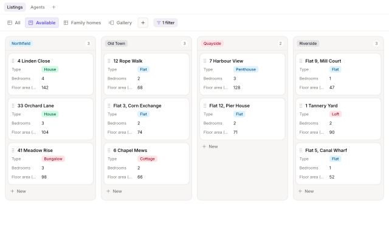

<!-- Generated by tools/gallery.mjs from showcase.yaml and build.json; do not edit. -->
# Estate Agency Listings

[Table](../README.md) › [CRM & Sales](../README.md#crm--sales) · `crm` `listings` `formula` `rollup` `kanban`

Fourteen homes for sale with size, asking price and a price-per-square-metre formula, and three agents whose books roll up.



| | |
|---|---|
| Document | [estate-agency-listings.ktable](estate-agency-listings.ktable) (232 KB) |
| Contents | 2 tables |
| Features | `table.schema`, `table.records`, `table.links`, `table.views` |
| Built by | `kition-table` @ `4660b37040`: 18 commands in 43 ms |

## About

An estate agent's stock: each listing has a neighbourhood, a type, bedrooms, floor area and an
asking price, and a formula works out the price per square metre. Agents link to the listings
they hold, with rollups for the count, the total and the highest asking price.

## Checks

- `inspect.tables`: `[{"title":"Listings"},{"title":"Agents"}]`
- `results.shown.result`: `{"view":"Available","viewType":"kanban","records":12}`
- `results.l.result.total`: `14`
- `results.l.result.items.4.values.per_m2`: `{"approx":6093.75,"tol":0.01}`
- `results.a.result.items.0.values`: `{"count":5,"book":1603000,"top":468000}`
- `results.a.result.items.2.values.top`: `780000`
- `results.avail.result.type`: `"kanban"`
- diagnostics: none (the kit's check finds nothing wrong)
- the saved document opens again; the thumbnail matches `thumb.png` within the `render` tolerance

## Steps

<details><summary>18 commands (from <a href="showcase.yaml">showcase.yaml</a>)</summary>

```yaml
- command: table.tables.delete
  params:
    tableId: 1
- command: table.tables.create
  params:
    title: Listings
    name: listings
    fields:
      - name: address
        title: Address
        type: text
        primary: true
      - name: area
        title: Neighbourhood
        type: single_select
        options:
          choices:
            - Northfield
            - Old Town
            - Quayside
            - Riverside
            - Southgate
      - name: type
        title: Type
        type: single_select
        options:
          choices:
            - Bungalow
            - Cottage
            - Flat
            - House
            - Loft
            - Penthouse
            - Townhouse
      - name: beds
        title: Bedrooms
        type: number
      - name: size
        title: Floor area (m²)
        type: number
      - name: price
        title: Asking price
        type: number
      - name: per_m2
        title: Price per m²
        type: formula
        formula: "{price} / {size}"
      - name: status
        title: Status
        type: single_select
        options:
          choices:
            - For sale
            - Under offer
            - Sold
  as: t_listings
- command: table.transact
  params:
    ops:
      - op: records.create
        tableId: $t_listings.result.id
        records:
          - address: 12 Rope Walk
            area: Old Town
            type: Flat
            beds: 2
            size: 68
            price: 295000
            status: For sale
          - address: 4 Linden Close
            area: Northfield
            type: House
            beds: 4
            size: 142
            price: 540000
            status: Under offer
          - address: Flat 9, Mill Court
            area: Riverside
            type: Flat
            beds: 1
            size: 47
            price: 212000
            status: For sale
          - address: 33 Orchard Lane
            area: Northfield
            type: House
            beds: 3
            size: 104
            price: 415000
            status: For sale
          - address: 7 Harbour View
            area: Quayside
            type: Penthouse
            beds: 3
            size: 128
            price: 780000
            status: For sale
          - address: 2 Weavers Row
            area: Old Town
            type: Townhouse
            beds: 3
            size: 96
            price: 468000
            status: Sold
          - address: Flat 3, Corn Exchange
            area: Old Town
            type: Flat
            beds: 2
            size: 74
            price: 330000
            status: Under offer
          - address: 19 Beech Avenue
            area: Southgate
            type: House
            beds: 5
            size: 188
            price: 695000
            status: For sale
          - address: 1 Tannery Yard
            area: Riverside
            type: Loft
            beds: 2
            size: 90
            price: 402000
            status: For sale
          - address: 58 Station Road
            area: Southgate
            type: Flat
            beds: 2
            size: 63
            price: 248000
            status: Sold
          - address: Flat 12, Pier House
            area: Quayside
            type: Flat
            beds: 2
            size: 71
            price: 385000
            status: For sale
          - address: 6 Chapel Mews
            area: Old Town
            type: Cottage
            beds: 2
            size: 66
            price: 318000
            status: For sale
          - address: 41 Meadow Rise
            area: Northfield
            type: Bungalow
            beds: 3
            size: 98
            price: 372000
            status: Under offer
          - address: Flat 5, Canal Wharf
            area: Riverside
            type: Flat
            beds: 1
            size: 52
            price: 226000
            status: For sale
  as: tx_listings_0
- command: table.tables.create
  params:
    title: Agents
    name: agents
    fields:
      - name: agent
        title: Agent
        type: text
        primary: true
      - name: email
        title: Email
        type: text
  as: t_agents
- command: table.transact
  params:
    ops:
      - op: records.create
        tableId: $t_agents.result.id
        records:
          - agent: Helen Achebe
            email: helen@keystone-homes.example
          - agent: Omar Faruk
            email: omar@keystone-homes.example
          - agent: Signe Dahl
            email: signe@keystone-homes.example
  as: tx_agents_0
- command: table.fields.create
  params:
    tableId: $t_agents.result.id
    name: listings
    title: Listings
    type: link_to_record
    options:
      target_table_id: $t_listings.result.id
      allow_multiple: true
  as: f_agents_listings
- command: table.transact
  params:
    ops:
      - op: cells.set
        tableId: $t_agents.result.id
        records:
          - rowKey: $tx_agents_0.result.created.0
            values:
              listings:
                - $tx_listings_0.result.created.0
                - $tx_listings_0.result.created.2
                - $tx_listings_0.result.created.5
                - $tx_listings_0.result.created.8
                - $tx_listings_0.result.created.13
          - rowKey: $tx_agents_0.result.created.1
            values:
              listings:
                - $tx_listings_0.result.created.1
                - $tx_listings_0.result.created.3
                - $tx_listings_0.result.created.7
                - $tx_listings_0.result.created.12
          - rowKey: $tx_agents_0.result.created.2
            values:
              listings:
                - $tx_listings_0.result.created.4
                - $tx_listings_0.result.created.6
                - $tx_listings_0.result.created.9
                - $tx_listings_0.result.created.10
                - $tx_listings_0.result.created.11
- command: table.fields.create
  params:
    tableId: $t_agents.result.id
    name: count
    title: Listings held
    type: rollup
    options:
      link_field_id: $f_agents_listings.result.id
      target_field_id: $t_listings.result.fields.0.id
      aggregation: count
  as: f_agents_count
- command: table.fields.create
  params:
    tableId: $t_agents.result.id
    name: book
    title: Book value
    type: rollup
    options:
      link_field_id: $f_agents_listings.result.id
      target_field_id: $t_listings.result.fields.5.id
      aggregation: sum
  as: f_agents_book
- command: table.fields.create
  params:
    tableId: $t_agents.result.id
    name: top
    title: Top asking price
    type: rollup
    options:
      link_field_id: $f_agents_listings.result.id
      target_field_id: $t_listings.result.fields.5.id
      aggregation: max
  as: f_agents_top
- command: table.views.create
  params:
    tableId: $t_listings.result.id
    title: Available
    type: kanban
    config:
      group_field_name: area
  as: avail
- command: table.views.putFilterTree
  params:
    tableId: $t_listings.result.id
    viewId: $avail.result.id
    tree:
      conjunction: and
      children:
        - condition:
            field_id: $t_listings.result.fields.7.id
            operator: neq
            value: Sold
- command: table.views.create
  params:
    tableId: $t_listings.result.id
    title: Family homes
    type: grid
  as: family
- command: table.views.putFilterTree
  params:
    tableId: $t_listings.result.id
    viewId: $family.result.id
    tree:
      conjunction: and
      children:
        - condition:
            field_id: $t_listings.result.fields.3.id
            operator: gte
            value: 3
- command: table.views.putSorts
  params:
    tableId: $t_listings.result.id
    viewId: $family.result.id
    items:
      - field_id: $t_listings.result.fields.5.id
        direction: asc
- command: table.views.create
  params:
    tableId: $t_listings.result.id
    title: Gallery
    type: gallery
  as: gal
- command: table.records.list
  params:
    tableId: $t_listings.result.id
    limit: 100
  as: l
- command: table.records.list
  params:
    tableId: $t_agents.result.id
    limit: 100
  as: a
```

</details>
