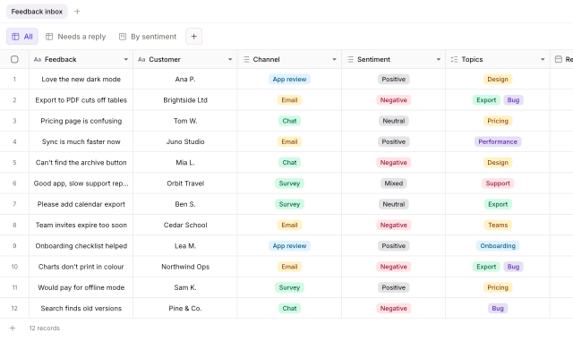

<!-- Generated by tools/gallery.mjs from showcase.yaml and build.json; do not edit. -->
# Feedback Inbox Data Check

[Table](../README.md) › [Databases](../README.md#databases) · `feedback` `data-quality` `diagnostics` `kanban`

A customer feedback inbox where the kit's check finds a sentiment that is not one of the options and a required owner left empty.



| | |
|---|---|
| Document | [feedback-inbox-data-check.ktable](feedback-inbox-data-check.ktable) (220 KB) |
| Contents | 1 table |
| Features | `table.schema`, `table.records`, `table.views`, `table.agent.observe` |
| Built by | `kition-table` @ `4660b37040`: 8 commands in 39 ms |

## About

Twelve pieces of feedback with channel, sentiment, topics, date, owner and a resolved flag. Two rows
break the table's own rules, and the check names both: one sentiment says "Mixed", which the select
does not offer, and one row has no owner although the field is required.

## Checks

- `inspect.tables`: `[{"title":"Feedback inbox"}]`
- `results.shown.result`: `{"table":"Feedback inbox","viewType":"grid","records":12}`
- `results.f.result.total`: `12`
- `results.f.result.items.5.values.sentiment`: `"Mixed"`
- `results.f.result.items.7.values.owner`: `{"exists":false}`
- diagnostics: `table.select-option-missing`, `table.required-empty`
- the saved document opens again; the thumbnail matches `thumb.png` within the `render` tolerance

## Steps

<details><summary>8 commands (from <a href="showcase.yaml">showcase.yaml</a>)</summary>

```yaml
- command: table.tables.delete
  params:
    tableId: 1
- command: table.tables.create
  params:
    title: Feedback inbox
    name: feedback
    fields:
      - name: feedback
        title: Feedback
        type: text
        primary: true
      - name: customer
        title: Customer
        type: text
      - name: channel
        title: Channel
        type: single_select
        options:
          choices:
            - Email
            - Chat
            - Survey
            - App review
      - name: sentiment
        title: Sentiment
        type: single_select
        options:
          choices:
            - Positive
            - Neutral
            - Negative
      - name: topics
        title: Topics
        type: multi_select
        options:
          choices:
            - Bug
            - Design
            - Export
            - Onboarding
            - Performance
            - Pricing
            - Support
            - Teams
      - name: received
        title: Received
        type: date
      - name: owner
        title: Owner
        type: single_select
        options:
          choices:
            - Kim
            - Ravi
        required: true
      - name: resolved
        title: Resolved
        type: checkbox
  as: t_feedback
- command: table.transact
  params:
    ops:
      - op: records.create
        tableId: $t_feedback.result.id
        records:
          - feedback: Love the new dark mode
            customer: Ana P.
            channel: App review
            sentiment: Positive
            topics:
              - Design
            received: 2026-11-02
            resolved: true
            owner: Kim
          - feedback: Export to PDF cuts off tables
            customer: Brightside Ltd
            channel: Email
            sentiment: Negative
            topics:
              - Export
              - Bug
            received: 2026-11-02
            resolved: false
            owner: Ravi
          - feedback: Pricing page is confusing
            customer: Tom W.
            channel: Chat
            sentiment: Neutral
            topics:
              - Pricing
            received: 2026-11-03
            resolved: false
            owner: Kim
          - feedback: Sync is much faster now
            customer: Juno Studio
            channel: Email
            sentiment: Positive
            topics:
              - Performance
            received: 2026-11-03
            resolved: true
            owner: Ravi
          - feedback: Can't find the archive button
            customer: Mia L.
            channel: Chat
            sentiment: Negative
            topics:
              - Design
            received: 2026-11-04
            resolved: false
            owner: Kim
          - feedback: Good app, slow support replies
            customer: Orbit Travel
            channel: Survey
            sentiment: Mixed
            topics:
              - Support
            received: 2026-11-04
            resolved: false
            owner: Ravi
          - feedback: Please add calendar export
            customer: Ben S.
            channel: Survey
            sentiment: Neutral
            topics:
              - Export
            received: 2026-11-05
            resolved: false
            owner: Kim
          - feedback: Team invites expire too soon
            customer: Cedar School
            channel: Email
            sentiment: Negative
            topics:
              - Teams
            received: 2026-11-05
            resolved: false
          - feedback: Onboarding checklist helped
            customer: Lea M.
            channel: App review
            sentiment: Positive
            topics:
              - Onboarding
            received: 2026-11-06
            resolved: true
            owner: Kim
          - feedback: Charts don't print in colour
            customer: Northwind Ops
            channel: Email
            sentiment: Negative
            topics:
              - Export
              - Bug
            received: 2026-11-06
            resolved: false
            owner: Ravi
          - feedback: Would pay for offline mode
            customer: Sam K.
            channel: Survey
            sentiment: Positive
            topics:
              - Pricing
            received: 2026-11-07
            resolved: false
            owner: Kim
          - feedback: Search finds old versions
            customer: Pine & Co.
            channel: Chat
            sentiment: Negative
            topics:
              - Bug
            received: 2026-11-07
            resolved: false
            owner: Ravi
  as: tx_feedback_0
- command: table.views.create
  params:
    tableId: $t_feedback.result.id
    title: Needs a reply
    type: grid
  as: open
- command: table.views.putFilterTree
  params:
    tableId: $t_feedback.result.id
    viewId: $open.result.id
    tree:
      conjunction: and
      children:
        - condition:
            field_id: $t_feedback.result.fields.7.id
            operator: eq
            value: false
- command: table.views.putSorts
  params:
    tableId: $t_feedback.result.id
    viewId: $open.result.id
    items:
      - field_id: $t_feedback.result.fields.5.id
        direction: asc
- command: table.views.create
  params:
    tableId: $t_feedback.result.id
    title: By sentiment
    type: kanban
    config:
      group_field_name: sentiment
  as: mood
- command: table.records.list
  params:
    tableId: $t_feedback.result.id
    limit: 100
  as: f
```

</details>
