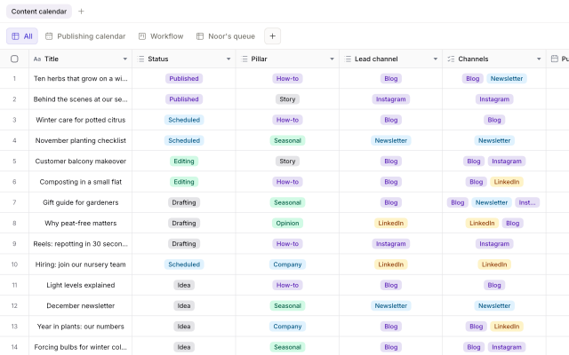

<!-- Generated by tools/gallery.mjs from showcase.yaml and build.json; do not edit. -->
# Garden Brand Content Calendar

[Table](../README.md) › [Content Calendars](../README.md#content-calendars) · `content-calendar` `calendar` `kanban` `multi-select` `formula`

Sixteen posts across blog, newsletter and social channels, with status, pillar, author, publish dates and read time.



| | |
|---|---|
| Document | [garden-brand-content-calendar.ktable](garden-brand-content-calendar.ktable) (228 KB) |
| Contents | 1 table |
| Features | `table.schema`, `table.records`, `table.views` |
| Built by | `kition-table` @ `4660b37040`: 10 commands in 42 ms |

## About

An editorial calendar for a small garden-supply brand. Each post has a status, a content pillar,
a lead channel, every channel it goes out on (multi-select), a publish date, an author and a word
count, from which a formula estimates the read time. A long-text brief is shown as Markdown.

## Checks

- `inspect.tables`: `[{"title":"Content calendar"}]`
- `results.shown.result`: `{"table":"Content calendar","viewType":"grid","records":16}`
- `results.postrecs.result.total`: `16`
- `results.postrecs.result.items.0.values`: `{"channels":["Blog","Newsletter"],"read_time":7}`
- `results.postrecs.result.items.2.values.brief`: `{"contains":"**Angle:**"}`
- `results.brief.result.values.title`: `"Winter care for potted citrus"`
- `results.cal.result`: `{"type":"calendar","title":"Publishing calendar"}`
- diagnostics: none (the kit's check finds nothing wrong)
- the saved document opens again; the thumbnail matches `thumb.png` within the `render` tolerance

## Steps

<details><summary>10 commands (from <a href="showcase.yaml">showcase.yaml</a>)</summary>

```yaml
- command: table.tables.delete
  params:
    tableId: 1
- command: table.tables.create
  params:
    title: Content calendar
    name: posts
    fields:
      - name: title
        title: Title
        type: text
        primary: true
      - name: status
        title: Status
        type: single_select
        options:
          choices:
            - Idea
            - Drafting
            - Editing
            - Scheduled
            - Published
      - name: pillar
        title: Pillar
        type: single_select
        options:
          choices:
            - How-to
            - Seasonal
            - Story
            - Opinion
            - Company
      - name: lead
        title: Lead channel
        type: single_select
        options:
          choices:
            - Blog
            - Newsletter
            - Instagram
            - LinkedIn
      - name: channels
        title: Channels
        type: multi_select
        options:
          choices:
            - Blog
            - Newsletter
            - Instagram
            - LinkedIn
      - name: publish
        title: Publish on
        type: date
        options:
          date_format: day_month_year_slash
      - name: author
        title: Author
        type: single_select
        options:
          choices:
            - Noor
            - Rosa
            - Theo
      - name: words
        title: Words
        type: number
      - name: read_time
        title: Read time (min)
        type: formula
        formula: "{words} / 200"
      - name: brief
        title: Brief
        type: long_text
        options:
          showAs: markdown
  as: t_posts
- command: table.transact
  params:
    ops:
      - op: records.create
        tableId: $t_posts.result.id
        records:
          - title: Ten herbs that grow on a windowsill
            status: Published
            pillar: How-to
            lead: Blog
            channels:
              - Blog
              - Newsletter
            publish: 2026-11-03
            author: Noor
            words: 1400
          - title: Behind the scenes at our seed farm
            status: Published
            pillar: Story
            lead: Instagram
            channels:
              - Instagram
            publish: 2026-11-05
            author: Theo
            words: 200
          - title: Winter care for potted citrus
            status: Scheduled
            pillar: How-to
            lead: Blog
            channels:
              - Blog
            publish: 2026-11-10
            author: Noor
            words: 1200
          - title: November planting checklist
            status: Scheduled
            pillar: Seasonal
            lead: Newsletter
            channels:
              - Newsletter
            publish: 2026-11-12
            author: Rosa
            words: 800
          - title: Customer balcony makeover
            status: Editing
            pillar: Story
            lead: Blog
            channels:
              - Blog
              - Instagram
            publish: 2026-11-14
            author: Theo
            words: 1000
          - title: Composting in a small flat
            status: Editing
            pillar: How-to
            lead: Blog
            channels:
              - Blog
              - LinkedIn
            publish: 2026-11-17
            author: Noor
            words: 1600
          - title: Gift guide for gardeners
            status: Drafting
            pillar: Seasonal
            lead: Blog
            channels:
              - Blog
              - Newsletter
              - Instagram
            publish: 2026-11-20
            author: Rosa
            words: 1800
          - title: Why peat-free matters
            status: Drafting
            pillar: Opinion
            lead: LinkedIn
            channels:
              - LinkedIn
              - Blog
            publish: 2026-11-21
            author: Theo
            words: 900
          - title: "Reels: repotting in 30 seconds"
            status: Drafting
            pillar: How-to
            lead: Instagram
            channels:
              - Instagram
            publish: 2026-11-24
            author: Rosa
            words: 100
          - title: "Hiring: join our nursery team"
            status: Scheduled
            pillar: Company
            lead: LinkedIn
            channels:
              - LinkedIn
            publish: 2026-11-25
            author: Theo
            words: 400
          - title: Light levels explained
            status: Idea
            pillar: How-to
            lead: Blog
            channels:
              - Blog
            publish: 2026-11-27
            author: Noor
            words: 1400
          - title: December newsletter
            status: Idea
            pillar: Seasonal
            lead: Newsletter
            channels:
              - Newsletter
            publish: 2026-12-01
            author: Rosa
            words: 900
          - title: "Year in plants: our numbers"
            status: Idea
            pillar: Company
            lead: Blog
            channels:
              - Blog
              - LinkedIn
            publish: 2026-12-04
            author: Theo
            words: 1100
          - title: Forcing bulbs for winter colour
            status: Idea
            pillar: Seasonal
            lead: Blog
            channels:
              - Blog
              - Instagram
            publish: 2026-12-08
            author: Noor
            words: 1300
          - title: Q&A with our head grower
            status: Idea
            pillar: Story
            lead: Instagram
            channels:
              - Instagram
              - Newsletter
            publish: 2026-12-10
            author: Rosa
            words: 600
          - title: Watering myths, busted
            status: Idea
            pillar: Opinion
            lead: Blog
            channels:
              - Blog
            publish: 2026-12-15
            author: Noor
            words: 1200
  as: tx_posts_0
- command: table.views.create
  params:
    tableId: $t_posts.result.id
    title: Publishing calendar
    type: calendar
  as: cal
- command: table.views.create
  params:
    tableId: $t_posts.result.id
    title: Workflow
    type: kanban
    config:
      group_field_name: status
  as: flow
- command: table.views.create
  params:
    tableId: $t_posts.result.id
    title: Noor's queue
    type: grid
  as: noor
- command: table.views.putFilterTree
  params:
    tableId: $t_posts.result.id
    viewId: $noor.result.id
    tree:
      conjunction: and
      children:
        - condition:
            field_id: $t_posts.result.fields.6.id
            operator: eq
            value: Noor
        - condition:
            field_id: $t_posts.result.fields.1.id
            operator: neq
            value: Published
- command: table.views.putSorts
  params:
    tableId: $t_posts.result.id
    viewId: $noor.result.id
    items:
      - field_id: $t_posts.result.fields.5.id
        direction: asc
- command: table.records.update
  params:
    tableId: $t_posts.result.id
    recordId: 3
    values:
      brief: |-
        **Angle:** citrus indoors in winter.
        - light
        - watering
        - pests
  as: brief
- command: table.records.list
  params:
    tableId: $t_posts.result.id
    limit: 100
  as: postrecs
```

</details>
