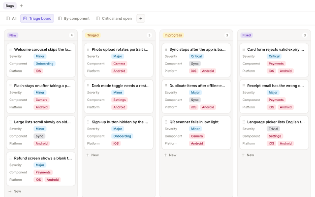

<!-- Generated by tools/gallery.mjs from showcase.yaml and build.json; do not edit. -->
# Mobile App Bug Tracker

[Table](../README.md) › [Projects & Tasks](../README.md#projects--tasks) · `bug-tracker` `csv-import` `kanban` `rating` `grouping`

Fourteen bugs imported from CSV, with severity, status, component, platforms and a five-star user-impact rating.



| | |
|---|---|
| Document | [mobile-bug-tracker.ktable](mobile-bug-tracker.ktable) (228 KB) |
| Contents | 1 table |
| Features | `table.schema`, `table.records`, `table.views`, `table.import-export` |
| Built by | `kition-table` @ `4660b37040`: 12 commands in 14 ms |

## About

The bug list comes in as CSV text through table.csv.import, its header naming the fields by
title; each cell arrives as its field's type: the points as numbers, the user impact as a
rating, the platforms as a multi-select. Views add a triage board by status, bugs grouped by
component and sorted by impact, and a filter for critical bugs still open. The table also exports
as Markdown.

## Checks

- `inspect.tables`: `[{"title":"Bugs"}]`
- `results.shown.result`: `{"view":"Triage board","viewType":"kanban","records":14}`
- `results.bugrecs.result.total`: `14`
- `results.bugrecs.result.items.0.values`: `{"severity":"Critical","impact":5,"points":5,"platform":["iOS","Android"]}`
- `results.bugrecs.result.items.1.values`: `{"impact":4,"points":3,"platform":["Android"]}`
- `results.bugrecs.result.items.8.values.status`: `"Won't fix"`
- `results.imp.result.created`: `14`
- `results.md.result.content`: `{"contains":"| Sync stops after the app is backgrounded | Critical |"}`
- diagnostics: none (the kit's check finds nothing wrong)
- the saved document opens again; the thumbnail matches `thumb.png` within the `render` tolerance

## Steps

<details><summary>12 commands (from <a href="showcase.yaml">showcase.yaml</a>)</summary>

```yaml
- command: table.tables.delete
  params:
    tableId: 1
- command: table.tables.create
  params:
    title: Bugs
    name: bugs
    fields:
      - name: bug
        title: Bug
        type: text
        primary: true
      - name: severity
        title: Severity
        type: single_select
        options:
          choices:
            - Critical
            - Major
            - Minor
            - Trivial
      - name: status
        title: Status
        type: single_select
        options:
          choices:
            - New
            - Triaged
            - In progress
            - Fixed
            - Won't fix
      - name: component
        title: Component
        type: single_select
        options:
          choices:
            - Sync
            - Camera
            - Payments
            - Onboarding
            - Settings
      - name: platform
        title: Platform
        type: multi_select
        options:
          choices:
            - iOS
            - Android
      - name: impact
        title: User impact
        type: rating
        options:
          max: 5
      - name: reported
        title: Reported
        type: date
      - name: version
        title: Found in
        type: text
      - name: points
        title: Points
        type: number
      - name: steps
        title: Steps to reproduce
        type: long_text
  as: t_bugs
- command: table.csv.import
  params:
    tableId: $t_bugs.result.id
    content: |
      Bug,Severity,Status,Component,User impact,Platform,Reported,Found in,Points
      Sync stops after the app is backgrounded,Critical,In progress,Sync,5,"iOS, Android",2026-11-02,4.8.0,5
      Photo upload rotates portrait images,Major,Triaged,Camera,4,"Android",2026-11-03,4.8.0,3
      Card form rejects valid expiry dates,Critical,Fixed,Payments,5,"iOS, Android",2026-10-28,4.7.2,2
      Welcome carousel skips the last slide,Minor,New,Onboarding,2,"iOS",2026-11-05,4.8.0,1
      Dark mode toggle needs a restart,Minor,Triaged,Settings,2,"Android",2026-11-01,4.7.2,1
      Duplicate items after offline edits,Major,In progress,Sync,4,"iOS, Android",2026-10-30,4.7.2,3
      Flash stays on after taking a photo,Minor,New,Camera,2,"Android",2026-11-06,4.8.0,1
      Receipt email has the wrong currency,Major,Fixed,Payments,3,"iOS, Android",2026-10-25,4.7.1,2
      Typo in the notification settings,Trivial,Won't fix,Settings,1,"iOS",2026-10-20,4.7.0,1
      Sign-up button hidden by the keyboard,Major,Triaged,Onboarding,4,"iOS",2026-11-04,4.8.0,2
      Large lists scroll slowly on older phones,Minor,New,Sync,3,"Android",2026-11-07,4.8.0,3
      Refund screen shows a blank total,Major,New,Payments,4,"iOS, Android",2026-11-07,4.8.0,2
      QR scanner fails in low light,Minor,In progress,Camera,3,"Android",2026-11-02,4.8.0,2
      Language picker lists English twice,Trivial,Fixed,Settings,1,"iOS, Android",2026-10-22,4.7.1,1
  as: imp
- command: table.views.create
  params:
    tableId: $t_bugs.result.id
    title: Triage board
    type: kanban
    config:
      group_field_name: status
  as: board
- command: table.views.create
  params:
    tableId: $t_bugs.result.id
    title: By component
    type: grid
  as: bycomp
- command: table.views.putSorts
  params:
    tableId: $t_bugs.result.id
    viewId: $bycomp.result.id
    items:
      - field_id: $t_bugs.result.fields.5.id
        direction: desc
- command: table.views.putGroups
  params:
    tableId: $t_bugs.result.id
    viewId: $bycomp.result.id
    items:
      - field_id: $t_bugs.result.fields.3.id
        direction: asc
- command: table.views.create
  params:
    tableId: $t_bugs.result.id
    title: Critical and open
    type: grid
  as: crit
- command: table.views.putFilterTree
  params:
    tableId: $t_bugs.result.id
    viewId: $crit.result.id
    tree:
      conjunction: and
      children:
        - condition:
            field_id: $t_bugs.result.fields.1.id
            operator: eq
            value: Critical
        - condition:
            field_id: $t_bugs.result.fields.2.id
            operator: neq
            value: Fixed
- command: table.records.update
  params:
    tableId: $t_bugs.result.id
    recordId: 1
    values:
      steps: |-
        1. Start a sync of 500 items
        2. Switch to another app for a minute
        3. Come back: the progress bar is frozen
  as: upd
- command: table.markdown.export
  params:
    tableId: $t_bugs.result.id
  as: md
- command: table.records.list
  params:
    tableId: $t_bugs.result.id
    limit: 100
  as: bugrecs
```

</details>
