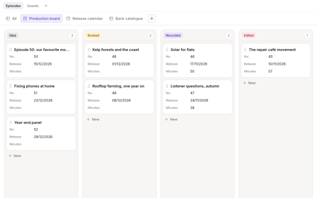

<!-- Generated by tools/gallery.mjs from showcase.yaml and build.json; do not edit. -->
# Podcast Episode Planner

[Table](../README.md) › [Content Calendars](../README.md#content-calendars) · `podcast` `kanban` `calendar` `lookup` `linked-records`

Twelve episodes of an interview podcast from idea to published, with release dates, runtimes and guests looked up from a second table.



| | |
|---|---|
| Document | [podcast-episode-planner.ktable](podcast-episode-planner.ktable) (232 KB) |
| Contents | 2 tables |
| Features | `table.schema`, `table.records`, `table.links`, `table.views` |
| Built by | `kition-table` @ `4660b37040`: 15 commands in 47 ms |

## About

An interview show's production plan. Episodes move through a production board; a calendar shows
release dates. Guests live in their own table and a lookup brings each guest's organisation into
the episode. The back-catalogue view freezes the title column and uses taller rows.

## Checks

- `inspect.tables`: `[{"title":"Episodes"},{"title":"Guests"}]`
- `results.shown.result`: `{"view":"Production board","viewType":"kanban","records":12}`
- `results.e.result.total`: `12`
- `results.e.result.items.0.values`: `{"number":41,"guest_org":"Tidepool Institute"}`
- `results.e.result.items.11.values.guest_org`: `"Greenline Research, Sunward Systems"`
- `results.e.result.items.6.values.guests`: `[]`
- `results.cfg.result.config`: `{"row_height":"medium","frozen_column_count":1}`
- diagnostics: none (the kit's check finds nothing wrong)
- the saved document opens again; the thumbnail matches `thumb.png` within the `render` tolerance

## Steps

<details><summary>15 commands (from <a href="showcase.yaml">showcase.yaml</a>)</summary>

```yaml
- command: table.tables.delete
  params:
    tableId: 1
- command: table.tables.create
  params:
    title: Episodes
    name: episodes
    fields:
      - name: title
        title: Title
        type: text
        primary: true
      - name: number
        title: No.
        type: number
      - name: status
        title: Status
        type: single_select
        options:
          choices:
            - Idea
            - Booked
            - Recorded
            - Edited
            - Published
      - name: release
        title: Release
        type: date
        options:
          date_format: day_month_year_slash
      - name: minutes
        title: Minutes
        type: number
      - name: season
        title: Season
        type: single_select
        options:
          choices:
            - Autumn 2026
            - Winter 2026
      - name: sponsor
        title: Sponsor read
        type: checkbox
      - name: notes
        title: Show notes
        type: long_text
  as: t_episodes
- command: table.transact
  params:
    ops:
      - op: records.create
        tableId: $t_episodes.result.id
        records:
          - title: Life in a rock pool
            number: 41
            status: Published
            release: 2026-10-06
            minutes: 48
            season: Autumn 2026
            sponsor: false
          - title: Farming the roofs of Osaka
            number: 42
            status: Published
            release: 2026-10-13
            minutes: 52
            season: Autumn 2026
            sponsor: true
          - title: What a carbon price really costs
            number: 43
            status: Published
            release: 2026-10-20
            minutes: 61
            season: Autumn 2026
            sponsor: false
          - title: Chairs that last a century
            number: 44
            status: Published
            release: 2026-10-27
            minutes: 44
            season: Autumn 2026
            sponsor: true
          - title: The repair café movement
            number: 45
            status: Edited
            release: 2026-11-10
            minutes: 57
            season: Autumn 2026
            sponsor: false
          - title: Solar for flats
            number: 46
            status: Recorded
            release: 2026-11-17
            minutes: 50
            season: Autumn 2026
            sponsor: true
          - title: Listener questions, autumn
            number: 47
            status: Recorded
            release: 2026-11-24
            minutes: 38
            season: Autumn 2026
            sponsor: false
          - title: Kelp forests and the coast
            number: 48
            status: Booked
            release: 2026-12-01
            minutes: null
            season: Winter 2026
            sponsor: true
          - title: Rooftop farming, one year on
            number: 49
            status: Booked
            release: 2026-12-08
            minutes: null
            season: Winter 2026
            sponsor: false
          - title: "Episode 50: our favourite moments"
            number: 50
            status: Idea
            release: 2026-12-15
            minutes: null
            season: Winter 2026
            sponsor: true
          - title: Fixing phones at home
            number: 51
            status: Idea
            release: 2026-12-22
            minutes: null
            season: Winter 2026
            sponsor: false
          - title: Year-end panel
            number: 52
            status: Idea
            release: 2026-12-29
            minutes: null
            season: Winter 2026
            sponsor: true
  as: tx_episodes_0
- command: table.tables.create
  params:
    title: Guests
    name: guests
    fields:
      - name: guest
        title: Guest
        type: text
        primary: true
      - name: role
        title: Role
        type: text
      - name: org
        title: Organisation
        type: text
  as: t_guests
- command: table.transact
  params:
    ops:
      - op: records.create
        tableId: $t_guests.result.id
        records:
          - guest: Dr. Ines Romero
            role: Marine biologist
            org: Tidepool Institute
          - guest: Kenji Arai
            role: Urban farmer
            org: Rooftop Harvest
          - guest: Abena Mensah
            role: Climate economist
            org: Greenline Research
          - guest: Lars Holm
            role: Furniture maker
            org: Holm Workshop
          - guest: Mariana Duarte
            role: Repair café founder
            org: Fix-It Collective
          - guest: Tariq Saleh
            role: Solar engineer
            org: Sunward Systems
  as: tx_guests_0
- command: table.fields.create
  params:
    tableId: $t_episodes.result.id
    name: guests
    title: Guests
    type: link_to_record
    options:
      target_table_id: $t_guests.result.id
      allow_multiple: true
  as: f_episodes_guests
- command: table.transact
  params:
    ops:
      - op: cells.set
        tableId: $t_episodes.result.id
        records:
          - rowKey: $tx_episodes_0.result.created.0
            values:
              guests:
                - $tx_guests_0.result.created.0
          - rowKey: $tx_episodes_0.result.created.1
            values:
              guests:
                - $tx_guests_0.result.created.1
          - rowKey: $tx_episodes_0.result.created.2
            values:
              guests:
                - $tx_guests_0.result.created.2
          - rowKey: $tx_episodes_0.result.created.3
            values:
              guests:
                - $tx_guests_0.result.created.3
          - rowKey: $tx_episodes_0.result.created.4
            values:
              guests:
                - $tx_guests_0.result.created.4
          - rowKey: $tx_episodes_0.result.created.5
            values:
              guests:
                - $tx_guests_0.result.created.5
          - rowKey: $tx_episodes_0.result.created.7
            values:
              guests:
                - $tx_guests_0.result.created.0
          - rowKey: $tx_episodes_0.result.created.8
            values:
              guests:
                - $tx_guests_0.result.created.1
          - rowKey: $tx_episodes_0.result.created.10
            values:
              guests:
                - $tx_guests_0.result.created.4
          - rowKey: $tx_episodes_0.result.created.11
            values:
              guests:
                - $tx_guests_0.result.created.2
                - $tx_guests_0.result.created.5
- command: table.fields.create
  params:
    tableId: $t_episodes.result.id
    name: guest_org
    title: Guest organisation
    type: lookup
    options:
      link_field_id: $f_episodes_guests.result.id
      target_field_id: $t_guests.result.fields.2.id
      multi_value_mode: concat
  as: f_episodes_guest_org
- command: table.views.create
  params:
    tableId: $t_episodes.result.id
    title: Production board
    type: kanban
    config:
      group_field_name: status
  as: board
- command: table.views.create
  params:
    tableId: $t_episodes.result.id
    title: Release calendar
    type: calendar
  as: cal
- command: table.views.create
  params:
    tableId: $t_episodes.result.id
    title: Back catalogue
    type: grid
  as: back
- command: table.views.putFilterTree
  params:
    tableId: $t_episodes.result.id
    viewId: $back.result.id
    tree:
      conjunction: and
      children:
        - condition:
            field_id: $t_episodes.result.fields.2.id
            operator: eq
            value: Published
- command: table.views.putSorts
  params:
    tableId: $t_episodes.result.id
    viewId: $back.result.id
    items:
      - field_id: $t_episodes.result.fields.1.id
        direction: desc
- command: table.views.patchConfig
  params:
    tableId: $t_episodes.result.id
    viewId: $back.result.id
    row_height: medium
    frozen_column_count: 1
  as: cfg
- command: table.records.list
  params:
    tableId: $t_episodes.result.id
    limit: 100
  as: e
```

</details>
