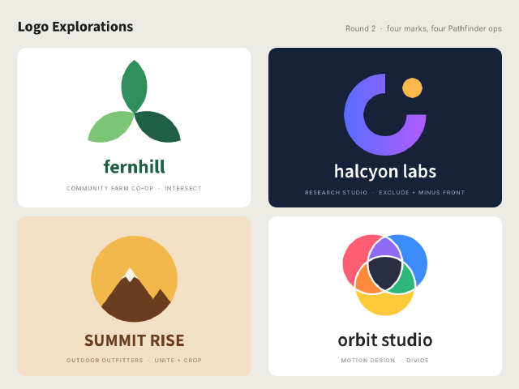
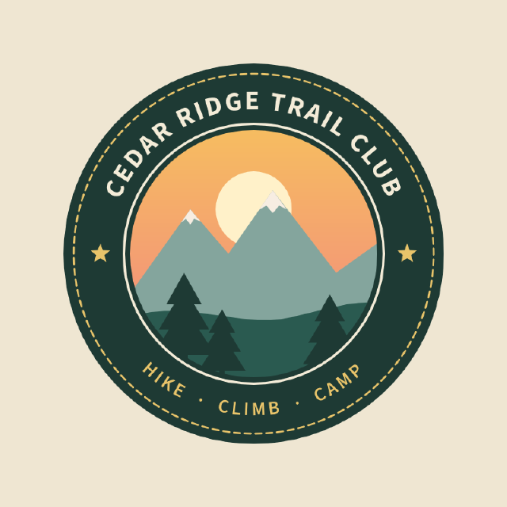
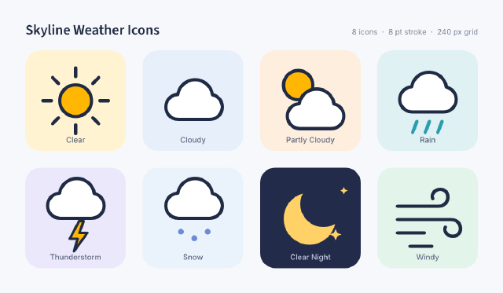
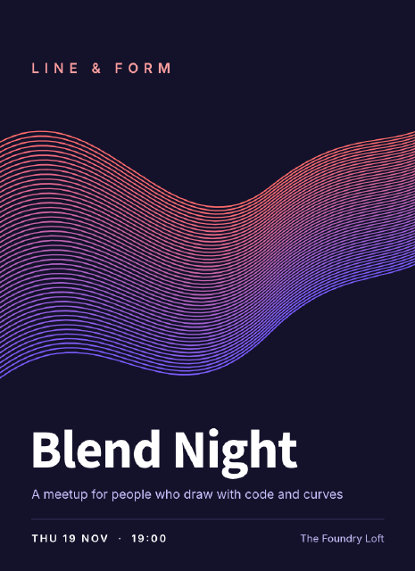
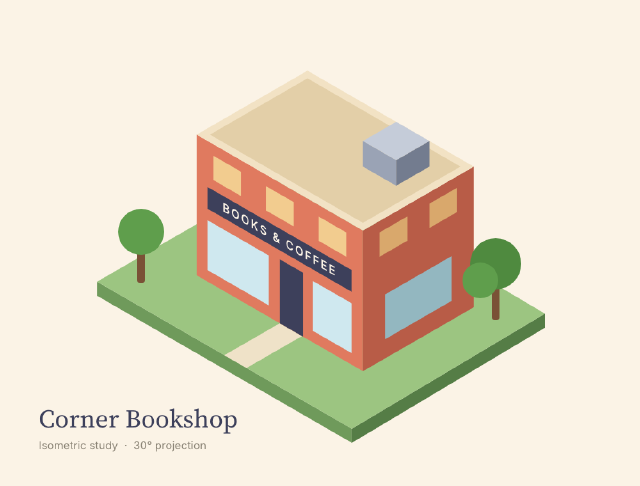
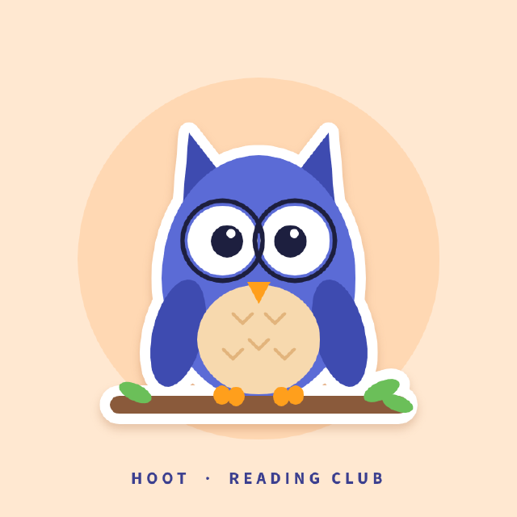
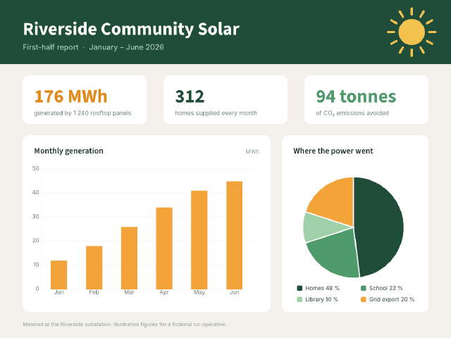
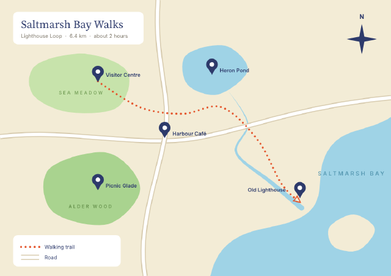
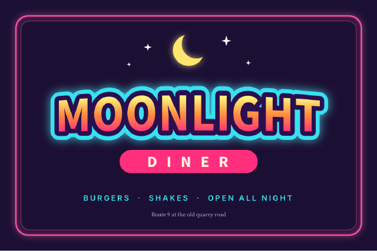
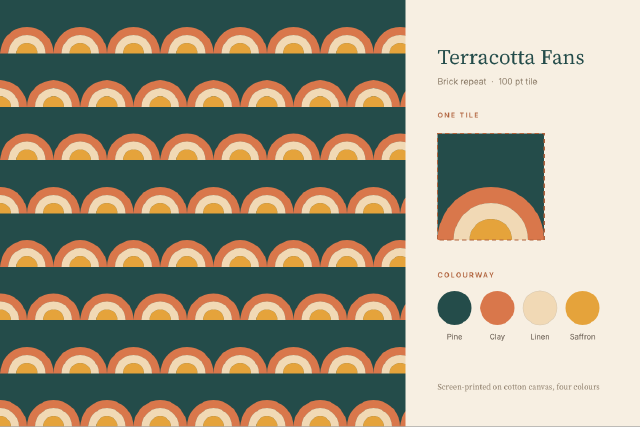

<!-- Generated by tools/gallery.mjs from showcase.yaml and build.json; do not edit. -->
# Vector showcase

Vector illustration: paths, shapes, gradients, strokes, type and artboards. Saved as .kvector. Every sample is built from `showcase.yaml` by the kit's own commands and drawn by its own engine (`kition-vector`).

**11 samples** · 5 categories · 23 features of `kition-vector/features.yaml` · [all kits](../README.md)

[Icons & Logos](#icons--logos) (3) · [Illustration](#illustration) (4) · [Infographics](#infographics) (2) · [Lettering](#lettering) (1) · [Patterns](#patterns) (1)

## Icons & Logos

<table>
<tr>
<td width="33%" valign="top">
 
Vector 
<b><a href="logo-mark-explorations/">Logo Mark Explorations</a></b> 
Four original logo marks on a presentation sheet, each built with a different Pathfinder operation. 
<i>1 artboard; 3 layers; 35 objects</i> 
<code>logo</code> <code>pathfinder</code> <code>gradients</code> <code>branding</code>
</td>
<td width="33%" valign="top">
 
Vector 
<b><a href="trail-club-badge/">Trail Club Badge</a></b> 
A round patch emblem with type set on two circular paths, a dashed stitch line and a sunset mountain scene clipped to a circle. 
<i>1 artboard; 2 layers; 20 objects</i> 
<code>badge</code> <code>emblem</code> <code>type-on-path</code> <code>clipping-mask</code>
</td>
<td width="33%" valign="top">
 
Vector 
<b><a href="weather-icon-set/">Weather Icon Set</a></b> 
Eight duotone weather icons on a 240 px tile grid, their clouds united from circles and the moon cut with Minus Front. 
<i>1 artboard; 3 layers; 51 objects</i> 
<code>icons</code> <code>pathfinder</code> <code>strokes</code> <code>grid</code>
</td>
</tr>
</table>

## Illustration

<table>
<tr>
<td width="33%" valign="top">
 
Vector 
<b><a href="alpine-lake-sunrise/">Alpine Lake Sunrise</a></b> 
A flat landscape illustration — layered mountains, a low sun and pines mirrored in a still lake — built on named layers. 
<i>1 artboard; 5 layers; 27 objects</i> 
<code>illustration</code> <code>landscape</code> <code>gradients</code> <code>layers</code> <code>paths</code>
</td>
<td width="33%" valign="top">
 
Vector 
<b><a href="blend-ribbon-poster/">Blend Ribbon Meetup Poster</a></b> 
A design-meetup poster whose flowing ribbon is a 48-step blend between two stroked curves, from coral to violet. 
<i>1 artboard; 3 layers; 13 objects</i> 
<code>poster</code> <code>blend</code> <code>strokes</code> <code>typography</code>
</td>
<td width="33%" valign="top">
 
Vector 
<b><a href="isometric-corner-bookshop/">Isometric Corner Bookshop</a></b> 
A small isometric building whose facades are drawn flat and projected onto the 30° grid with affine transforms. 
<i>1 artboard; 3 layers; 36 objects</i> 
<code>illustration</code> <code>isometric</code> <code>transform</code> <code>groups</code>
</td>
</tr>
<tr>
<td width="33%" valign="top">
 
Vector 
<b><a href="reading-owl-mascot/">Reading Owl Mascot Sticker</a></b> 
A library reading-club mascot built from ellipses and paths, mirrored with Reflect and cut out as a die-cut sticker with Offset Path and Unite. 
<i>1 artboard; 2 layers; 34 objects</i> 
<code>illustration</code> <code>mascot</code> <code>sticker</code> <code>pathfinder</code> <code>offset-path</code>
</td>
<td width="33%"></td>
<td width="33%"></td>
</tr>
</table>

## Infographics

<table>
<tr>
<td width="33%" valign="top">
 
Vector 
<b><a href="community-solar-infographic/">Community Solar Infographic</a></b> 
A half-year report infographic with live column and pie graphs restyled in the brand palette, stat cards and a sun icon. 
<i>1 artboard; 3 layers; 80 objects</i> 
<code>infographic</code> <code>charts</code> <code>graphs</code> <code>report</code>
</td>
<td width="33%" valign="top">
 
Vector 
<b><a href="saltmarsh-bay-trail-map/">Saltmarsh Bay Trail Map</a></b> 
An illustrated walking map — curvature-tool coastline and parks, roads with two-stroke appearances, a dashed trail and pins placed from one symbol. 
<i>1 artboard; 4 layers; 37 objects</i> 
<code>map</code> <code>symbols</code> <code>appearance</code> <code>strokes</code> <code>illustration</code>
</td>
<td width="33%"></td>
</tr>
</table>

## Lettering

<table>
<tr>
<td width="33%" valign="top">
 
Vector 
<b><a href="retro-diner-lettering/">Retro Diner Lettering</a></b> 
Neon-diner lettering — type outlined to paths, filled with a sunset gradient, ringed by offset outlines and arched with a warp envelope. 
<i>1 artboard; 2 layers; 36 objects</i> 
<code>lettering</code> <code>gradients</code> <code>outlines</code> <code>envelope</code>
</td>
<td width="33%"></td>
<td width="33%"></td>
</tr>
</table>

## Patterns

<table>
<tr>
<td width="33%" valign="top">
 
Vector 
<b><a href="terracotta-fan-pattern/">Terracotta Fan Pattern</a></b> 
A mid-century fan motif made into a seamless pattern swatch, shown as a textile spec card with the tile and its colourway. 
<i>1 artboard; 3 layers; 25 objects</i> 
<code>pattern</code> <code>swatches</code> <code>seamless</code> <code>textile</code>
</td>
<td width="33%"></td>
<td width="33%"></td>
</tr>
</table>

## Tags

`appearance` 1 · `badge` 1 · `blend` 1 · `branding` 1 · `charts` 1 · `clipping-mask` 1 · `emblem` 1 · `envelope` 1 · `gradients` 3 · `graphs` 1 · `grid` 1 · `groups` 1 · `icons` 1 · `illustration` 4 · `infographic` 1 · `isometric` 1 · `landscape` 1 · `layers` 1 · `lettering` 1 · `logo` 1 · `map` 1 · `mascot` 1 · `offset-path` 1 · `outlines` 1 · `pathfinder` 3 · `paths` 1 · `pattern` 1 · `poster` 1 · `report` 1 · `seamless` 1 · `sticker` 1 · `strokes` 3 · `swatches` 1 · `symbols` 1 · `textile` 1 · `transform` 1 · `type-on-path` 1 · `typography` 1
