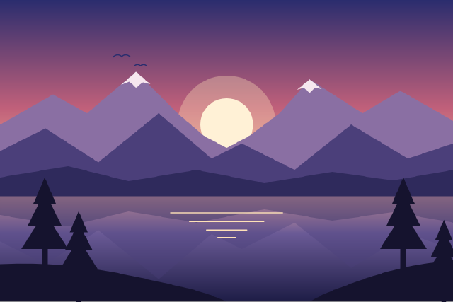

<!-- Generated by tools/gallery.mjs from showcase.yaml and build.json; do not edit. -->
# Alpine Lake Sunrise

[Vector](../README.md) › [Illustration](../README.md#illustration) · `illustration` `landscape` `gradients` `layers` `paths`

A flat landscape illustration — layered mountains, a low sun and pines mirrored in a still lake — built on named layers.



| | |
|---|---|
| Document | [alpine-lake-sunrise.kvector](alpine-lake-sunrise.kvector) (23 KB) |
| Contents | 1 artboard; 5 layers; 27 objects |
| Features | `vector.shape.primitives`, `vector.path.edit`, `vector.paint.fill-stroke`, `vector.layer.panel`, `vector.object.transform`, `vector.paint.transparency` |
| Built by | `kition-vector` @ `65d8d59892`: 54 commands in 11 ms |

## About

Five layers stack the scene back to front: Sky (a three-stop linear gradient and a sun with a
soft halo), Far Range and Near Range (closed paths in receding blues), Lake (a gradient water body
with the ridges reflected by `object.reflect` and faded with opacity) and Forest (pines as
triangle paths on small trunks, duplicated and scaled along the shore).

## Checks

- `inspect.layers`: `{"count":5}`
- `inspect.layers.0`: `{"name":"Forest","children":{"count":8}}`
- `inspect.layers.1`: `{"name":"Lake","children":{"count":7,"any":{"kind":"Path","fill":"#4b3f7a","opacity":{"approx":0.35,"tol":0.01}}}}`
- `inspect.layers.1.children.-1`: `{"kind":"Rectangle","fill":"Linear gradient"}`
- `inspect.layers.2`: `{"name":"Near Range","children":{"count":2}}`
- `inspect.layers.3`: `{"name":"Far Range"}`
- `inspect.layers.4`: `{"name":"Sky","children":{"count":3,"any":{"kind":"Ellipse","fill":"#fff1d6"}}}`
- `results.mirrored.ids`: `{"count":2}`
- diagnostics: none (the kit's check finds nothing wrong)
- the saved document opens again; the thumbnail matches `thumb.png` within the `render` tolerance

## Steps

<details><summary>54 commands (from <a href="showcase.yaml">showcase.yaml</a>)</summary>

```yaml
- command: layer.setProps
  params:
    name: Sky
- command: shape.rectangle
  params:
    x: 0
    y: 0
    width: 1200
    height: 520
  as: sky
- command: paint.setStroke
  params:
    none: true
- command: paint.setFill
  params:
    gradient:
      kind: linear
      angle: -90
      stops:
        - offset: 0
          color: "#2b2d6e"
        - offset: 0.55
          color: "#c0607a"
        - offset: 1
          color: "#ffc59a"
- command: shape.ellipse
  params:
    x: 470
    y: 200
    width: 260
    height: 260
  as: halo
- command: paint.setFill
  params:
    color: "#ffe2b8"
- command: transparency.set
  params:
    opacity: 35
- command: shape.ellipse
  params:
    x: 530
    y: 260
    width: 140
    height: 140
  as: sun
- command: paint.setFill
  params:
    color: "#fff1d6"
- command: transparency.set
  params:
    opacity: 100
- command: layer.new
  params:
    name: Far Range
  as: far
- command: path.create
  params:
    d: M0 520 L0 330 L140 250 L230 300 L360 190 L470 300 L540 360 L600 392 L660 360 L740 300 L820 210 L960 300 L1060 240 L1200 320 L1200 520 Z
  as: farRidge
- command: paint.setFill
  params:
    color: "#8a6fa3"
- command: path.create
  params:
    d: M320 225 L360 190 L398 223 L378 218 L360 232 L342 216 Z M786 238 L820 210 L852 236 L834 232 L820 246 L804 232 Z
  as: snow
- command: paint.setFill
  params:
    color: "#f6e6ee"
- command: layer.new
  params:
    name: Near Range
  as: near
- command: path.create
  params:
    d: M0 520 L0 400 L120 340 L260 430 L420 300 L560 420 L640 380 L780 450 L930 330 L1080 420 L1200 380 L1200 520 Z
  as: nearRidge
- command: paint.setFill
  params:
    color: "#4b3f7a"
- command: path.create
  params:
    d: M0 520 L0 470 L180 440 L340 480 L520 450 L700 485 L880 455 L1040 478 L1200 450 L1200 520 Z
  as: foothills
- command: paint.setFill
  params:
    color: "#2f2a5c"
- command: layer.new
  params:
    name: Lake
  as: lake
- command: shape.rectangle
  params:
    x: 0
    y: 520
    width: 1200
    height: 280
  as: water
- command: paint.setFill
  params:
    gradient:
      kind: linear
      angle: -90
      stops:
        - offset: 0
          color: "#e8a6a0"
        - offset: 0.35
          color: "#6a5a96"
        - offset: 1
          color: "#1d1c45"
- command: select.set
  params:
    ids:
      - $nearRidge.id
      - $foothills.id
- command: object.reflect
  params:
    axis: horizontal
    origin:
      - 600
      - 520
    copy: true
  as: mirrored
- command: layer.move
  params:
    ids:
      - $mirrored.ids.0
      - $mirrored.ids.1
    target: $lake.id
- command: transparency.set
  params:
    opacity: 35
- command: layer.setCurrent
  params:
    id: $lake.id
- command: shape.rectangle
  params:
    x: 450
    y: 562
    width: 300
    height: 4
    radius: 2
  as: glint1
- command: paint.setFill
  params:
    color: "#ffe2b8"
- command: transparency.set
  params:
    opacity: 70
- command: shape.rectangle
  params:
    x: 500
    y: 586
    width: 200
    height: 3
    radius: 1.5
- command: shape.rectangle
  params:
    x: 545
    y: 608
    width: 110
    height: 3
    radius: 1.5
- command: shape.rectangle
  params:
    x: 575
    y: 628
    width: 50
    height: 2
    radius: 1
- command: layer.new
  params:
    name: Forest
  as: forest
- command: path.create
  params:
    d: M118 470 L148 540 L134 540 L164 600 L142 600 L180 660 L126 660 L126 800 L110 800 L110 660 L56 660 L94 600 L72 600 L102 540 L88 540 Z
  as: pine
- command: paint.setFill
  params:
    color: "#15132e"
- command: object.move
  params:
    dx: 90
    dy: 30
    copy: true
  as: pine2
- command: object.scale
  params:
    sx: 80
    origin:
      - 208
      - 800
- command: select.set
  params:
    ids:
      - $pine.id
- command: object.move
  params:
    dx: 950
    dy: 0
    copy: true
- command: object.move
  params:
    dx: 95
    dy: 40
    copy: true
- command: object.scale
  params:
    sx: 75
    origin:
      - 1213
      - 800
- command: path.create
  params:
    d: M0 800 L0 700 C200 690 340 730 480 760 C560 778 600 800 600 800 Z
  as: shoreLeft
- command: paint.setFill
  params:
    color: "#15132e"
- command: path.create
  params:
    d: M1200 800 L1200 690 C1060 700 960 740 880 770 C840 786 820 800 820 800 Z
  as: shoreRight
- command: paint.setFill
  params:
    color: "#15132e"
- command: path.create
  params:
    d: M300 150 Q312 140 322 150 Q332 140 344 150
  as: bird1
- command: paint.setFill
  params:
    none: true
- command: paint.setStroke
  params:
    color: "#2b2d6e"
- command: stroke.set
  params:
    weight: 3
    cap: round
    join: round
- command: object.move
  params:
    dx: 50
    dy: 25
    copy: true
- command: object.scale
  params:
    sx: 75
- command: select.none
  params: {}
```

</details>
