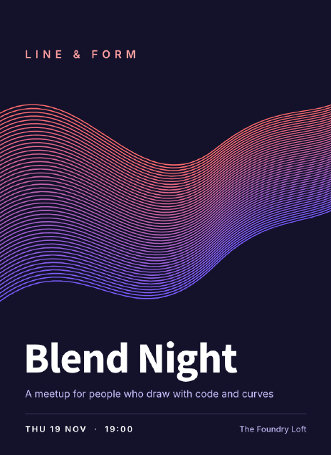

<!-- Generated by tools/gallery.mjs from showcase.yaml and build.json; do not edit. -->
# Blend Ribbon Meetup Poster

[Vector](../README.md) › [Illustration](../README.md#illustration) · `poster` `blend` `strokes` `typography`

A design-meetup poster whose flowing ribbon is a 48-step blend between two stroked curves, from coral to violet.



| | |
|---|---|
| Document | [blend-ribbon-poster.kvector](blend-ribbon-poster.kvector) (14 KB) |
| Contents | 1 artboard; 3 layers; 13 objects |
| Features | `vector.object.blend`, `vector.paint.stroke`, `vector.path.edit`, `vector.text.edit`, `vector.shape.primitives` |
| Built by | `kition-vector` @ `65d8d59892`: 33 commands in 49 ms |

## About

Only two paths are drawn: a coral curve and a violet curve, 2.5 pt strokes with no fill.
`object.blend.make {steps: 46}` fills the space between them with intermediate curves whose
shape and colour step evenly, and the blend stays live — `object.blend.info` reports its two key
objects and spacing. Headline in Source Sans 3 Bold, details in Inter.

## Checks

- `inspect.layers`: `{"count":3}`
- `inspect.layers.0`: `{"name":"Type","children":{"count":6,"any":{"kind":"Type","text":"Blend Night"}}}`
- `inspect.layers.1`: `{"name":"Ribbon","children":{"count":1}}`
- `inspect.layers.1.children.0`: `{"kind":"Blend","children":{"count":2}}`
- `results.blendInfo`: `{"target":"blend","spacing":"steps","steps":46,"keys":{"count":2}}`
- diagnostics: none (the kit's check finds nothing wrong)
- the saved document opens again; the thumbnail matches `thumb.png` within the `render` tolerance

## Steps

<details><summary>33 commands (from <a href="showcase.yaml">showcase.yaml</a>)</summary>

```yaml
- command: layer.setProps
  params:
    name: Poster
- command: shape.rectangle
  params:
    x: 0
    y: 0
    width: 800
    height: 1100
- command: paint.setStroke
  params:
    none: true
- command: paint.setFill
  params:
    color: "#14122b"
- command: layer.new
  params:
    name: Ribbon
  as: ribbon
- command: select.none
  params: {}
- command: path.create
  params:
    d: M-40 300 C180 120 320 520 520 360 C680 230 760 300 860 220
  as: curveA
- command: paint.setFill
  params:
    none: true
- command: paint.setStroke
  params:
    color: "#ff6b6b"
- command: stroke.set
  params:
    weight: 2.5
- command: path.create
  params:
    d: M-40 760 C200 540 300 860 520 640 C660 500 760 560 860 470
  as: curveB
- command: paint.setStroke
  params:
    color: "#7b5cff"
- command: object.blend.make
  params:
    ids:
      - $curveA.id
      - $curveB.id
    steps: 46
  as: blend
- command: object.blend.info
  params: {}
  as: blendInfo
- command: select.none
  params: {}
- command: layer.new
  params:
    name: Type
  as: type
- command: select.none
  params: {}
- command: text.create
  params:
    x: 60
    y: 140
    text: LINE & FORM
    size: 26
    font: Inter
    style: SemiBold
    color: "#ff9f9f"
  as: kicker
- command: text.setStyle
  params:
    id: $kicker.id
    tracking: 400
- command: text.create
  params:
    x: 56
    y: 900
    text: Blend Night
    size: 104
    font: Source Sans 3
    style: Bold
    color: "#ffffff"
  as: headline
- command: text.setStyle
  params:
    id: $headline.id
    tracking: -20
- command: text.create
  params:
    x: 60
    y: 960
    text: A meetup for people who draw with code and curves
    size: 24
    font: Inter
    color: "#c9c3ff"
- command: shape.line
  params:
    x1: 60
    y1: 1000
    x2: 740
    y2: 1000
- command: paint.setFill
  params:
    none: true
- command: paint.setStroke
  params:
    color: "#3a3566"
- command: stroke.set
  params:
    weight: 1.5
- command: select.none
  params: {}
- command: paint.setStroke
  params:
    none: true
- command: text.create
  params:
    x: 60
    y: 1044
    text: THU 19 NOV  ·  19:00
    size: 20
    font: Inter
    style: SemiBold
    color: "#ffffff"
  as: date
- command: text.setStyle
  params:
    id: $date.id
    tracking: 160
- command: text.create
  params:
    x: 740
    y: 1044
    text: The Foundry Loft
    size: 20
    font: Inter
    color: "#c9c3ff"
  as: venue
- command: text.setStyle
  params:
    id: $venue.id
    justify: right
- command: select.none
  params: {}
```

</details>
