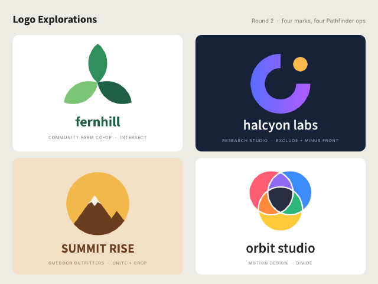

<!-- Generated by tools/gallery.mjs from showcase.yaml and build.json; do not edit. -->
# Logo Mark Explorations

[Vector](../README.md) › [Icons & Logos](../README.md#icons--logos) · `logo` `pathfinder` `gradients` `branding`

Four original logo marks on a presentation sheet, each built with a different Pathfinder operation.



| | |
|---|---|
| Document | [logo-mark-explorations.kvector](logo-mark-explorations.kvector) (32 KB) |
| Contents | 1 artboard; 3 layers; 35 objects |
| Features | `vector.object.pathfinder`, `vector.shape.primitives`, `vector.object.transform`, `vector.paint.fill-stroke`, `vector.text.edit` |
| Built by | `kition-vector` @ `65d8d59892`: 79 commands in 49 ms |

## About

Fernhill's leaf is the Intersect of two circles, rotated with copies into a trefoil. Halcyon's
ring is two concentric circles excluded, then opened with Minus Front and filled with a linear
gradient. Summit Rise unites two peaks and crops them to a copy of its sun disc. Orbit divides
three overlapping circles into seven pieces, each recoloured through `document.node`.

## Checks

- `inspect.layers`: `{"count":3}`
- `inspect.layers.0`: `{"name":"Wordmarks","children":{"count":8,"all":{"kind":"Type"}}}`
- `inspect.layers.1`: `{"name":"Marks","children":{"count":9}}`
- `inspect.layers.1.children.0`: `{"kind":"Group","children":{"count":7,"all":{"kind":"Path"}}}`
- `inspect.layers.1.children.2`: `{"kind":"Group","children":{"count":1,"any":{"fill":"#6b3d1f"}}}`
- `inspect.layers.1.children`: `{"any":{"kind":"Path","fill":"Linear gradient"}}`
- `results.leaf.ids`: `{"count":1}`
- `results.arc.ids`: `{"count":1}`
- `results.summit.ids`: `{"count":1}`
- `results.pieces.children`: `{"count":7}`
- diagnostics: none (the kit's check finds nothing wrong)
- the saved document opens again; the thumbnail matches `thumb.png` within the `render` tolerance

## Steps

<details><summary>79 commands (from <a href="showcase.yaml">showcase.yaml</a>)</summary>

```yaml
- command: layer.setProps
  params:
    name: Sheet
- command: shape.rectangle
  params:
    x: 0
    y: 0
    width: 1200
    height: 900
- command: paint.setStroke
  params:
    none: true
- command: paint.setFill
  params:
    color: "#eceae4"
- command: shape.rectangle
  params:
    x: 40
    y: 110
    width: 540
    height: 370
    radius: 20
- command: paint.setFill
  params:
    color: "#ffffff"
- command: shape.rectangle
  params:
    x: 620
    y: 110
    width: 540
    height: 370
    radius: 20
- command: paint.setFill
  params:
    color: "#16213a"
- command: shape.rectangle
  params:
    x: 40
    y: 500
    width: 540
    height: 370
    radius: 20
- command: paint.setFill
  params:
    color: "#f3dfc6"
- command: shape.rectangle
  params:
    x: 620
    y: 500
    width: 540
    height: 370
    radius: 20
- command: paint.setFill
  params:
    color: "#ffffff"
- command: text.create
  params:
    x: 40
    y: 72
    text: Logo Explorations
    size: 34
    font: Source Sans 3
    style: Bold
    color: "#1c1c1c"
- command: text.create
  params:
    x: 1160
    y: 72
    text: Round 2  ·  four marks, four Pathfinder ops
    size: 18
    font: Inter
    color: "#7b776c"
  as: meta
- command: text.setStyle
  params:
    id: $meta.id
    justify: right
- command: layer.new
  params:
    name: Marks
  as: marks
- command: select.none
  params: {}
- command: shape.ellipse
  params:
    x: 180
    y: 120
    width: 160
    height: 160
  as: la
- command: shape.ellipse
  params:
    x: 280
    y: 120
    width: 160
    height: 160
  as: lb
- command: select.set
  params:
    ids:
      - $la.id
      - $lb.id
- command: object.pathfinder.intersect
  params: {}
  as: leaf
- command: paint.setFill
  params:
    color: "#2f8f5b"
- command: object.rotate
  params:
    angle: 120
    origin:
      - 310
      - 262
    copy: true
  as: leaf2
- command: paint.setFill
  params:
    color: "#7cc576"
- command: object.rotate
  params:
    angle: 120
    origin:
      - 310
      - 262
    copy: true
  as: leaf3
- command: paint.setFill
  params:
    color: "#1f5f45"
- command: shape.ellipse
  params:
    x: 795
    y: 170
    width: 190
    height: 190
  as: ra
- command: shape.ellipse
  params:
    x: 840
    y: 215
    width: 100
    height: 100
  as: rb
- command: select.set
  params:
    ids:
      - $ra.id
      - $rb.id
- command: object.pathfinder.exclude
  params: {}
  as: ring
- command: shape.rectangle
  params:
    x: 890
    y: 150
    width: 120
    height: 115
  as: gap
- command: select.set
  params:
    ids:
      - $ring.ids.0
      - $gap.id
- command: object.pathfinder.minusFront
  params: {}
  as: arc
- command: paint.setFill
  params:
    gradient:
      kind: linear
      angle: 0
      stops:
        - offset: 0
          color: "#5b6cff"
        - offset: 1
          color: "#b05cff"
- command: shape.ellipse
  params:
    x: 930
    y: 180
    width: 46
    height: 46
  as: dot
- command: paint.setFill
  params:
    color: "#ffb84d"
- command: shape.ellipse
  params:
    x: 210
    y: 545
    width: 200
    height: 200
  as: disc
- command: paint.setFill
  params:
    color: "#f2b84b"
- command: path.create
  params:
    d: M190 770 L300 618 L410 770 Z
  as: peakA
- command: path.create
  params:
    d: M300 770 L370 668 L450 770 Z
  as: peakB
- command: select.set
  params:
    ids:
      - $peakA.id
      - $peakB.id
- command: object.pathfinder.unite
  params: {}
  as: range
- command: paint.setFill
  params:
    color: "#6b3d1f"
- command: select.set
  params:
    ids:
      - $disc.id
- command: object.move
  params:
    dx: 0
    dy: 0
    copy: true
  as: discCopy
- command: object.arrange.bringToFront
  params: {}
- command: select.set
  params:
    ids:
      - $range.ids.0
      - $discCopy.ids.0
- command: object.pathfinder.crop
  params: {}
  as: summit
- command: path.create
  params:
    d: M279 647 L300 618 L321 647 L310 640 L300 652 L290 640 Z
  as: snowcap
- command: paint.setFill
  params:
    color: "#fff6e8"
- command: shape.ellipse
  params:
    x: 790
    y: 540
    width: 140
    height: 140
  as: oa
- command: shape.ellipse
  params:
    x: 850
    y: 540
    width: 140
    height: 140
  as: ob
- command: shape.ellipse
  params:
    x: 820
    y: 592
    width: 140
    height: 140
  as: oc
- command: select.set
  params:
    ids:
      - $oa.id
      - $ob.id
      - $oc.id
- command: object.pathfinder.divide
  params: {}
  as: orbit
- command: document.node
  params:
    id: $orbit.ids.0
    summary: true
    depth: 1
  as: pieces
- command: paint.setStroke
  params:
    color: "#ffffff"
    ids:
      - $orbit.ids.0
- command: stroke.set
  params:
    weight: 4
    join: round
    ids:
      - $orbit.ids.0
- command: paint.setFill
  params:
    color: "#2b2d42"
    ids:
      - $pieces.children.0.id
- command: paint.setFill
  params:
    color: "#8d6bf2"
    ids:
      - $pieces.children.1.id
- command: paint.setFill
  params:
    color: "#ff8a3d"
    ids:
      - $pieces.children.2.id
- command: paint.setFill
  params:
    color: "#ff5d73"
    ids:
      - $pieces.children.3.id
- command: paint.setFill
  params:
    color: "#2fb67c"
    ids:
      - $pieces.children.4.id
- command: paint.setFill
  params:
    color: "#3d8bfd"
    ids:
      - $pieces.children.5.id
- command: paint.setFill
  params:
    color: "#ffc93c"
    ids:
      - $pieces.children.6.id
- command: select.none
  params: {}
- command: layer.new
  params:
    name: Wordmarks
  as: words
- command: select.none
  params: {}
- command: text.create
  params:
    x: 310
    y: 400
    text: fernhill
    size: 44
    font: Source Sans 3
    style: Bold
    color: "#1f5f45"
  as: w1
- command: text.create
  params:
    x: 310
    y: 440
    text: COMMUNITY FARM CO-OP  ·  INTERSECT
    size: 13
    font: Inter
    style: Medium
    color: "#8a8f86"
  as: c1
- command: text.create
  params:
    x: 890
    y: 410
    text: halcyon labs
    size: 44
    font: Source Sans 3
    style: Semibold
    color: "#ffffff"
  as: w2
- command: text.create
  params:
    x: 890
    y: 450
    text: RESEARCH STUDIO  ·  EXCLUDE + MINUS FRONT
    size: 13
    font: Inter
    style: Medium
    color: "#8f9bb8"
  as: c2
- command: text.create
  params:
    x: 310
    y: 800
    text: SUMMIT RISE
    size: 40
    font: Source Sans 3
    style: Bold
    color: "#6b3d1f"
  as: w3
- command: text.create
  params:
    x: 310
    y: 838
    text: OUTDOOR OUTFITTERS  ·  UNITE + CROP
    size: 13
    font: Inter
    style: Medium
    color: "#a07a5a"
  as: c3
- command: text.create
  params:
    x: 890
    y: 800
    text: orbit studio
    size: 44
    font: Source Sans 3
    style: Semibold
    color: "#232323"
  as: w4
- command: text.create
  params:
    x: 890
    y: 838
    text: MOTION DESIGN  ·  DIVIDE
    size: 13
    font: Inter
    style: Medium
    color: "#8a8a8a"
  as: c4
- command: text.setStyle
  params:
    ids:
      - $w1.id
      - $c1.id
      - $w2.id
      - $c2.id
      - $w3.id
      - $c3.id
      - $w4.id
      - $c4.id
    justify: center
- command: text.setStyle
  params:
    ids:
      - $c1.id
      - $c2.id
      - $c3.id
      - $c4.id
    tracking: 120
- command: select.none
  params: {}
```

</details>
