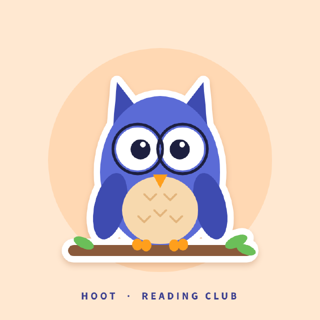

<!-- Generated by tools/gallery.mjs from showcase.yaml and build.json; do not edit. -->
# Reading Owl Mascot Sticker

[Vector](../README.md) › [Illustration](../README.md#illustration) · `illustration` `mascot` `sticker` `pathfinder` `offset-path`

A library reading-club mascot built from ellipses and paths, mirrored with Reflect and cut out as a die-cut sticker with Offset Path and Unite.



| | |
|---|---|
| Document | [reading-owl-mascot.kvector](reading-owl-mascot.kvector) (33 KB) |
| Contents | 1 artboard; 2 layers; 34 objects |
| Features | `vector.shape.primitives`, `vector.object.transform`, `vector.object.path`, `vector.object.pathfinder`, `vector.effect.live`, `vector.paint.stroke` |
| Built by | `kition-vector` @ `65d8d59892`: 65 commands in 76 ms |

## About

The owl is simple geometry: an ellipse body and belly, triangle ear tufts and a tilted wing each
drawn once and mirrored across the centre line with `object.reflect {copy: true}`, eyes as
stacked circles behind stroked round glasses. The die-cut border is `object.path.offsetPath`
(16 pt, round joins) of the silhouette parts, united into one white shape with a soft live drop
shadow and sent behind the owl.

## Checks

- `inspect.layers`: `{"count":2}`
- `inspect.layers.0`: `{"name":"Owl","children":{"count":26}}`
- `inspect.layers.0.children.-1`: `{"kind":"Compound Path","fill":"#ffffff","children":{"all":{"fill":"#ffffff"}},"bounds":{"width":{"approx":492,"tol":1},"height":{"approx":467,"tol":1}}}`
- `inspect.layers.0.children`: `{"any":{"kind":"Ellipse","fill":"#5b6bd6"}}`
- `inspect.layers.1`: `{"name":"Backdrop","children":{"count":3}}`
- `results.offsets.ids`: `{"count":7}`
- `results.sticker.ids`: `{"count":1}`
- `results.earR.ids`: `{"count":1}`
- `results.wingR.ids`: `{"count":1}`
- diagnostics: none (the kit's check finds nothing wrong)
- the saved document opens again; the thumbnail matches `thumb.png` within the `render` tolerance

## Steps

<details><summary>65 commands (from <a href="showcase.yaml">showcase.yaml</a>)</summary>

```yaml
- command: layer.setProps
  params:
    name: Backdrop
- command: shape.rectangle
  params:
    x: 0
    y: 0
    width: 800
    height: 800
- command: paint.setStroke
  params:
    none: true
- command: paint.setFill
  params:
    color: "#ffe8d1"
- command: shape.ellipse
  params:
    x: 120
    y: 120
    width: 560
    height: 560
- command: paint.setFill
  params:
    color: "#ffd8b3"
- command: text.create
  params:
    x: 400
    y: 748
    text: HOOT  ·  READING CLUB
    size: 26
    font: Source Sans 3
    style: Bold
    color: "#3b3f8f"
  as: caption
- command: text.setStyle
  params:
    id: $caption.id
    justify: center
    tracking: 240
- command: layer.new
  params:
    name: Owl
  as: owl
- command: select.none
  params: {}
- command: path.create
  params:
    d: M282 318 L292 205 L352 282 Z
  as: earL
- command: paint.setFill
  params:
    color: "#3e4bb0"
- command: object.reflect
  params:
    axis: vertical
    origin:
      - 400
      - 400
    copy: true
  as: earR
- command: shape.ellipse
  params:
    x: 236
    y: 430
    width: 78
    height: 170
    rotation: 14
  as: wingL
- command: object.reflect
  params:
    axis: vertical
    origin:
      - 400
      - 400
    copy: true
  as: wingR
- command: shape.rectangle
  params:
    x: 170
    y: 612
    width: 460
    height: 28
    radius: 14
  as: branch
- command: paint.setFill
  params:
    color: "#8a5a3b"
- command: shape.ellipse
  params:
    x: 250
    y: 240
    width: 300
    height: 380
  as: body
- command: paint.setFill
  params:
    color: "#5b6bd6"
- command: object.arrange.sendBackward
  params: {}
- command: object.arrange.sendBackward
  params: {}
- command: object.arrange.sendBackward
  params: {}
- command: shape.ellipse
  params:
    x: 305
    y: 440
    width: 190
    height: 170
  as: belly
- command: paint.setFill
  params:
    color: "#f7d9ae"
- command: path.create
  params:
    d: M360 485 L375 500 L390 485 M410 485 L425 500 L440 485 M385 525 L400 540 L415 525 M345 540 L360 555 L375 540 M425 540 L440 555 L455 540
  as: feathers
- command: paint.setFill
  params:
    none: true
- command: paint.setStroke
  params:
    color: "#e2b47c"
- command: stroke.set
  params:
    weight: 5
    cap: round
    join: round
- command: select.none
  params: {}
- command: paint.setStroke
  params:
    none: true
- command: shape.ellipse
  params:
    x: 290
    y: 318
    width: 108
    height: 108
  as: eyeL
- command: paint.setFill
  params:
    color: "#ffffff"
- command: shape.ellipse
  params:
    x: 402
    y: 318
    width: 108
    height: 108
  as: eyeR
- command: shape.ellipse
  params:
    x: 326
    y: 348
    width: 50
    height: 50
  as: pupilL
- command: paint.setFill
  params:
    color: "#1d1f3f"
- command: shape.ellipse
  params:
    x: 424
    y: 348
    width: 50
    height: 50
  as: pupilR
- command: shape.ellipse
  params:
    x: 350
    y: 354
    width: 14
    height: 14
- command: paint.setFill
  params:
    color: "#ffffff"
- command: shape.ellipse
  params:
    x: 448
    y: 354
    width: 14
    height: 14
- command: shape.ellipse
  params:
    x: 282
    y: 310
    width: 124
    height: 124
  as: lensL
- command: paint.setFill
  params:
    none: true
- command: paint.setStroke
  params:
    color: "#1d1f3f"
- command: stroke.set
  params:
    weight: 7
- command: shape.ellipse
  params:
    x: 394
    y: 310
    width: 124
    height: 124
  as: lensR
- command: path.create
  params:
    d: M398 360 Q400 350 402 360
- command: select.none
  params: {}
- command: paint.setStroke
  params:
    none: true
- command: path.create
  params:
    d: M382 436 L418 436 L400 470 Z
  as: beak
- command: paint.setFill
  params:
    color: "#ff9f1c"
- command: shape.ellipse
  params:
    x: 330
    y: 596
    width: 26
    height: 30
- command: shape.ellipse
  params:
    x: 352
    y: 598
    width: 26
    height: 30
- command: shape.ellipse
  params:
    x: 422
    y: 598
    width: 26
    height: 30
- command: shape.ellipse
  params:
    x: 444
    y: 596
    width: 26
    height: 30
- command: shape.ellipse
  params:
    x: 560
    y: 590
    width: 60
    height: 28
    rotation: -25
  as: leaf
- command: paint.setFill
  params:
    color: "#6bbf59"
- command: shape.ellipse
  params:
    x: 590
    y: 612
    width: 50
    height: 24
    rotation: 20
- command: shape.ellipse
  params:
    x: 182
    y: 594
    width: 54
    height: 26
    rotation: 25
- command: select.set
  params:
    ids:
      - $body.id
      - $earL.id
      - $earR.ids.0
      - $wingL.id
      - $wingR.ids.0
      - $branch.id
      - $leaf.id
- command: object.path.offsetPath
  params:
    offset: 16
    joins: round
  as: offsets
- command: select.set
  params:
    ids: $offsets.ids
- command: object.pathfinder.unite
  params: {}
  as: sticker
- command: paint.setFill
  params:
    color: "#ffffff"
- command: object.arrange.sendToBack
  params: {}
- command: effect.apply
  params:
    effect: stylize.dropShadow
    params:
      x: 0
      y: 8
      blur: 14
      opacity: 25
      color: "#9a5b2e"
- command: select.none
  params: {}
```

</details>
