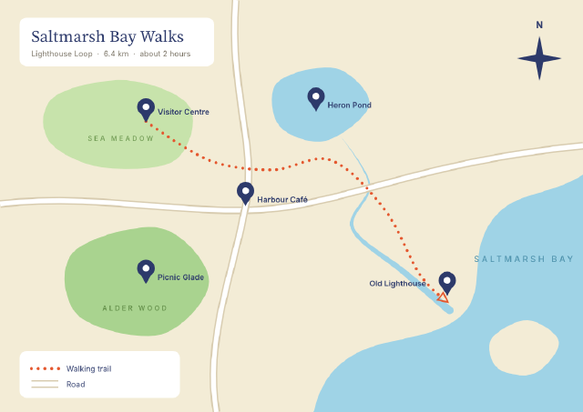

<!-- Generated by tools/gallery.mjs from showcase.yaml and build.json; do not edit. -->
# Saltmarsh Bay Trail Map

[Vector](../README.md) › [Infographics](../README.md#infographics) · `map` `symbols` `appearance` `strokes` `illustration`

An illustrated walking map — curvature-tool coastline and parks, roads with two-stroke appearances, a dashed trail and pins placed from one symbol.



| | |
|---|---|
| Document | [saltmarsh-bay-trail-map.kvector](saltmarsh-bay-trail-map.kvector) (30 KB) |
| Contents | 1 artboard; 4 layers; 37 objects |
| Features | `vector.symbol.manage`, `vector.paint.appearance`, `vector.paint.stroke`, `vector.path.edit`, `vector.shape.primitives`, `vector.text.edit` |
| Built by | `kition-vector` @ `65d8d59892`: 80 commands in 25 ms |

## About

Coastline, meadow, wood, pond and island are closed `path.curvature` shapes, the river an open
one with a taper-start width profile. Each road is one path with two strokes in its appearance —
a 16 pt sand casing and a 10 pt white core added with `appearance.addStroke` — copied to the
second road and the legend with `appearance.copyFrom`. The trail is a dotted round-capped stroke
ending in an arrowhead, and the five pins are instances of one "Map Pin" symbol (a united circle
and point with a white dot).

## Checks

- `inspect.layers`: `{"count":4}`
- `inspect.layers.0`: `{"name":"Labels","children":{"count":16}}`
- `inspect.layers.1`: `{"name":"Places","children":{"count":7}}`
- `inspect.layers.1.children`: `{"any":{"kind":"Symbol"}}`
- `inspect.layers.2`: `{"name":"Roads","children":{"count":3}}`
- `inspect.layers.2.children.0`: `{"kind":"Path","stroke":"#e4572e","strokeOptions":{"cap":"round","endArrow":"TriangleOpen","dash":{"count":2}}}`
- `inspect.layers.3`: `{"name":"Terrain","children":{"count":7}}`
- `inspect.layers.3.children.0`: `{"kind":"Path","stroke":"#9fd3e6","strokeOptions":{"profile":"taperStart"}}`
- `results.symbols.symbols`: `{"count":1,"all":{"name":"Map Pin","instances":5}}`
- `results.pinShape.ids`: `{"count":1}`
- diagnostics: none (the kit's check finds nothing wrong)
- the saved document opens again; the thumbnail matches `thumb.png` within the `render` tolerance

## Steps

<details><summary>80 commands (from <a href="showcase.yaml">showcase.yaml</a>)</summary>

```yaml
- command: layer.setProps
  params:
    name: Terrain
- command: shape.rectangle
  params:
    x: 0
    y: 0
    width: 1200
    height: 850
- command: paint.setStroke
  params:
    none: true
- command: paint.setFill
  params:
    color: "#9fd3e6"
- command: path.create
  params:
    d: M0 0 L1200 0 L1200 360 C1120 410 1050 390 1005 465 C960 540 1010 615 930 665 C850 712 760 690 690 760 C655 795 645 850 645 850 L0 850 Z
  as: land
- command: paint.setFill
  params:
    color: "#f3ecd6"
- command: path.curvature
  params:
    closed: true
    points:
      - x: 1010
        y: 700
      - x: 1085
        y: 660
      - x: 1150
        y: 705
      - x: 1100
        y: 770
      - x: 1025
        y: 760
  as: island
- command: path.curvature
  params:
    closed: true
    points:
      - x: 110
        y: 200
      - x: 260
        y: 165
      - x: 390
        y: 220
      - x: 360
        y: 330
      - x: 210
        y: 345
      - x: 100
        y: 290
  as: meadow
- command: paint.setFill
  params:
    color: "#c7e3ab"
- command: path.curvature
  params:
    closed: true
    points:
      - x: 150
        y: 520
      - x: 330
        y: 470
      - x: 430
        y: 580
      - x: 330
        y: 690
      - x: 160
        y: 650
  as: wood
- command: paint.setFill
  params:
    color: "#a9d38f"
- command: path.curvature
  params:
    closed: true
    points:
      - x: 570
        y: 170
      - x: 690
        y: 140
      - x: 760
        y: 215
      - x: 670
        y: 290
      - x: 575
        y: 260
  as: lake
- command: paint.setFill
  params:
    color: "#9fd3e6"
- command: path.curvature
  params:
    points:
      - x: 700
        y: 280
      - x: 760
        y: 380
      - x: 725
        y: 470
      - x: 830
        y: 560
      - x: 925
        y: 640
  as: river
- command: paint.setFill
  params:
    none: true
- command: paint.setStroke
  params:
    color: "#9fd3e6"
- command: stroke.set
  params:
    weight: 16
    cap: round
    profile: taperStart
- command: layer.new
  params:
    name: Roads
  as: roads
- command: select.none
  params: {}
- command: path.create
  params:
    d: M0 420 C220 395 420 455 600 425 C760 398 900 330 1200 300
  as: road1
- command: paint.setFill
  params:
    none: true
- command: paint.setStroke
  params:
    color: "#d8ccb0"
- command: stroke.set
  params:
    weight: 16
    cap: butt
    profile: uniform
- command: appearance.addStroke
  params: {}
- command: appearance.setItem
  params:
    index: 2
    color: "#ffffff"
    weight: 10
- command: path.create
  params:
    d: M485 0 C470 190 530 300 505 425 C480 560 420 700 445 850
  as: road2
- command: appearance.copyFrom
  params:
    source: $road1.id
- command: path.curvature
  params:
    points:
      - x: 300
        y: 250
      - x: 430
        y: 330
      - x: 560
        y: 350
      - x: 680
        y: 330
      - x: 790
        y: 430
      - x: 860
        y: 560
      - x: 905
        y: 610
  as: trail
- command: appearance.clear
  params: {}
- command: paint.setFill
  params:
    none: true
- command: paint.setStroke
  params:
    color: "#e4572e"
- command: stroke.set
  params:
    weight: 6
    cap: round
    dash:
      - 0
      - 14
    endArrow: TriangleOpen
- command: layer.new
  params:
    name: Places
  as: places
- command: select.none
  params: {}
- command: shape.ellipse
  params:
    x: 282
    y: 202
    width: 36
    height: 36
  as: pinHead
- command: appearance.clear
  params: {}
- command: paint.setFill
  params:
    color: "#2d3a6b"
- command: paint.setStroke
  params:
    none: true
- command: path.create
  params:
    d: M286 228 L300 252 L314 228 Z
  as: pinTip
- command: select.set
  params:
    ids:
      - $pinHead.id
      - $pinTip.id
- command: object.pathfinder.unite
  params: {}
  as: pinShape
- command: shape.ellipse
  params:
    x: 293
    y: 213
    width: 14
    height: 14
  as: pinDot
- command: paint.setFill
  params:
    color: "#ffffff"
- command: select.set
  params:
    ids:
      - $pinShape.ids.0
      - $pinDot.id
- command: symbol.new
  params:
    name: Map Pin
  as: pin
- command: symbol.place
  params:
    name: Map Pin
    x: 650
    y: 205
- command: symbol.place
  params:
    name: Map Pin
    x: 505
    y: 400
- command: symbol.place
  params:
    name: Map Pin
    x: 300
    y: 560
- command: symbol.place
  params:
    name: Map Pin
    x: 920
    y: 585
- command: symbol.list
  params: {}
  as: symbols
- command: select.none
  params: {}
- command: shape.star
  params:
    cx: 1110
    cy: 120
    radius1: 46
    radius2: 11
    points: 4
  as: compass
- command: paint.setFill
  params:
    color: "#2d3a6b"
- command: text.create
  params:
    x: 1110
    y: 58
    text: N
    size: 22
    font: Source Sans 3
    style: Bold
    color: "#2d3a6b"
  as: north
- command: text.setStyle
  params:
    id: $north.id
    justify: center
- command: layer.new
  params:
    name: Labels
  as: labels
- command: select.none
  params: {}
- command: shape.rectangle
  params:
    x: 40
    y: 36
    width: 400
    height: 100
    radius: 14
- command: paint.setFill
  params:
    color: "#ffffff"
- command: text.create
  params:
    x: 64
    y: 86
    text: Saltmarsh Bay Walks
    size: 34
    font: Source Serif 4
    color: "#2d3a6b"
- command: text.create
  params:
    x: 64
    y: 116
    text: Lighthouse Loop  ·  6.4 km  ·  about 2 hours
    size: 16
    font: Inter
    color: "#7b7466"
- command: text.create
  params:
    x: 324
    y: 236
    text: Visitor Centre
    size: 16
    font: Inter
    style: SemiBold
    color: "#2d3a6b"
- command: text.create
  params:
    x: 674
    y: 222
    text: Heron Pond
    size: 16
    font: Inter
    style: SemiBold
    color: "#2d3a6b"
- command: text.create
  params:
    x: 529
    y: 417
    text: Harbour Café
    size: 16
    font: Inter
    style: SemiBold
    color: "#2d3a6b"
- command: text.create
  params:
    x: 324
    y: 577
    text: Picnic Glade
    size: 16
    font: Inter
    style: SemiBold
    color: "#2d3a6b"
- command: text.create
  params:
    x: 760
    y: 590
    text: Old Lighthouse
    size: 16
    font: Inter
    style: SemiBold
    color: "#2d3a6b"
- command: text.create
  params:
    x: 180
    y: 290
    text: SEA MEADOW
    size: 14
    font: Inter
    style: Medium
    color: "#6f9a52"
  as: area1
- command: text.create
  params:
    x: 210
    y: 640
    text: ALDER WOOD
    size: 14
    font: Inter
    style: Medium
    color: "#5e8a44"
  as: area2
- command: text.create
  params:
    x: 975
    y: 540
    text: SALTMARSH BAY
    size: 17
    font: Inter
    style: Medium
    color: "#4f93ad"
  as: area3
- command: text.setStyle
  params:
    ids:
      - $area1.id
      - $area2.id
      - $area3.id
    tracking: 300
- command: shape.rectangle
  params:
    x: 40
    y: 724
    width: 330
    height: 96
    radius: 14
- command: paint.setFill
  params:
    color: "#ffffff"
- command: shape.line
  params:
    x1: 64
    y1: 760
    x2: 120
    y2: 760
  as: legendTrail
- command: appearance.copyFrom
  params:
    source: $trail.id
- command: stroke.set
  params:
    endArrow: null
- command: shape.line
  params:
    x1: 64
    y1: 792
    x2: 120
    y2: 792
  as: legendRoad
- command: appearance.copyFrom
  params:
    source: $road1.id
- command: text.create
  params:
    x: 136
    y: 766
    text: Walking trail
    size: 16
    font: Inter
    color: "#2d3a6b"
- command: text.create
  params:
    x: 136
    y: 798
    text: Road
    size: 16
    font: Inter
    color: "#2d3a6b"
- command: select.none
  params: {}
```

</details>
